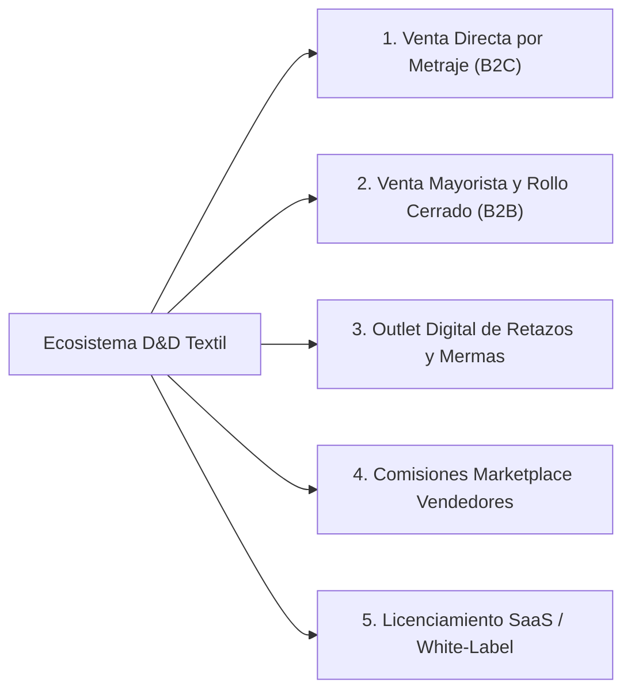

# Modelo de Negocio y Estrategia de Producto — D&D Textil

**Proyecto:** Plataforma Distribuida de Comercialización y Control Logístico Textil (**D&D Textil**)  
**Programa de Formación:** Tecnólogo en Análisis y Desarrollo de Software (ADSO) — SENA  
**Enfoque:** E-Commerce B2B / B2C & Sistema de Gestión Operativa Textil (WMS / POS / Marketplace)  
**Ubicación Base de Operaciones:** Distrito Textil del Centro de Medellín, Antioquia, Colombia  

---

## 1. Resumen Ejecutivo

**D&D Textil** es una plataforma tecnológica integral de comercio electrónico (*E-Commerce B2B/B2C*) y gestión logística de bodega especializada en la industria textil y de insumos para la confección en Colombia. A diferencia de las plataformas genéricas de comercio electrónico que operan bajo unidades discretas (piezas o cajas cerradas), **D&D Textil** ha sido arquitecturada desde su núcleo de dominio (*Domain-Driven Design*) para gestionar la naturaleza continua, fraccionable y físico-química de las telas: **venta por metraje lineal decimal, trazabilidad por lote de tintorería (*dye lot*), continuidad de pieza por rollo físico y liquidación automatizada de mermas y retazos**.

El propósito del proyecto es digitalizar la cadena de suministro entre importadores/distribuidores textiles, talleres de confección, diseñadores independientes y compradores minoristas, conectando en tiempo real el **piso de corte en bodega** con una **vitrina digital omnicanal** (Web SPA/PWA en React 18 y Aplicación Móvil Android nativa) respaldada por un motor transaccional en **Java 21** y **PostgreSQL 15** con integración financiera **Wompi** y facturación electrónica con **CUFE**.

---

## 2. Problema y Solución (Propuesta de Valor)

### 2.1. Problemática del Sector Textil Tradicional

Los distribuidores textiles, depósitos de telas y talleres de confección enfrentan cuatro dolores operativos y comerciales críticos que las soluciones de software convencionales (Shopify, WooCommerce o ERPs genéricos) no resuelven de forma nativa:

1. **Fragmentación de Inventario (*Stock* Fantasma por Rollos):** Un sistema tradicional puede reportar `15 metros disponibles` de Lino Belga, pero en la bodega física esos 15 metros están divididos en tres retazos de 5 metros en rollos distintos. Cuando un confeccionista compra 12 metros continuos para un tendido de corte, el pedido falla en bodega porque no se pueden entregar tramos empatados.
2. **Inconsistencia Cromática entre Partidas (*Lotes de Tintorería*):** Dos rollos de la misma referencia teñidos en fechas distintas presentan variaciones de tono ($\Delta E$). Mezclar lotes en un mismo pedido arruina colecciones enteras de confección.
3. **Pérdida Financiera por Mermas y Retazos (*Sub-meter Remnants*):** Al cortar un rollo de 50 metros a lo largo de múltiples ventas, quedan remanentes inferiores a 1.0 metro lineal que pierden valor comercial, se acumulan sin trazabilidad en estanterías y representan entre el **4 % y el 8 % de pérdida directa sobre el inventario**.
4. **Fricción en Cotización Mayorista y Logística de Despacho:** La negociación de descuentos por volumen, rollo cerrado y validación de pagos electrónicos suele realizarse manualmente vía WhatsApp o mostrador, generando cuellos de botella, errores de corte y demoras en el alistamiento.

### 2.2. Nuestra Solución Tecnológica (Propuesta de Valor)

**D&D Textil** resuelve estos dolores mediante una arquitectura de software especializada en reglas de negocio textiles:

| Dolor del Mercado | Solución Tecnológica en D&D Textil | Impacto en el Negocio |
| :--- | :--- | :--- |
| **Venta sobre inventario fragmentado** | **Algoritmo *Best-Fit* de Corte Textil (`ServicioCorteTextil`)**: Verifica que el metraje solicitado quepa íntegramente en un único rollo físico y selecciona el rollo que minimiza el desperdicio remanente. | **0 % de pedidos cancelados** por falta de continuidad de pieza y reducción óptima de retazos. |
| **Variación de color entre rollos** | **Trazabilidad por `lote_tintoreria`**: Cada rollo físico se vincula a su partida de teñido, garantizando consistencia cromática en órdenes para talleres de confección. | Disminución drástica de devoluciones y reclamaciones por diferencias de tonalidad. |
| **Acumulación de retazos no vendidos** | **Motor Automático de Mermas y Liquidación**: Si tras un corte el remanente es $< 1.0\text{ m}$, el rollo pasa automáticamente al estado `RETAZO_LIQUIDADO` con un **40 % de descuento** en vitrina. | Recuperación de capital de trabajo inmovilizado y rotación acelerada de saldos de bodega. |
| **Sobreventa en picos de demanda** | **Concurrencia Transaccional ACID + Patrón Saga**: Bloqueo pesimista (`SELECT ... FOR UPDATE`) en PostgreSQL e idempotencia criptográfica con webhooks **Wompi** (SHA-256). | Integridad financiera del 100 % incluso con decenas de compradores simultáneos sobre el mismo rollo. |
| **Errores humanos en mesa de corte** | **Etiquetado Térmico con Código QR y Facturación PDF con CUFE**: Generación instantánea de etiquetas para rollos/mermas y órdenes de corte escaneables en bodega. | Reducción de hasta un **60 % en el tiempo de alistamiento (*picking & cutting*)**. |

---

## 3. Segmento de Clientes (Target Market)

El modelo comercial de **D&D Textil** atiende un mercado de múltiples lados (*Multi-sided Market*) segmentado en tres perfiles principales:

### 3.1. Segmento B2B — Talleres de Confección, Marcas de Moda y Maquilas (Core Revenue)
* **Perfil:** Pequeñas y medianas empresas (PyMEs) confeccionistas, marcas emergentes de moda (*slow/fast fashion*), dotaciones empresariales y talleres satélites ubicados en Medellín, Bogotá, Cali, Bucaramanga y el Eje Cafetero.
* **Necesidad Principal:** Compra recurrente por volumen ($\ge 25\text{ m}$) o rollo cerrado ($\ge 50\text{ m}$), garantía de lote de tintorería uniforme, fichas técnicas precisas (gramaje $\text{g/m}^2$, ancho útil, composición de fibras, porcentaje de elongación) y facturación electrónica con soporte contable.
* **Ticket Promedio Estimado:** \$450.000 – \$3.500.000 COP por orden.

### 3.2. Segmento B2C / Prosumidor — Diseñadores Independientes, Sastres, Tapiceros y Estudiantes
* **Perfil:** Diseñadores de modas, talleres de alta costura a medida, emprendedores de manualidades/hogar y estudiantes de diseño textil o patronaje.
* **Necesidad Principal:** Compra fraccionada desde 1 metro lineal, acceso a **Calculadora de Metraje por Proyecto** integrada en la plataforma, compra de retazos en liquidación a bajo costo y envíos rápidos a domicilio.
* **Ticket Promedio Estimado:** \$65.000 – \$320.000 COP por orden.

### 3.3. Aliados Comerciales (B2B2C) — Vendedores y Distribuidores Textiles Asociados
* **Perfil:** Importadores y comerciantes del sector textil (ej. sector La Candelaria / El Hueco en Medellín) que desean comercializar su inventario a través del ecosistema **D&D Textil** usando el **Panel de Vendedor**.
* **Necesidad Principal:** Digitalizar su catálogo sin invertir en desarrollo propio, recibir alertas automáticas de bajo stock y gestionar pedidos con métricas de rotación en tiempo real.

---

## 4. Modelo de Ingresos (Monetización)

La estrategia de monetización de **D&D Textil** combina márgenes comerciales escalonados sobre la venta directa con líneas de ingresos digitales y de plataforma:

### 4.1. Líneas de Ingreso Detalladas

| Fuente de Ingreso | Mecanismo de Cobro y Regla de Negocio | Margen Bruto Estimado | Participación Proyectada en Ingresos |
| :--- | :--- | :---: | :---: |
| **1. Venta Minorista al Detal (B2C)** | Venta de tela por metro lineal ($1\text{ m}$ a $24.9\text{ m}$) a precio de lista estándar ($P_{\text{lista}}$). | **35 % – 45 %** | **30 %** |
| **2. Venta Mayorista por Volumen (B2B)** | Compras entre $25\text{ m}$ y $49.9\text{ m}$ con descuento automático del **12 %**, incentivando el incremento del ticket promedio (*upselling*). | **25 % – 32 %** | **35 %** |
| **3. Venta de Rollo Cerrado (B2B Industrial)** | Compras $\ge 50\text{ m}$ o pieza sellada de fábrica con descuento automático del **25 %**; cero costo operativo de corte en mesa y máxima velocidad de despacho. | **18 % – 22 %** | **20 %** |
| **4. Liquidación Inteligente de Retazos** | Monetización de remanentes $< 1.0\text{ m}$ (`RETAZO_LIQUIDADO`) con descuento del **40 %**, transformando una pérdida contable histórica en flujo de caja positivo. | **Recuperación de costo (5 % – 10 %)** | **5 %** |
| **5. Comisión por Vendedores Terceros (*Take Rate*)** | Cobro de comisión del **6 % al 10 %** por transacción procesada a distribuidores externos que publican su catálogo en el módulo multi-vendedor. | **85 % – 90 %** (Ingreso neto digital) | **10 %** |

> [!TIP]
> **Escalabilidad Futura (Fase SaaS B2B):** La arquitectura desacoplada y contenerizada en Docker permite comercializar **D&D Textil** bajo modalidad *Software as a Service (SaaS)* o *White-Label* a otras distribuidoras textiles en Latinoamérica mediante una suscripción mensual (\$250.000 – \$600.000 COP/mes por bodega).

---

## 5. Estructura de Costos

Gracias a una decisión arquitectónica deliberada —**Backend en Java 21 nativo (`HttpServer` + HikariCP + JDBC) sin frameworks pesados y despliegue en contenedores ligeros Alpine Linux**—, la huella de memoria RAM y CPU se reduce en más de un 60 % frente a pilas empresariales tradicionales, optimizando el **Costo Total de Propiedad (TCO)**.

### 5.1. Costos Tecnológicos e Infraestructura Cloud (OPEX Mensual Estimado)

| Categoría | Componente / Servicio | Especificación Técnica | Costo Mensual Estimado (USD / COP) |
| :--- | :--- | :--- | :--- |
| **Cómputo y Contenedores** | Servidor VPS Cloud (AWS Lightsail / DigitalOcean / Hetzner) | 2 vCPU, 4 GB RAM, 80 GB NVMe SSD ejecutando Docker Compose (`nginx`, `backend-java`, `postgres:15-alpine`) | \$24 USD (~ \$100.000 COP) |
| **Almacenamiento y Backups (DRP)** | Object Storage (AWS S3 / Backblaze B2) | Almacenamiento de imágenes de catálogo WebP y respaldos automatizados de PostgreSQL (RPO $\le 24\text{h}$, retención 7 días) | \$5 USD (~ \$21.000 COP) |
| **Dominio, DNS y Seguridad** | Cloudflare + Dominio `.com` / `.co` | Certificado TLS/SSL, CDN para activos estáticos, mitigación DDoS y WAF básico | \$3 USD (~ \$13.000 COP) |
| **Correo Transaccional** | Proveedor SMTP / API Transaccional | Envío automático de confirmaciones de pedido, alertas de stock y facturas | \$0 – \$10 USD (~ \$42.000 COP) |
| **Licencias de Software** | Stack Open Source (Java 21 Temurin, PostgreSQL, React, Nginx) | **100 % Open Source / Sin costo de licenciamiento propietario** | **\$0 USD (\$0 COP)** |
| **Total Infraestructura TI** | **Operación 24/7 en Producción** | **Capacidad para > 15.000 visitas/mes y cientos de pedidos diarios** | **~\$42 USD / mes (~ \$176.000 COP)** |

### 5.2. Costos Transaccionales, Operativos y de Desarrollo

* **Comisiones de Pasarela de Pagos (Wompi):** Costo variable por transacción aprobada (~ **2.65 % + \$700 COP + IVA** para tarjetas/PSE/Nequi), absorbido dentro del margen bruto comercial.
* **Operación Logística de Bodega:** Insumos de empaque impermeable para rollos textiles, etiquetas térmicas adhesivas para impresoras QR y transporte de última milla.
* **Mantenimiento Evolutivo y QA (CAPEX/OPEX):** Horas de ingeniería para evolución continua, pruebas automatizadas (44 pruebas de backend + suite frontend + pruebas de estrés k6) y soporte técnico nivel 2/3.

---

## 6. Canales de Distribución y Adquisición

### 6.1. Canales de Distribución Digital y Física (Omnicanalidad)

1. **Plataforma Web Responsiva (SPA + PWA):** Accesible desde cualquier navegador de escritorio o móvil, instalable en pantalla de inicio gracias a su *Service Worker* y `manifest.json` sin pasar por tiendas de aplicaciones.
2. **Aplicación Móvil Android (`TiendaTextilApp`):** Empaquetado nativo híbrido con aceleración por hardware y soporte offline de catálogo, ideal para confeccionistas y compradores recurrentes desde el celular.
3. **Puntos Físicos y Bodega Central (Centro de Medellín):** Integración *Phygital* (Físico + Digital) con mapa interactivo de sedes, permitiendo compra en línea con retiro en bodega (*Click & Collect*) o despacho nacional.
4. **Etiquetas Físicas con Código QR en Rollos:** Cada corte o rollo despachado lleva impresa una etiqueta térmica con código QR que facilita la recompra inmediata de la misma referencia.

### 6.2. Estrategia de Adquisición de Clientes (Go-To-Market)

* **SEO Técnico y Metadatos OpenGraph:** Indexación orgánica por términos de alta intención de compra (*"comprar lino por metros Medellín"*, *"tela antifluido por rollo Colombia"*, *"algodón perchado mayorista"*).
* **Herramienta Gratuita de Atracción (*Lead Magnet*):** La **Calculadora de Metraje por Proyecto** integrada en la web atrae tráfico orgánico de diseñadores y confeccionistas que calculan cuánto material necesitan e inician la compra en un clic.
* **Autenticación Sin Fricción (SSO OAuth2):** Registro e inicio de sesión en un solo clic mediante cuentas corporativas o personales de **Google** y **Microsoft**, reduciendo el abandono en el embudo de registro.
* **Programa de Cupones y Fidelización:** Motor nativo de cupones promocionales por porcentaje o valor fijo con control de vigencia para campañas de primera compra y reactivación de talleres.

---

## 7. Ventaja Competitiva (Foso Defensivo / *Unfair Advantage*)

Frente a competidores tradicionales (almacenes físicos de telas con atención manual) y plataformas genéricas de comercio electrónico, **D&D Textil** posee ventajas competitivas estructurales difíciles de replicar rápidamente:

| Criterio Comparativo | Almacenes Físicos Tradicionales | E-Commerce Genérico (Shopify / Woo) | **D&D Textil (Nuestra Plataforma)** |
| :--- | :---: | :---: | :---: |
| **Control de continuidad por rollo físico** | Manual / Propenso a error | No soportado nativamente | **Automático (Algoritmo *Best-Fit*)** |
| **Trazabilidad por lote de tintorería** | Inexistente o en papel | No soportado | **Nativo en BD y orden de corte** |
| **Liquidación automática de retazos ($< 1\text{ m}$)** | Pérdida en bodega | Manual | **Automatizado (-40 % en tiempo real)** |
| **Cálculo automático de escalas mayoristas** | Negociación manual | Requiere plugins de pago | **Nativo (12 % mayorista / 25 % rollo)** |
| **Etiquetado térmico QR para bodega** | No disponible | Costoso (Apps externas) | **Integrado en el Backend Java** |
| **Protección contra sobreventa concurrente** | N/A | Eventual (riesgo de sobreventa) | **Bloqueo Pesimista ACID + Saga Wompi** |
| **Costo mensual de licencias SaaS / Plugins** | N/A | \$80 – \$350 USD / mes | **\$0 USD (Tecnología Propia)** |

---

## 8. Métricas Clave de Rendimiento (KPIs)

Para evaluar objetivamente la salud comercial, operativa y tecnológica del negocio, **D&D Textil** monitorea tres tableros de indicadores (integrados en el **Panel Administrativo de Analítica** de la plataforma):

### 8.1. KPIs Comerciales y Financieros
* **GMV (*Gross Merchandise Value*):** Valor total bruto de los metros y rollos transaccionados a través de la plataforma mensualmente (Meta año 1: crecimiento intermensual $\ge 12\text{ \%}$).
* **AOV (*Average Order Value* / Ticket Promedio):** Valor promedio por pedido, desglosado entre órdenes B2C y órdenes mayoristas B2B (Meta: superar \$280.000 COP combinados mediante los incentivos de 25 m y 50 m).
* **Tasa de Conversión de Carrito a Pago Aprobado:** Porcentaje de usuarios que completan el flujo de checkout con Wompi (Meta: $\ge 3.5\text{ \%}$ en tráfico general y $\ge 18\text{ \%}$ en clientes B2B recurrentes).
* **LTV / CAC (*Lifetime Value vs. Customer Acquisition Cost*):** Relación entre el valor de vida de un taller confeccionista recurrente y su costo de adquisición (Meta saludable: $\text{LTV/CAC} \ge 4.0$).

### 8.2. KPIs Operativos y Logísticos de Bodega Textil
* **Índice de Aprovechamiento por Rollo (*Roll Yield Rate*):** Porcentaje de metros vendidos a precio pleno o mayorista frente a los metros que terminan como merma o retazo (Meta: $\ge 96.5\text{ \%}$ de aprovechamiento útil).
* **Tasa de Recuperación de Retazos:** Porcentaje de rollos en estado `RETAZO_LIQUIDADO` que se venden exitosamente en menos de 15 días gracias al descuento automático del 40 % (Meta: $\ge 80\text{ \%}$).
* **Tiempo Ciclo de Alistamiento y Corte (*Order-to-Cut Lead Time*):** Tiempo transcurrido desde la confirmación del webhook de Wompi hasta el escaneo QR y corte en mesa (Meta: $< 45\text{ minutos}$ en horario hábil).
* **Exactitud de Inventario (*Inventory Record Accuracy - IRA*):** Concordancia entre el metraje en PostgreSQL y el metraje físico real en estantería (Meta: $\ge 99.2\text{ \%}$).

### 8.3. KPIs Técnicos y de Calidad de Software (ISO/IEC 25010)
* **Latencia de API en Percentil 95 ($P_{95}$):** Tiempo de respuesta en consultas de catálogo y cálculo de corte bajo carga concurrente (Meta validada con k6: $P_{95} \le 200\text{ ms}$).
* **Tasa de Errores Transaccionales y Sobreventa:** Cantidad de inconsistencias de stock en concurrencia alta (Meta: **0.0 %** garantizado por bloqueo `FOR UPDATE` y suite de 44 pruebas automatizadas).
* **Disponibilidad del Servicio (*Uptime SLA*) y Resiliencia DRP:** Disponibilidad operativa del contenedor API/Frontend (Meta: $\ge 99.5\text{ \%}$ con **RPO $\le 24\text{h}$** y **RTO $\le 15\text{ min}$**).
