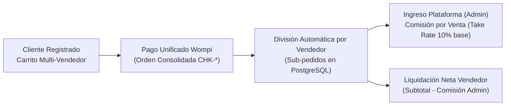

# Modelo de Negocio y Estrategia de Producto — D&D Textil Marketplace

**Proyecto:** Plataforma Marketplace Textil Multi-Vendedor y Control Logístico (**D&D Textil**)  
**Programa de Formación:** Tecnólogo en Análisis y Desarrollo de Software (ADSO) — SENA  
**Modelo Operativo:** Marketplace Textil Multi-Vendedor B2B / B2C por **Comisión + Venta** (Inspirado en Mercado Libre, Falabella y Éxito)  
**Ubicación Base de Operaciones:** Distrito Textil del Centro de Medellín, Antioquia, Colombia (Cobertura Nacional Multi-Ciudad: Medellín, Bogotá, Cali y Barranquilla)

---

## 1. Resumen Ejecutivo

**D&D Textil** es un **marketplace textil multinacional multi-vendedor (B2B y B2C)** y sistema logístico especializado en la industria de telas y confección. A diferencia de los catálogos genéricos de una sola tienda o de los comercios electrónicos de productos unitarios, **D&D Textil** conecta en un solo ecosistema a **múltiples casas proveedoras textiles verificadas** con talleres de confección, diseñadores independientes y compradores finales, manteniendo un núcleo de dominio (*Domain-Driven Design*) diseñado para las reglas físicas reales de la tela: **venta fraccionada por metro lineal decimal, continuidad de pieza por rollo físico (`lote_tintoreria`), escalas mayoristas, liquidación de mermas y división automática de pedidos multi-vendedor con cálculo de comisiones para la plataforma**.

Cada proveedor externo gestiona autónomamente su catálogo, ficha técnica, stock en metros, precios, promociones, exclusividad VIP y **perfil público de tienda estilo red social** (`/tienda/:id`), compitiendo sanamente en precio, calificación real y volumen vendido mientras la plataforma monetiza por **comisión sobre venta (*Take Rate*)** bajo una pasarela de pago unificada (**Wompi**) y estricta gobernanza **antifraude**.

---

## 2. Problema y Propuesta de Valor

### 2.1. Problemática del Sector Textil Tradicional y Multi-Proveedor

1. **Fragmentación de Proveedores y Opacidad de Precios:** Los talleres y diseñadores deben contactar múltiples distribuidores por WhatsApp para comparar precios por metro, gramaje, ancho, promociones o disponibilidad real en inventario.
2. **Stock Fantasma y Discontinuidad entre Rollos:** Un inventario convencional puede sumar `15 m` repartidos en retazos de 5 m; si un confeccionista necesita 12 m continuos del mismo lote de tintorería (`lote_tintoreria`), un empate parcial arruina el lote completo de prendas.
3. **Pérdida Financiera por Mermas y Sub-Metros Sin Trazabilidad:** Los sobrantes inferiores a 1.0 m y las mermas por error de corte o defecto de fábrica suelen acumularse sin métricas reales por proveedor ni auditoría de impacto financiero.
4. **Riesgo de Fraude y Alteración de Precios o Inventario por Terceros:** Cuando un marketplace carece de separación estricta de roles, administradores o terceros podrían alterar precios de vendedores, modificar metrajes de lotes o generar mermas falsas que causan pérdidas y desconfianza comercial.
5. **Baja Fidelización de Compradores Recurrentes:** Los clientes frecuentes de alto volumen rara vez reciben acceso anticipado o colecciones privadas diferenciadas del comprador ocasional.

### 2.2. Nuestra Solución Tecnológica (Propuesta de Valor)

| Dolor del Ecosistema Textil | Solución Implementada en D&D Textil | Impacto en el Negocio |
| :--- | :--- | :--- |
| **Catálogo único limitado** | **Marketplace Multi-Vendedor con Perfiles Públicos Tipo Facebook (`/tiendas`, `/tienda/:id`)**: Múltiples proveedores externos reales compiten en vitrina con portada, avatar, biografía, reseñas verificadas (`resenas_vendedor`) e insignias de *Más Vendido* y *Oferta*. | Amplitud inmediata de referencias textiles sin asumir inventario propio inmovilizado (*Asset-Light*). |
| **Falta de comparación objetiva** | **Comparador Competitivo de Vendedores (`GET /api/productos/{id}/competencia`)**: Muestra otros proveedores que ofrecen telas equivalentes en la misma categoría comparando precio neto, descuento activo y reputación. | Transparencia de mercado que eleva conversión y fomenta competitividad real entre tiendas. |
| **Pedidos divididos y conciliación manual** | **Split Automático Multi-Vendedor + Comisión en Checkout (`PedidoDAO`)**: Un cliente paga un solo carrito con **Wompi** y el backend crea automáticamente sub-pedidos independientes por vendedor (`grupo_checkout`), liquidando `monto_comision_admin` y `ganancia_neta_vendedor`. | Cobro unificado para el comprador e ingreso transparente por comisión para el administrador. |
| **Fraude o manipulación de precios/lotes** | **Gobernanza Antifraude RBAC**: El backend (`HTTP 403`) y los paneles impiden que el administrador modifique precios, descuentos, lotes (`lotes_inventario`), rollos o mermas de un vendedor. El admin audita, notifica stock bajo y envía reportes reales. | Integridad total para los proveedores externos y trazabilidad inmutable en `actividad_reciente`. |
| **Baja retención de compradores frecuentes** | **Algoritmo de Exclusividad VIP (`ServicioExclusividadVIP`)**: Desbloquea telas exclusivas para clientes frecuentes ($\ge 3$ pedidos completados/pagados o $\ge 50\text{ m}$ acumulados) y alerta al vendedor (`alertas_vendedor`) para activar exclusividad y descuentos. | Aumento de recurrencia, ticket promedio B2B y lealtad hacia la plataforma. |
| **Pérdidas por cortes fragmentados y mermas** | **Motor *Best-Fit* (`ServicioCorteTextil`) + Auditoría de Mermas**: Garantiza continuidad en un mismo rollo y lote cromático, reclasifica retazos $< 1.0\text{ m}$ y consolida el impacto real de mermas por vendedor. | Cero entregas empatadas y visibilidad financiera exacta de mermas por tienda. |

---

## 3. Ecosistema de Actores y Segmentos de Mercado

**D&D Textil** opera como un **mercado bilateral/multilateral (*Multi-Sided Platform*)** con cuatro actores claramente delimitados:

| Actor / Segmento | Perfil Real en el Mercado | Propuesta de Valor y Reglas en Plataforma |
| :--- | :--- | :--- |
| **Segmento B2B (Talleres, Maquilas y Marcas)** | Confeccionistas, dotaciones empresariales y diseñadores de producción que demandan continuidad por lote y volumen ($\ge 15\text{ m}$ / $\ge 50\text{ m}$). | Comparador entre proveedores, descuentos por volumen, bloqueo VIP automático de colecciones privadas, facturas PDF y trazabilidad por lote. |
| **Segmento B2C (Modistas, Sastres y Hogar)** | Compradores minoristas registrados como **Cliente** que adquieren metraje fraccionado desde 1 metro para proyectos puntuales. | Solo usuarios registrados con rol **`cliente`** pueden ejecutar checkout (`401`/`403` para visitantes, vendedores o admin), evitando auto-compras o compras sin registro. |
| **Proveedores Externos Verificados (Vendedores)** | Casas distribuidoras reales de distintas ciudades de Colombia. Sembrados en BD: **Textiles Pérez & Cía** (Medellín), **Casa Textil González** (Bogotá), **Hilos del Valle Textil** (Cali) y **Telas & Seda del Caribe** (Barranquilla). | Autonomía total sobre precios, descuentos, lotes, perfil tipo Facebook (`/vendedor/mi-tienda`) y gestión de pedidos propios; recepción de alertas de mercado y auditoría (`/vendedor/alertas`). |
| **Administrador del Marketplace** | Operador de la plataforma y garante de cumplimiento, calidad, liquidez de comisiones y prevención de fraude. | Recibe comisión por cada venta del marketplace, audita fichas técnicas con alerta al vendedor, supervisa lotes en solo lectura, notifica stock bajo y envía reportes reales de mermas. |

---

## 4. Modelo de Ingresos y Monetización (Comisión + Venta)

A diferencia de una tienda tradicional que depende exclusivamente de inventario propio, **D&D Textil** opera un modelo híbrido centrado en **Comisión por Venta (*Marketplace Take Rate*)** complementado con ventas mayoristas escalonadas y servicios digitales:

### 4.1. Mecanismo Financiero en Plataforma

1. **Comisión por Venta del Marketplace (*Take Rate*) — Motor Principal de Rentabilidad del Administrador:**
   - Cada proveedor tiene configurada su `tasa_comision` individual en PostgreSQL (`10.00 %` por defecto, configurable por el administrador según acuerdos comerciales en `/admin/vendedores`).
   - Al concretarse el checkout, `PedidoDAO` divide el carrito por `vendedor_id` bajo un mismo `grupo_checkout` y calcula en cada sub-pedido:
     - $\text{Comisión Administrador} = \text{Subtotal} \times \frac{\text{tasa\_comision}}{100}$ (`monto_comision_admin`)
     - $\text{Ganancia Neta Vendedor} = \text{Subtotal} - \text{Comisión Administrador}$ (`ganancia_neta_vendedor`)
   - El **Panel del Administrador** (`/admin`) consolida en tiempo real los ingresos brutos del marketplace y las comisiones netas ganadas, mientras el **Panel del Vendedor** (`/vendedor`) muestra sus ventas brutas frente a sus ingresos netos tras comisión.

2. **Tarificación Escalonada de Ventas Directas y Mayoristas (Motor Textil):**
   - **Detal ($< 15\text{ m}$):** Precio de lista configurado libremente por el vendedor.
   - **Mayorista ($15\text{ m}$ a $49.99\text{ m}$):** Descuento automático escalonado del **15 %** para impulsar volumen B2B.
   - **Rollo Cerrado ($\ge 50\text{ m}$):** Descuento automático industrial del **25 %**, reduciendo tiempos de corte en mesa.
   - **Promociones Propias del Vendedor y Retazos ($< 1.0\text{ m}$):** Cada vendedor activa descuentos promocionales (`porcentaje_descuento` hasta 90 %) y liquida remanentes sub-metro (`RETAZO_LIQUIDADO` al **40 %** de descuento).

3. **Conversión VIP de Alto Margen:**
   - El motor `ServicioExclusividadVIP` identifica clientes recurrentes ($\ge 3$ pedidos pagados/entregados o $\ge 50\text{ m}$ comprados) y les habilita colecciones exclusivas premium (`es_exclusivo = true`), elevando el AOV y la comisión absoluta recaudada sin recurrir a descuentos masivos.

4. **Escalabilidad B2B / Expansión Regional:**
   - La arquitectura multi-vendedor en Docker (`nginx` + `Java 21` + `PostgreSQL 17`) soporta la incorporación ilimitada de nuevas casas textileras por ciudad/país mediante perfiles independientes y catálogo paginado por base de datos.

---

## 5. Gobernanza Antifraude y Control Operativo

Para proteger tanto la rentabilidad de los vendedores externos como la confiabilidad ante los clientes, el sistema aplica separación estricta de responsabilidades en backend (`401`/`403`) y frontend:

1. **Intangibilidad de Precios y Promociones de Vendedores:** Ningún administrador puede editar el precio, descuento o estado VIP de un producto ajeno (`PUT /api/productos/{id}` responde `403` al admin).
2. **Auditoría Real con Alerta Obligatoria al Vendedor:** El administrador modera publicaciones vía `PUT /api/productos/{id}/moderar` (`Aprobado`, `Cambios solicitados` o `Suspendido`), exigiendo motivo real de auditoría en cambios solicitados o suspensión, creando automáticamente una alerta persistente (`auditoria_admin`) en el panel del vendedor y manteniendo visible el producto en corrección (`activo = true` para `changes_requested`).
3. **Prohibición de Alteración de Lotes y Mermas por Administración:** En `ManejadorInventario`, la creación o modificación de lotes, rollos, cortes o mermas está bloqueada con **HTTP 403** para administradores (`ControlLotes` y `CalculadoraMerma` operan en **modo auditoría de solo lectura**).
4. **Flujo Real de Alertas Preventivas y Reportes:**
   - **Notificación de Stock Bajo:** Desde `/admin/inventario/alertas` o `/admin/inventario/lotes`, el administrador notifica (`POST /api/inventario/notificar-stock`) al proveedor propietario para que reponga inventario.
   - **Envío de Métricas de Mermas por Vendedor:** Desde `/admin/inventario/merma`, las métricas consolidadas en PostgreSQL (`eventos_merma`) se envían directamente al panel de cada vendedor (`POST /api/inventario/enviar-reporte-mermas`).

---

## 6. Estructura de Costos (CAPEX / OPEX)

La plataforma evita licencias propietarias y frameworks pesados gracias a su stack abierto (**React 18 + Vite 5 + Java 21 nativo `HttpServer` + HikariCP + PostgreSQL 17 + Docker**):

| Categoría | Componente / Servicio | Especificación | Costo Mensual Estimado |
| :--- | :--- | :--- | :--- |
| **Cómputo Cloud** | VPS / Contenedores Docker | 2–4 vCPU, 4 GB RAM, SSD NVMe (`db`, `backend`, `frontend`) | \$24 USD (~ \$100.000 COP) |
| **Respaldos y Media** | Object Storage + Snapshots DB | Backups diarios `pg_dump` y almacenamiento de imágenes WebP/JPG | \$5 USD (~ \$21.000 COP) |
| **Red, TLS y CDN** | Dominio + WAF/CDN | Terminación HTTPS, caché estática y mitigación DDoS básica | \$3 USD (~ \$13.000 COP) |
| **Notificaciones** | SMTP / API Transaccional | Confirmaciones de compra, facturas PDF y alertas críticas | \$0 – \$10 USD (~ \$42.000 COP) |
| **Licenciamiento** | Java 21, PostgreSQL 17, React, Nginx | **100 % Open Source (cero regalías de software)** | **\$0 USD (\$0 COP)** |
| **Pasarela Wompi** | Costo variable transaccional | Comisión de pasarela por pago aprobado (~2.65 % + \$700 COP + IVA) | Variable sobre GMV |

---

## 7. Canales de Distribución y Adquisición

1. **Marketplace Web Responsivo (SPA React 18):** Catalogación paginada sin lag, perfiles públicos de proveedor tipo Facebook (`/tiendas`, `/tienda/:id`), comparación de competencia y modo claro/oscuro bajo psicología del color 60-30-10 accesible (WCAG).
2. **Cliente Móvil Híbrido Android (`TiendaTextilApp`):** Envoltorio Kotlin sobre WebView para operación rápida desde talleres y dispositivos móviles.
3. **Captura y Conversión (*Go-To-Market*):**
   - **Calculadora de Metraje por Proyecto (`/cliente/coleccion/calculadora`)** como herramienta gratuita de atracción para diseñadores y confeccionistas.
   - **Registro Obligatorio de Cliente / SSO (Google y Microsoft)** para habilitar compras seguras y seguimiento en `/cliente/pedidos`.
   - **Motor de Cupones y Alertas VIP** para reactivación de compras recurrentes.

---

## 8. Ventaja Competitiva

| Criterio | Depósito Físico Tradicional | Ecommerce Genérico (Shopify / Woo) | **D&D Textil Marketplace** |
| :--- | :---: | :---: | :---: |
| **Modelo Multi-Vendedor con Comisiones Automáticas** | No | Requiere apps externas costosas | **Nativo (`grupo_checkout` + `Take Rate` en PostgreSQL)** |
| **Perfiles Públicos de Tienda Tipo Red Social** | No | Limitado | **Nativo (`/tienda/:id` + editor `/vendedor/mi-tienda`)** |
| **Continuidad de Pieza y Lote de Tintorería** | Manual | No soportado | **Algoritmo *Best-Fit* (`ServicioCorteTextil`)** |
| **Gobernanza Antifraude (Precios, Lotes y Mermas)** | Vulnerable a alteración | No aplica a multi-vendedor nativo | **RBAC estricto (`403`) + Auditoría con Alertas Reales** |
| **Desbloqueo VIP para Clientes Frecuentes** | Informal | Manual | **Automático (`ServicioExclusividadVIP`) + Alertas Vendedor** |
| **Costo Base de Licencias** | N/A | \$80 – \$350 USD / mes | **\$0 USD (Java 21 + PostgreSQL + React)** |

---

## 9. Métricas Clave de Rendimiento (KPIs)

### 9.1. KPIs de Marketplace y Monetización
- **GMV Total y por Proveedor:** Volumen bruto mensual transaccionado desagregado entre las tiendas activas del marketplace.
- **Ingresos Netos por Comisión (*Net Take Rate Revenue*):** Suma mensual de `monto_comision_admin` liquidada sobre pedidos pagados.
- **Tasa de Recurrencia y Penetración VIP:** Porcentaje de clientes que alcanzan el umbral frecuente ($\ge 3$ pedidos o $\ge 50\text{ m}$) y adquieren telas exclusivas.
- **AOV (Ticket Promedio B2B/B2C):** Impulsado por el carrito unificado multi-vendedor y las escalas mayoristas (15 % desde 15 m y 25 % desde 50 m).

### 9.2. KPIs Operativos, Antifraude y Calidad (ISO/IEC 25010)
- **Índice de Aprovechamiento por Rollo y Reducción de Mermas:** Medido mediante `eventos_merma` e `impacto_costo` reales reportados periódicamente a cada vendedor.
- **SLA de Atención de Auditorías y Stock Bajo:** Tiempo transcurrido desde la emisión de una alerta administrativa (`auditoria_admin` / `stock_bajo`) hasta que el vendedor la marca como atendida o repone inventario.
- **Integridad de Concurrencia y Pruebas Automatizadas:** **0 % sobreventa** (`SELECT ... FOR UPDATE` + Wompi SHA-256), validado por **108 pruebas automatizadas (62 Backend Java 21 en 5 suites + 46 Frontend ESM, 100 % aprobadas)**.

---

## 10. Adopción Operativa y Documentación Complementaria

Para facilitar la incorporación de nuevos proveedores textiles, clientes y auditores sin fricción:
- **[Manual de Usuario Oficial](./documentacion/13-manual-de-usuario.md)** ([PDF](./documentacion/Manual_de_usuario_DD_Textil.pdf)): Guía paso a paso del Marketplace, perfiles de tienda, compra restringida a clientes, alertas VIP/auditoría/mermas y controles del administrador.
- **[Índice General de Documentación](./DOCUMENTACION.md)**: Acceso completo a la arquitectura C4, esquema de 31 tablas en PostgreSQL, especificación IEEE 830, contrato OpenAPI v3.0 y guion de sustentación SENA.
