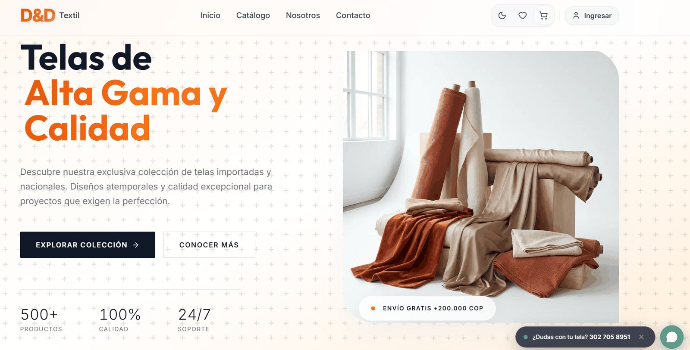

<div align="center">

# D&D Textil — Marketplace Textil Multi-Vendedor

### Ecosistema B2B/B2C por Comisión + Venta para la Industria Textil

Plataforma marketplace multi-vendedor para la comercialización, comparación de proveedores, control logístico de corte continuo e inventario antifraude de telas, construida con React 18, Java 21, PostgreSQL 17 y Docker.

<p>
  
  
  
  
  
  
  
  
  
</p>

<p>
  
  
  
  
</p>

<br />

<p align="center">
  
</p>

</div>

---

## Visión general

**D&D Textil** conecta en un solo marketplace a **múltiples proveedores textiles verificados** con clientes minoristas (B2C) y talleres de confección (B2B). Cada vendedor administra su propia vitrina tipo red social, catálogo, precios, promociones y lotes; la plataforma procesa compras multi-vendedor en un solo pago unificado (**Wompi**) dividiendo automáticamente los sub-pedidos y liquidando la **comisión de plataforma** para el administrador.

**Lo esencial en pocas líneas**

- **Marketplace Multi-Vendedor (`/tiendas`, `/tienda/:id`)**: 4 casas proveedoras reales con perfiles tipo Facebook editables (`/vendedor/mi-tienda`), calificación real y reseñas directas al vendedor, comparador competitivo entre tiendas, insignia *Más Vendido* y *Oferta*, y diseño Glassmorphism bajo psicología del color **60-30-10** accesible (WCAG).
- **Motor VIP y Alertas Reales**: Algoritmo `ServicioExclusividadVIP` que desbloquea colecciones exclusivas para clientes frecuentes ($\ge 3$ pedidos o $\ge 50\text{ m}$) y envía oportunidades inteligentes + notificaciones administrativas reales al vendedor (`/vendedor/alertas`).
- **Seguridad de Compras y Control Antifraude**: Solo usuarios autenticados con rol **`cliente`** pueden comprar y calificar (`401`/`403` en backend + `ProtectedRoute` estricto). El **`administrador`** no puede alterar precios, descuentos, lotes ni mermas de los vendedores (`HTTP 403`), operando como auditor de solo lectura que notifica cambios, stock bajo y reportes reales de mermas.
- **Despliegue completo con Docker Compose**: Tres contenedores listos en un solo comando (`postgres:17`, `backend-java` Java 21, `frontend` React + Nginx).

## Arquitectura

```
┌──────────────────────────┐     ┌──────────────────────────┐
│  Frontend  React + Vite  │     │  Frontend  App Android   │
│  http://localhost:3001   │     │  WebView + Kotlin        │
└────────────┬─────────────┘     └────────────┬─────────────┘
             │  REST / JSON                    │  REST / JSON
             ▼                                ▼
┌────────────────────────────────────────────────────────────┐
│            Backend  Java 21 (HTTPServer + JDBC)            │
│                http://localhost:8081/api/*                 │
└──────────────┬─────────────────────────────┬───────────────┘
               │  JDBC                       │  HTTPS + webhook
               ▼                             ▼
┌──────────────────────────────┐   ┌──────────────────────────┐
│ PostgreSQL 17 (Docker volume)│   │  Pasarela Wompi (sandbox)│
└──────────────────────────────┘   └──────────────────────────┘
```

| Capa | En cifras verificadas |
| :--- | :--- |
| Frontend | **58 rutas** en `App.jsx` entre tienda pública, directorio/perfiles de tiendas, checkout estricto para cliente y paneles Cliente, Vendedor y Administrador, **sin datos hardcodeados** |
| Backend | **Java 21**: **18 manejadores HTTP** sobre `ManejadorBase` (CORS, tokens `HmacSHA256`, tasa 1200 req/min por IP, logs JSON), **8 servicios** de aplicación, **15 DAOs/migradores** JDBC y **22 modelos** en `dominio` |
| Base de datos | **31 tablas** y **31 llaves foráneas** en `BASE DE DATOS/01_esquema_espanol.sql` (incluye `perfiles_vendedor`, `resenas_vendedor`, `alertas_vendedor`, `rollos_textil`, `eventos_pago_wompi`, `direcciones_usuario`) |

## Características

| Área | Detalle |
| :--- | :--- |
| **Marketplace y Tiendas** | Catálogo paginado por BD sin lag de scroll, comparador competitivo entre vendedores, directorio `/tiendas`, perfil público tipo Facebook `/tienda/:id` con portada, avatar, biografía, políticas de envío y reseñas al vendedor. |
| **Pagos y Comisiones** | Checkout exclusivo para `cliente` registrado con división automática multi-vendedor (`grupo_checkout`, `porcentaje_comision`, `monto_comision_admin`, `ganancia_neta_vendedor`) y pasarela unificada Wompi (SHA-256), Nequi / Bre-B, Mercado Pago, ePayco, Tarjeta y PSE. |
| **Acceso y Seguridad** | Registro con Habeas Data (Ley 1581/2012), inicio de sesión por correo o SSO (**Google** / **Microsoft**), sesiones `HmacSHA256` verificadas contra PostgreSQL en cada petición y controles antifraude (`HTTP 403`). |
| **Cliente** | Historial y rastreo de pedidos, factura PDF con CUFE, tickets de soporte, lista de deseos, reseñas 1–5 estrellas y calculadora de metraje por proyecto. |
| **Vendedor** | Editor en vivo de su perfil de tienda (`/vendedor/mi-tienda`), gestión de sus telas/precios/descuentos/exclusividad VIP, control propio de stock/lotes y centro de alertas reales (`/vendedor/alertas`: `auditoria_admin`, `stock_bajo`, `reporte_mermas`, `demanda_vip`, `competencia_precio`). |
| **Administrador (Auditoría Antifraude)** | Moderación de productos con observación obligatoria y alerta automática al vendedor, auditoría de lotes en solo lectura (`/admin/inventario/lotes`), notificación real de stock bajo (`/admin/inventario/alertas`), envío de métricas reales de mermas por vendedor (`/admin/inventario/merma`), comisiones por proveedor, cupones, tickets y analítica. |
| **Despliegue** | `docker compose up -d --build` levanta base de datos, backend Java 21 y frontend Nginx saludables. |

## Inicio rápido

### Requisitos

- Docker Engine v24 o superior
- Docker Compose v2 o superior

### Despliegue

```bash
# Clonar el repositorio
git clone https://github.com/Jhonmoreno000/PROYECTO-SENA-TIENDA-TEXTIL-.git
cd PROYECTO-SENA-TIENDA-TEXTIL-

# Configurar variables de entorno
cp .env.example .env

# Levantar los tres servicios en segundo plano
docker compose up -d --build
```

### Puertos

| Servicio | Acceso |
| :--- | :--- |
| Frontend de la aplicación | http://localhost:3001 (Docker) / http://localhost:5173 (Dev) |
| Backend API (REST) | http://localhost:8081 |
| Base de Datos PostgreSQL 17 | localhost:5432 |

### Variables de pagos y SSO

Se definen en el archivo `.env`. Sin ellas la tienda funciona en entorno local, pero la pasarela real o el SSO externo requieren configurarlas:

| Variable | Uso |
| :--- | :--- |
| `WOMPI_PUBLIC_KEY` / `WOMPI_PRIVATE_KEY` | Llaves del comercio en Wompi |
| `WOMPI_INTEGRITY_SECRET` / `WOMPI_EVENTS_SECRET` | Firma SHA-256 de pago y verificación del webhook |
| `WOMPI_ENV` | `sandbox` (pruebas) o `production` |
| `VITE_GOOGLE_CLIENT_ID` | Client ID de Google Cloud Console validado por el backend |
| `VITE_AZURE_CLIENT_ID` / `VITE_AZURE_TENANT_ID` | Aplicación de Microsoft Entra ID validada por el backend |

> `docker-compose.yml` incluye valores de desarrollo seguros/sandbox. Reemplázalos en `.env` para producción y nunca subas secretos reales al repositorio.

### Detener y limpiar

```bash
# Detener los contenedores
docker compose down

# Detener y eliminar los datos persistidos (reset total de BD)
docker compose down -v
```

## Credenciales y Proveedores Reales Sembrados

Usuarios reales poblados automáticamente en PostgreSQL para validar los tres roles y la competencia multi-vendedor:

| Rol | Tienda / Perfil | Correo electrónico | Contraseña | Acceso / Panel |
| :--- | :--- | :--- | :--- | :--- |
| **Administrador** | Administración D&D Textil | `admin@ddtextil.com` | `admin123` | Auditoría, moderación, comisiones, alertas stock/mermas y métricas (`/admin`) |
| **Vendedor** | **Textiles Pérez & Cía** (Medellín) | `vendedor@ddtextil.com` | `vendedor123` | Gestión de telas, tienda tipo Facebook, alertas y pedidos (`/vendedor`) |
| **Vendedor** | **Casa Textil González** (Bogotá) | `maria.gonzalez@ddtextil.com` | `vendedor123` | Gestión de linos, lanas, tienda propia y alertas (`/vendedor`) |
| **Vendedor** | **Hilos del Valle Textil** (Cali) | `andres.restrepo@hilosdelvalle.com` | `vendedor123` | Gestión de denim, driles técnicos y pedidos (`/vendedor`) |
| **Vendedor** | **Telas & Seda del Caribe** (Barranquilla) | `valentina.castro@telasdelcaribe.com` | `vendedor123` | Gestión de sedas, terciopelos y linos tropicales (`/vendedor`) |
| **Cliente** | Cliente Principal / VIP | `cliente@ddtextil.com` | `cliente123` | Checkout, calculadora textil, rastreo, reseñas y VIP (`/cliente`) |
| **Cliente** | Cliente Secundario | `cliente@gmail.com` | `cliente123` | Cuenta de compras y calificación a proveedores (`/cliente`) |
| **Cliente** | Camila Ruiz | `camila.ruiz@correo.com` | `cliente123` | Cuenta de cliente adicional (`/cliente`) |

## Calidad de Software y Suite de Pruebas Automatizadas

El proyecto implementa los estándares **ISO/IEC 25010** y **OWASP ASVS** con **108 pruebas automatizadas (100 % aprobadas)**: **62 pruebas Backend Java 21 (5 suites)** + **46 pruebas Frontend (Node/ESM)**.

### Guía de Comandos de Terminal para Pruebas y Validaciones (CLI)

#### 1. Pruebas, Lint y Compilación del Frontend (React + Vite + ESLint)
```bash
cd "tienda digital de telas"
npm ci
npm run lint    # 0 errores
npm test        # 46/46 pruebas aprobadas
npm run build   # Build de producción limpio
```

#### 2. Compilación y Ejecución de las 5 Suites del Backend (Java 21)
```bash
cd "tienda digital de telas/backend-java/servidor-api"

# Compilar (Linux/macOS/Docker):
mkdir -p bin && find src -name "*.java" > sources.txt
javac --release 21 -encoding UTF-8 -cp "lib/*" -d bin @sources.txt

# Ejecutar las 5 suites (62 pruebas en total):
java -cp "bin:lib/*" PruebasReglasNegocioTextil    # 14/14
java -cp "bin:lib/*" PruebasSeguridadIntegridad   # 20/20
java -cp "bin:lib/*" PruebasConcurrenciaYPagos    # 11/11
java -cp "bin:lib/*" PruebasContratoApi           #  9/9
java -cp "bin:lib/*" PruebasMarketplace           #  8/8
```
> En PowerShell nativo de Windows utiliza `;` en lugar de `:` para `-cp "bin;lib/*"`.

#### 3. Validación de Infraestructura y Contenedores (Docker)
```bash
docker compose config
docker compose up -d --build
docker compose ps
curl -I http://localhost:8081/health/live
curl -I http://localhost:8081/health/ready
curl -I http://localhost:3001
```

#### 4. Validación Rápida RBAC y Antifraude vía Terminal (cURL)
```bash
# Rechazo sin sesión en usuarios (esperado: 401):
curl -i http://localhost:8081/api/usuarios

# Rechazo de compra a visitante anónimo (esperado: 401):
curl -i -X POST http://localhost:8081/api/pedidos -H "Content-Type: application/json" -d '{}'

# Rechazo PCI-DSS ante datos crudos de tarjeta (esperado: 400):
curl -i -X POST http://localhost:8081/api/pedidos -H "Content-Type: application/json" -d '{"pan":"4532012345678910","cvv":"123"}'
```

### Pruebas de Carga y Rendimiento Concurrente

Disponibles en [`pruebas-carga/`](pruebas-carga/README.md):
- **Grafana k6:** `k6 run pruebas-carga/script_k6_estres_tienda.js`
- **PowerShell:** `powershell -ExecutionPolicy Bypass -File pruebas-carga/simulador_carga_concurrente.ps1 -TotalPeticiones 100 -Concurrencia 10`
- **Bash:** `./pruebas-carga/simulador_carga_concurrente.sh http://localhost:8081 100 10`

### Probes de Observabilidad (Health Checks)
- **Liveness Probe:** `GET http://localhost:8081/health/live`
- **Readiness Probe:** `GET http://localhost:8081/health/ready`
- **Reporte Global:** `GET http://localhost:8081/api/health`

## Portal Central de Documentación Técnica

El cuerpo documental oficial está estructurado en `documentacion/` y sincronizado con la arquitectura actual:

* **[Índice General de Documentación](DOCUMENTACION.md)**
* **[Modelo de Negocio y Estrategia Marketplace (Comisión + Venta)](MODELO_DE_NEGOCIO.md)**
* 01. **[Especificación de Requerimientos de Software (IEEE 830 y BDD)](documentacion/01-especificacion-requerimientos-ieee830.md)**
* 02. **[Arquitectura de Software, Modelo C4 y Backend Java 21](documentacion/02-arquitectura-software-c4-y-backend.md)**
* 03. **[Arquitectura del Frontend y Gestión de Roles de Usuario](documentacion/03-arquitectura-frontend-y-roles.md)**
* 04. **[Diseño, Estructura y Esquema de Base de Datos Relacional](documentacion/04-base-de-datos-diseno-y-esquema.md)** | **[Esquema Relacional (31 tablas)](BASE%20DE%20DATOS/README.md)**
* 05. **[Políticas de Seguridad, Resiliencia y Calidad de Software](documentacion/05-politicas-seguridad-resiliencia-y-calidad.md)**
* 06. **[Manual Técnico de Instalación, Configuración y Despliegue](documentacion/06-manual-tecnico-instalacion-y-despliegue.md)**
* 07. **[Motor Textil, Reglas de Negocio y Suite de Pruebas Automatizadas](documentacion/07-motor-textil-reglas-negocio-y-pruebas.md)**
* 08. **[Modelo Entidad-Relación (DER completo de 31 tablas)](documentacion/08-modelo-entidad-relacion.md)**
* 09. **[Mapa de Navegación por Rol (58 rutas)](documentacion/09-mapa-de-navegacion.md)**
* 10. **[Casos de Uso](documentacion/10-casos-de-uso.md)**
* 11. **[Diagrama de Clases del Backend](documentacion/11-diagrama-de-clases.md)**
* 12. **[Diagramas de Secuencia](documentacion/12-diagramas-de-secuencia.md)**
* 13. **[Manual de Usuario Oficial (Markdown)](documentacion/13-manual-de-usuario.md)** | **[Manual de Usuario (PDF Oficial)](documentacion/Manual_de_usuario_DD_Textil.pdf)**
* 14. **[Plan Maestro y Reporte de Pruebas (ISO/IEC 25010 — 108 pruebas)](documentacion/14-plan-y-reporte-de-pruebas-iso25010.md)**
* 15. **[Glosario Técnico y Catálogo Maestro Textil](documentacion/15-glosario-tecnico-y-catalogo-maestro-textil.md)**
* 16. **[Guion de Demostración para Sustentación SENA ADSO](documentacion/16-guion-demostracion-sustentacion-sena.md)**
* 17. **[Contrato de Interfaz OpenAPI v3.0](documentacion/openapi_tienda_textil.yaml)**
* 18. **[Matriz de Requerimientos (RF, RNF y Trazabilidad)](documentacion/Matriz_de_requerimientos_v2.xlsx)**
* 19. **[Framework de Pruebas de Carga y Rendimiento](pruebas-carga/README.md)**

---

<div align="center">

<sub>Proyecto formativo SENA · D&D Textil Marketplace · Calidad ISO/IEC 25010 & DevSecOps · 108 pruebas automatizadas (62 backend + 46 frontend)</sub>

</div>
