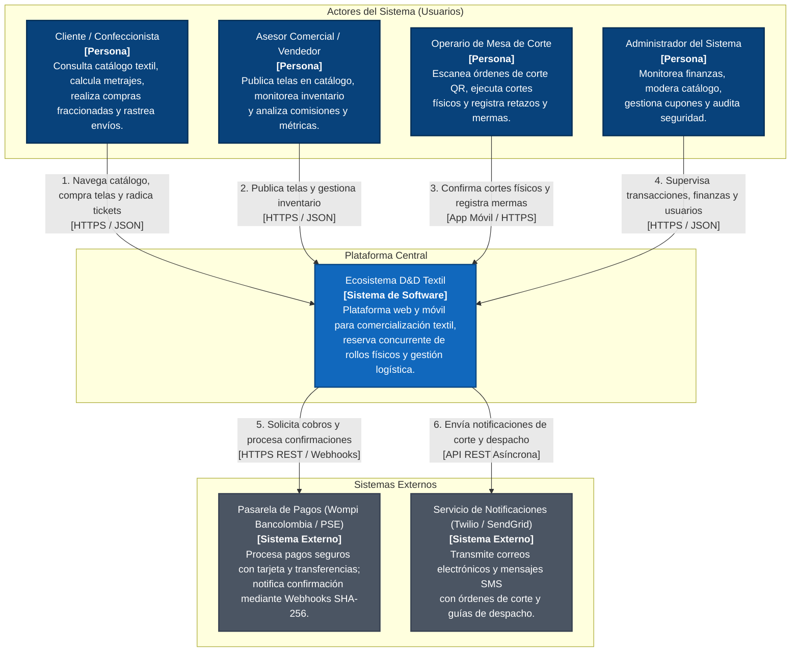
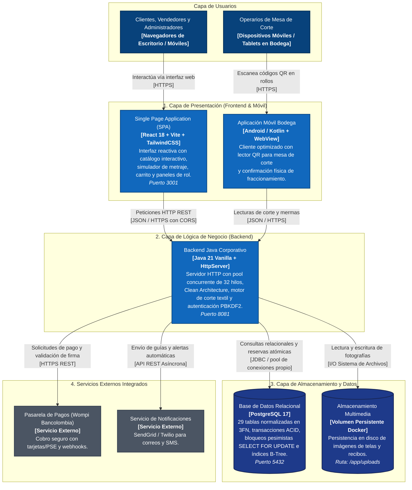
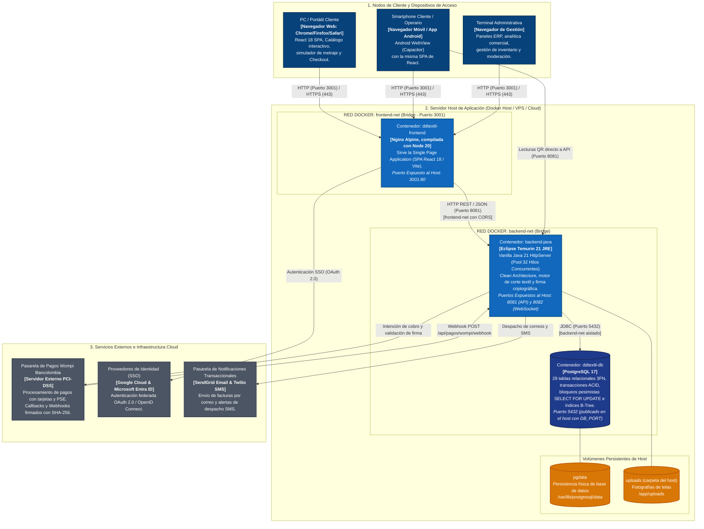
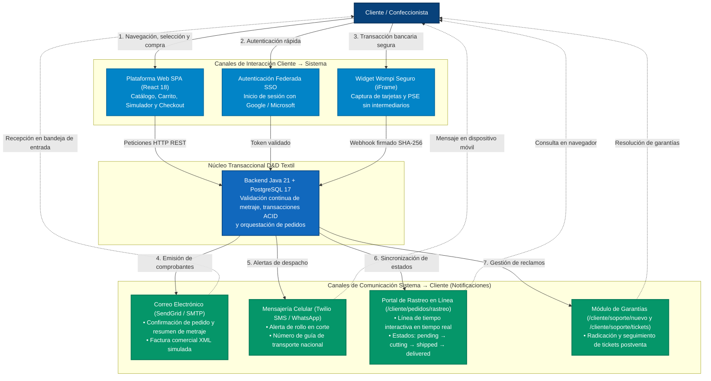
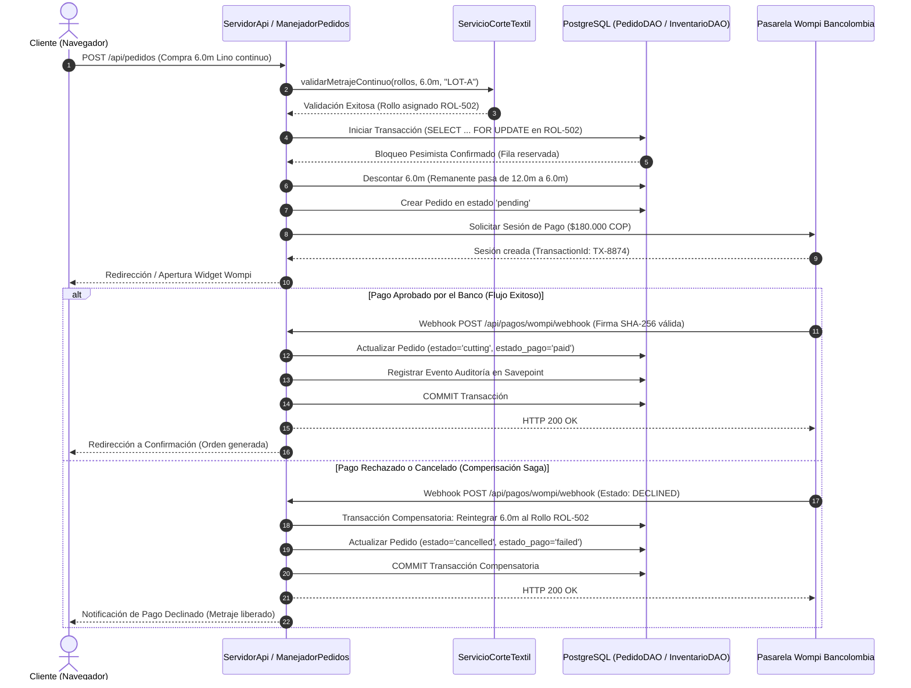

# Arquitectura de Software, Modelo C4 y Backend Java
**Proyecto:** Plataforma Distribuida de Comercializacion y Control Logistico Textil (D&D Textil)  
**Programa de Formacion:** Tecnologo en Analisis y Desarrollo de Software (ADSO) - SENA  
**Estandares:** Clean Architecture, Domain-Driven Design (DDD), Modelo C4 (Simon Brown), Principios SOLID  
**Version:** 2.0.0 - Documentacion Tecnica Oficial  

---

## 1. Vision General del Backend

El backend de **D&D Textil** es un servicio corporativo desarrollado en **Java 21 (Vanilla Java)** de alto rendimiento, disenado especificamente para eliminar la sobrecarga de memoria y dependencias de marcos de trabajo pesados como Spring Boot o Jakarta EE. 

### Caracteristicas Fundamentales del Diseno:
1. **Servidor HTTP Embebido de Alto Rendimiento:** Utiliza `com.sun.net.httpserver.HttpServer` configurado con un **Pool de Hilos Concurrente** (`Executors.newFixedThreadPool`) con un minimo de 32 hilos y escalable segun los nucleos de procesamiento (`Runtime.getRuntime().availableProcessors() * 8`). Esto garantiza la atencion simultanea de cientos de peticiones sin congelamiento de sockets.
2. **Pool de Conexiones JDBC propio:** `Conexion.java` mantiene un pool acotado (`ArrayBlockingQueue`) de conexiones fisicas hacia PostgreSQL: 24 por defecto (`DB_POOL_SIZE`, minimo 8), con espera limitada cuando el pool esta lleno y liberacion mediante bloques `try-with-resources`. No usa librerias externas como HikariCP.
3. **Serializacion y Deserializacion JSON Segura:** Utiliza **Google Gson** para la transformacion bidireccional entre payloads JSON y modelos POJO del dominio, con anotaciones `@SerializedName` que garantizan compatibilidad bilingue y desacoplamiento de nombres de red.
4. **Arquitectura Limpia (Clean Architecture) Hibrida:** El codigo se organiza en tres capas independientes (**Dominio**, **Aplicacion** e **Infraestructura**), aplicando estrictamente el principio de inversion de dependencias para que las reglas de negocio no dependan de la base de datos ni del transporte HTTP.

---

## 2. Estructura Exhaustiva de Capas y Paquetes

La distribucion fisica del codigo fuente en `tienda digital de telas/backend-java/servidor-api/src/` se estructura de la siguiente manera:

```text
src/
 |
 +-- dominio/
 |    +-- modelos/                    # Entidades puras y objetos de valor
 |    |    +-- RolloTextil.java       # Entidad de trazabilidad por rollo fisico y tintoreria
 |    |    +-- Producto.java          # Ficha tecnica textil (precio, gramaje, ancho, stock)
 |    |    +-- Usuario.java           # Cuenta de usuario con rol RBAC, estado y comisiones
 |    |    +-- Pedido.java            # Encabezado de pedido comercial y estados de pago
 |    |    +-- LoteInventario.java    # Lote de compra a proveedores de tejeduria
 |    |    +-- EventoMerma.java       # Registro de retazos liquidados y mermas tecnicas
 |    |    +-- Cupon.java             # Reglas de cupones de descuento (porcentaje o fijo)
 |    |    +-- ItemCarrito.java       # Items temporales vinculados al carrito de compra
 |    |    +-- Resena.java            # Calificaciones y comentarios de clientes
 |    |    +-- TicketSoporte.java     # Reclamos de garantia y devoluciones
 |    |    +-- UmbralStock.java       # Alertas minimas de metros por categoria
 |    |    +-- ReporteError.java      # Reportes de incidencias tecnicas
 |    |    +-- DiapositivaCarrusel.java # Banners del carrusel dinamico de la tienda
 |    |    +-- SeccionInicio.java     # Secciones modulares de la pagina principal
 |    |    +-- BannerGlobal.java      # Barra de anuncios superior configurable
 |    |    +-- VentaDiaria.java       # Consolidado de ventas diarias para graficos
 |    |    +-- VentaRegion.java       # Distribucion porcentual de despachos por departamento
 |    |    +-- ActividadReciente.java # Pistas de auditoria administrativa
 |    +-- repositorios/               # Interfaces abstractas de persistencia
 |    |    +-- RepositorioUsuario.java # Contrato de persistencia de usuarios
 |    +-- excepciones/                # Excepciones de negocio
 |         +-- ExcepcionDominio.java  # Excepcion controlada para violacion de reglas
 |
 +-- aplicacion/
 |    +-- servicios/                  # Casos de uso y logica de negocio
 |         +-- ServicioCorteTextil.java  # Motor de validacion continua, mermas y tarifas
 |         +-- ServicioAutenticacion.java # Hash PBKDF2 con sal (respaldo SHA-256) y validacion de roles
 |         +-- ServicioFactura.java       # Generador de representacion XML simulada
 |
 +-- infraestructura/
 |    +-- configuracion/
 |    |    +-- Conexion.java          # Pool de conexiones propio (ArrayBlockingQueue) y driver PostgreSQL
 |    +-- persistencia/jdbc/          # Acceso a datos relacionales (DAOs)
 |    |    +-- JdbcRepositorioUsuarioImpl.java # Implementacion del contrato RepositorioUsuario
 |    |    +-- ProductoDAO.java       # Consultas y persistencia de telas e imagenes
 |    |    +-- PedidoDAO.java         # Transacciones atomicas con SELECT FOR UPDATE
 |    |    +-- InventarioDAO.java     # Gestion de lotes, mermas y rollos fisicos
 |    |    +-- CarritoDAO.java        # Persistencia de items de carrito por usuario
 |    |    +-- CuponDAO.java          # Validacion de codigos promocionales
 |    |    +-- SoporteDAO.java        # Administracion de tickets de reclamos
 |    |    +-- ResenasDAO.java        # Persistencia de calificaciones
 |    |    +-- CarruselDAO.java       # Gestion de diapositivas
 |    |    +-- SeccionesInicioDAO.java # Configuracion de secciones dinamicas
 |    |    +-- ConfiguracionDAO.java  # Parametros globales del sistema
 |    +-- api/
 |         +-- ServidorApi.java       # Servidor HTTP central, enrutamiento y DI manual
 |         +-- manejadores/           # Controladores de endpoints REST
 |              +-- ManejadorBase.java              # Filtros comunes: RateLimit, CORS, CorrelationId
 |              +-- ManejadorAutenticacion.java     # POST /api/login, /api/register
 |              +-- ManejadorProductos.java         # GET/POST/PUT/DELETE /api/productos
 |              +-- ManejadorPedidos.java           # GET/POST/PUT /api/pedidos, actualizacion de estados
 |              +-- ManejadorCarrito.java           # GET/POST/PUT/DELETE /api/carrito
 |              +-- ManejadorCupones.java           # GET/POST /api/cupones, validacion
 |              +-- ManejadorInventario.java        # GET/POST/PUT /api/inventario: lotes, rollos, mermas y corte
 |              +-- ManejadorUsuarios.java          # GET/PUT /api/usuarios: perfil, rol, suspension y direcciones
 |              +-- ManejadorSoporte.java           # GET/POST /api/support, tickets y bugs
 |              +-- ManejadorResenas.java           # GET/POST /api/reviews
 |              +-- ManejadorCarrusel.java          # GET/POST/PUT/DELETE /api/carousel
 |              +-- ManejadorSeccionesInicio.java   # GET/POST/PUT /api/home-sections
 |              +-- ManejadorConfiguracion.java     # GET/POST /api/configuracion
 |              +-- ManejadorArchivosEstaticos.java # GET /uploads/* con prevencion path traversal
 |              +-- ManejadorSalud.java             # GET /health/live, /health/ready
 |
 +-- App.java                         # Punto de entrada de la aplicacion
 +-- SembradorDatosPrueba.java         # Sembrador de datos de prueba (contrasenas SHA-256, aceptadas como respaldo)
 +-- PruebasReglasNegocioTextil.java  # Suite de pruebas unitarias (14 pruebas)
 +-- PruebasSeguridadIntegridad.java  # Suite de seguridad e integridad (21 pruebas)
 +-- PruebasConcurrenciaYPagos.java   # Suite de concurrencia, pagos y DAST (11 pruebas)
 +-- PruebasContratoApi.java          # Suite de contrato OpenAPI (9 pruebas)
 +-- PruebasWebSocket.java            # Suite de tiempo real (4 pruebas)
```

---

## 3. Modelo C4 - Diagramas de Arquitectura

### 3.1. Nivel 1: Diagrama de Contexto del Sistema

A continuación se presenta el **Diagrama de Contexto (Nivel 1)** del Ecosistema D&D Textil, organizado formalmente con delimitación de límites, roles de usuario, plataforma central y servicios externos integrados:



---

### 3.2. Nivel 2: Diagrama de Contenedores

A continuación se ilustra la interacción entre los contenedores de software que conforman el ecosistema (SPA en React, App Móvil Android con Capacitor, Backend en Java 21, Base de Datos PostgreSQL 17 y Almacenamiento Multimedia):



---

### 3.3. Nivel 3: Diagrama de Componentes (Modulo de Inventario y Corte Textil)

A continuación se detalla la arquitectura de componentes interna del Backend Java, reflejando estrictamente la separación de responsabilidades de **Clean Architecture** (Infraestructura HTTP, Casos de Uso, Entidades de Dominio, Persistencia JDBC y Base de Datos):

```mermaid
flowchart TD
    classDef httpStyle fill:#1e3a8a,stroke:#3b82f6,stroke-width:2px,color:#ffffff,font-family:sans-serif;
    classDef appStyle fill:#065f46,stroke:#10b981,stroke-width:2px,color:#ffffff,font-family:sans-serif;
    classDef domainStyle fill:#581c87,stroke:#a855f7,stroke-width:2px,color:#ffffff,font-family:sans-serif;
    classDef daoStyle fill:#7c2d12,stroke:#f97316,stroke-width:2px,color:#ffffff,font-family:sans-serif;
    classDef dbStyle fill:#0f172a,stroke:#64748b,stroke-width:2px,color:#ffffff,font-family:sans-serif;

    subgraph CapaHTTP ["1. Capa de Infraestructura HTTP (Controladores REST)"]
        direction TB
        ManejadorBase["ManejadorBase<br/>• RateLimiting (1200 req/min por IP)<br/>• Validación CORS y Encabezados<br/>• Filtro X-Correlation-ID"]:::httpStyle
        
        subgraph HandlersEspecializados ["Manejadores Especializados (Extienden ManejadorBase)"]
            direction LR
            ManejadorAuth["ManejadorAutenticacion<br/>(/api/login, /api/register)"]:::httpStyle
            ManejadorProd["ManejadorProductos<br/>(/api/productos, filtros)"]:::httpStyle
            ManejadorPed["ManejadorPedidos<br/>(/api/pedidos, checkout)"]:::httpStyle
            ManejadorInv["ManejadorInventario<br/>(/api/inventario, rollos, mermas)"]:::httpStyle
        end
        HandlersEspecializados -.->|Heredan control| ManejadorBase
    end

    subgraph CapaAplicacion ["2. Capa de Aplicación (Servicios y Casos de Uso)"]
        direction LR
        ServicioAuth["ServicioAutenticacion<br/>• hashearContrasena()<br/>• validarCredenciales()"]:::appStyle
        ServicioCorte["ServicioCorteTextil<br/>• validarMetrajeContinuo()<br/>• procesarCorteYRemanente()<br/>• calcularTarifaEscalonada()"]:::appStyle
        ServicioWompi["ServicioCriptoWompi<br/>• generarFirmaIntegridad()<br/>• validarChecksumWebhook()"]:::appStyle
        ServicioFac["ServicioFactura<br/>• generarFacturaXmlSimulada()"]:::appStyle
    end

    subgraph CapaDominio ["3. Capa de Dominio (Entidades de Negocio Puras)"]
        direction LR
        Rollo["RolloTextil<br/>(codigo, metros, lote_tintoreria)"]:::domainStyle
        Producto["Producto<br/>(precio, ancho, peso, stock)"]:::domainStyle
        Pedido["Pedido<br/>(items, total, estado_pago)"]:::domainStyle
        Merma["EventoMerma<br/>(metros_perdidos, motivo, costo)"]:::domainStyle
    end

    subgraph CapaPersistencia ["4. Capa de Persistencia (DAOs y pool de conexiones)"]
        direction LR
        UsuarioDAO["JdbcRepositorioUsuarioImpl<br/>(Cuentas RBAC)"]:::daoStyle
        ProductoDAO["ProductoDAO<br/>(Fichas Textiles)"]:::daoStyle
        PedidoDAO["PedidoDAO<br/>(Transacciones Atómicas)"]:::daoStyle
        InventarioDAO["InventarioDAO<br/>(Rollos y Lotes)"]:::daoStyle
        PagoWompiDAO["PagoWompiDAO<br/>(Auditoría Webhooks)"]:::daoStyle
        ConexionPool[("Conexion<br/>Pool propio de 24 conexiones")]:::daoStyle
    end

    subgraph MotorPostgres ["5. Base de Datos"]
        PostgresDB[("PostgreSQL 17<br/>Bloqueo SELECT FOR UPDATE")]:::dbStyle
    end

    %% Invocaciones entre capas
    ManejadorAuth -->|Invoca| ServicioAuth
    ManejadorProd -->|Consulta catálogo| ProductoDAO
    ManejadorPed -->|Ejecuta validación y corte| ServicioCorte
    ManejadorPed -->|Calcula firma y valida pago| ServicioWompi
    ManejadorPed -->|Genera XML| ServicioFac
    ManejadorInv -->|Aplica reglas de fraccionamiento| ServicioCorte

    ServicioCorte -->|Manipula ciclo de vida| Rollo
    ServicioCorte -->|Genera registro| Merma
    ServicioCorte -->|Actualiza metros| InventarioDAO
    ServicioAuth -->|Consulta usuarios| UsuarioDAO
    ServicioWompi -->|Registra evento con Savepoint| PagoWompiDAO

    ManejadorPed -->|Persiste orden y detalle| PedidoDAO

    UsuarioDAO --> ConexionPool
    ProductoDAO --> ConexionPool
    PedidoDAO --> ConexionPool
    InventarioDAO --> ConexionPool
    PagoWompiDAO --> ConexionPool

    ConexionPool -->|Sentencias SQL Preparadas| PostgresDB
```



---

### 3.4. Nivel 4: Diagrama de Despliegue del Sistema (Mapa de Despliegue)

A continuación se ilustra la **Topología Física y de Red del Despliegue**, detallando los nodos de hardware, contenedores Docker, puertos de comunicación, políticas de aislamiento y servicios en la nube:



---

### 3.5. Diagrama de Comunicación del Sistema con el Cliente (Flujo Omnicanal e Interacción)

A continuación se detalla el **Flujo de Comunicación Integral entre el Cliente y el Ecosistema**, cubriendo el ciclo de vida completo: navegación en catálogo, cálculo de metrajes, autenticación SSO, pago seguro en Wompi, confirmación transaccional y seguimiento postventa:

#### 3.5.1. Canales de Comunicación y Puntos de Contacto



---

#### 3.5.2. Diagrama de Secuencia de Comunicación Transaccional y Postventa

> **Alcance:** las fases 3 y 4 de este diagrama muestran la integración prevista con el widget y el webhook de Wompi. Hoy el frontend no abre el widget y el pago se aprueba en el navegador (ver «Flujo de Pago Vigente (simulado)» al final del documento).

```mermaid
sequenceDiagram
    autonumber
    actor Cliente as Cliente / Confeccionista
    participant UI as SPA React 18 (Frontend Web / Móvil)
    participant Auth as Proveedor SSO / Auth (Google/Microsoft)
    participant API as Backend Java (ServidorApi / Handlers)
    participant Wompi as Pasarela Wompi Bancolombia
    participant DB as PostgreSQL 17 (Transacciones ACID)
    participant Notif as Servicio de Notificaciones (Email & SMS)

    %% FASE 1: Exploración y Cálculo
    rect rgb(240, 248, 255)
    Note over Cliente, API: FASE 1: Descubrimiento, Catálogo y Simulación de Metraje
    Cliente->>UI: Navega catálogo y abre Calculadora de Metraje
    UI->>API: GET /api/productos (Filtro por fibra, ancho, gramaje)
    API-->>UI: Listado de telas disponibles y metros en stock
    UI-->>Cliente: Visualización interactiva y cálculo de tela (+10% margen técnico)
    end

    %% FASE 2: Autenticación
    rect rgb(245, 245, 250)
    Note over Cliente, Auth: FASE 2: Identificación y Autenticación Segura (SSO / Directa)
    Cliente->>UI: Clic en "Iniciar Sesión"(Google / Microsoft / Email)
    UI->>Auth: Redirección OAuth 2.0 / OpenID Connect
    Auth-->>UI: Retorno con Token de Acceso
    UI->>API: POST /api/login (Validación de credenciales / perfil SSO)
    API-->>UI: Token de sesión emitido y perfil cargado en ContextoAutenticacion
    end

    %% FASE 3: Compra y Pasarela
    rect rgb(255, 250, 240)
    Note over Cliente, Wompi: FASE 3: Checkout y Transacción Bancaria con Wompi
    Cliente->>UI: Clic en "Finalizar Compra"en /checkout
    UI->>API: POST /api/pagos/intencion (Items, metros y datos de envío)
    API->>DB: Validar stock continuo y calcular total en servidor
    API-->>UI: Respuesta con Referencia, Monto en centavos y Firma SHA-256
    UI->>Wompi: Apertura del Widget oficial de Wompi (Checkout iFrame Seguro)
    Cliente->>Wompi: Ingresa medio de pago (Tarjeta de Crédito / Transferencia PSE)
    Wompi-->>Cliente: Notificación inmediata de procesamiento bancario
    end

    %% FASE 4: Confirmación y Webhook
    rect rgb(240, 255, 240)
    Note over Wompi, DB: FASE 4: Confirmación Asíncrona Webhook y Descuento de Inventario
    Wompi->>API: Webhook POST /api/pagos/wompi/webhook (Estado: APPROVED, Firma SHA-256)
    API->>API: Validar Checksum criptográfico (MessageDigest.isEqual)
    API->>DB: Iniciar Transacción con Bloqueo SELECT ... FOR UPDATE en Rollo
    API->>DB: Descontar metraje físico, actualizar pedido a 'cutting' y registrar auditoría
    API->>DB: COMMIT Transacción
    API-->>Wompi: HTTP 200 OK (Recepción confirmada)
    end

    %% FASE 5: Notificación y Postventa
    rect rgb(255, 245, 245)
    Note over API, Cliente: FASE 5: Notificaciones Multicanal y Seguimiento Postventa
    API->>Notif: Despachar Notificaciones Transaccionales
    Notif-->>Cliente: Correo de confirmación del pedido (si SMTP está configurado); la factura PDF se descarga desde el historial
    Notif-->>Cliente: Envío de SMS: Notificación de orden de corte y guía de despacho
    Cliente->>UI: Ingresa a /cliente/pedidos/rastreo
    UI->>API: GET /api/pedidos/{id}
    API-->>UI: Estado en tiempo real ('cutting' -> 'shipped' -> 'delivered')
    UI-->>Cliente: Visualización de línea de tiempo interactiva
    end
```

---

## 4. Implementacion de los Principios SOLID en el Backend

El backend implementa los cinco principios de diseno de Robert C. Martin:

### 4.1. S - Single Responsibility Principle (Principio de Responsabilidad Unica)
Cada componente posee una sola razon para cambiar:
- `ManejadorAutenticacion`: Se limita a capturar la peticion HTTP, verificar cabeceras CORS, deserializar el cuerpo JSON y enviar la respuesta HTTP correspondiente. No ejecuta hashes ni consultas SQL.
- `ServicioAutenticacion`: Contiene exclusivamente la logica de negocio (generacion de hash PBKDF2WithHmacSHA256 (10 000 iteraciones y sal aleatoria; las cuentas antiguas con SHA-256 se siguen aceptando), verificacion de suspension de cuenta y evaluacion de roles).
- `JdbcRepositorioUsuarioImpl`: Maneja de forma estricta las sentencias SQL preparadas (`SELECT`, `INSERT`, `UPDATE`), mapeando los conjuntos de resultados (`ResultSet`) a instancias de `Usuario`.

### 4.2. O - Open/Closed Principle (Principio de Abierto/Cerrado)
El despachador central `ServidorApi.java` esta estructurado para incorporar nuevas rutas de la API sin requerir la modificacion de los manejadores existentes. Nuevos metodos de calculo textil o pasarelas de pago extienden las interfaces de dominio sin alterar los flujos ya probados.

### 4.3. L - Liskov Substitution Principle (Principio de Sustitucion de Liskov)
Todos los controladores del sistema extienden de `ManejadorBase`, el cual implementa el contrato estandar `HttpHandler` de Java. Cualquier manejador concreto (`ManejadorProductos`, `ManejadorPedidos`, `ManejadorInventario`) puede ser sustituido por una version mock de pruebas sin alterar el funcionamiento del servidor.

### 4.4. I - Interface Segregation Principle (Principio de Segregacion de Interfaces)
Las interfaces del dominio (`dominio/repositorios/`) definen metodos estrictamente acotados a su entidad. `RepositorioUsuario` define unicamente operaciones sobre usuarios (`buscarPorCorreo`, `guardar`), evitando que los consumidores queden acoplados a metodos de inventario o facturacion.

### 4.5. D - Dependency Inversion Principle (Principio de Inversion de Dependencia)
Los modulos de alto nivel (casos de uso) no dependen de las clases de acceso a datos de bajo nivel; ambos dependen de abstracciones. En `ServidorApi.java` se realiza la inyeccion de dependencias desacoplando la persistencia de las reglas de negocio:

```java
// 1. Instanciacion de persistencia de bajo nivel (Detalle Tecnico)
RepositorioUsuario repositorioUsuario = new JdbcRepositorioUsuarioImpl();

// 2. Inyeccion de la abstraccion al servicio de alto nivel
ServicioAutenticacion servicioAutenticacion = new ServicioAutenticacion(repositorioUsuario);

// 3. Inyeccion del servicio al controlador HTTP final
ManejadorAutenticacion manejadorAutenticacion = new ManejadorAutenticacion(servicioAutenticacion);
```

---

## 5. Orquestacion Transaccional Saga y Eventos Asincronos

> **Alcance:** la compensación por webhook rechazado describe el diseño con Wompi. En el flujo vigente el pago es simulado y la confirmación llega desde el navegador por `POST /api/pagos/confirmar`.

Para gestionar la consistencia en el proceso de compra de tela continua y fraccionada, el sistema implementa una máquina de estados tipo **Saga Coreografiada** con transacciones compensatorias automáticas ante fallos de pago o cancelación:



---

## 6. Catalogo General de Endpoints de la API REST

El servidor escucha por defecto en el puerto **`8081`** y expone cabeceras CORS para integracion con el cliente web y movil:

Cada ruta en español tiene un alias en inglés que llega al mismo manejador (`/api/productos` y `/api/products`, `/api/pedidos` y `/api/orders`, etc.). La tabla usa los nombres en español, que son los que llama el frontend.

| Metodo | Ruta | Descripcion | Control de acceso | Codigos de Respuesta |
| :---: | :--- | :--- | :--- | :---: |
| `POST` | `/api/iniciar-sesion` (alias `/api/login`) | Inicio de sesion; devuelve el usuario y el token firmado de 12 horas. Bloquea el correo o la IP durante 15 minutos tras 5 intentos fallidos | Publica | 200, 400, 429 |
| `POST` | `/api/registro` (alias `/api/register`) | Registro de clientes; exige `aceptaHabeasData = true` y clave de 8 o mas caracteres | Publica | 201, 400 |
| `POST` | `/api/autenticacion/sso` (alias `/api/sso`) | Inicio con Google o Microsoft validando el token con el proveedor | Publica | 200, 401 |
| `GET` | `/api/usuarios`, `/api/usuarios/{id}` | Listado y detalle de usuarios | Token; el listado solo administrador, el detalle el propio usuario o el administrador | 200, 401, 403, 404 |
| `PUT` | `/api/usuarios/{id}` | Edicion de perfil; cambio de rol, comision, suspension o activacion (`/rol`, `/estado` o campos en el cuerpo) | Token del propio usuario o administrador; rol y estado solo administrador | 200, 400, 401, 403 |
| `DELETE` | `/api/usuarios/{id}` | Eliminacion de un usuario | Solo administrador | 200, 401, 403 |
| `GET/POST/PUT/DELETE` | `/api/usuarios/{id}/direcciones` | Direcciones de envio del usuario | Token del propio usuario o administrador | 200, 201, 400, 401, 403 |
| `GET` | `/api/productos`, `/api/productos/{id}`, `/api/productos/pendientes` | Catalogo, detalle y telas pendientes de aprobacion | Publica (pendientes: vendedor o administrador) | 200, 403, 404 |
| `POST` | `/api/productos` | Publicacion de una tela | Token de vendedor o administrador | 201, 400, 401, 403 |
| `PUT` | `/api/productos/{id}`, `/api/productos/{id}/imagen`, `/api/productos/{id}/moderar` | Edicion, imagen en Base64 y moderacion | Token del vendedor dueño o administrador; moderar y ofertas solo administrador | 200, 400, 401, 403, 404 |
| `DELETE` | `/api/productos/{id}` | Retiro de una tela | Token del vendedor dueño o administrador | 200, 401, 403, 404 |
| `GET` | `/api/pedidos`, `/api/pedidos/{id}` | Pedidos filtrados por rol (ver anexo) | Token; el detalle solo para el cliente, el vendedor del pedido o el administrador | 200, 401, 403, 404 |
| `POST` | `/api/pedidos` | Creacion del pedido con bloqueo pesimista del stock; rechaza datos de tarjeta en el cuerpo | Publica: el cliente sale de `userId` del cuerpo (ver nota) | 201, 400, 500 |
| `PUT` | `/api/pedidos/{id}` | Cambio de estado, numero de guia y notas | Token de vendedor o administrador | 200, 400, 401, 403 |
| `GET/POST/PUT/DELETE` | `/api/carrito` | Carrito por usuario (`?userId=`); `DELETE /api/carrito/vaciar/{id}` lo vacia | Sin validacion de rol | 200, 400 |
| `GET/POST` | `/api/cupones` | Listado y creacion de cupones | Crear: solo administrador | 200, 201, 400, 403 |
| `PUT` | `/api/cupones/{id}/activar`, `/api/cupones/{id}/desactivar` | Activacion y desactivacion | Solo administrador | 200, 403 |
| `GET` | `/api/pagos/configuracion`, `/api/pagos/estado?referencia=` | Configuracion publica y estado de una transaccion (el estado hoy responde 404 por un error SQL) | Publica | 200, 400, 404 |
| `POST` | `/api/pagos/intencion`, `/api/pagos/confirmar` | Intencion de pago con el total calculado en el backend (201) y confirmacion (pago simulado; hoy la confirmacion responde 400, ver «Flujo de Pago Vigente») | Publica | 200, 201, 400, 404 |
| `POST` | `/api/pagos/webhook` | Webhook de Wompi con verificacion de firma | Firma HMAC | 200, 400, 401 |
| `GET` | `/api/facturas`, `/api/facturas/{id}` | Listado de facturas y PDF generado con PDFBox | Sin validacion de rol | 200, 404 |
| `GET/POST/PUT` | `/api/soporte/tickets`, `/api/soporte/errores` | Tickets de soporte y reportes de fallo | Sin validacion de rol | 200, 201, 400 |
| `GET/POST` | `/api/resenas` | Reseñas de un producto (`?productId=`); una por usuario y producto | Sin validacion de rol | 200, 201, 400, 409 |
| `GET/POST/PUT` | `/api/inventario/lotes`, `/rollos`, `/mermas`, `/umbrales` | Lotes, rollos textiles, mermas y umbrales de stock | Sin validacion de rol | 200, 400, 500 |
| `POST` | `/api/inventario/corte` | Corte de un rollo con `ServicioCorteTextil` | Sin validacion de rol | 200, 400, 404 |
| `GET` | `/api/metricas/*`, `/api/actividad`, `/api/banner` | Metricas del panel, actividad reciente y banner | Sin validacion de rol | 200 |
| `GET/POST/PUT/DELETE` | `/api/carrusel`, `/api/secciones-inicio`, `/api/configuracion` | Contenido editable del inicio | Sin validacion de rol | 200, 400, 404 |
| `GET` | `/health/live`, `/health/ready` (alias `/api/salud`) | Sondas de vida y de conexion a PostgreSQL | Publica | 200, 503 |
| `GET` | `/uploads/*` | Imagenes subidas (bloquea rutas fuera de la carpeta) | Publica | 200, 403, 404 |

> **Nota:** el control por rol solo existe en los manejadores de usuarios, productos, pedidos y cupones. La creacion de pedidos y los pagos no exigen sesion; sin sesion, `Payment.jsx` envia `userId = 4`. Ver el anexo «Estado real de los controles» del documento 05.


---

## Anexo de Arquitectura Backend: Aislamiento Multi-Tenancy de Pedidos por Rol

El controlador `ManejadorPedidos` y el componente de persistencia `PedidoDAO` aplican aislamiento estricto de datos según la identidad verificada en `TokenSesion.Identidad`:

- **Rol Administrador (`esAdministrador()`):** accede al consolidado completo de órdenes (`obtenerTodosLosPedidos()`) y a cualquier pedido individual para auditoría y soporte.
- **Rol Vendedor (`esVendedor()`):** al consultar `GET /api/pedidos` o `GET /api/pedidos/{id}`, el DAO filtra las órdenes por `pedidos.vendedor_id = ?` (`obtenerPedidosPorVendedor`); el detalle de un pedido solo se entrega si su `vendedor_id` es el del vendedor autenticado.
- **Rol Cliente:** solo puede listar y consultar pedidos cuyo `usuario_id` coincida exactamente con el `idUsuario` autenticado en su token de sesión.

### Evolución de Plataforma a OpenJDK 21 LTS y Persistencia Directa PostgreSQL

- **Runtime Backend:** El servidor HTTP nativo (`com.sun.net.httpserver.HttpServer`) y el contenedor Docker multi-etapa operan sobre **Eclipse Temurin OpenJDK 21 LTS**, aprovechando mejoras de rendimiento en manejo de hilos y recolector de basura.
- **Sincronización Frontend-Backend sin Mocks Residuales:** Los contextos de React (`ContextoAutenticacion`, `ContextoMetricas`) y las vistas de pedidos y soporte consultan directamente los endpoints transaccionales de PostgreSQL, garantizando consistencia de datos entre sesiones y roles.

### Canal en Tiempo Real con WebSocket (puerto 8082)

Ademas de la API REST del puerto 8081, el backend levanta un servidor WebSocket propio (`infraestructura.api.websocket.ServidorWebSocket`, RFC 6455, sin librerias externas) en el puerto **8082** (`WS_PORT`). `ServidorApi` lo inicia junto al servidor HTTP y `docker-compose.yml` expone el puerto.

| Evento | Quien lo emite | Cuando |
| :--- | :--- | :--- |
| `NUEVO_PEDIDO` | `ManejadorPedidos` | Se crea un pedido |
| `PEDIDO_ACTUALIZADO` | `ManejadorPedidos` | Cambia el estado de un pedido |
| `STOCK_ACTUALIZADO` | `ManejadorProductos` | Cambia el stock de un producto |
| `NUEVO_PRODUCTO` | `ManejadorProductos` | Se publica un producto |
| `OFERTA_ACTUALIZADA` | `ManejadorProductos` | Se marca o desmarca una oferta |
| `NOTIFICACION` | `ServidorWebSocket.transmitirNotificacion` | Alertas del sistema |

Clases del paquete: `ServidorWebSocket` (acepta conexiones y transmite), `ClienteWebSocket` (una conexion) y `MensajeWebSocket` (tipo y datos del evento). La suite `PruebasWebSocket` cubre el canal.

### Flujo de Pago Vigente (simulado)

El flujo de compra usa `ManejadorPagosWompi` y `PagoWompiDAO`:

1. `POST /api/pagos/intencion`: el backend recalcula el total con los precios de la base de datos, valida el stock con `SELECT … FOR SHARE` (no lo descuenta), crea el pedido en estado `pending` y devuelve la referencia. El stock se descuenta despues, al aprobar el pago (`procesarTransaccionWompi`: bloquea el pedido con `FOR UPDATE` y aplica `GREATEST(0, stock - metros)`). El camino de `POST /api/pedidos` (`PedidoDAO`, con `FOR UPDATE` sobre cada producto) existe en el backend, pero el checkout no lo usa.
2. El frontend (`Payment.jsx`) presenta seis pestañas: Wompi, Mercado Pago, Nequi / Bre-B, ePayco, tarjeta y PSE (con la opción de contraentrega dentro de PSE). **Ningun medio se conecta a una pasarela real**: el pago se aprueba en el navegador.
3. `POST /api/pagos/confirmar`: esta disenado para marcar el pedido como `paid` con el estado que envia el navegador.

> **Defecto conocido (verificado el 17/11/2026):** la confirmacion falla siempre. La referencia de pago tiene el formato `DD-<marca de tiempo de 13 digitos>-XXXX`, y el filtro `ServicioAutenticacion.contieneDatosTarjetaSensibles` (expresion `.*\b(?:\d[ -]*?){13,19}\b.*`) la confunde con un numero de tarjeta. El endpoint responde `400` *"Rechazado por seguridad PCI-DSS"*, el pedido queda con `estado = pending`, `estado_pago = pending` y `metodo_pago = 'wompi'` (aunque se elija tarjeta u otro medio), y el frontend muestra igual *"¡Pago Aprobado y Pedido Confirmado!"* porque no revisa la respuesta. Ademas, `GET /api/pagos/estado` responde `404` en todos los casos: la consulta `PagoWompiDAO.consultarPedidoPorReferencia` tiene la clausula `FILTER (WHERE ...)` dentro de `json_agg(...)` y PostgreSQL devuelve un error de sintaxis.

Pendiente: corregir el filtro PCI para que no revise el campo de referencia (o exigir separadores tipicos de una tarjeta), mover el `FILTER` fuera de `json_agg` y mostrar el error en el frontend cuando la confirmacion falle. Tambien queda pendiente verificar la transaccion contra la pasarela antes de confirmar y exigir sesion en la confirmacion. Mercado Pago y ePayco aparecen en la interfaz, pero no tienen integracion en el backend. El backend conserva el receptor de eventos de Wompi (`PagoWompiDAO.procesarTransaccionWompi`), pero el frontend no abre el widget de Wompi.

### Persistencia de Usuarios

La clase `UsuarioDAO` se elimino. `JdbcRepositorioUsuarioImpl` concentra el acceso a la tabla `usuarios` y a `direcciones_usuario`.
