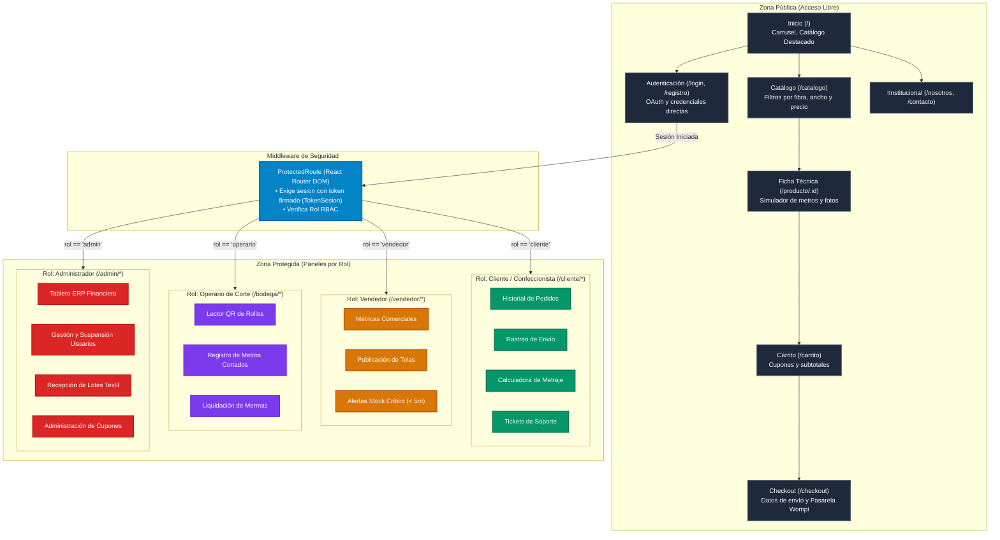

# Arquitectura del Frontend y Gestion de Roles de Usuario
**Proyecto:** Plataforma Distribuida de Comercializacion y Control Logistico Textil (D&D Textil)  
**Programa de Formacion:** Tecnologo en Analisis y Desarrollo de Software (ADSO) - SENA  
**Tecnologias:** React 18, Vite 5, TailwindCSS 3, Context API, React Router DOM v6  
**Version:** 2.0.0 - Documentacion Tecnica Oficial  

---

## 1. Arquitectura de la Interfaz de Usuario (Frontend)

El frontend de **D&D Textil** esta estructurado como una aplicacion de pagina unica (**Single Page Application - SPA**) utilizando **React 18** y el empaquetador de alto desempeno **Vite 5**. La arquitectura delega el renderizado al navegador del cliente mediante el DOM virtual, eliminando las recargas de pagina tradicionales y proporcionando transiciones fluidas de 60 cuadros por segundo.

### 1.1. Stack Tecnologico Principal
- **React 18.3.1:** Biblioteca base que implementa el paradigma funcional y de componentes declarativos. Aprovecha tecnicas de actualizacion granular del arbol de componentes (*reconciliation*) para actualizar unicamente los nodos que sufren cambios de estado.
- **Vite 5.4.11:** Empaquetador modular que utiliza modulos ECMAScript nativos (ESM) en desarrollo, acelerando el arranque en caliente (*Hot Module Replacement - HMR*) en menos de 100 milisegundos.
- **TailwindCSS 3.4.1:** Motor de estilos atomicos basado en utilidades de generacion Just-In-Time (JIT). Facilita el diseno consistente de interfaces bajo la estetica *Glassmorphism* (fondos translucidos, bordes tenues y desenfoques `backdrop-blur`).
- **Context API de React:** Sistema nativo de propagacion de estado global para sesiones de usuario (`ContextoAutenticacion`), carrito (`ContextoCarrito`), catalogo (`ContextoProducto`), paneles (`ContextoMetricas`) y tiempo real (`ContextoWebSocket`).
- **React Router DOM 6.22.0:** Sistema de enrutamiento del lado del cliente con proteccion condicional de rutas segun el rol del usuario autenticado.

### 1.2. Vista Previa de la Interfaz Principal (Landing Page)


---

## 2. Estructura de Directorios del Frontend (`tienda digital de telas/src/`)

El codigo fuente del frontend se organiza de forma modular para garantizar alta cohesión y bajo acoplamiento:

```text
tienda digital de telas/src/
 |
 +-- App.jsx                  # Las 54 rutas de la aplicacion y su proteccion por rol
 +-- main.jsx                 # Punto de entrada; monta AppProviders y el enrutador
 +-- config.js                # URL de la API (VITE_API_URL) y mapa RUTAS_API
 |
 +-- componentes/             # Componentes reutilizables
 |    +-- Encabezado.jsx, PieDePagina.jsx, Portada.jsx, Carrusel.jsx
 |    +-- TarjetaProducto.jsx, ProductGrid.jsx, SmartFilter.jsx, ReviewsSection.jsx
 |    +-- CheckoutForm.jsx, ResumenPedido.jsx, Toast.jsx, ErrorBoundary.jsx
 |    +-- ProtectedRoute.jsx   # Restringe rutas segun sesion y rol
 |    +-- AppProviders.jsx     # Anida los proveedores de contexto (incluye WebSocketProvider)
 |    +-- common/              # BotonWhatsAppFlotante, LogoutLoader, ModalSSOCorreo
 |    +-- dashboard/           # Tarjetas de metricas, graficas y CommandPalette
 |    +-- layouts/LayoutPanel.jsx  # Estructura comun de los tres paneles
 |
 +-- contextos/               # Estado global (Context API)
 |    +-- ContextoAutenticacion.jsx  # Login, registro, SSO, token y cierre de sesion
 |    +-- ContextoCarrito.jsx        # Carrito y cupones
 |    +-- ContextoProducto.jsx       # Catalogo y eventos de stock en tiempo real
 |    +-- ContextoMetricas.jsx       # Datos de paneles, inventario, cupones y lista de deseos
 |    +-- ContextoNotificacion.jsx   # Avisos en pantalla
 |    +-- ContextoWebSocket.jsx      # Conexion con el servidor WebSocket (puerto 8082)
 |    +-- UIContext.jsx              # Estado visual (tema, menus)
 |
 +-- paginas/                 # Vistas
 |    +-- Inicio, Catalogo, DetalleProducto, Carrito, Pago (checkout), ConfirmacionPedido
 |    +-- IniciarSesion, Registro, About, Contact, BugReport, NoEncontrado
 |    +-- payment/             # Payment.jsx (pasarelas simuladas), PSEForm, CodigoQRTextil...
 |    +-- cliente/             # PanelCliente; Orders/, Collection/, Soporte/, Settings/
 |    +-- vendedor/            # PanelVendedor, PedidosVendedor, StockAlerts
 |    +-- admin/               # ResumenAdmin, GestionUsuarios, ProductosAdmin, FacturasAdmin...
 |         +-- Inventario/, Moderacion/, Soporte/, Analiticas/
 |
 +-- datos/                   # Menus de cada panel (enlacesAdmin, enlacesCliente, enlacesVendedor)
 +-- hooks/                   # useDarkMode, useLocalStorage
 +-- servicios/               # servicioOAuth (Google/Microsoft), servicioWebSocket, servicioWompi
 +-- utilidades/              # formateadores, interceptorSesion (cabecera Authorization), sesion,
                              # analyticsUtils, inventoryUtils, metricsUtils, animations
```

---

## 3. Matriz de Roles y Permisos de Navegacion (RBAC)

La plataforma cuenta con cuatro roles de usuario claramente diferenciados, con permisos explicitos sobre las rutas y vistas del sistema:

| Rol de Usuario | Prefijo de Ruta | Vistas y Capacidades Autorizadas | Restricciones de Seguridad |
| :--- | :--- | :--- | :--- |
| **Cliente** | `/cliente/*` | Consulta de pedidos propios, seguimiento de envio (`/cliente/pedidos/rastreo`), uso de la calculadora de metraje, lista de deseos y radicacion de tickets de garantia. | Bloqueado para ver pedidos ajenos, catalogar productos o acceder a paneles de gestion. |
| **Vendedor** | `/vendedor/*` | Publicacion de telas, actualizacion de stock, visualizacion de sus propias ventas y recepcion de alertas de stock critico (< 5 metros). | Solo puede editar productos vinculados a su identificador de usuario (`vendedor_id`). |
| **Operario de Corte** | `/bodega/*` | Escaneo de ordenes de corte con codigo QR, validacion de rollos fisicos y registro de metros cortados y mermas. | No tiene acceso a informacion de precios de venta, utilidades ni facturacion. |
| **Administrador** | `/admin/*` | Moderacion de productos, suspension o reactivacion de usuarios, configuracion de umbrales criticos, creacion de cupones y metricas globales. | Acceso total con registro de auditoria inmutable en cada accion. |

---

## 4. Mapa de Navegacion del Ecosistema

A continuación se presenta el **Diagrama del Mapa de Navegación del Frontend**, ilustrando la segmentación entre las rutas públicas de libre acceso, el filtro de protección RBAC (`ProtectedRoute`) y los tableros de control especializados para cada rol:



---

### 4.1. Vistas Publicas (Sin Autenticacion Requerida)
- **Inicio (`/`):** Exposicion del catalogo destacado, colecciones de temporada y banner de anuncios superior.
- **Catalogo de Telas (`/catalogo`):** Tarjetas interactivas con busqueda en tiempo real por texto y filtrado por categorias (Algodon, Seda, Lino, Dril, Terciopelo, etc.).
- **Detalle de Producto (`/producto/:id`):** Visualizacion de fotografia en alta resolucion, ancho util, peso, cuidados textiles y selector dinamico de metros con validacion de disponibilidad.
- **Carrito de Compras (`/carrito`):** Administracion de items seleccionados, calculo de subtotales y aplicacion de cupones de descuento.
- **Proceso de Pago (`/checkout`, `/pago` y `/confirmacion`):** Formulario de datos de despacho, confirmacion de pasarela de pago y generacion del comprobante con numero de orden.
- **Sobre Nosotros (`/nosotros`) y Contacto (`/contacto`):** Paginas institucionales y formulario de contacto interactivo con mapa de ubicación.
- **Acceso (`/login` y `/registro`):** Formularios con validacion de campos y soporte OAuth con Google/Microsoft.

### 4.2. Vistas Protegidas por Rol (Requieren Sesión Activa)
- **Cliente (`/cliente/*`):** Panel de gestión de compras, descarga de facturas simuladas, seguimiento en tiempo real y calculadora textil.
- **Vendedor (`/vendedor/*`):** Publicación de telas, catálogo personal, liquidación de comisiones y control de inventario local.
- **Operario de Corte (`/bodega/*`):** Estación de corte móvil con lector de códigos QR para rollos físicos y registro de mermas.
- **Administrador (`/admin/*`):** Panel integral de supervisión, auditoría de usuarios, aprobación de lotes textiles y configuración global.

---

## 5. Motor y Formulas de la Calculadora de Metraje Inteligente

Ubicada en `/cliente/coleccion/calculadora`, la **Calculadora de Metraje** asiste al confeccionista calculando la cantidad exacta de tela necesaria para un proyecto, incorporando un **margen de seguridad tecnico del diez por ciento (+10%)** para compensar encogimientos por lavado y desperdicios de corte de patron:

### Formulas Matematicas Implementadas:

1. **Cortinas Tradicionales:**
   $$\text{Metros} = \left( \text{Alto de Ventana} + 0.30\text{ m (dobladillo)} \right) \times \left( \frac{\text{Ancho} \times 2.0\text{ (pliegues)}}{\text{Ancho Util de Tela}} \right) \times 1.10$$

2. **Vestido Largo / Enterizo:**
   $$\text{Metros} = \left( \text{Largo de Prenda} + \text{Largo de Manga} + 0.25\text{ m} \right) \times 1.10$$

3. **Falda Circular o Plisada:**
   $$\text{Metros} = \left( 2 \times \text{Largo de Falda} + 0.40\text{ m} \right) \times 1.10$$

4. **Manteles de Mesa:**
   $$\text{Metros} = \left( \text{Largo de Mesa} + 2 \times \text{Caida Deseada (0.25 m a 0.35 m)} \right) \times 1.10$$

5. **Cojines y Tapiceria:**
   $$\text{Metros} = \left( \text{Cantidad de Cojines} \times 0.55\text{ m} \right) \times 1.10$$

---

## 6. Arquitectura del Cliente Movil (Android Wrapper)

Ubicada en el modulo `TiendaTextilApp/`, la aplicacion movil ofrece una experiencia optimizada para dispositivos Android (telefonos y tabletas de operarios de corte y clientes):

### 6.1. Componentes del Contenedor Nativo
- **Lenguaje:** Kotlin 1.9+ sobre Android SDK 34 (Android 14) con compatibilidad hacia atras hasta Android 7.0 (API 24).
- **Contenedor WebView Optimizado:** Emplea `androidx.webkit.WebViewAssetLoader` para servir el paquete estatico compilado de la SPA de React desde el almacenamiento interno del dispositivo (`assets/`), eliminando la latencia de descarga por red celular en la carga inicial de vistas.
- **Configuracion de Red Segura:** Define un archivo de configuracion de seguridad de red (`network_security_config.xml`) que habilita el trafico HTTP en entornos de desarrollo local hacia la direccion IP del emulador Android (`10.0.2.2:8081`) o la IP de red local corporativa en dispositivos fisicos.
- **Manejo del Ciclo de Vida y Navegacion:** Integra el evento de retroceso de hardware (`OnBackPressedDispatcher`) para permitir navegacion por historial en la aplicacion web antes de finalizar la actividad principal.


---

## Anexo de Arquitectura Frontend: Gestión Reactiva de Vigencia de Sesión y Aislamiento de Estado

En la capa cliente (`tienda digital de telas/src`), la seguridad y privacidad entre sesiones en un mismo navegador se refuerzan mediante tres mecanismos coordinados:

1. **Utilidad de Vigencia de Token (`src/utilidades/sesion.js`):**
   - Decodifica de forma segura la sección de carga Base64URL del token firmado para extraer la marca de expiración (`exp`) en milisegundos (`expiracionDeToken`, `tokenVigente`, `sesionVigente`).
2. **Cierre Automático por Expiración (`ContextoAutenticacion.jsx`):**
   - Al hidratar el usuario desde `localStorage` y durante la sesión activa, un temporizador reactivo (`setTimeout`) programa el cierre automático de sesión exactamente en el instante en que vence el token o cuando el backend responde con código `401` a una consulta de `ContextoMetricas` (función `apiFetchDetallado`, que invoca el cierre de sesión).
3. **Limpieza de Métricas entre Sesiones (`ContextoMetricas.jsx`):**
   - Cuando el usuario cierra sesión o cambia de cuenta, el contexto limpia de inmediato los arreglos de pedidos en memoria para evitar que datos de una sesión previa sean visibles por otro usuario en el mismo equipo.

### Integración con Centro de Notificaciones (`/api/configuracion/notificaciones`)

| Método | Ruta | Autenticación | Descripción |
| :--- | :--- | :--- | :--- |
| `GET` | `/api/configuracion/notificaciones?usuarioId={id}` | Sesión activa | Lista las últimas notificaciones del usuario y avisos globales ordenados por fecha descendente. |
| `POST` | `/api/configuracion/notificaciones` | Sesión activa | Registra una nueva notificación operativa o marca todas como leídas (`accion: "marcar_todas_leidas"`). |
| `PUT` | `/api/configuracion/notificaciones/{id}` | Sesión activa | Marca una notificación específica como leída (`leida = true`). |

### Sincronizacion en Tiempo Real (`ContextoWebSocket`)

`WebSocketProvider` (en `AppProviders.jsx`) abre una conexion con el servidor WebSocket del backend (puerto 8082, o la URL de `VITE_WS_URL`) mediante `servicios/servicioWebSocket.js`. `ContextoProducto` escucha `STOCK_ACTUALIZADO`, `OFERTA_ACTUALIZADA` y `NUEVO_PRODUCTO`; `ContextoWebSocket` escucha `NUEVO_PEDIDO` y `NOTIFICACION`. Asi el catalogo y los paneles se actualizan sin recargar la pagina. El backend tambien emite `PEDIDO_ACTUALIZADO`, pero el frontend todavia no lo escucha.

### Piezas Agregadas en Noviembre de 2026

| Pieza | Archivo | Funcion |
| :--- | :--- | :--- |
| Interceptor de sesion | `utilidades/interceptorSesion.js` | Agrega `Authorization: Bearer <token>` a cada peticion |
| Limite de errores | `componentes/ErrorBoundary.jsx` | Evita que un fallo de una vista tumbe toda la aplicacion |
| Codigo QR de pago | `paginas/payment/CodigoQRTextil.jsx` | QR para Nequi y Bre-B |
| Boton de WhatsApp | `componentes/common/BotonWhatsAppFlotante.jsx` | Contacto directo con la tienda |
| Favoritos por usuario | `contextos/ContextoMetricas.jsx` | Lista de deseos guardada en el navegador por usuario |

El frontend define 54 rutas en `App.jsx`.
