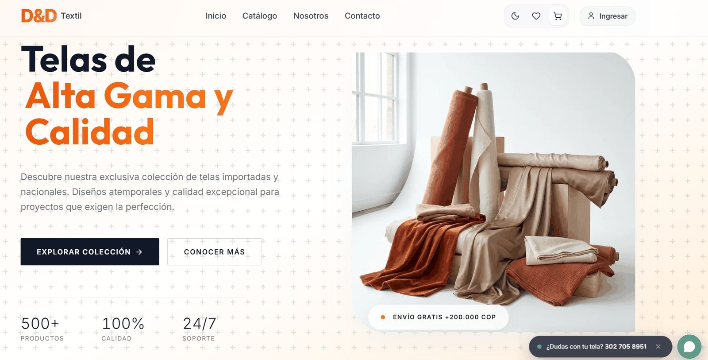
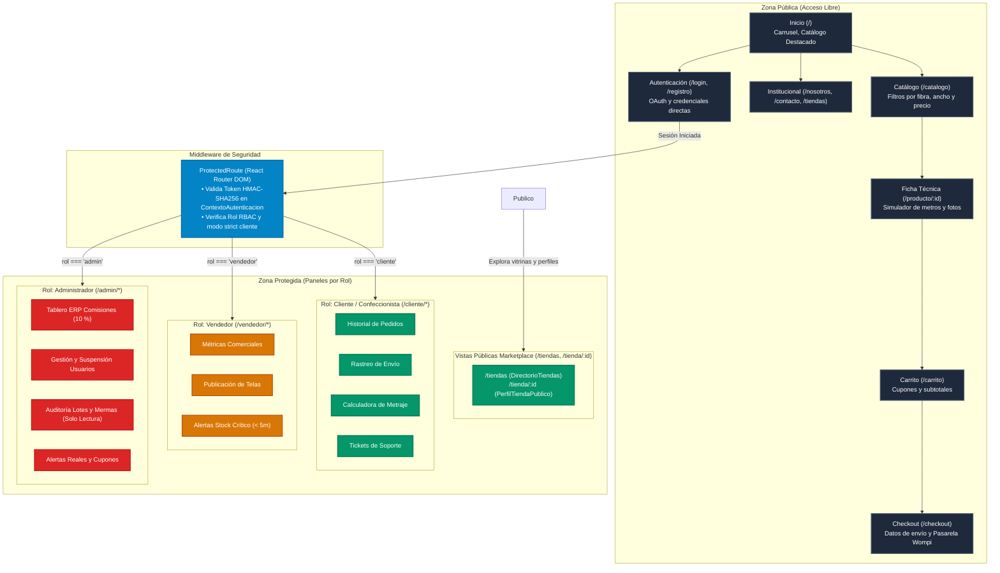

# Arquitectura del Frontend y Gestion de Roles de Usuario
**Proyecto:** Plataforma Distribuida de Comercializacion y Control Logistico Textil (D&D Textil)  
**Programa de Formacion:** Tecnologo en Analisis y Desarrollo de Software (ADSO) - SENA  
**Tecnologias:** React 18, Vite 5, TailwindCSS 3, Context API, React Router DOM v6  
**Version:** 2.0.0 - Documentacion Tecnica Oficial  

---

## 1. Arquitectura de la Interfaz de Usuario (Frontend)

El frontend de **D&D Textil** esta estructurado como una aplicacion de pagina unica (**Single Page Application - SPA**) utilizando **React 18** y el empaquetador de alto desempeno **Vite 5**. La arquitectura delega el renderizado al navegador del cliente mediante el DOM virtual, eliminando las recargas de pagina tradicionales y proporcionando transiciones fluidas de 60 cuadros por segundo.

### 1.1. Stack Tecnologico Principal
- **React 18.3.1:** Biblioteca base que implementa el paradigma funcional y de componentes declarativos. Aprovecha tecnicas de actualizacion granular del arbol de componentes (*reconciliation*) para actualizar unicamente los nodos que sufren cambios de estado.
- **Vite 5.4.11:** Empaquetador modular que utiliza modulos ECMAScript nativos (ESM) en desarrollo, acelerando el arranque en caliente (*Hot Module Replacement - HMR*) en menos de 100 milisegundos.
- **TailwindCSS 3.4.1:** Motor de estilos atomicos basado en utilidades de generacion Just-In-Time (JIT). Facilita el diseno consistente de interfaces bajo la estetica *Glassmorphism* (fondos translucidos, bordes tenues y desenfoques `backdrop-blur`).
- **Context API de React:** Sistema nativo de propagacion de estado global para sesiones de usuario (`ContextoAutenticacion`), compras multi-vendedor (`ContextoCarrito`), catalogo (`ContextoProducto`) y KPIs reales (`ContextoMetricas`).
- **React Router DOM 6.22.0:** Sistema de enrutamiento del lado del cliente con proteccion condicional de rutas segun el rol del usuario autenticado.

### 1.2. Vista Previa de la Interfaz Principal (Landing Page)



---

## 2. Estructura de Directorios del Frontend (`tienda digital de telas/src/`)

El codigo fuente del frontend se organiza de forma modular para garantizar alta cohesión y bajo acoplamiento:

```text
tienda digital de telas/src/
 |
 +-- componentes/             # Componentes visuales y layouts reutilizables (Glassmorphism 60-30-10)
 |    +-- common/             # BotonWhatsAppFlotante, LogoutLoader, ModalSSOCorreo
 |    +-- dashboard/          # BarChart, ErpAreaChart, ErpMetricCard, MetricCard, NotificationFeed, CommandPalette
 |    +-- layouts/            # LayoutPanel (sidebar y cabecera unificada de paneles)
 |    +-- Encabezado.jsx      # Barra de navegación con detector de sesión, tiendas y carrito
 |    +-- PieDePagina.jsx     # Pie de página institucional y enlaces legales
 |    +-- TarjetaProducto.jsx # Tarjeta optimizada con distintivos VIP, Más Vendido, Descuento y Tienda
 |    +-- PerfilTiendaFacebook.jsx # Vista social reutilizable de tienda (portada, avatar, bio, reseñas)
 |    +-- ProtectedRoute.jsx  # Guardia RBAC con modo estricto (`strict={true}`) para rol cliente
 |    +-- ProductGrid.jsx     # Grilla paginada e incremental sin lag con filtros normalizados NFD
 |    +-- Toast.jsx           # Notificaciones flotantes de éxito y error
 |
 +-- contextos/               # Proveedores de estado global reactivo
 |    +-- ContextoAutenticacion.jsx # Token HMAC-SHA256, perfil y vigencia en sesión
 |    +-- ContextoCarrito.jsx       # Sincronización multi-vendedor, subtotales y cupones
 |    +-- ContextoProducto.jsx      # Catálogo, tiendas reales, caché y filtros
 |    +-- ContextoMetricas.jsx      # KPIs reales de ventas, comisiones, rotación y mermas
 |    +-- ContextoNotificacion.jsx  # Alertas y notificaciones del navegador
 |
 +-- datos/                   # Definición de enlaces laterales por rol
 |    +-- enlacesCliente.js   # Navegación de panel cliente
 |    +-- enlacesVendedor.js  # Navegación de vendedor (/vendedor/mi-tienda, /vendedor/alertas, etc.)
 |    +-- enlacesAdmin.js     # Navegación admin (Auditoría Lotes/Mermas, Notificar Stock Bajo, etc.)
 |
 +-- paginas/                 # 58 rutas organizadas por rol y módulo (`App.jsx`)
 |    +-- Inicio.jsx, Catalogo.jsx, DetalleProducto.jsx, Carrito.jsx, Pago.jsx, ConfirmacionPedido.jsx
 |    +-- DirectorioTiendas.jsx, PerfilTiendaPublico.jsx # Vitrina multi-vendedor `/tiendas` y `/tienda/:id`
 |    +-- About.jsx, Contact.jsx, IniciarSesion.jsx, Registro.jsx, BugReport.jsx
 |    +-- payment/            # Pasarela multi-método Wompi, PSE, Nequi, Tarjeta 3D, QR Textil
 |    +-- cliente/            # PanelCliente, HistorialPedidos, SeguimientoPedido, ProjectCalculator, Wishlist, Perfil, AddressBook, Soporte
 |    +-- vendedor/           # PanelVendedor, MiTiendaVendedor, AlertasOportunidad, PedidosVendedor, StockAlerts
 |    +-- admin/              # ResumenAdmin, ProductosAdmin, MetricasVendedor, ControlLotes, CalculadoraMerma, ConfiguracionStock, ColaAprobacion, Analiticas/*
 |
 +-- servicios/               # Integraciones externas (servicioWompi.js, servicioOAuth.js)
 +-- utilidades/              # Interceptor JWT, animaciones, inventario, métricas, sesiones y formateadores COP/metros
```

---

## 3. Matriz de Roles y Permisos de Navegacion (RBAC)

La plataforma cuenta con cuatro roles de usuario claramente diferenciados, con permisos explicitos sobre las rutas y vistas del sistema:

| Rol de Usuario | Prefijo de Ruta | Vistas y Capacidades Autorizadas | Restricciones de Seguridad |
| :--- | :--- | :--- | :--- |
| **Cliente** | `/cliente/*` | Consulta de pedidos propios, seguimiento de envio (`/cliente/rastreo`), uso de la calculadora de metraje, lista de deseos y radicacion de tickets de garantia. | Bloqueado para ver pedidos ajenos, catalogar productos o acceder a paneles de gestion. |
| **Vendedor** | `/vendedor/*` | Publicacion de telas, actualizacion de stock, visualizacion de sus propias ventas y recepcion de alertas de stock critico (< 5 metros). | Solo puede editar productos vinculados a su identificador de usuario (`vendedor_id`). |
| **Vendedor (Marketplace)** | `/vendedor/*` | Edición en vivo de perfil de tienda tipo red social (`/vendedor/mi-tienda`), publicación de telas, precios y stock propios, alertas VIP/auditoría (`/vendedor/alertas`) y órdenes de corte. | Aislado a sus propios productos y sub-pedidos (`vendedor_id`). No puede comprar ni moderar otras tiendas. |
| **Administrador (Gobierno)** | `/admin/*` | Auditoría antifraude en modo solo lectura de precios/lotes/mermas, moderación (`changes_requested`), envío real de alertas de stock y mermas, métricas, comisiones (10 %) y cupones. | Bloqueado para editar precios, stock, rollos, lotes o mermas de vendedores (`HTTP 403`) y bloqueado en checkout. |
| **Administrador** | `/admin/*` | Moderacion de productos, suspension o reactivacion de usuarios, configuracion de umbrales criticos, creacion de cupones y metricas globales. | Acceso total con registro de auditoria inmutable en cada accion. |

---

## 4. Mapa de Navegacion del Ecosistema

A continuación se presenta el **Diagrama del Mapa de Navegación del Frontend**, ilustrando la segmentación entre las rutas públicas de libre acceso, el filtro de protección RBAC (`ProtectedRoute`) y los tableros de control especializados para cada rol:



---

### 4.1. Vistas Publicas y Compra Segura (RBAC Estricto)
- **Inicio (`/`):** Exposicion del catalogo destacado, colecciones de temporada, slider y banner global configurable.
- **Tiendas Proveedoras (`/tiendas`) y Perfil Público (`/tienda/:id`):** Directorio real de los 4 proveedores textiles y vitrina tipo red social con portada, avatar, biografía, ciudad, políticas y reseñas verificadas (`perfiles_vendedor`, `resenas_vendedor`).
- **Catalogo de Telas (`/catalogo`):** Scroll paginado optimizado sin lag, exclusividad VIP desbloqueada para clientes recurrentes, filtros por categoría/precio y distintivos de teoría del color 60-30-10.
- **Detalle de Producto (`/producto/:id`):** Fotografía de alta resolución, ancho util, gramaje, cuidados textiles, calificación del vendedor, comparativa competitiva multi-vendedor (`GET /api/productos/{id}/competencia`) y selector de metraje.
- **Carrito Multi-Vendedor (`/carrito`):** Agrupación de telas de distintas tiendas proveedoras, subtotales y aplicación de cupones.
- **Proceso de Pago (`/checkout`, `/pago`, `/confirmacion`):** Protegido estrictamente con `<ProtectedRoute roles="cliente" strict={true}>`; divide automáticamente el carrito en sub-pedidos independientes (`grupo_checkout`) liquidando comisión admin (10 %) y ganancia neta por vendedor.
- **Sobre Nosotros (`/nosotros`) y Contacto (`/contacto`):** Páginas institucionales y formulario de soporte/contacto conectado al backend.
- **Acceso (`/login` y `/registro`):** Formularios validados con cuentas reales y soporte OAuth con Google/Microsoft.

### 4.2. Vistas Protegidas por Rol (58 Rutas Totales en `App.jsx`)
- **Cliente (`/cliente/*`):** Panel personal con historial por sub-pedidos, descarga de facturas electrónicas en PDF (`/cliente/pedidos`), rastreo (`/cliente/pedidos/rastreo`), libreta de direcciones y calculadora textil (`/cliente/coleccion/calculadora`).
- **Vendedor (`/vendedor/*`):** Publicación de telas, precios propios, editor visual tipo red social (`/vendedor/mi-tienda`), bandeja real de alertas VIP/auditoría/mermas (`/vendedor/alertas`), gestión de stock (`/vendedor/stock`) y pedidos propios (`/vendedor/pedidos`).
- **Administrador (`/admin/*`):** Moderación (`changes_requested` hacia `/vendedor/alertas`), auditoría antifraude en modo solo lectura sobre precios/lotes/mermas (`HTTP 403` ante mutación), envío de notificaciones reales de stock/mermas y analítica financiera alimentada 100 % desde PostgreSQL.

### 4.3. Teoría del Color (60-30-10), Glassmorphism y Política Cero Hardcoding
1. **Psicología del Color 60-30-10:** 60 % fondos neutros suaves (`slate-50` / `slate-950` con glassmorphism constante), 30 % textos y superficies estructurales (`slate-800` / blanco translúcido con alto contraste WCAG AA) y 10 % acentos funcionales psicológicos (naranja cálido en CTAs de conversión, esmeralda en verificaciones y disponibilidad, ámbar en exclusividad VIP y alertas preventivas, rojo reservado para críticos).
2. **Eliminación Total de Datos Hardcodeados:** Todas las analíticas administrativas, comisiones, inventarios, calificaciones y alertas del frontend consumen directamente los endpoints REST respaldados por PostgreSQL.
- **Administrador (`/admin/*`):** Panel integral de supervisión, auditoría de usuarios, aprobación de lotes textiles y configuración global.

---

## 5. Motor y Formulas de la Calculadora de Metraje Inteligente

Ubicada en `/cliente/coleccion/calculadora`, la **Calculadora de Metraje** asiste al confeccionista calculando la cantidad exacta de tela necesaria para un proyecto, incorporando un **margen de seguridad tecnico del diez por ciento (+10%)** para compensar encogimientos por lavado y desperdicios de corte de patron:

### Formulas Matematicas Implementadas:

1. **Cortinas Tradicionales:**
   $$\text{Metros} = \left( \text{Alto de Ventana} + 0.30\text{ m (dobladillo)} \right) \times \left( \frac{\text{Ancho} \times 2.0\text{ (pliegues)}}{\text{Ancho Util de Tela}} \right) \times 1.10$$

2. **Vestido Largo / Enterizo:**
   $$\text{Metros} = \left( \text{Largo de Prenda} + \text{Largo de Manga} + 0.25\text{ m} \right) \times 1.10$$

3. **Falda Circular o Plisada:**
   $$\text{Metros} = \left( 2 \times \text{Largo de Falda} + 0.40\text{ m} \right) \times 1.10$$

4. **Manteles de Mesa:**
   $$\text{Metros} = \left( \text{Largo de Mesa} + 2 \times \text{Caida Deseada (0.25 m a 0.35 m)} \right) \times 1.10$$

5. **Cojines y Tapiceria:**
   $$\text{Metros} = \left( \text{Cantidad de Cojines} \times 0.55\text{ m} \right) \times 1.10$$

---

## 6. Arquitectura del Cliente Movil (Android Wrapper)

Ubicada en el modulo `TiendaTextilApp/`, la aplicacion movil ofrece una experiencia optimizada para dispositivos Android (telefonos y tabletas para clientes y vendedores en despacho):

### 6.1. Componentes del Contenedor Nativo
- **Lenguaje:** Kotlin 1.9+ sobre Android SDK 34 (Android 14) con compatibilidad hacia atras hasta Android 7.0 (API 24).
- **Contenedor WebView Optimizado:** Emplea `androidx.webkit.WebViewAssetLoader` para servir el paquete estatico compilado de la SPA de React desde el almacenamiento interno del dispositivo (`assets/`), eliminando la latencia de descarga por red celular en la carga inicial de vistas.
- **Configuracion de Red Segura:** Define un archivo de configuracion de seguridad de red (`network_security_config.xml`) que habilita el trafico HTTP en entornos de desarrollo local hacia la direccion IP del emulador Android (`10.0.2.2:8081`) o la IP de red local corporativa en dispositivos fisicos.
- **Manejo del Ciclo de Vida y Navegacion:** Integra el evento de retroceso de hardware (`OnBackPressedDispatcher`) para permitir navegacion por historial en la aplicacion web antes de finalizar la actividad principal.


---

## Anexo de Arquitectura Frontend: Gestión Reactiva de Vigencia de Sesión y Aislamiento de Estado

En la capa cliente (`tienda digital de telas/src`), la seguridad y privacidad entre sesiones en un mismo navegador se refuerzan mediante tres mecanismos coordinados:

1. **Utilidad de Vigencia de Token (`src/utilidades/sesion.js`):**
   - Decodifica de forma segura la sección de carga Base64URL del token firmado para extraer la marca de expiración (`exp`) en milisegundos (`expiracionDeToken`, `tokenVigente`, `sesionVigente`).
2. **Cierre Automático por Expiración (`ContextoAutenticacion.jsx`):**
   - Al hidratar el usuario desde `localStorage` y durante la sesión activa, un temporizador reactivo (`setTimeout`) programa el cierre automático de sesión exactamente en el instante en que vence el token o cuando el backend responde con código `401` (evento global `ddtextil:sesion-expirada` emitido desde `clienteApi.js`).
3. **Limpieza de Métricas entre Sesiones (`ContextoMetricas.jsx`):**
   - Cuando el usuario cierra sesión o cambia de cuenta, el contexto limpia de inmediato los arreglos de pedidos en memoria para evitar que datos de una sesión previa sean visibles por otro usuario en el mismo equipo.

### Integración con Centro de Notificaciones (`/api/configuracion/notificaciones`)

| Método | Ruta | Autenticación | Descripción |
| :--- | :--- | :--- | :--- |
| `GET` | `/api/configuracion/notificaciones?usuarioId={id}` | Sesión activa | Lista las últimas notificaciones del usuario y avisos globales ordenados por fecha descendente. |
| `POST` | `/api/configuracion/notificaciones` | Sesión activa | Registra una nueva notificación operativa o marca todas como leídas (`accion: "marcar_todas_leidas"`). |
| `PUT` | `/api/configuracion/notificaciones/{id}` | Sesión activa | Marca una notificación específica como leída (`leida = true`). |
