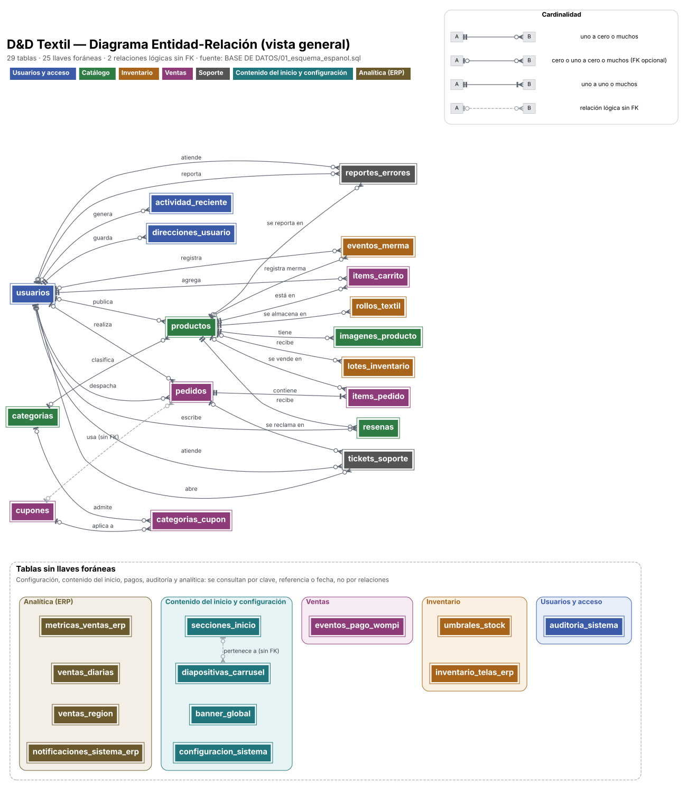
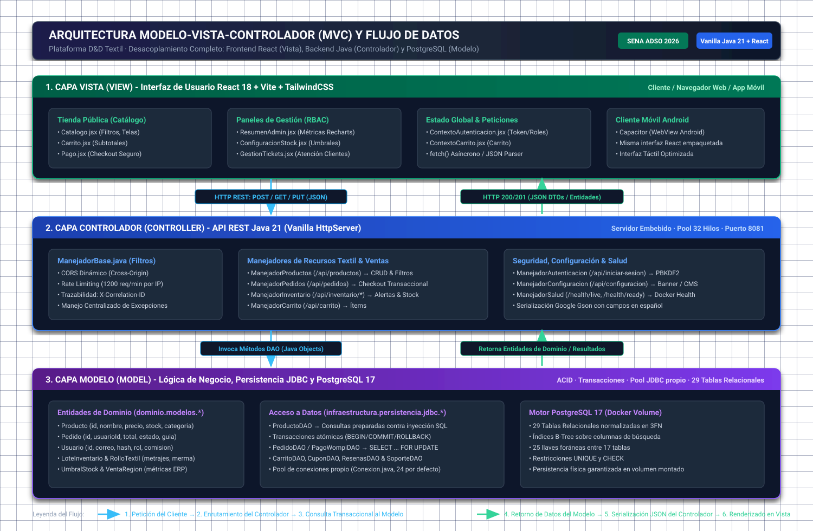
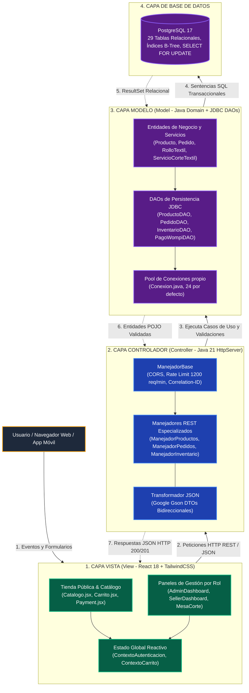
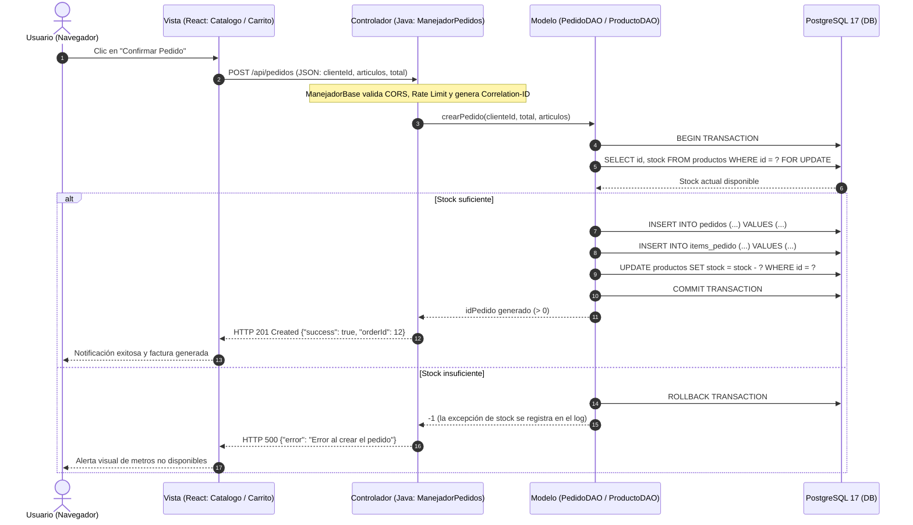

# Diseno, Estructura y Esquema de Base de Datos Relacional
**Proyecto:** Plataforma Distribuida de Comercializacion y Control Logistico Textil (D&D Textil)  
**Programa de Formacion:** Tecnologo en Analisis y Desarrollo de Software (ADSO) - SENA  
**Motor de Base de Datos:** PostgreSQL 17 (Codificacion UTF-8)  
**Version:** 2.0.0 - Documentacion Tecnica Oficial  

---

## 1. Diseno Arquitectonico de la Base de Datos

El modelo de datos de **D&D Textil** esta implementado sobre el motor relacional **PostgreSQL 17**, optimizado para garantizar la integridad transaccional (ACID), alta concurrencia mediante bloqueos a nivel de fila y consistencia estricta en el inventario fisico de telas.

### Principios de Diseno Aplicados:
1. **Normalizacion hasta Tercera Forma Normal (3FN):** Se eliminaron redundancias en catalogos, cupones y transacciones, manteniendo claves foraneas con restricciones de integridad referencial (`ON DELETE CASCADE` o `ON DELETE SET NULL` segun corresponda).
2. **Precision Decimal en Metrajes y Moneda:** Los precios y valores monetarios se modelan con el tipo `NUMERIC(12,2)` para prevenir errores de coma flotante en pesos colombianos (COP). Las longitudes de metraje de telas se modelan con `NUMERIC(10,2)` permitiendo fraccionamientos exactos de dos decimales (centimetros).
3. **Manejo Seguro de Identificadores y Seguridad:** Las contrasenas se almacenan en campos `VARCHAR(255)` que albergan el hash PBKDF2WithHmacSHA256 (10 000 iteraciones y sal aleatoria). Las cuentas antiguas con SHA-256 se siguen aceptando como respaldo. No se almacena ninguna informacion referente a tarjetas de credito o claves bancarias (cumplimiento PCI-DSS).

---

## 2. Modelo Relacional y Diagrama Entidad-Relación (DER)

El modelo relacional traduce los requerimientos del negocio textil a un conjunto de relaciones normalizadas en **Tercera Forma Normal (3FN)**, garantizando atomicidad, eliminación de redundancias y consistencia de claves primarias y foráneas.

### 2.1. Diagrama Gráfico Vectorial del Modelo Relacional

A continuación se presenta el **diagrama entidad-relación** de las 29 tablas, agrupadas por módulo con colores, con sus 25 llaves foráneas. Se genera directamente desde `01_esquema_espanol.sql` con `documentacion/diagramas/fuentes/generar_der.py`, así que siempre coincide con el esquema:

> **Nota:** La versión con todas las columnas está en [der_completo.svg](diagramas/der_completo.svg). Los archivos `modelo_relacional.svg` y `modelo_relacional_actualizado.svg` son versiones anteriores que no incluyen las tablas agregadas en noviembre.

---

### 2.2. Notación Formal del Esquema Relacional

En la notación relacional estándar (Codd / Date), cada entidad o tabla se define con sus atributos, identificando las claves primarias (**PK**) subrayadas y las claves foráneas (**FK**) que establecen integridad referencial hacia sus tablas destino:

1. **`USUARIOS`**  
    `USUARIOS(`<u>`id`</u>, `nombre`, `correo` [UK], `telefono`, `contrasena_hash`, `rol`, `activo`, `suspendido`, `motivo_suspension`, `tasa_comision`, `registrado_en`, `ultimo_acceso`)

2. **`DIRECCIONES_USUARIO`**  
    `DIRECCIONES_USUARIO(`<u>`id`</u>, `usuario_id` [FK &rarr; `USUARIOS.id`], `etiqueta`, `nombre_destinatario`, `telefono`, `direccion`, `ciudad`, `departamento`, `codigo_postal`, `predeterminada`, `creado_en`)

3. **`CATEGORIAS`**  
    `CATEGORIAS(`<u>`id`</u>, `nombre` [UK], `descripcion`, `creado_en`)

4. **`PRODUCTOS`**  
    `PRODUCTOS(`<u>`id`</u>, `nombre`, `categoria_id` [FK &rarr; `CATEGORIAS.id`], `precio`, `vendedor_id` [FK &rarr; `USUARIOS.id`], `descripcion`, `material`, `ancho`, `peso`, `cuidados`, `stock`, `destacado`, `activo`, `estado_moderacion`, `motivo_rechazo`, `es_nueva_coleccion`, `es_exclusivo`, `es_oferta`, `creado_en`, `actualizado_en`)

5. **`IMAGENES_PRODUCTO`**  
    `IMAGENES_PRODUCTO(`<u>`id`</u>, `producto_id` [FK &rarr; `PRODUCTOS.id`], `url_imagen`, `orden_visualizacion`)

6. **`ROLLOS_TEXTIL`**  
    `ROLLOS_TEXTIL(`<u>`id`</u>, `producto_id` [FK &rarr; `PRODUCTOS.id`], `codigo_rollo` [UK], `metraje_inicial`, `metraje_remanente`, `lote_tintoreria`, `estado`, `ubicacion_bodega`, `creado_en`, `actualizado_en`)

7. **`LOTES_INVENTARIO`**  
    `LOTES_INVENTARIO(`<u>`id`</u>, `producto_id` [FK &rarr; `PRODUCTOS.id`], `numero_lote`, `metros_recibidos`, `metros_actuales`, `costo_por_metro`, `proveedor`, `estado`, `fecha_recepcion`, `notas`, `creado_en`)

8. **`EVENTOS_MERMA`**  
    `EVENTOS_MERMA(`<u>`id`</u>, `producto_id` [FK &rarr; `PRODUCTOS.id`], `id_lote`, `metros_perdidos`, `motivo`, `descripcion`, `impacto_costo`, `responsable`, `usuario_id` [FK &rarr; `USUARIOS.id`], `creado_en`)

9. **`UMBRALES_STOCK`**  
    `UMBRALES_STOCK(`<u>`id`</u>, `tipo_tela` [UK], `metros_minimos`, `alerta_activa`)

10. **`INVENTARIO_TELAS_ERP`**  
    `INVENTARIO_TELAS_ERP(`<u>`id`</u>, `sku` [UK], `nombre_tela`, `categoria`, `proveedor`, `metros_actuales`, `metros_minimos`, `costo_por_metro`, `fecha_ultima_reposicion`)

11. **`PEDIDOS`**  
    `PEDIDOS(`<u>`id`</u>, `usuario_id` [FK &rarr; `USUARIOS.id`], `vendedor_id` [FK &rarr; `USUARIOS.id`], `nombre_cliente`, `correo_cliente`, `telefono_cliente`, `documento_cliente`, `direccion_envio`, `ciudad_envio`, `departamento_envio`, `monto_total`, `subtotal`, `monto_impuesto`, `costo_envio`, `monto_descuento`, `codigo_cupon`, `estado`, `metodo_pago`, `estado_pago`, `referencia_pago` [UK], `monto_centavos`, `moneda`, `wompi_transaccion_id`, `pagado_en`, `numero_guia`, `notas`, `creado_en`, `actualizado_en`)

12. **`ITEMS_PEDIDO`**  
    `ITEMS_PEDIDO(`<u>`id`</u>, `pedido_id` [FK &rarr; `PEDIDOS.id`], `producto_id` [FK &rarr; `PRODUCTOS.id`], `cantidad`, `precio_por_metro`, `subtotal`)

13. **`ITEMS_CARRITO`**  
    `ITEMS_CARRITO(`<u>`id`</u>, `usuario_id` [FK &rarr; `USUARIOS.id`], `producto_id` [FK &rarr; `PRODUCTOS.id`], `cantidad`, `agregado_en`, `actualizado_en`)

14. **`EVENTOS_PAGO_WOMPI`**  
    `EVENTOS_PAGO_WOMPI(`<u>`id`</u>, `referencia_pago`, `transaccion_id`, `estado`, `origen`, `resultado`, `carga_util`, `recibido_en`)

15. **`CUPONES`**  
    `CUPONES(`<u>`id`</u>, `codigo` [UK], `tipo_descuento`, `valor_descuento`, `expira_en`, `compra_minima`, `usos_maximos`, `solo_primera_vez`, `conteo_usos`, `activo`, `creado_en`)

16. **`CATEGORIAS_CUPON`**  
    `CATEGORIAS_CUPON(`<u>`id`</u>, `cupon_id` [FK &rarr; `CUPONES.id`], `categoria_id` [FK &rarr; `CATEGORIAS.id`])

17. **`RESENAS`**  
    `RESENAS(`<u>`id`</u>, `producto_id` [FK &rarr; `PRODUCTOS.id`], `usuario_id` [FK &rarr; `USUARIOS.id`], `calificacion`, `comentario`, `creado_en`)

18. **`TICKETS_SOPORTE`**  
    `TICKETS_SOPORTE(`<u>`id`</u>, `usuario_id` [FK &rarr; `USUARIOS.id`], `pedido_id` [FK &rarr; `PEDIDOS.id`], `nombre_usuario`, `correo_usuario`, `categoria`, `asunto`, `descripcion`, `estado`, `prioridad`, `asignado_a` [FK &rarr; `USUARIOS.id`], `creado_en`, `actualizado_en`, `resuelto_en`)

19. **`REPORTES_ERRORES`**  
    `REPORTES_ERRORES(`<u>`id`</u>, `vendedor_id` [FK &rarr; `USUARIOS.id`], `nombre_vendedor`, `correo_reportante`, `titulo`, `area`, `severidad`, `producto_id` [FK &rarr; `PRODUCTOS.id`], `nombre_producto`, `descripcion`, `pasos`, `estado`, `prioridad`, `asignado_a` [FK &rarr; `USUARIOS.id`], `reportado_en`, `resuelto_en`)

20. **`CONFIGURACION_SISTEMA`**  
    `CONFIGURACION_SISTEMA(`<u>`id`</u>, `clave` [UK], `valor`, `actualizado_en`)

21. **`SECCIONES_INICIO`**  
    `SECCIONES_INICIO(`<u>`id`</u>, `clave` [UK], `titulo`, `subtitulo`, `activo`, `orden`, `creado_en`)

22. **`DIAPOSITIVAS_CARRUSEL`**  
    `DIAPOSITIVAS_CARRUSEL(`<u>`id`</u>, `titulo`, `subtitulo`, `imagen`, `cta`, `clave_seccion`, `activo`, `orden`, `creado_en`)

23. **`BANNER_GLOBAL`**  
    `BANNER_GLOBAL(`<u>`id`</u>, `activo`, `mensaje`, `tipo_banner`, `actualizado_en`)

24. **`METRICAS_VENTAS_ERP`**  
    `METRICAS_VENTAS_ERP(`<u>`id`</u>, `fecha_registro` [UK], `ventas_reales`, `ventas_objetivo`, `margen_ganancia`, `creado_en`)

25. **`VENTAS_DIARIAS`**  
    `VENTAS_DIARIAS(`<u>`id`</u>, `fecha_venta` [UK], `ventas_totales`, `pedidos_totales`, `creado_en`)

26. **`VENTAS_REGION`**  
    `VENTAS_REGION(`<u>`id`</u>, `region` [UK], `capital`, `ventas_totales`, `pedidos_totales`, `porcentaje`, `creado_en`)

27. **`ACTIVIDAD_RECIENTE`**  
    `ACTIVIDAD_RECIENTE(`<u>`id`</u>, `tipo`, `usuario_id` [FK &rarr; `USUARIOS.id`], `nombre_usuario`, `accion`, `creado_en`)

28. **`NOTIFICACIONES_SISTEMA_ERP`**  
    `NOTIFICACIONES_SISTEMA_ERP(`<u>`id`</u>, `tipo`, `titulo`, `mensaje`, `leido`, `creado_en`)

29. **`AUDITORIA_SISTEMA`**  
    `AUDITORIA_SISTEMA(`<u>`id`</u>, `usuario_id`, `rol`, `accion`, `recurso`, `ip_origen`, `detalles`, `fecha_creacion`)

### 2.3. Diagrama Entidad-Relación (DER)

El DER completo, con las 29 tablas, las 25 llaves foráneas y su cardinalidad, está en [08-modelo-entidad-relacion.md](08-modelo-entidad-relacion.md) (imágenes [der_simple.svg](diagramas/der_simple.svg) y [der_completo.svg](diagramas/der_completo.svg), y versión Mermaid). Se mantiene en un solo documento para que no haya dos versiones distintas.

---

## 3. Diccionario de Datos Exhaustivo

Generado a partir de `BASE DE DATOS/01_esquema_espanol.sql`. «Nulo = SI» indica que la columna admite `NULL`.

### 3.1. Tabla: `usuarios`

Cuentas de clientes, vendedores y administradores, con su rol, estado y comisión.

| Columna | Tipo | Nulo | Restricción | Por defecto | Descripción |
| :--- | :--- | :---: | :---: | :--- | :--- |
| `id` | `SERIAL` | NO | **PK** | - | Identificador primario autoincremental. |
| `nombre` | `VARCHAR(100)` | NO | - | - | Nombre. |
| `correo` | `VARCHAR(150)` | NO | **UK** | - | Correo de inicio de sesión. |
| `telefono` | `VARCHAR(50)` | SI | - | - | Teléfono de contacto. |
| `contrasena_hash` | `VARCHAR(255)` | NO | - | - | Hash PBKDF2WithHmacSHA256 con sal (`pbkdf2$10000$sal$hash`); las cuentas antiguas o sembradas conservan SHA-256 y se aceptan como respaldo. |
| `rol` | `VARCHAR(50)` | SI | CHECK | `'cliente'` | Rol de acceso. Valores: `administrador`, `vendedor`, `cliente`. |
| `activo` | `BOOLEAN` | SI | - | `true` | Indica si el registro está activo o visible. |
| `suspendido` | `BOOLEAN` | SI | - | `false` | Bloqueo administrativo de la cuenta. |
| `motivo_suspension` | `TEXT` | SI | - | - | Motivo registrado al suspender. |
| `tasa_comision` | `NUMERIC(5,2)` | SI | - | - | Porcentaje de comisión del vendedor. |
| `registrado_en` | `TIMESTAMP` | SI | - | `CURRENT_TIMESTAMP` | Fecha y hora de registro. |
| `ultimo_acceso` | `TIMESTAMP` | SI | - | - | Último inicio de sesión. |

### 3.2. Tabla: `direcciones_usuario`

Libreta de direcciones de envío de cada usuario.

| Columna | Tipo | Nulo | Restricción | Por defecto | Descripción |
| :--- | :--- | :---: | :---: | :--- | :--- |
| `id` | `SERIAL` | NO | **PK** | - | Identificador primario autoincremental. |
| `usuario_id` | `INTEGER` | NO | **FK** | - | Usuario relacionado. Referencia a `usuarios(id)` (`ON DELETE CASCADE`). |
| `etiqueta` | `VARCHAR(100)` | SI | - | `'Casa'` | Nombre corto de la dirección (Casa, Oficina). |
| `nombre_destinatario` | `VARCHAR(150)` | SI | - | - | Persona que recibe. |
| `telefono` | `VARCHAR(50)` | SI | - | - | Teléfono de contacto. |
| `direccion` | `TEXT` | NO | - | - | Dirección física. |
| `ciudad` | `VARCHAR(100)` | SI | - | - | Ciudad. |
| `departamento` | `VARCHAR(100)` | SI | - | - | Departamento. |
| `codigo_postal` | `VARCHAR(20)` | SI | - | - | Código postal. |
| `predeterminada` | `BOOLEAN` | SI | - | `false` | Dirección usada por defecto. |
| `creado_en` | `TIMESTAMP` | SI | - | `CURRENT_TIMESTAMP` | Fecha y hora de creación. |

### 3.3. Tabla: `categorias`

Tipos de tela del catálogo (algodón, lino, seda…).

| Columna | Tipo | Nulo | Restricción | Por defecto | Descripción |
| :--- | :--- | :---: | :---: | :--- | :--- |
| `id` | `SERIAL` | NO | **PK** | - | Identificador primario autoincremental. |
| `nombre` | `VARCHAR(100)` | NO | **UK** | - | Nombre. |
| `descripcion` | `TEXT` | SI | - | - | Descripción. |
| `creado_en` | `TIMESTAMP` | SI | - | `CURRENT_TIMESTAMP` | Fecha y hora de creación. |

### 3.4. Tabla: `productos`

Telas publicadas: precio por metro, ficha técnica, stock, moderación y marcas de vitrina.

| Columna | Tipo | Nulo | Restricción | Por defecto | Descripción |
| :--- | :--- | :---: | :---: | :--- | :--- |
| `id` | `SERIAL` | NO | **PK** | - | Identificador primario autoincremental. |
| `nombre` | `VARCHAR(200)` | NO | - | - | Nombre. |
| `categoria_id` | `INTEGER` | SI | **FK** | - | Categoría relacionada. Referencia a `categorias(id)` (`ON DELETE SET NULL`). |
| `precio` | `NUMERIC(12,2)` | NO | CHECK | - | Precio por metro en COP. Regla: `precio >= 0`. |
| `vendedor_id` | `INTEGER` | SI | **FK** | - | Vendedor relacionado. Referencia a `usuarios(id)` (`ON DELETE SET NULL`). |
| `descripcion` | `TEXT` | SI | - | - | Descripción. |
| `material` | `VARCHAR(100)` | SI | - | - | Composición de la tela. |
| `ancho` | `VARCHAR(50)` | SI | - | - | Ancho útil del rollo. |
| `peso` | `VARCHAR(50)` | SI | - | - | Gramaje. |
| `cuidados` | `TEXT` | SI | - | - | Instrucciones de lavado y cuidado. |
| `stock` | `NUMERIC(10,2)` | SI | CHECK | `0.00` | Metros disponibles para la venta. Regla: `stock >= 0`. |
| `destacado` | `BOOLEAN` | SI | - | `false` | Se muestra entre los destacados. |
| `activo` | `BOOLEAN` | SI | - | `true` | Indica si el registro está activo o visible. |
| `estado_moderacion` | `VARCHAR(50)` | SI | - | `'approved'` | Estado de revisión del administrador (`approved`, `pending`, `rejected`). |
| `motivo_rechazo` | `TEXT` | SI | - | - | Motivo indicado al rechazar. |
| `es_nueva_coleccion` | `BOOLEAN` | SI | - | `false` | Aparece en «Nuevas colecciones». |
| `es_exclusivo` | `BOOLEAN` | SI | - | `false` | Aparece en «Exclusivas». |
| `es_oferta` | `BOOLEAN` | SI | - | `false` | Aparece en «Ofertas» (solo el administrador lo cambia). |
| `creado_en` | `TIMESTAMP` | SI | - | `CURRENT_TIMESTAMP` | Fecha y hora de creación. |
| `actualizado_en` | `TIMESTAMP` | SI | - | - | Fecha y hora de la última modificación. |

### 3.5. Tabla: `imagenes_producto`

Galería de fotos de cada tela y su orden.

| Columna | Tipo | Nulo | Restricción | Por defecto | Descripción |
| :--- | :--- | :---: | :---: | :--- | :--- |
| `id` | `SERIAL` | NO | **PK** | - | Identificador primario autoincremental. |
| `producto_id` | `INTEGER` | NO | **FK** | - | Tela relacionada. Referencia a `productos(id)` (`ON DELETE CASCADE`). |
| `url_imagen` | `TEXT` | NO | - | - | Ruta en `/uploads/` o URL de la foto. |
| `orden_visualizacion` | `INTEGER` | SI | - | `0` | Posición en la galería (0 = principal). |

### 3.6. Tabla: `rollos_textil`

Rollos físicos de cada tela con su metraje restante, lote de tintorería y ubicación. Los usa `POST /api/inventario/corte`.

| Columna | Tipo | Nulo | Restricción | Por defecto | Descripción |
| :--- | :--- | :---: | :---: | :--- | :--- |
| `id` | `SERIAL` | NO | **PK** | - | Identificador primario autoincremental. |
| `producto_id` | `INTEGER` | NO | **FK** | - | Tela relacionada. Referencia a `productos(id)` (`ON DELETE CASCADE`). |
| `codigo_rollo` | `VARCHAR(50)` | NO | **UK** | - | Código impreso en la etiqueta del rollo. |
| `metraje_inicial` | `NUMERIC(10,2)` | NO | CHECK | - | Metros con que llegó el rollo. Regla: `metraje_inicial >= 0`. |
| `metraje_remanente` | `NUMERIC(10,2)` | NO | CHECK | - | Metros que quedan tras los cortes. Regla: `metraje_remanente >= 0`. |
| `lote_tintoreria` | `VARCHAR(50)` | SI | - | - | Lote de teñido; los cortes de un pedido deben salir del mismo lote. |
| `estado` | `VARCHAR(50)` | SI | - | `'disponible'` | Estado del rollo. |
| `ubicacion_bodega` | `VARCHAR(100)` | SI | - | - | Ubicación física en bodega. |
| `creado_en` | `TIMESTAMP` | SI | - | `CURRENT_TIMESTAMP` | Fecha y hora de creación. |
| `actualizado_en` | `TIMESTAMP` | SI | - | `CURRENT_TIMESTAMP` | Fecha y hora de la última modificación. |

### 3.7. Tabla: `lotes_inventario`

Lotes de tela recibidos de proveedores.

| Columna | Tipo | Nulo | Restricción | Por defecto | Descripción |
| :--- | :--- | :---: | :---: | :--- | :--- |
| `id` | `SERIAL` | NO | **PK** | - | Identificador primario autoincremental. |
| `producto_id` | `INTEGER` | SI | **FK** | - | Tela relacionada. Referencia a `productos(id)` (`ON DELETE CASCADE`). |
| `numero_lote` | `VARCHAR(50)` | SI | - | - | Número del lote del proveedor. |
| `metros_recibidos` | `NUMERIC(10,2)` | NO | - | - | Metros recibidos. |
| `metros_actuales` | `NUMERIC(10,2)` | SI | - | - | Metros disponibles hoy. |
| `costo_por_metro` | `NUMERIC(10,2)` | NO | - | - | Costo de compra por metro. |
| `proveedor` | `VARCHAR(100)` | SI | - | - | Proveedor de la tela. |
| `estado` | `VARCHAR(50)` | SI | - | `'active'` | Estado del registro. |
| `fecha_recepcion` | `DATE` | SI | - | `CURRENT_DATE` | Fecha de llegada a bodega. |
| `notas` | `TEXT` | SI | - | - | Observaciones internas. |
| `creado_en` | `TIMESTAMP` | SI | - | `CURRENT_TIMESTAMP` | Fecha y hora de creación. |

### 3.8. Tabla: `eventos_merma`

Pérdidas de tela (daños, retazos, muestras) y su costo.

| Columna | Tipo | Nulo | Restricción | Por defecto | Descripción |
| :--- | :--- | :---: | :---: | :--- | :--- |
| `id` | `SERIAL` | NO | **PK** | - | Identificador primario autoincremental. |
| `producto_id` | `INTEGER` | SI | **FK** | - | Tela relacionada. Referencia a `productos(id)` (`ON DELETE CASCADE`). |
| `id_lote` | `VARCHAR(50)` | SI | - | - | Lote afectado (texto). |
| `metros_perdidos` | `NUMERIC(10,2)` | NO | - | - | Metros perdidos. |
| `motivo` | `VARCHAR(100)` | NO | - | - | Causa de la merma. |
| `descripcion` | `TEXT` | SI | - | - | Descripción. |
| `impacto_costo` | `NUMERIC(10,2)` | SI | - | - | Costo de la pérdida en COP. |
| `responsable` | `VARCHAR(100)` | SI | - | - | Persona que registró la merma. |
| `usuario_id` | `INTEGER` | SI | **FK** | - | Usuario relacionado. Referencia a `usuarios(id)` (`ON DELETE SET NULL`). |
| `creado_en` | `TIMESTAMP` | SI | - | `CURRENT_TIMESTAMP` | Fecha y hora de creación. |

### 3.9. Tabla: `umbrales_stock`

Metraje mínimo por tipo de tela para disparar alertas de stock bajo.

| Columna | Tipo | Nulo | Restricción | Por defecto | Descripción |
| :--- | :--- | :---: | :---: | :--- | :--- |
| `id` | `SERIAL` | NO | **PK** | - | Identificador primario autoincremental. |
| `tipo_tela` | `VARCHAR(100)` | NO | **UK** | - | Tipo de tela vigilado. |
| `metros_minimos` | `NUMERIC(10,2)` | SI | - | `20.0` | Metraje mínimo antes de alertar. |
| `alerta_activa` | `BOOLEAN` | SI | - | `true` | Activa o desactiva la alerta. |

### 3.10. Tabla: `inventario_telas_erp`

Inventario de referencia para los tableros de analítica.

| Columna | Tipo | Nulo | Restricción | Por defecto | Descripción |
| :--- | :--- | :---: | :---: | :--- | :--- |
| `id` | `SERIAL` | NO | **PK** | - | Identificador primario autoincremental. |
| `sku` | `VARCHAR(50)` | NO | **UK** | - | Código de referencia. |
| `nombre_tela` | `VARCHAR(150)` | NO | - | - | Nombre de la tela. |
| `categoria` | `VARCHAR(100)` | SI | - | - | Categoría. |
| `proveedor` | `VARCHAR(150)` | SI | - | - | Proveedor de la tela. |
| `metros_actuales` | `NUMERIC(10,2)` | SI | - | `0.00` | Metros disponibles hoy. |
| `metros_minimos` | `NUMERIC(10,2)` | SI | - | `20.00` | Metraje mínimo antes de alertar. |
| `costo_por_metro` | `NUMERIC(12,2)` | SI | - | `0.00` | Costo de compra por metro. |
| `fecha_ultima_reposicion` | `DATE` | SI | - | - | Última reposición. |

### 3.11. Tabla: `pedidos`

Encabezado de cada compra: cliente, envío, montos, estado logístico y datos del pago.

| Columna | Tipo | Nulo | Restricción | Por defecto | Descripción |
| :--- | :--- | :---: | :---: | :--- | :--- |
| `id` | `SERIAL` | NO | **PK** | - | Identificador primario autoincremental. |
| `usuario_id` | `INTEGER` | SI | **FK** | - | Usuario relacionado. Referencia a `usuarios(id)` (`ON DELETE SET NULL`). |
| `vendedor_id` | `INTEGER` | SI | **FK** | - | Vendedor relacionado. Referencia a `usuarios(id)` (`ON DELETE SET NULL`). |
| `nombre_cliente` | `VARCHAR(150)` | NO | - | - | Nombre de quien compra. |
| `correo_cliente` | `VARCHAR(150)` | NO | - | - | Correo de quien compra. |
| `telefono_cliente` | `VARCHAR(50)` | SI | - | - | Teléfono de contacto. |
| `documento_cliente` | `VARCHAR(50)` | SI | - | - | Documento de identidad para la factura. |
| `direccion_envio` | `TEXT` | NO | - | - | Dirección de entrega. |
| `ciudad_envio` | `VARCHAR(100)` | SI | - | - | Ciudad de entrega. |
| `departamento_envio` | `VARCHAR(100)` | SI | - | - | Departamento de entrega. |
| `monto_total` | `NUMERIC(12,2)` | NO | - | - | Total cobrado en COP. |
| `subtotal` | `NUMERIC(12,2)` | SI | - | - | Subtotal antes de impuestos. |
| `monto_impuesto` | `NUMERIC(12,2)` | SI | - | `0.00` | IVA (19 %). |
| `costo_envio` | `NUMERIC(12,2)` | SI | - | `0.00` | Costo del envío. |
| `monto_descuento` | `NUMERIC(12,2)` | SI | - | `0.00` | Descuento aplicado por cupón. |
| `codigo_cupon` | `VARCHAR(50)` | SI | - | - | Cupón usado. |
| `estado` | `VARCHAR(50)` | SI | - | `'pending'` | Estado logístico del pedido. |
| `metodo_pago` | `VARCHAR(50)` | SI | - | - | Medio de pago elegido. |
| `estado_pago` | `VARCHAR(50)` | SI | - | `'pending'` | Estado del pago. |
| `referencia_pago` | `VARCHAR(64)` | SI | **UK** | - | Referencia única del pago generada por el backend. |
| `monto_centavos` | `BIGINT` | SI | - | - | Total en centavos (formato de Wompi). |
| `moneda` | `VARCHAR(3)` | SI | - | `'COP'` | Moneda del pago. |
| `wompi_transaccion_id` | `VARCHAR(100)` | SI | - | - | Identificador de la transacción en Wompi, si existe. |
| `pagado_en` | `TIMESTAMP` | SI | - | - | Fecha y hora de aprobación del pago. |
| `numero_guia` | `VARCHAR(100)` | SI | - | - | Número de guía de la transportadora. |
| `notas` | `TEXT` | SI | - | - | Observaciones internas. |
| `creado_en` | `TIMESTAMP` | SI | - | `CURRENT_TIMESTAMP` | Fecha y hora de creación. |
| `actualizado_en` | `TIMESTAMP` | SI | - | - | Fecha y hora de la última modificación. |

### 3.12. Tabla: `items_pedido`

Telas y metros de cada pedido.

| Columna | Tipo | Nulo | Restricción | Por defecto | Descripción |
| :--- | :--- | :---: | :---: | :--- | :--- |
| `id` | `SERIAL` | NO | **PK** | - | Identificador primario autoincremental. |
| `pedido_id` | `INTEGER` | NO | **FK** | - | Pedido relacionado. Referencia a `pedidos(id)` (`ON DELETE CASCADE`). |
| `producto_id` | `INTEGER` | SI | **FK** | - | Tela relacionada. Referencia a `productos(id)` (`ON DELETE SET NULL`). |
| `cantidad` | `NUMERIC(10,2)` | NO | - | - | Metros (o unidades) solicitados. |
| `precio_por_metro` | `NUMERIC(12,2)` | NO | - | - | Precio por metro al momento de la compra. |
| `subtotal` | `NUMERIC(12,2)` | NO | - | - | Subtotal antes de impuestos. |

### 3.13. Tabla: `items_carrito`

Carrito guardado en el servidor por usuario.

| Columna | Tipo | Nulo | Restricción | Por defecto | Descripción |
| :--- | :--- | :---: | :---: | :--- | :--- |
| `id` | `SERIAL` | NO | **PK** | - | Identificador primario autoincremental. |
| `usuario_id` | `INTEGER` | NO | **FK** | - | Usuario relacionado. Referencia a `usuarios(id)` (`ON DELETE CASCADE`). |
| `producto_id` | `INTEGER` | NO | **FK** | - | Tela relacionada. Referencia a `productos(id)` (`ON DELETE CASCADE`). |
| `cantidad` | `NUMERIC(10,2)` | NO | CHECK | `1.00` | Metros (o unidades) solicitados. Regla: `cantidad > 0`. |
| `agregado_en` | `TIMESTAMP` | SI | - | `CURRENT_TIMESTAMP` | Fecha y hora en que se agregó. |
| `actualizado_en` | `TIMESTAMP` | SI | - | - | Fecha y hora de la última modificación. |

Restricciones de tabla: `UNIQUE (usuario_id, producto_id)`.

### 3.14. Tabla: `eventos_pago_wompi`

Bitácora de eventos de pago recibidos (webhook y confirmaciones), usada para la idempotencia.

| Columna | Tipo | Nulo | Restricción | Por defecto | Descripción |
| :--- | :--- | :---: | :---: | :--- | :--- |
| `id` | `SERIAL` | NO | **PK** | - | Identificador primario autoincremental. |
| `referencia_pago` | `VARCHAR(64)` | SI | - | - | Referencia del pedido. |
| `transaccion_id` | `VARCHAR(100)` | SI | - | - | Identificador de la transacción. |
| `estado` | `VARCHAR(30)` | SI | - | - | Estado del registro. |
| `origen` | `VARCHAR(30)` | SI | - | - | Origen del evento (webhook o confirmación). |
| `resultado` | `VARCHAR(60)` | SI | - | - | Resultado del procesamiento. |
| `carga_util` | `TEXT` | SI | - | - | Contenido recibido. |
| `recibido_en` | `TIMESTAMP` | SI | - | `CURRENT_TIMESTAMP` | Fecha y hora de recepción. |

### 3.15. Tabla: `cupones`

Cupones de descuento con sus reglas de uso.

| Columna | Tipo | Nulo | Restricción | Por defecto | Descripción |
| :--- | :--- | :---: | :---: | :--- | :--- |
| `id` | `SERIAL` | NO | **PK** | - | Identificador primario autoincremental. |
| `codigo` | `VARCHAR(50)` | NO | **UK** | - | Código que escribe el cliente. |
| `tipo_descuento` | `VARCHAR(20)` | SI | - | `'percentage'` | Porcentaje o valor fijo. |
| `valor_descuento` | `NUMERIC(10,2)` | NO | - | - | Valor del descuento. |
| `expira_en` | `TIMESTAMP` | SI | - | - | Fecha de vencimiento. |
| `compra_minima` | `NUMERIC(12,2)` | SI | - | - | Subtotal mínimo para aplicarlo. |
| `usos_maximos` | `INTEGER` | SI | - | - | Límite de usos. |
| `solo_primera_vez` | `BOOLEAN` | SI | - | `false` | Solo para la primera compra. |
| `conteo_usos` | `INTEGER` | SI | - | `0` | Usos realizados. |
| `activo` | `BOOLEAN` | SI | - | `true` | Indica si el registro está activo o visible. |
| `creado_en` | `TIMESTAMP` | SI | - | `CURRENT_TIMESTAMP` | Fecha y hora de creación. |

### 3.16. Tabla: `categorias_cupon`

Categorías a las que se limita un cupón.

| Columna | Tipo | Nulo | Restricción | Por defecto | Descripción |
| :--- | :--- | :---: | :---: | :--- | :--- |
| `id` | `SERIAL` | NO | **PK** | - | Identificador primario autoincremental. |
| `cupon_id` | `INTEGER` | SI | **FK** | - | Cupón relacionado. Referencia a `cupones(id)` (`ON DELETE CASCADE`). |
| `categoria_id` | `INTEGER` | SI | **FK** | - | Categoría relacionada. Referencia a `categorias(id)` (`ON DELETE CASCADE`). |

### 3.17. Tabla: `resenas`

Calificaciones de 1 a 5 estrellas y comentarios de los clientes.

| Columna | Tipo | Nulo | Restricción | Por defecto | Descripción |
| :--- | :--- | :---: | :---: | :--- | :--- |
| `id` | `SERIAL` | NO | **PK** | - | Identificador primario autoincremental. |
| `producto_id` | `INTEGER` | NO | **FK** | - | Tela relacionada. Referencia a `productos(id)` (`ON DELETE CASCADE`). |
| `usuario_id` | `INTEGER` | NO | **FK** | - | Usuario relacionado. Referencia a `usuarios(id)` (`ON DELETE CASCADE`). |
| `calificacion` | `INTEGER` | SI | CHECK | - | Estrellas de 1 a 5. Regla: `calificacion >= 1 AND calificacion <= 5`. |
| `comentario` | `TEXT` | NO | - | - | Texto de la reseña. |
| `creado_en` | `TIMESTAMP` | SI | - | `CURRENT_TIMESTAMP` | Fecha y hora de creación. |

Restricciones de tabla: `UNIQUE (producto_id, usuario_id)`.

### 3.18. Tabla: `tickets_soporte`

Casos de soporte y garantía abiertos por los usuarios.

| Columna | Tipo | Nulo | Restricción | Por defecto | Descripción |
| :--- | :--- | :---: | :---: | :--- | :--- |
| `id` | `SERIAL` | NO | **PK** | - | Identificador primario autoincremental. |
| `usuario_id` | `INTEGER` | SI | **FK** | - | Usuario relacionado. Referencia a `usuarios(id)` (`ON DELETE SET NULL`). |
| `pedido_id` | `INTEGER` | SI | **FK** | - | Pedido relacionado. Referencia a `pedidos(id)` (`ON DELETE SET NULL`). |
| `nombre_usuario` | `VARCHAR(100)` | SI | - | - | Nombre del usuario (copia para consulta rápida). |
| `correo_usuario` | `VARCHAR(150)` | SI | - | - | Correo de contacto. |
| `categoria` | `VARCHAR(100)` | SI | - | - | Categoría. |
| `asunto` | `VARCHAR(200)` | NO | - | - | Asunto del caso. |
| `descripcion` | `TEXT` | NO | - | - | Descripción. |
| `estado` | `VARCHAR(50)` | SI | - | `'open'` | Estado del registro. |
| `prioridad` | `VARCHAR(50)` | SI | - | `'medium'` | Prioridad de atención. |
| `asignado_a` | `INTEGER` | SI | **FK** | - | Administrador asignado al caso. Referencia a `usuarios(id)` (`ON DELETE SET NULL`). |
| `creado_en` | `TIMESTAMP` | SI | - | `CURRENT_TIMESTAMP` | Fecha y hora de creación. |
| `actualizado_en` | `TIMESTAMP` | SI | - | - | Fecha y hora de la última modificación. |
| `resuelto_en` | `TIMESTAMP` | SI | - | - | Fecha y hora de cierre. |

### 3.19. Tabla: `reportes_errores`

Reportes de fallos de la plataforma enviados desde «Reportar fallo».

| Columna | Tipo | Nulo | Restricción | Por defecto | Descripción |
| :--- | :--- | :---: | :---: | :--- | :--- |
| `id` | `SERIAL` | NO | **PK** | - | Identificador primario autoincremental. |
| `vendedor_id` | `INTEGER` | SI | **FK** | - | Vendedor relacionado. Referencia a `usuarios(id)` (`ON DELETE SET NULL`). |
| `nombre_vendedor` | `VARCHAR(100)` | SI | - | - | Nombre de quien reporta. |
| `correo_reportante` | `VARCHAR(150)` | SI | - | - | Correo de quien reporta. |
| `titulo` | `VARCHAR(200)` | SI | - | - | Título. |
| `area` | `VARCHAR(100)` | SI | - | - | Módulo afectado. |
| `severidad` | `VARCHAR(50)` | SI | - | - | Gravedad del fallo. |
| `producto_id` | `INTEGER` | SI | **FK** | - | Tela relacionada. Referencia a `productos(id)` (`ON DELETE SET NULL`). |
| `nombre_producto` | `VARCHAR(200)` | SI | - | - | Tela relacionada (texto). |
| `descripcion` | `TEXT` | NO | - | - | Descripción. |
| `pasos` | `TEXT` | SI | - | - | Pasos para reproducir el fallo. |
| `estado` | `VARCHAR(50)` | SI | - | `'new'` | Estado del registro. |
| `prioridad` | `VARCHAR(50)` | SI | - | `'medium'` | Prioridad de atención. |
| `asignado_a` | `INTEGER` | SI | **FK** | - | Administrador asignado al caso. Referencia a `usuarios(id)` (`ON DELETE SET NULL`). |
| `reportado_en` | `TIMESTAMP` | SI | - | `CURRENT_TIMESTAMP` | Fecha y hora del reporte. |
| `resuelto_en` | `TIMESTAMP` | SI | - | - | Fecha y hora de cierre. |

### 3.20. Tabla: `configuracion_sistema`

Parámetros clave-valor de la tienda (marca, contacto, notificaciones).

| Columna | Tipo | Nulo | Restricción | Por defecto | Descripción |
| :--- | :--- | :---: | :---: | :--- | :--- |
| `id` | `SERIAL` | NO | **PK** | - | Identificador primario autoincremental. |
| `clave` | `VARCHAR(100)` | NO | **UK** | - | Identificador textual único. |
| `valor` | `TEXT` | NO | - | - | Valor del parámetro. |
| `actualizado_en` | `TIMESTAMP` | SI | - | `CURRENT_TIMESTAMP` | Fecha y hora de la última modificación. |

### 3.21. Tabla: `secciones_inicio`

Apartados del inicio (nuevas colecciones, exclusivas, ofertas) y su orden.

| Columna | Tipo | Nulo | Restricción | Por defecto | Descripción |
| :--- | :--- | :---: | :---: | :--- | :--- |
| `id` | `SERIAL` | NO | **PK** | - | Identificador primario autoincremental. |
| `clave` | `VARCHAR(50)` | NO | **UK** | - | Identificador textual único. |
| `titulo` | `VARCHAR(150)` | NO | - | - | Título. |
| `subtitulo` | `VARCHAR(255)` | SI | - | - | Subtítulo. |
| `activo` | `BOOLEAN` | SI | - | `true` | Indica si el registro está activo o visible. |
| `orden` | `INTEGER` | SI | - | `1` | Posición de presentación. |
| `creado_en` | `TIMESTAMP` | SI | - | `CURRENT_TIMESTAMP` | Fecha y hora de creación. |

### 3.22. Tabla: `diapositivas_carrusel`

Diapositivas del carrusel principal.

| Columna | Tipo | Nulo | Restricción | Por defecto | Descripción |
| :--- | :--- | :---: | :---: | :--- | :--- |
| `id` | `SERIAL` | NO | **PK** | - | Identificador primario autoincremental. |
| `titulo` | `VARCHAR(150)` | NO | - | - | Título. |
| `subtitulo` | `VARCHAR(255)` | SI | - | - | Subtítulo. |
| `imagen` | `TEXT` | NO | - | - | Ruta o URL de la imagen. |
| `cta` | `VARCHAR(100)` | SI | - | - | Texto del botón de llamada a la acción. |
| `clave_seccion` | `VARCHAR(50)` | SI | - | - | Apartado al que lleva el botón. |
| `activo` | `BOOLEAN` | SI | - | `true` | Indica si el registro está activo o visible. |
| `orden` | `INTEGER` | SI | - | `1` | Posición de presentación. |
| `creado_en` | `TIMESTAMP` | SI | - | `CURRENT_TIMESTAMP` | Fecha y hora de creación. |

### 3.23. Tabla: `banner_global`

Mensaje del cintillo superior de la tienda.

| Columna | Tipo | Nulo | Restricción | Por defecto | Descripción |
| :--- | :--- | :---: | :---: | :--- | :--- |
| `id` | `SERIAL` | NO | **PK** | - | Identificador primario autoincremental. |
| `activo` | `BOOLEAN` | SI | - | `true` | Indica si el registro está activo o visible. |
| `mensaje` | `TEXT` | NO | - | - | Texto del mensaje. |
| `tipo_banner` | `VARCHAR(50)` | SI | - | `'info'` | Estilo visual del banner. |
| `actualizado_en` | `TIMESTAMP` | SI | - | `CURRENT_TIMESTAMP` | Fecha y hora de la última modificación. |

### 3.24. Tabla: `metricas_ventas_erp`

Serie de ventas reales frente al objetivo para analítica.

| Columna | Tipo | Nulo | Restricción | Por defecto | Descripción |
| :--- | :--- | :---: | :---: | :--- | :--- |
| `id` | `SERIAL` | NO | **PK** | - | Identificador primario autoincremental. |
| `fecha_registro` | `DATE` | NO | **UK** | - | Fecha del registro. |
| `ventas_reales` | `NUMERIC(15,2)` | NO | - | `0.00` | Ventas obtenidas. |
| `ventas_objetivo` | `NUMERIC(15,2)` | NO | - | `0.00` | Meta de ventas. |
| `margen_ganancia` | `NUMERIC(5,2)` | NO | - | `0.00` | Margen de ganancia. |
| `creado_en` | `TIMESTAMP` | SI | - | `CURRENT_TIMESTAMP` | Fecha y hora de creación. |

### 3.25. Tabla: `ventas_diarias`

Ventas y pedidos por día para las gráficas del panel.

| Columna | Tipo | Nulo | Restricción | Por defecto | Descripción |
| :--- | :--- | :---: | :---: | :--- | :--- |
| `id` | `SERIAL` | NO | **PK** | - | Identificador primario autoincremental. |
| `fecha_venta` | `DATE` | NO | **UK** | - | Día. |
| `ventas_totales` | `NUMERIC(14,2)` | SI | - | `0.00` | Valor total vendido. |
| `pedidos_totales` | `INTEGER` | SI | - | `0` | Número de pedidos. |
| `creado_en` | `TIMESTAMP` | SI | - | `CURRENT_TIMESTAMP` | Fecha y hora de creación. |

### 3.26. Tabla: `ventas_region`

Ventas por departamento o región de Colombia (mapa de ventas).

| Columna | Tipo | Nulo | Restricción | Por defecto | Descripción |
| :--- | :--- | :---: | :---: | :--- | :--- |
| `id` | `SERIAL` | NO | **PK** | - | Identificador primario autoincremental. |
| `region` | `VARCHAR(100)` | NO | **UK** | - | Departamento o región. |
| `capital` | `VARCHAR(100)` | SI | - | - | Ciudad capital. |
| `ventas_totales` | `NUMERIC(14,2)` | SI | - | `0.00` | Valor total vendido. |
| `pedidos_totales` | `INTEGER` | SI | - | `0` | Número de pedidos. |
| `porcentaje` | `NUMERIC(5,2)` | SI | - | `0.00` | Participación sobre el total. |
| `creado_en` | `TIMESTAMP` | SI | - | `CURRENT_TIMESTAMP` | Fecha y hora de creación. |

### 3.27. Tabla: `actividad_reciente`

Registro de acciones recientes que se muestra en el panel del administrador.

| Columna | Tipo | Nulo | Restricción | Por defecto | Descripción |
| :--- | :--- | :---: | :---: | :--- | :--- |
| `id` | `SERIAL` | NO | **PK** | - | Identificador primario autoincremental. |
| `tipo` | `VARCHAR(50)` | NO | - | - | Tipo o categoría del registro. |
| `usuario_id` | `INTEGER` | SI | **FK** | - | Usuario relacionado. Referencia a `usuarios(id)` (`ON DELETE SET NULL`). |
| `nombre_usuario` | `VARCHAR(100)` | SI | - | - | Nombre del usuario (copia para consulta rápida). |
| `accion` | `TEXT` | NO | - | - | Acción realizada. |
| `creado_en` | `TIMESTAMP` | SI | - | `CURRENT_TIMESTAMP` | Fecha y hora de creación. |

### 3.28. Tabla: `notificaciones_sistema_erp`

Avisos internos del panel de administración.

| Columna | Tipo | Nulo | Restricción | Por defecto | Descripción |
| :--- | :--- | :---: | :---: | :--- | :--- |
| `id` | `SERIAL` | NO | **PK** | - | Identificador primario autoincremental. |
| `tipo` | `VARCHAR(50)` | NO | - | - | Tipo o categoría del registro. |
| `titulo` | `VARCHAR(150)` | NO | - | - | Título. |
| `mensaje` | `TEXT` | NO | - | - | Texto del mensaje. |
| `leido` | `BOOLEAN` | SI | - | `false` | Indica si ya se leyó. |
| `creado_en` | `TIMESTAMP` | SI | - | `CURRENT_TIMESTAMP` | Fecha y hora de creación. |

### 3.29. Tabla: `auditoria_sistema`

Bitácora de auditoría de acciones sensibles (quién, qué recurso, desde qué IP).

| Columna | Tipo | Nulo | Restricción | Por defecto | Descripción |
| :--- | :--- | :---: | :---: | :--- | :--- |
| `id` | `SERIAL` | NO | **PK** | - | Identificador primario autoincremental. |
| `usuario_id` | `INTEGER` | SI | - | - | Usuario que actuó (sin llave foránea, para conservar el rastro). |
| `rol` | `VARCHAR(50)` | SI | - | - | Rol del usuario al momento de la acción. |
| `accion` | `VARCHAR(100)` | NO | - | - | Acción realizada. |
| `recurso` | `VARCHAR(100)` | SI | - | - | Recurso afectado. |
| `ip_origen` | `VARCHAR(45)` | SI | - | - | IP de origen. |
| `detalles` | `TEXT` | SI | - | - | Detalle de la acción. |
| `fecha_creacion` | `TIMESTAMP` | SI | - | `CURRENT_TIMESTAMP` | Fecha y hora de la acción. |

---

## 4. Indices de Rendimiento y Optimizacion de Consultas

Además de los índices que PostgreSQL crea automáticamente para cada `PRIMARY KEY` y cada `UNIQUE`, el esquema define estos 20 índices B-Tree:

| Índice | Tabla | Columnas |
| :--- | :--- | :--- |
| `idx_pedidos_usuario_id` | `pedidos` | `usuario_id` |
| `idx_items_pedido_pedido_id` | `items_pedido` | `pedido_id` |
| `idx_items_carrito_usuario_id` | `items_carrito` | `usuario_id` |
| `idx_resenas_producto_id` | `resenas` | `producto_id` |
| `idx_productos_vendedor_id` | `productos` | `vendedor_id` |
| `idx_imagenes_producto_producto_id` | `imagenes_producto` | `producto_id` |
| `idx_pedidos_referencia_pago` | `pedidos` | `referencia_pago` |
| `idx_eventos_wompi_referencia` | `eventos_pago_wompi` | `referencia_pago` |
| `idx_direcciones_usuario_id` | `direcciones_usuario` | `usuario_id` |
| `idx_rollos_textil_producto_id` | `rollos_textil` | `producto_id` |
| `idx_productos_activo_id` | `productos` | `activo, id` |
| `idx_productos_activo_vendedor` | `productos` | `activo, vendedor_id` |
| `idx_productos_activo_destacado` | `productos` | `activo, destacado` |
| `idx_imagenes_producto_prod_orden` | `imagenes_producto` | `producto_id, orden_visualizacion` |
| `idx_pedidos_usuario_estado` | `pedidos` | `usuario_id, estado` |
| `idx_rollos_textil_prod_estado_rem` | `rollos_textil` | `producto_id, estado, metraje_remanente` |
| `idx_cupones_codigo_activo` | `cupones` | `codigo, activo` |
| `idx_auditoria_sistema_usuario` | `auditoria_sistema` | `usuario_id` |
| `idx_auditoria_sistema_accion` | `auditoria_sistema` | `accion` |
| `idx_auditoria_sistema_fecha` | `auditoria_sistema` | `fecha_creacion` |

Cubren las consultas más frecuentes: catálogo activo, pedidos por usuario y estado, imágenes por producto en orden, rollos disponibles por producto, cupones activos por código, búsqueda de pagos por referencia y consultas de auditoría.

---

## 5. Scripts de Inicializacion Oficiales

Los scripts ejecutables de creacion de tablas, claves foraneas y datos iniciales de prueba con contrasenas encriptadas se encuentran ubicados en la carpeta raíz del repositorio:
1. `BASE DE DATOS/01_esquema_espanol.sql`: Definicion del esquema DDL completo de todas las tablas y relaciones.
2. `BASE DE DATOS/02_datos_iniciales.sql`: Carga de categorias, telas de prueba, usuarios con perfiles predeterminados y roles.
3. `BASE DE DATOS/README.md`: Documento de especificacion tecnica del modelo relacional formal y de la arquitectura MVC.

---

## 6. Integración con la Arquitectura Modelo-Vista-Controlador (MVC)

El sistema **D&D Textil** implementa el patrón arquitectónico **Modelo-Vista-Controlador (MVC)** desacoplado para aplicaciones web y móviles distribuidas (ADSO - SENA), garantizando una estricta separación de responsabilidades:

### 6.1. Diagrama Gráfico Vectorial de la Arquitectura MVC

El siguiente diagrama visual ilustra la arquitectura de tres capas, los componentes de software de cada capa, los canales de comunicación HTTP REST/JSON y JDBC, y el flujo de datos transaccional:

> **Nota:** Puedes hacer clic o abrir directamente el archivo vectorial en alta definición: [arquitectura_mvc.svg](diagramas/arquitectura_mvc.svg).

---

### 6.2. Diagrama de Flujo Arquitectónico MVC (Interacción entre Capas)

A continuación se ilustra la arquitectura de interacción desacoplada entre la **Vista**, el **Controlador**, el **Modelo** y el motor **PostgreSQL 17**, estructurada en un flujo bidireccional limpio (Petición descendente y Respuesta ascendente):

---

### 6.3. Componente M: El Modelo (Model)

El **Modelo** es el núcleo de la lógica de negocio y la persistencia de datos. Contiene los datos puros, las reglas de integridad y el acceso a la base de datos:

1. **Persistencia Relacional (PostgreSQL 17):**
   * Almacenamiento seguro, índices B-Tree de alto rendimiento, transacciones ACID y bloqueos a nivel de fila (`SELECT ... FOR UPDATE`) para evitar condiciones de carrera en compras simultáneas de tela.
2. **Entidades de Dominio (`dominio.modelos.*`):**
   * 19 clases Java en `dominio.modelos` (`Producto`, `Pedido`, `Usuario`, `ItemCarrito`, `RolloTextil`, `LoteInventario`, `EventoMerma`, `Cupon`, `Resena`, `TicketSoporte`, `ReporteError`, `UmbralStock`, `VentaRegion`, `VentaDiaria`, `ActividadReciente`, `BannerGlobal`, `DiapositivaCarrusel`, `SeccionInicio` y el registro `TransaccionWompi`).
   * Manejo bilingüe con anotaciones `@SerializedName` de Google Gson para serialización transparente.
3. **Objetos de Acceso a Datos (`infraestructura.persistencia.jdbc.*`):**
   * DAOs especializados (`ProductoDAO`, `PedidoDAO`, `InventarioDAO`, `CarritoDAO`, `CuponDAO`, `ResenasDAO`, `SoporteDAO`, `CarruselDAO`, `SeccionesInicioDAO`, `ConfiguracionDAO`, `PagoWompiDAO`) y el repositorio de usuarios `JdbcRepositorioUsuarioImpl`. `MigradorEsquemaPagos` crea al iniciar las tablas de pagos, direcciones y auditoría si faltan.
   * Consultas SQL parametrizadas mediante `PreparedStatement` para mitigar ataques de inyección SQL (OWASP Top 10).

### 6.4. Componente V: La Vista (View)

La **Vista** es la interfaz visual reactiva con la que interactúan los diferentes actores del sistema (Clientes, Vendedores, Administradores):

1. **Frontend React 18 + Vite:**
   * Estructura SPA (Single Page Application) modular y desacoplada del backend.
   * Estilizado con Tailwind CSS bajo principios de ergonomía visual y accesibilidad (WCAG 2.1).
2. **Componentes Clave de Vista:**
   * `src/paginas/Catalogo.jsx`: Renderizado del catálogo textil con filtros dinámicos por tipo de tela y precio.
   * `src/paginas/Carrito.jsx`: Carrito con cálculo de totales y aplicación de cupones.
   * `src/paginas/admin/ResumenAdmin.jsx`: Panel de control con gráficos Recharts para métricas comerciales.
   * `src/paginas/admin/Inventario/ConfiguracionStock.jsx`: Vista de configuración de umbrales y alertas de stock.
3. **Consumo Desacoplado:**
   * La Vista no accede jamás de forma directa a la base de datos; delega toda obtención de información mediante peticiones asíncronas `fetch()` hacia la API REST.

### 6.5. Componente C: El Controlador (Controller)

El **Controlador** actúa como puente intermediario e inteligente entre la Vista y el Modelo. Recibe las peticiones HTTP, orquesta las validaciones de seguridad y coordina el flujo de respuesta:

1. **Manejador Base (`ManejadorBase.java`):**
   * Hereda de `HttpHandler` del servidor embebido de Java.
   * Aplica políticas DevSecOps globales: cabeceras CORS dinámicas, Rate Limiting por IP (1200 req/min), inyección de `X-Correlation-ID` para trazabilidad y logs estructurados en JSON.
2. **Controladores Especializados (`infraestructura.api.manejadores.*`):**
   * `ManejadorProductos`: Gestiona las rutas `/api/productos` (GET, POST, PUT, DELETE).
   * `ManejadorPedidos`: Orquesta la creación transaccional de órdenes, validando stock disponible y calculando totales con impuestos.
   * `ManejadorInventario`: Procesa métricas de lotes, mermas, umbrales y ventas regionales.
   * `ManejadorCarrito`: Gestiona las adiciones, actualizaciones y vaciado del carrito de compras.
   * `ManejadorSalud`: Expone `/health/live` y `/health/ready` para auditoría y observabilidad en Docker.

### 6.6. Vistas de Base de Datos (SQL Views)

El esquema actual **no define vistas SQL** (`CREATE VIEW`). Las consultas de agregación (métricas de ventas, alertas de stock, resumen de facturas) se escriben directamente en los DAO, principalmente `InventarioDAO` y `PedidoDAO`, con `PreparedStatement`. Si más adelante se crean vistas, deben agregarse a `01_esquema_espanol.sql` y documentarse aquí.

### 6.7. Ciclo de Vida Transaccional MVC (Ejemplo: Compra y Descuento de Stock)

A continuación se ilustra la interacción coordinada entre la Vista, el Controlador, el Modelo y la Base de Datos PostgreSQL con el endpoint `POST /api/pedidos` (`PedidoDAO`).

> **Nota:** el checkout de la tienda no usa este endpoint sino `POST /api/pagos/intencion` (`PagoWompiDAO`), que valida el stock sin descontarlo y lo descuenta al aprobar el pago. Ver el doc 12, «Realizar compra».

---

## Anexo de Consultas Seguras en `PedidoDAO`: Proyección por Cliente y por Vendedor

Para respaldar el control de acceso basado en roles (RBAC) desde la capa de datos:

- **Consulta por cliente (`obtenerPedidosPorUsuario(int idUsuario)`):** filtra con `WHERE o.usuario_id = ?`, de modo que nunca se cargan pedidos de otros clientes.
- **Consulta por vendedor (`obtenerPedidosPorVendedor(int idVendedor)`):** filtra con `WHERE o.vendedor_id = ?`.
- **Administrador (`obtenerTodosLosPedidos()`):** sin filtro.
- **Detalle de un pedido:** `ManejadorPedidos` lo entrega solo si quien consulta es el administrador, el cliente dueño (`usuario_id`) o el vendedor del pedido (`vendedor_id`).

> **Nota:** el diagrama 6.7 muestra el comportamiento real cuando falta stock: `PedidoDAO` deshace la transacción y devuelve `-1`, y el manejador responde **500** con «Error al crear el pedido». Sería más claro responder 409 con el motivo.
