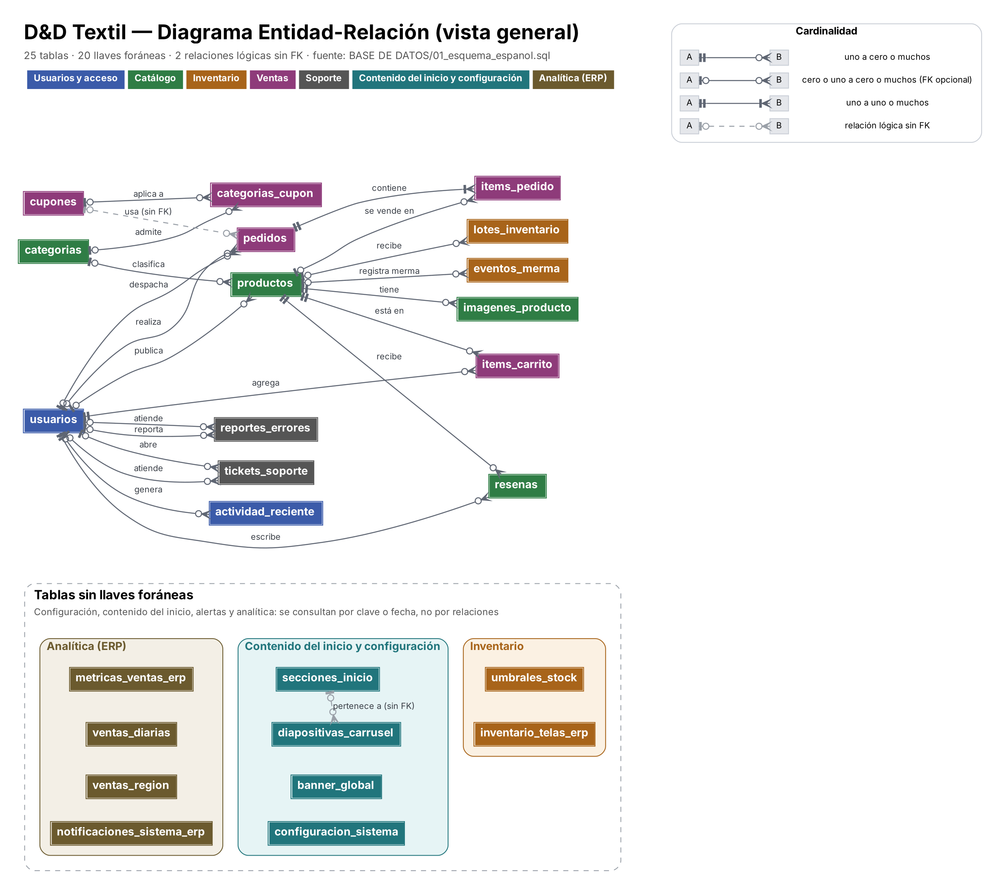
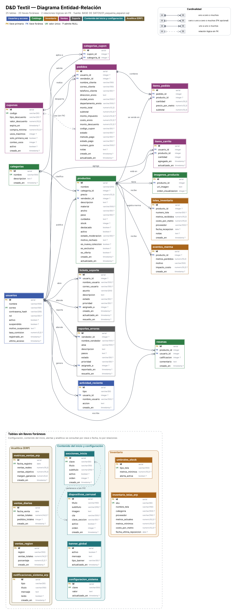

# Modelo Entidad-Relación (DER) — D&D Textil

> Fuente única: `BASE DE DATOS/01_esquema_espanol.sql`, que es el esquema que usan los DAO del backend (`infraestructura/persistencia/jdbc`). Este documento reemplaza el DER de 8 tablas de `04-base-de-datos-diseno-y-esquema.md` (sección 2.2) y de `BASE DE DATOS/README.md`, que no incluía 17 tablas y mostraba una tabla `ROLLOS_TEXTIL` que no existe en el esquema.

## 1. Resumen

| Dato | Valor |
| :--- | :--- |
| Tablas | 25 |
| Llaves foráneas (FK) | 20 |
| Relaciones lógicas sin FK | 2 |
| Tablas con relaciones | 15 |
| Tablas independientes | 10 |

**Tablas por módulo**

| Módulo | Tablas |
| :--- | :--- |
| Usuarios y acceso | `usuarios`, `actividad_reciente` |
| Catálogo | `categorias`, `productos`, `imagenes_producto`, `resenas` |
| Inventario | `lotes_inventario`, `eventos_merma`, `umbrales_stock`, `inventario_telas_erp` |
| Ventas | `items_carrito`, `pedidos`, `items_pedido`, `cupones`, `categorias_cupon` |
| Soporte | `tickets_soporte`, `reportes_errores` |
| Contenido del inicio y configuración | `secciones_inicio`, `diapositivas_carrusel`, `banner_global`, `configuracion_sistema` |
| Analítica (ERP) | `metricas_ventas_erp`, `ventas_diarias`, `ventas_region`, `notificaciones_sistema_erp` |

## 2. Diagramas

Vista general (entidades y relaciones), útil para presentaciones:

Vista completa con atributos, tipos y llaves, útil para el informe técnico:

Las versiones vectoriales están en `diagramas/der_simple.svg` y `diagramas/der_completo.svg`.

**Cómo leer la notación (pata de gallo):** la barra `|` indica *uno*, el círculo `o` indica *cero* (opcional) y la pata de gallo indica *muchos*. El símbolo más cercano a la tabla es el máximo; el más lejano, el mínimo. La línea punteada marca una relación que el código usa pero que la base de datos no obliga con una FOREIGN KEY.

### 2.1. Diagrama en Mermaid (se dibuja directamente en GitHub)

```mermaid
erDiagram
    CATEGORIAS |o--o{ PRODUCTOS : "clasifica"
    USUARIOS |o--o{ PRODUCTOS : "publica"
    PRODUCTOS ||--o{ IMAGENES_PRODUCTO : "tiene"
    PRODUCTOS |o--o{ LOTES_INVENTARIO : "recibe"
    PRODUCTOS |o--o{ EVENTOS_MERMA : "registra merma"
    CUPONES |o--o{ CATEGORIAS_CUPON : "aplica a"
    CATEGORIAS |o--o{ CATEGORIAS_CUPON : "admite"
    USUARIOS |o--o{ PEDIDOS : "realiza"
    USUARIOS |o--o{ PEDIDOS : "despacha"
    PEDIDOS ||--|{ ITEMS_PEDIDO : "contiene"
    PRODUCTOS |o--o{ ITEMS_PEDIDO : "se vende en"
    USUARIOS ||--o{ ITEMS_CARRITO : "agrega"
    PRODUCTOS ||--o{ ITEMS_CARRITO : "está en"
    PRODUCTOS ||--o{ RESENAS : "recibe"
    USUARIOS ||--o{ RESENAS : "escribe"
    USUARIOS |o--o{ TICKETS_SOPORTE : "abre"
    USUARIOS |o--o{ TICKETS_SOPORTE : "atiende"
    USUARIOS |o--o{ REPORTES_ERRORES : "reporta"
    USUARIOS |o--o{ REPORTES_ERRORES : "atiende"
    USUARIOS |o--o{ ACTIVIDAD_RECIENTE : "genera"
    SECCIONES_INICIO |o..o{ DIAPOSITIVAS_CARRUSEL : "pertenece a (sin FK)"
    CUPONES |o..o{ PEDIDOS : "usa (sin FK)"

    USUARIOS {
        int id PK
        varchar nombre
        varchar correo UK
        varchar contrasena_hash
        varchar rol
        bool activo
        bool suspendido
        text motivo_suspension
        numeric tasa_comision
        timestamp registrado_en
        timestamp ultimo_acceso
    }
    CATEGORIAS {
        int id PK
        varchar nombre UK
        text descripcion
        timestamp creado_en
    }
    PRODUCTOS {
        int id PK
        varchar nombre
        int categoria_id FK
        numeric precio
        int vendedor_id FK
        text descripcion
        varchar material
        varchar ancho
        varchar peso
        text cuidados
        int stock
        bool destacado
        bool activo
        varchar estado_moderacion
        text motivo_rechazo
        bool es_nueva_coleccion
        bool es_exclusivo
        bool es_oferta
        timestamp creado_en
        timestamp actualizado_en
    }
    IMAGENES_PRODUCTO {
        int id PK
        int producto_id FK
        text url_imagen
        int orden_visualizacion
    }
    LOTES_INVENTARIO {
        int id PK
        int producto_id FK
        varchar numero_lote
        numeric metros_recibidos
        numeric costo_por_metro
        varchar proveedor
        date fecha_recepcion
        text notas
        timestamp creado_en
    }
    EVENTOS_MERMA {
        int id PK
        int producto_id FK
        numeric metros_perdidos
        varchar motivo
        numeric impacto_costo
        timestamp creado_en
    }
    UMBRALES_STOCK {
        int id PK
        varchar tipo_tela UK
        numeric metros_minimos
        bool alerta_activa
    }
    CUPONES {
        int id PK
        varchar codigo UK
        varchar tipo_descuento
        numeric valor_descuento
        timestamp expira_en
        numeric compra_minima
        int usos_maximos
        bool solo_primera_vez
        int conteo_usos
        bool activo
        timestamp creado_en
    }
    CATEGORIAS_CUPON {
        int id PK
        int cupon_id FK
        int categoria_id FK
    }
    PEDIDOS {
        int id PK
        int usuario_id FK
        int vendedor_id FK
        varchar nombre_cliente
        varchar correo_cliente
        varchar telefono_cliente
        text direccion_envio
        varchar ciudad_envio
        varchar departamento_envio
        numeric monto_total
        numeric subtotal
        numeric monto_impuesto
        numeric costo_envio
        numeric monto_descuento
        varchar codigo_cupon
        varchar estado
        varchar metodo_pago
        varchar estado_pago
        varchar numero_guia
        text notas
        timestamp creado_en
        timestamp actualizado_en
    }
    ITEMS_PEDIDO {
        int id PK
        int pedido_id FK
        int producto_id FK
        numeric cantidad
        numeric precio_por_metro
        numeric subtotal
    }
    ITEMS_CARRITO {
        int id PK
        int usuario_id FK
        int producto_id FK
        int cantidad
        timestamp agregado_en
        timestamp actualizado_en
    }
    RESENAS {
        int id PK
        int producto_id FK
        int usuario_id FK
        int calificacion
        text comentario
        timestamp creado_en
    }
    TICKETS_SOPORTE {
        int id PK
        int usuario_id FK
        varchar nombre_usuario
        varchar correo_usuario
        varchar asunto
        text descripcion
        varchar estado
        varchar prioridad
        int asignado_a FK
        timestamp creado_en
        timestamp actualizado_en
        timestamp resuelto_en
    }
    REPORTES_ERRORES {
        int id PK
        int vendedor_id FK
        varchar nombre_vendedor
        varchar area
        text descripcion
        text pasos
        varchar estado
        varchar prioridad
        int asignado_a FK
        timestamp reportado_en
        timestamp resuelto_en
    }
    CONFIGURACION_SISTEMA {
        int id PK
        varchar clave UK
        text valor
        timestamp actualizado_en
    }
    SECCIONES_INICIO {
        int id PK
        varchar clave UK
        varchar titulo
        varchar subtitulo
        bool activo
        int orden
        timestamp creado_en
    }
    DIAPOSITIVAS_CARRUSEL {
        int id PK
        varchar titulo
        varchar subtitulo
        text imagen
        varchar cta
        varchar clave_seccion
        bool activo
        int orden
        timestamp creado_en
    }
    BANNER_GLOBAL {
        int id PK
        bool activo
        text mensaje
        varchar tipo_banner
        timestamp actualizado_en
    }
    METRICAS_VENTAS_ERP {
        int id PK
        date fecha_registro UK
        numeric ventas_reales
        numeric ventas_objetivo
        numeric margen_ganancia
        timestamp creado_en
    }
    VENTAS_DIARIAS {
        int id PK
        date fecha_venta UK
        numeric ventas_totales
        int pedidos_totales
        timestamp creado_en
    }
    VENTAS_REGION {
        int id PK
        varchar region
        numeric ventas_totales
        numeric porcentaje
        timestamp creado_en
    }
    ACTIVIDAD_RECIENTE {
        int id PK
        varchar tipo
        int usuario_id FK
        varchar nombre_usuario
        text accion
        timestamp creado_en
    }
    NOTIFICACIONES_SISTEMA_ERP {
        int id PK
        varchar tipo
        varchar titulo
        text mensaje
        bool leido
        timestamp creado_en
    }
    INVENTARIO_TELAS_ERP {
        int id PK
        varchar sku UK
        varchar nombre_tela
        varchar categoria
        varchar proveedor
        numeric metros_actuales
        numeric metros_minimos
        numeric costo_por_metro
        date fecha_ultima_reposicion
    }
```

## 3. Relaciones

| # | Tabla padre | Tabla hija (columna FK) | Cardinalidad | Significado | Al borrar el padre |
| :-: | :--- | :--- | :-: | :--- | :--- |
| 1 | `categorias` | `productos.categoria_id` | 0..1 : 0..N | categorias **clasifica** productos | queda en NULL |
| 2 | `usuarios` | `productos.vendedor_id` | 0..1 : 0..N | usuarios **publica** productos | queda en NULL |
| 3 | `productos` | `imagenes_producto.producto_id` | 1 : 0..N | productos **tiene** imagenes_producto | se borran en cascada |
| 4 | `productos` | `lotes_inventario.producto_id` | 0..1 : 0..N | productos **recibe** lotes_inventario | se borran en cascada |
| 5 | `productos` | `eventos_merma.producto_id` | 0..1 : 0..N | productos **registra merma** eventos_merma | se borran en cascada |
| 6 | `cupones` | `categorias_cupon.cupon_id` | 0..1 : 0..N | cupones **aplica a** categorias_cupon | se borran en cascada |
| 7 | `categorias` | `categorias_cupon.categoria_id` | 0..1 : 0..N | categorias **admite** categorias_cupon | se borran en cascada |
| 8 | `usuarios` | `pedidos.usuario_id` | 0..1 : 0..N | usuarios **realiza** pedidos | queda en NULL |
| 9 | `usuarios` | `pedidos.vendedor_id` | 0..1 : 0..N | usuarios **despacha** pedidos | queda en NULL |
| 10 | `pedidos` | `items_pedido.pedido_id` | 1 : 1..N | pedidos **contiene** items_pedido | se borran en cascada |
| 11 | `productos` | `items_pedido.producto_id` | 0..1 : 0..N | productos **se vende en** items_pedido | queda en NULL |
| 12 | `usuarios` | `items_carrito.usuario_id` | 1 : 0..N | usuarios **agrega** items_carrito | se borran en cascada |
| 13 | `productos` | `items_carrito.producto_id` | 1 : 0..N | productos **está en** items_carrito | se borran en cascada |
| 14 | `productos` | `resenas.producto_id` | 1 : 0..N | productos **recibe** resenas | se borran en cascada |
| 15 | `usuarios` | `resenas.usuario_id` | 1 : 0..N | usuarios **escribe** resenas | se borran en cascada |
| 16 | `usuarios` | `tickets_soporte.usuario_id` | 0..1 : 0..N | usuarios **abre** tickets_soporte | queda en NULL |
| 17 | `usuarios` | `tickets_soporte.asignado_a` | 0..1 : 0..N | usuarios **atiende** tickets_soporte | queda en NULL |
| 18 | `usuarios` | `reportes_errores.vendedor_id` | 0..1 : 0..N | usuarios **reporta** reportes_errores | queda en NULL |
| 19 | `usuarios` | `reportes_errores.asignado_a` | 0..1 : 0..N | usuarios **atiende** reportes_errores | queda en NULL |
| 20 | `usuarios` | `actividad_reciente.usuario_id` | 0..1 : 0..N | usuarios **genera** actividad_reciente | queda en NULL |

Notas sobre las relaciones:

- `usuarios` participa con distintos papeles: como **cliente** (`pedidos.usuario_id`, `resenas`, `items_carrito`), como **vendedor** (`productos.vendedor_id`, `pedidos.vendedor_id`, `reportes_errores.vendedor_id`) y como **personal de soporte** (`asignado_a` en tickets y reportes). El papel depende de la columna `rol`.
- `categorias_cupon` es una tabla intermedia que resuelve la relación muchos a muchos entre `cupones` y `categorias`.
- `items_pedido` guarda `precio_por_metro` al momento de la compra, así el histórico no cambia si luego sube el precio del producto.
- La cardinalidad 1..N de `pedidos → items_pedido` es una regla de negocio (no hay pedidos vacíos); la base de datos no la puede forzar.

### 3.1. Relaciones lógicas (sin FOREIGN KEY)

| Tabla hija.columna | Apunta a | Riesgo |
| :--- | :--- | :--- |
| `pedidos.codigo_cupon` | `cupones.codigo` | Se puede guardar un código de cupón que no existe o que luego se borra. |
| `diapositivas_carrusel.clave_seccion` | `secciones_inicio.clave` | Una diapositiva puede quedar asociada a una sección inexistente y no mostrarse. |

### 3.2. Tablas independientes

Estas tablas no tienen llaves foráneas porque se consultan por clave, fecha o código:

- **Inventario:** `umbrales_stock`, `inventario_telas_erp`
- **Contenido del inicio y configuración:** `secciones_inicio`, `diapositivas_carrusel`, `banner_global`, `configuracion_sistema`
- **Analítica (ERP):** `metricas_ventas_erp`, `ventas_diarias`, `ventas_region`, `notificaciones_sistema_erp`

## 4. Observaciones del esquema (para corregir o justificar)

1. **Dos esquemas a la vez.** Docker monta toda la carpeta `BASE DE DATOS/` como scripts de inicio, así que además de las 25 tablas en español se crean las 25 tablas en inglés de `TIENDA DIGITAL TEXTIL.sql` (`orders`, `users`, `products`…). El backend escribe los pedidos en `pedidos`, pero `ManejadorFactura` lee las facturas desde `orders`/`order_items`/`users`/`products`, por lo que un pedido nuevo no aparece en facturación. Conviene dejar un solo esquema y mover el volcado en inglés fuera de esa carpeta.
2. **Columnas duplicadas.** `02_datos_iniciales.sql` agrega columnas alias en inglés (`name`, `email`, `role`, `code`, `active`…) y copia los valores una sola vez; después pueden quedar desincronizadas. No se incluyen en el DER.
3. **Metros enteros en el carrito.** `items_carrito.cantidad` y `productos.stock` son `INTEGER`, mientras que `items_pedido.cantidad` es `NUMERIC(10,2)`. Si se venden fracciones de metro (1,5 m), el carrito no las puede guardar.
4. **FK opcionales que deberían ser obligatorias.** `lotes_inventario.producto_id`, `eventos_merma.producto_id` y las dos columnas de `categorias_cupon` admiten NULL; un lote o una merma sin producto no tiene sentido.
5. **Faltan restricciones UNIQUE compuestas.** Nada impide repetir el mismo producto dos veces en el carrito de un usuario (`items_carrito(usuario_id, producto_id)`) ni la misma pareja en `categorias_cupon(cupon_id, categoria_id)`.
6. **Valores libres en columnas de estado.** `usuarios.rol`, `pedidos.estado`, `pedidos.estado_pago` y `tickets_soporte.estado` son `VARCHAR` sin `CHECK`; un error de escritura crea un estado nuevo.
7. **Inventario duplicado.** `inventario_telas_erp` repite datos de `productos` y `lotes_inventario` (nombre, categoría como texto, costo por metro) sin relación con ellas.
