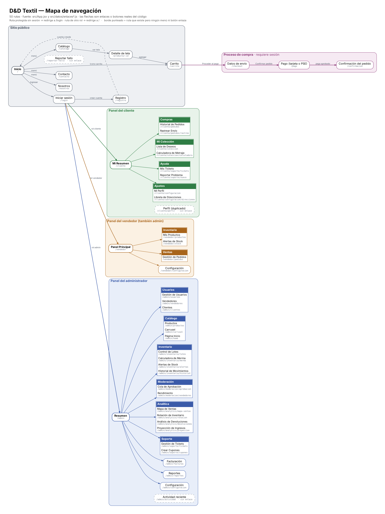
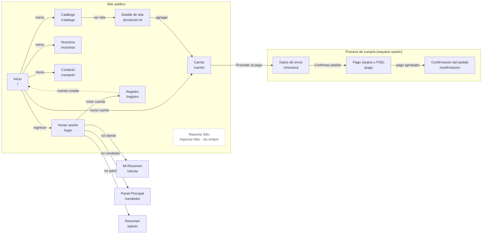
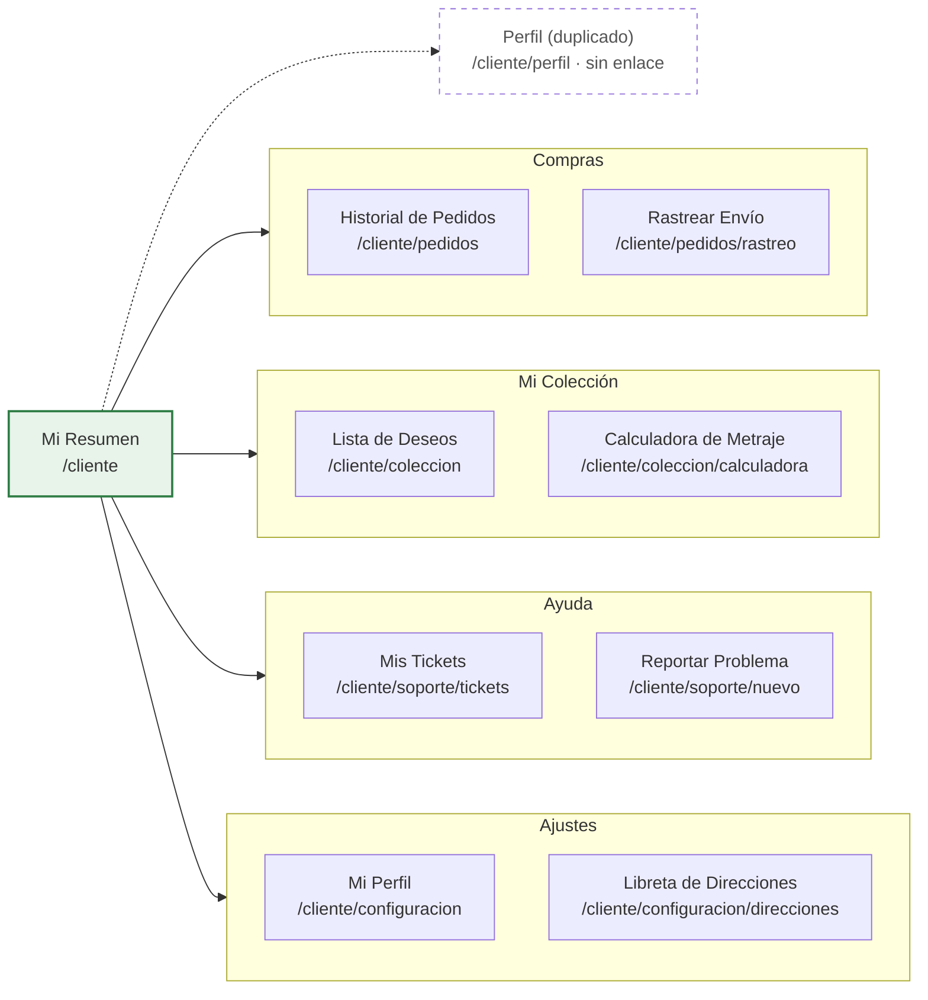
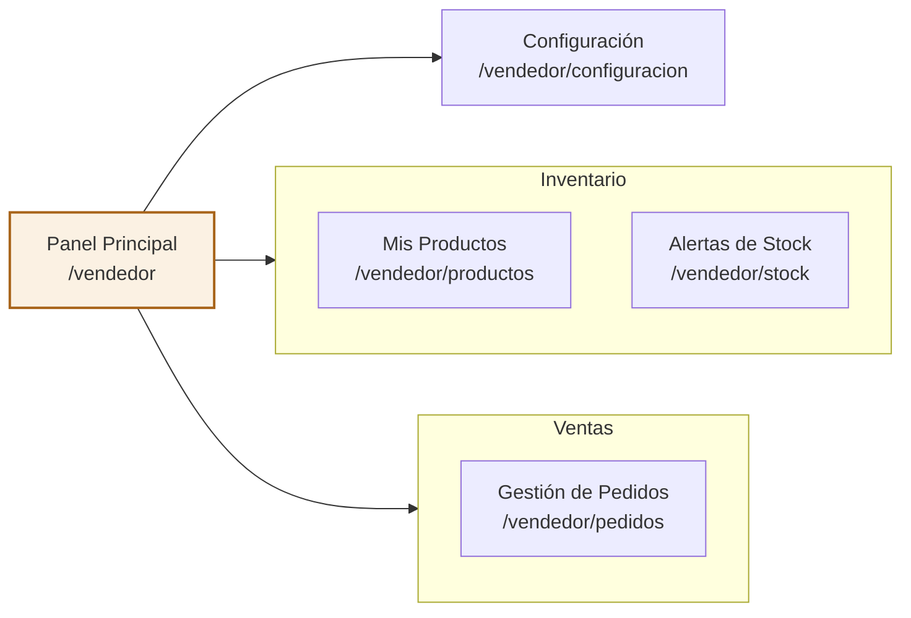
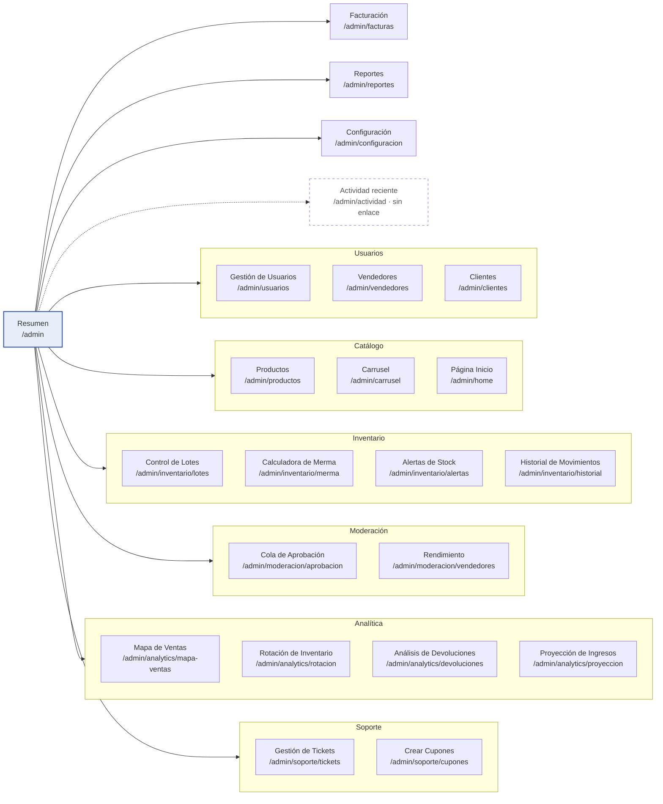

# Mapa de navegación — D&D Textil

> Generado a partir del código: las 50 rutas de `tienda digital de telas/src/App.jsx`, los menús laterales de `src/datos/enlacesCliente.js`, `enlacesVendedor.js` y `enlacesAdmin.js`, y los enlaces del encabezado, carrito y pago. Reemplaza la sección 4 de `03-arquitectura-frontend-y-roles.md` (que solo cubría las vistas públicas) y la imagen `public/images/diagrams/mapa-navegacion.png`.

## 1. Diagrama general

Versión vectorial: `diagramas/mapa_navegacion.svg`.

**Reglas de acceso** (componente `ProtectedRoute`):

- Si una ruta protegida se abre sin sesión, redirige a `/login` guardando la ruta pedida (ver observación 4).
- Si el usuario tiene sesión pero no el rol requerido, redirige a `/`.
- Al iniciar sesión, `IniciarSesion.jsx` envía a cada rol a su panel: cliente → `/cliente`, vendedor → `/vendedor`, admin → `/admin`.
- El administrador también puede entrar al panel del vendedor (rutas con `roles={['vendedor','admin']}`).

## 2. Diagramas por sección (se dibujan en GitHub)

### 2.1. Sitio público y proceso de compra

### 2.2. Panel del cliente

### 2.3. Panel del vendedor

### 2.4. Panel del administrador

## 3. Inventario de rutas

| # | Ruta | Pantalla | Componente | Acceso | Cómo se llega |
| :-: | :--- | :--- | :--- | :--- | :--- |
| 1 | `/` | Inicio | `Inicio` | Pública | Logo y menú superior |
| 2 | `/catalogo` | Catálogo | `Catalogo` | Pública | Menú superior y pie de página |
| 3 | `/producto/:id` | Detalle de tela | `DetalleProducto` | Pública | Tarjeta de producto en Catálogo o Inicio |
| 4 | `/carrito` | Carrito | `Carrito` | Pública | Ícono del carrito en el encabezado |
| 5 | `/nosotros` | Nosotros | `About` | Pública | Menú superior y pie de página |
| 6 | `/contacto` | Contacto | `Contact` | Pública | Menú superior y pie de página |
| 7 | `/login` | Iniciar sesión | `IniciarSesion` | Pública | Botón Ingresar del encabezado; redirección de rutas protegidas |
| 8 | `/registro` | Registro | `Registro` | Pública | Enlace desde Iniciar sesión |
| 9 | `/reportar-fallo` | Reportar fallo | `BugReport` | Pública | Ningún enlace (solo escribiendo la URL) |
| 10 | `/pago` | Pago (tarjeta o PSE) | `Payment` | Cualquier usuario con sesión | Botón «Confirmar pedido» en Datos de envío |
| 11 | `/checkout` | Datos de envío | `Pago` | Cualquier usuario con sesión | Botón «Proceder al pago» del carrito |
| 12 | `/confirmacion` | Confirmación del pedido | `ConfirmacionPedido` | Cualquier usuario con sesión | Automático tras un pago aprobado (tarjeta o PSE) |
| 13 | `/cliente` | Mi Resumen | `PanelCliente` | Cliente | Inicio de sesión con rol cliente; menú de usuario del encabezado |
| 14 | `/cliente/perfil` | Perfil (duplicado) | `Perfil` | Cliente | Ningún enlace (solo escribiendo la URL) |
| 15 | `/cliente/pedidos` | Historial de Pedidos | `ClientOrderHistory` | Cliente | Menú lateral › Compras › Historial de Pedidos |
| 16 | `/cliente/pedidos/rastreo` | Rastrear Envío | `SeguimientoPedido` | Cliente | Menú lateral › Compras › Rastrear Envío |
| 17 | `/cliente/coleccion` | Lista de Deseos | `Wishlist` | Cliente | Menú lateral › Mi Colección › Lista de Deseos |
| 18 | `/cliente/coleccion/calculadora` | Calculadora de Metraje | `ProjectCalculator` | Cliente | Menú lateral › Mi Colección › Calculadora de Metraje |
| 19 | `/cliente/soporte/nuevo` | Reportar Problema | `NewReport` | Cliente | Menú lateral › Ayuda › Reportar Problema |
| 20 | `/cliente/soporte/tickets` | Mis Tickets | `MyTickets` | Cliente | Menú lateral › Ayuda › Mis Tickets |
| 21 | `/cliente/configuracion` | Mi Perfil | `Perfil` | Cliente | Menú lateral › Ajustes › Mi Perfil |
| 22 | `/cliente/configuracion/direcciones` | Libreta de Direcciones | `AddressBook` | Cliente | Menú lateral › Ajustes › Libreta de Direcciones |
| 23 | `/vendedor` | Panel Principal | `ProductosVendedor` | Vendedor y admin | Inicio de sesión con rol vendedor |
| 24 | `/vendedor/productos` | Mis Productos | `ProductosVendedor` | Vendedor y admin | Menú lateral › Inventario › Mis Productos |
| 25 | `/vendedor/pedidos` | Gestión de Pedidos | `PedidosVendedor` | Vendedor y admin | Menú lateral › Ventas › Gestión de Pedidos |
| 26 | `/vendedor/stock` | Alertas de Stock | `StockAlerts` | Vendedor y admin | Menú lateral › Inventario › Alertas de Stock |
| 27 | `/vendedor/configuracion` | Configuración | `Perfil` | Vendedor y admin | Menú lateral › Configuración |
| 28 | `/admin` | Resumen | `ResumenAdmin` | Admin | Inicio de sesión con rol admin; menú de usuario del encabezado |
| 29 | `/admin/usuarios` | Gestión de Usuarios | `GestionUsuarios` | Admin | Menú lateral › Usuarios › Gestión de Usuarios |
| 30 | `/admin/vendedores` | Vendedores | `MetricasVendedor` | Admin | Menú lateral › Usuarios › Vendedores |
| 31 | `/admin/clientes` | Clientes | `MetricasCliente` | Admin | Menú lateral › Usuarios › Clientes |
| 32 | `/admin/productos` | Productos | `ProductosAdmin` | Admin | Menú lateral › Catálogo › Productos |
| 33 | `/admin/carrusel` | Carrusel | `GestionarCarrusel` | Admin | Menú lateral › Catálogo › Carrusel |
| 34 | `/admin/home` | Página Inicio | `GestionarInicio` | Admin | Menú lateral › Catálogo › Página Inicio |
| 35 | `/admin/facturas` | Facturación | `FacturasAdmin` | Admin | Menú lateral › Facturación |
| 36 | `/admin/reportes` | Reportes | `ReportesAdmin` | Admin | Menú lateral › Reportes |
| 37 | `/admin/actividad` | Actividad reciente | `ActividadAdmin` | Admin | Ningún enlace (solo escribiendo la URL) |
| 38 | `/admin/inventario/lotes` | Control de Lotes | `ControlLotes` | Admin | Menú lateral › Inventario › Control de Lotes |
| 39 | `/admin/inventario/merma` | Calculadora de Merma | `CalculadoraMerma` | Admin | Menú lateral › Inventario › Calculadora de Merma |
| 40 | `/admin/inventario/alertas` | Alertas de Stock | `ConfiguracionStock` | Admin | Menú lateral › Inventario › Alertas de Stock |
| 41 | `/admin/inventario/historial` | Historial de Movimientos | `HistorialMovimientos` | Admin | Menú lateral › Inventario › Historial de Movimientos |
| 42 | `/admin/moderacion/aprobacion` | Cola de Aprobación | `ColaAprobacion` | Admin | Menú lateral › Moderación › Cola de Aprobación |
| 43 | `/admin/moderacion/vendedores` | Rendimiento | `RendimientoVendedores` | Admin | Menú lateral › Moderación › Rendimiento |
| 44 | `/admin/analytics/mapa-ventas` | Mapa de Ventas | `MapaVentas` | Admin | Menú lateral › Analítica › Mapa de Ventas |
| 45 | `/admin/analytics/rotacion` | Rotación de Inventario | `RankingRotacion` | Admin | Menú lateral › Analítica › Rotación de Inventario |
| 46 | `/admin/analytics/devoluciones` | Análisis de Devoluciones | `AnalisisDevoluciones` | Admin | Menú lateral › Analítica › Análisis de Devoluciones |
| 47 | `/admin/analytics/proyeccion` | Proyección de Ingresos | `ProyeccionIngresos` | Admin | Menú lateral › Analítica › Proyección de Ingresos |
| 48 | `/admin/soporte/tickets` | Gestión de Tickets | `GestionTickets` | Admin | Menú lateral › Soporte › Gestión de Tickets |
| 49 | `/admin/soporte/cupones` | Crear Cupones | `CreacionCupones` | Admin | Menú lateral › Soporte › Crear Cupones |
| 50 | `/admin/configuracion` | Configuración | `ConfiguracionSistema` | Admin | Menú lateral › Configuración |

## 4. Observaciones de navegación

1. **Rutas sin enlace.** `/reportar-fallo`, `/cliente/perfil` y `/admin/actividad` existen en `App.jsx` pero ningún menú, botón ni enlace lleva a ellas. Hay que enlazarlas o eliminarlas.
2. **Pantallas duplicadas.** `/cliente/perfil` y `/cliente/configuracion` cargan el mismo componente `Perfil`; `/vendedor` y `/vendedor/productos` cargan el mismo `ProductosVendedor`, así que el «Panel Principal» del vendedor no es un resumen sino la lista de productos.
3. **Nombres cruzados en el pago.** `/checkout` usa el archivo `Pago.jsx` (datos de envío) y `/pago` usa `payment/Payment.jsx` (tarjeta o PSE). Conviene renombrar los archivos para que coincidan con la ruta.
4. **El login no regresa a la compra.** `IniciarSesion.jsx` guarda la ruta pedida en `from`, pero solo la usa si el rol no es cliente, vendedor ni admin. En la práctica, un cliente que pulsa «Proceder al pago» sin sesión termina en `/cliente` en vez de volver a `/checkout`.
5. **Destino distinto para el vendedor.** Tras el login va a `/vendedor`, pero el menú de usuario del encabezado lo lleva a `/vendedor/productos`.
6. **Documentación anterior.** La sección 4 de `03-arquitectura-frontend-y-roles.md` menciona `/contactos` y `/checkout/success`, que no existen; las rutas reales son `/contacto` y `/confirmacion`.
