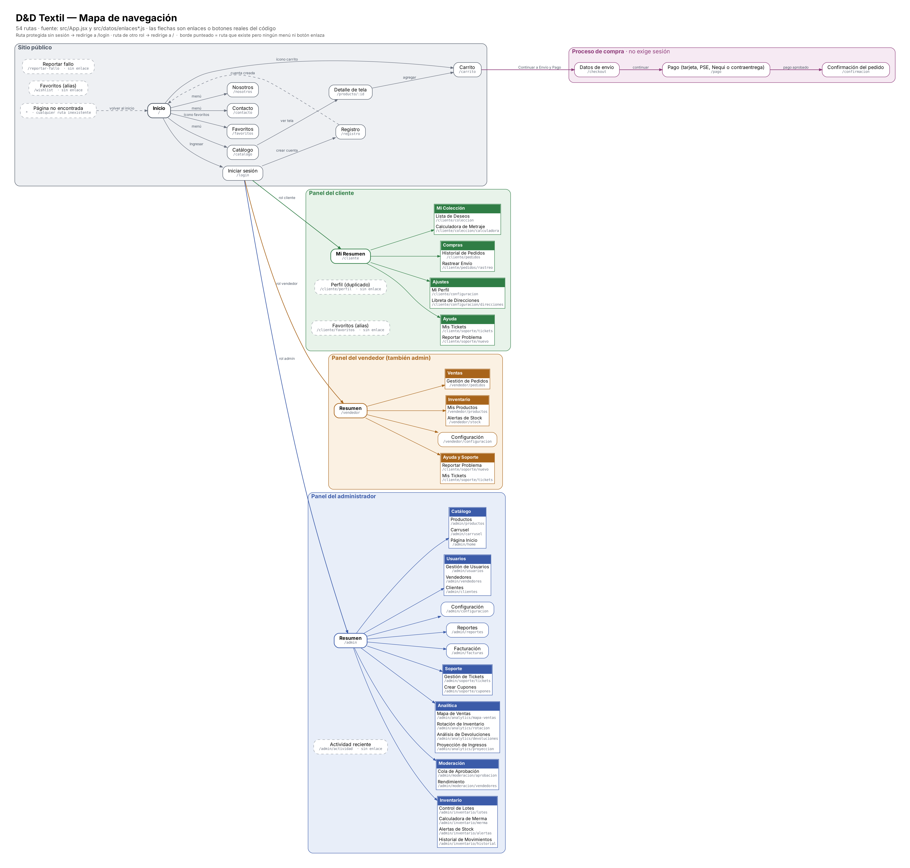
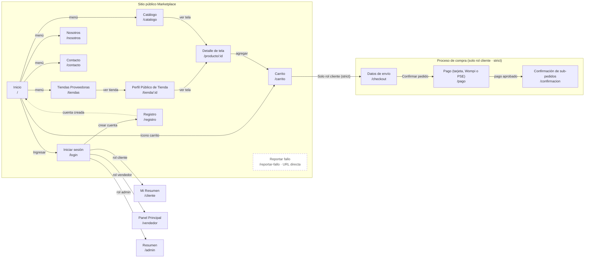
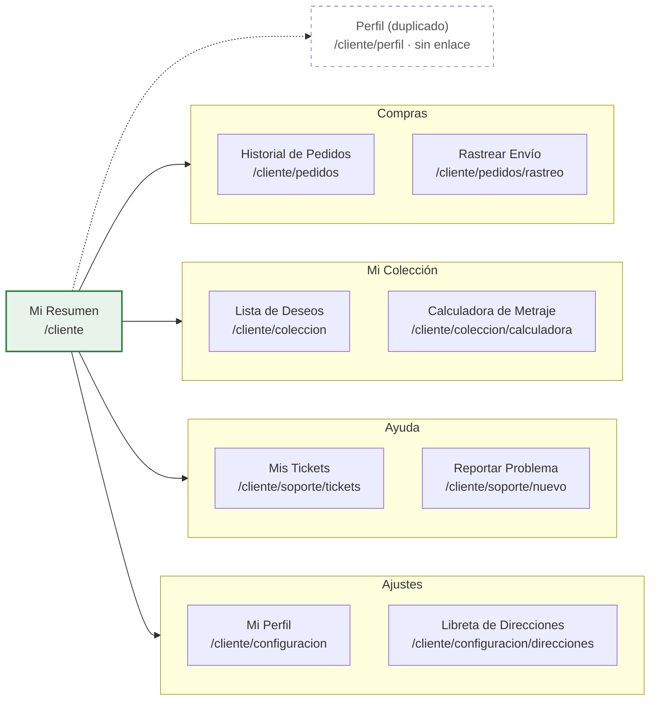
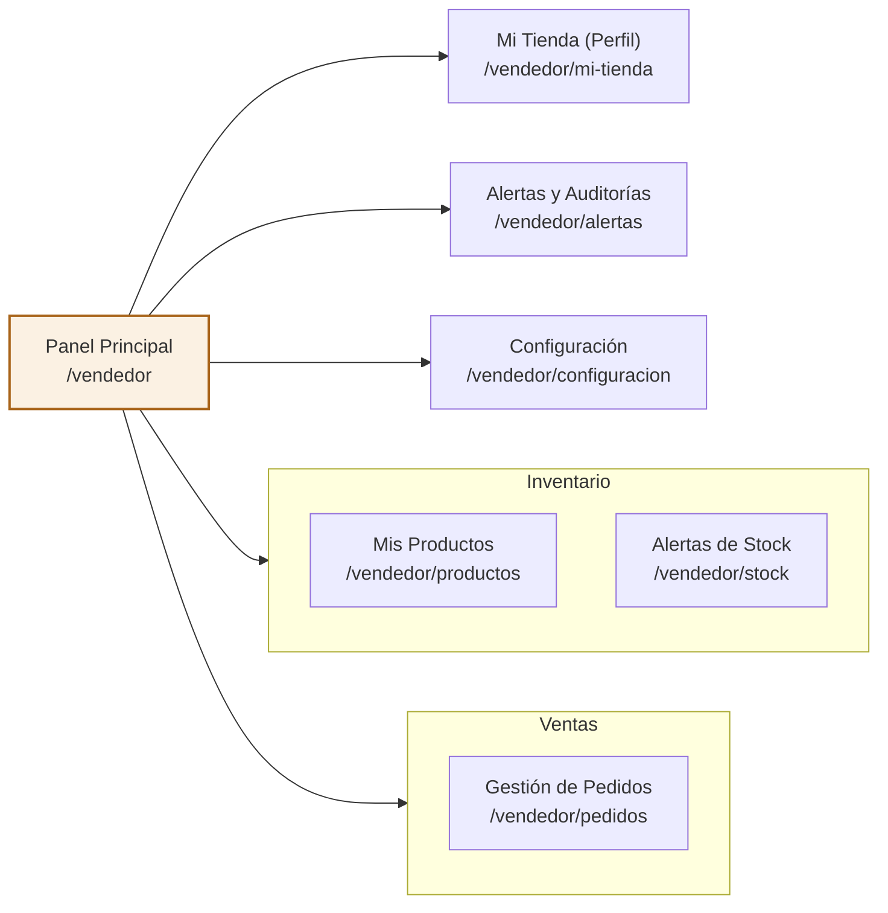
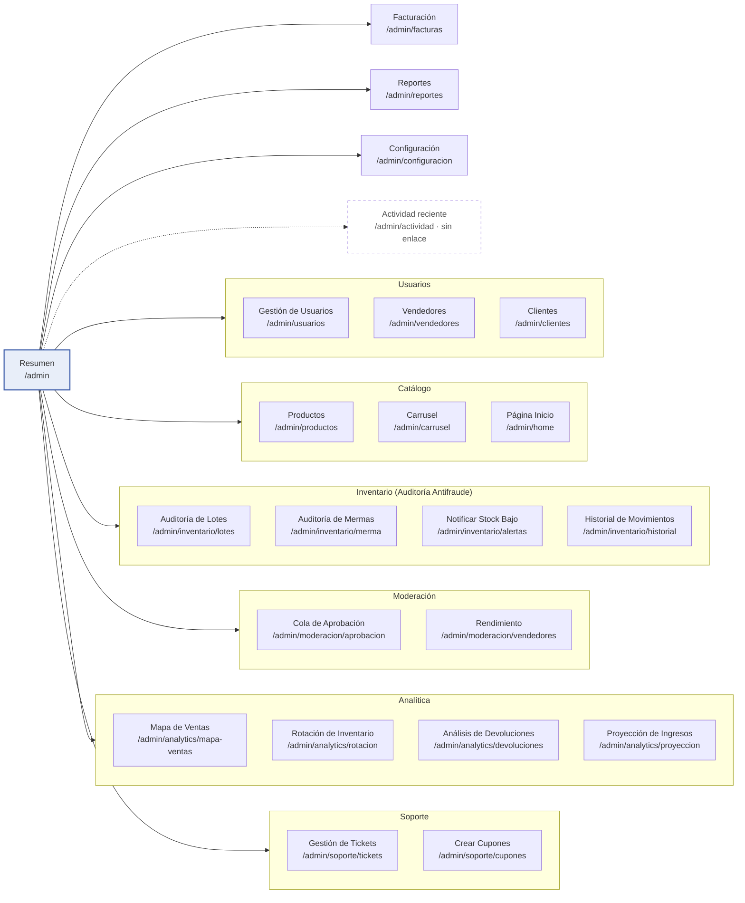

# Mapa de navegación — D&D Textil

> Generado a partir del código: las 58 rutas de `tienda digital de telas/src/App.jsx`, los menús laterales de `src/datos/enlacesCliente.js`, `enlacesVendedor.js` y `enlacesAdmin.js`, y los enlaces del encabezado, directorio de tiendas (`/tiendas`, `/tienda/:id`), carrito y pago exclusivo para clientes (`strict={true}`). Reemplaza la sección 4 de `03-arquitectura-frontend-y-roles.md`.

## 1. Diagrama general

Versión vectorial: `diagramas/mapa_navegacion.svg`.

**Reglas de acceso** (componente `ProtectedRoute`):

- Si una ruta protegida se abre sin sesión, redirige a `/login` guardando la ruta pedida. Las rutas de compra (`/checkout`, `/pago`, `/confirmacion`) operan con `roles="cliente" strict={true}` (solo un usuario autenticado como cliente puede pagar).
- Si el usuario tiene sesión pero no el rol requerido, redirige a `/`.
- Al iniciar sesión, `IniciarSesion.jsx` envía a cada rol a su panel: cliente → `/cliente`, vendedor → `/vendedor`, admin → `/admin`.
- El administrador también puede entrar al panel del vendedor (rutas con `roles={['vendedor','admin']}`).

## 2. Diagramas por sección (se dibujan en GitHub)

### 2.1. Sitio público y proceso de compra

### 2.2. Panel del cliente

### 2.3. Panel del vendedor

### 2.4. Panel del administrador

## 3. Inventario completo de las 58 rutas (`App.jsx`)

| # | Ruta | Pantalla | Componente | Acceso | Cómo se llega |
| :-: | :--- | :--- | :--- | :--- | :--- |
| 1 | `/` | Inicio | `Inicio` | Pública | Logo y menú superior |
| 2 | `/catalogo` | Catálogo | `Catalogo` | Pública | Menú superior y pie de página |
| 3 | `/tiendas` | Tiendas Proveedoras | `DirectorioTiendas` | Pública | Menú superior *Tiendas*, tarjetas de tienda |
| 4 | `/tienda/:id` | Perfil Público de Tienda | `PerfilTiendaPublico` | Pública | Tarjeta de vendedor en `/tiendas` o `/producto/:id` |
| 5 | `/producto/:id` | Detalle de tela y comparador | `DetalleProducto` | Pública | Tarjeta de producto en Catálogo, Tienda o Inicio |
| 6 | `/carrito` | Carrito multi-vendedor | `Carrito` | Pública | Ícono del carrito en el encabezado |
| 7 | `/favoritos` | Lista de Deseos (alias) | `Wishlist` | Pública | Enlace Lista de Deseos |
| 8 | `/wishlist` | Lista de Deseos (alias) | `Wishlist` | Pública | Enlace Lista de Deseos |
| 9 | `/cliente/favoritos` | Lista de Deseos (alias) | `Wishlist` | Pública | Acceso directo a favoritos |
| 10 | `/nosotros` | Nosotros | `About` | Pública | Menú superior y pie de página |
| 11 | `/contacto` | Contacto | `Contact` | Pública | Menú superior y pie de página |
| 12 | `/login` | Iniciar sesión | `IniciarSesion` | Pública | Botón Ingresar del encabezado; redirección de rutas protegidas |
| 13 | `/registro` | Registro | `Registro` | Pública | Enlace desde Iniciar sesión |
| 14 | `/reportar-fallo` | Reportar fallo | `BugReport` | Pública | URL directa para reporte técnico |
| 15 | `/checkout` | Datos de envío | `Pago` | **Solo `cliente` (`strict`)** | Botón «Proceder al pago» del carrito |
| 16 | `/pago` | Pago (tarjeta, Wompi o PSE) | `Payment` | **Solo `cliente` (`strict`)** | Botón «Confirmar pedido» en Datos de envío |
| 17 | `/confirmacion` | Confirmación de sub-pedidos | `ConfirmacionPedido` | **Solo `cliente` (`strict`)** | Automático tras un pago aprobado |
| 18 | `/cliente` | Mi Resumen | `PanelCliente` | `cliente` | Inicio de sesión como cliente; menú de usuario |
| 19 | `/cliente/perfil` | Perfil (alias) | `Perfil` | `cliente` | Acceso directo al perfil |
| 20 | `/cliente/pedidos` | Historial de Pedidos | `ClientOrderHistory` | `cliente` | Menú lateral › Compras › Historial de Pedidos |
| 21 | `/cliente/pedidos/rastreo` | Rastrear Envío | `SeguimientoPedido` | `cliente`, `vendedor`, `admin` | Menú lateral › Compras › Rastrear Envío |
| 22 | `/cliente/coleccion` | Lista de Deseos | `Wishlist` | Pública / Cliente | Menú lateral › Mi Colección › Lista de Deseos |
| 23 | `/cliente/coleccion/calculadora` | Calculadora de Metraje | `ProjectCalculator` | `cliente`, `vendedor`, `admin` | Menú lateral › Mi Colección › Calculadora de Metraje |
| 24 | `/cliente/soporte/nuevo` | Reportar Problema | `NewReport` | `cliente`, `vendedor`, `admin` | Menú lateral › Ayuda › Reportar Problema |
| 25 | `/cliente/soporte/tickets` | Mis Tickets | `MyTickets` | `cliente`, `vendedor`, `admin` | Menú lateral › Ayuda › Mis Tickets |
| 26 | `/cliente/configuracion` | Mi Perfil | `Perfil` | `cliente` | Menú lateral › Ajustes › Mi Perfil |
| 27 | `/cliente/configuracion/direcciones` | Libreta de Direcciones | `AddressBook` | `cliente` | Menú lateral › Ajustes › Libreta de Direcciones |
| 28 | `/vendedor` | Resumen y Catálogo Vendedor | `PanelVendedor` | `vendedor`, `admin` | Inicio de sesión como vendedor |
| 29 | `/vendedor/productos` | Mis Productos | `PanelVendedor` | `vendedor`, `admin` | Menú lateral › Inventario › Mis Productos |
| 30 | `/vendedor/pedidos` | Gestión de Pedidos | `PedidosVendedor` | `vendedor`, `admin` | Menú lateral › Ventas › Gestión de Pedidos |
| 31 | `/vendedor/stock` | Alertas de Stock | `StockAlerts` | `vendedor`, `admin` | Menú lateral › Inventario › Alertas de Stock |
| 32 | `/vendedor/mi-tienda` | Mi Tienda (Editor Social) | `MiTiendaVendedor` | `vendedor`, `admin` | Menú lateral › Mi Tienda (Perfil) |
| 33 | `/vendedor/alertas` | Alertas y Auditorías | `AlertasOportunidad` | `vendedor`, `admin` | Menú lateral › Alertas y Auditorías |
| 34 | `/vendedor/configuracion` | Configuración | `Perfil` | `vendedor`, `admin` | Menú lateral › Configuración |
| 35 | `/admin` | Resumen | `ResumenAdmin` | `admin` | Inicio de sesión como admin; menú de usuario |
| 36 | `/admin/usuarios` | Gestión de Usuarios | `GestionUsuarios` | `admin` | Menú lateral › Usuarios › Gestión de Usuarios |
| 37 | `/admin/vendedores` | Vendedores | `MetricasVendedor` | `admin` | Menú lateral › Usuarios › Vendedores |
| 38 | `/admin/clientes` | Clientes | `MetricasCliente` | `admin` | Menú lateral › Usuarios › Clientes |
| 39 | `/admin/productos` | Productos (Auditoría) | `ProductosAdmin` | `admin` | Menú lateral › Catálogo › Productos |
| 40 | `/admin/carrusel` | Carrusel | `GestionarCarrusel` | `admin` | Menú lateral › Catálogo › Carrusel |
| 41 | `/admin/home` | Página Inicio | `GestionarInicio` | `admin` | Menú lateral › Catálogo › Página Inicio |
| 42 | `/admin/facturas` | Facturación | `FacturasAdmin` | `admin` | Menú lateral › Facturación |
| 43 | `/admin/reportes` | Reportes | `ReportesAdmin` | `admin` | Menú lateral › Reportes |
| 44 | `/admin/actividad` | Actividad reciente | `ActividadAdmin` | `admin` | URL directa de auditoría |
| 45 | `/admin/inventario/lotes` | Auditoría de Lotes | `ControlLotes` | `admin` | Menú lateral › Inventario › Auditoría de Lotes |
| 46 | `/admin/inventario/merma` | Auditoría de Mermas | `CalculadoraMerma` | `admin` | Menú lateral › Inventario › Auditoría de Mermas |
| 47 | `/admin/inventario/alertas` | Notificar Stock Bajo | `ConfiguracionStock` | `admin` | Menú lateral › Inventario › Notificar Stock Bajo |
| 48 | `/admin/inventario/historial` | Historial de Movimientos | `HistorialMovimientos` | `admin` | Menú lateral › Inventario › Historial de Movimientos |
| 49 | `/admin/moderacion/aprobacion` | Cola de Aprobación | `ColaAprobacion` | `admin` | Menú lateral › Moderación › Cola de Aprobación |
| 50 | `/admin/moderacion/vendedores` | Rendimiento | `RendimientoVendedores` | `admin` | Menú lateral › Moderación › Rendimiento |
| 51 | `/admin/analytics/mapa-ventas` | Mapa de Ventas | `MapaVentas` | `admin` | Menú lateral › Analítica › Mapa de Ventas |
| 52 | `/admin/analytics/rotacion` | Rotación de Inventario | `RankingRotacion` | `admin` | Menú lateral › Analítica › Rotación de Inventario |
| 53 | `/admin/analytics/devoluciones` | Análisis de Devoluciones | `AnalisisDevoluciones` | `admin` | Menú lateral › Analítica › Análisis de Devoluciones |
| 54 | `/admin/analytics/proyeccion` | Proyección de Ingresos | `ProyeccionIngresos` | `admin` | Menú lateral › Analítica › Proyección de Ingresos |
| 55 | `/admin/soporte/tickets` | Gestión de Tickets | `GestionTickets` | `admin` | Menú lateral › Soporte › Gestión de Tickets |
| 56 | `/admin/soporte/cupones` | Crear Cupones | `CreacionCupones` | `admin` | Menú lateral › Soporte › Crear Cupones |
| 57 | `/admin/configuracion` | Configuración | `ConfiguracionSistema` | `admin` | Menú lateral › Configuración |
| 58 | `*` | Página 404 | `NoEncontrado` | Pública | Cualquier ruta inexistente |

## 4. Observaciones y Controles de Navegación

1. **Bloqueo estricto de compras para rol `cliente`:** `/checkout`, `/pago` y `/confirmacion` usan `<ProtectedRoute roles="cliente" strict={true}>`, impidiendo que visitantes anónimos, vendedores o administradores ejecuten pagos en plataforma.
2. **Separación antifraude en Inventario del Administrador:** las rutas `/admin/inventario/lotes`, `/admin/inventario/merma` y `/admin/inventario/alertas` operan como tableros de auditoría en modo solo lectura con botones reales para notificar stock bajo y enviar reportes de mermas a cada vendedor (`/vendedor/alertas`).
3. **Ecosistema Marketplace Público y Vendedor:** `/tiendas` (`DirectorioTiendas`), `/tienda/:id` (`PerfilTiendaPublico`), `/vendedor/mi-tienda` (`MiTiendaVendedor`) y `/vendedor/alertas` (`AlertasOportunidad`) integran el flujo social y de oportunidades VIP de extremo a extremo.

---

## Anexo de Navegación Segura: Verificación de Vigencia de Token y Activos Estáticos

1. **Guardia de Navegación con Vigencia Temporal (`RutaProtegida.jsx`):**
   - Antes de renderizar cualquier ruta privada (`/cliente/*`, `/vendedor/*`, `/admin/*` o `/checkout`), el guardia verifica no solo la presencia del objeto `usuario`, sino también que `sesionVigente(usuario)` sea verdadera. Si el token caducó, redirige limpiamente a `/login`.
2. **Resolución Limpia de Imágenes en `/uploads/*`:**
   - Tanto el manejador de archivos estáticos del backend (`ManejadorArchivosEstaticos`) como el middleware del servidor de desarrollo Vite (`vite.config.js`) devuelven estrictamente `HTTP 404` cuando un recurso bajo `/uploads/` no existe en disco, permitiendo que los componentes visuales (`Imagen Seguras` / `onError`) activen de inmediato la fotografía textil de respaldo sin pantallas rotas.
