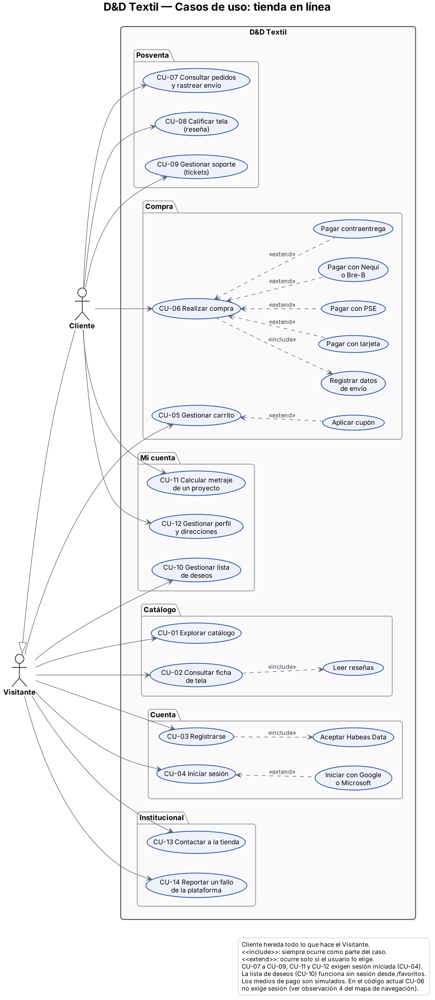
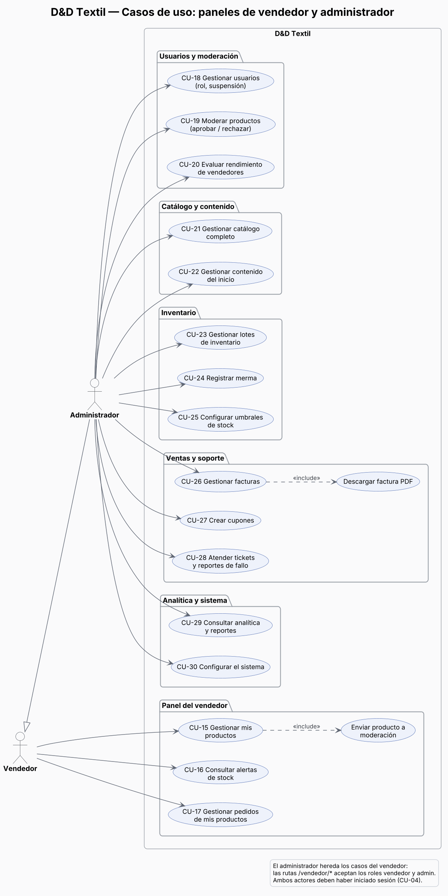

# Casos de uso — D&D Textil

> Construido a partir de las rutas de `src/App.jsx`, los menús de cada panel, las llamadas a la API del frontend (`src/contextos/ContextoMetricas.jsx`, `ContextoAutenticacion.jsx`, `ContextoProducto.jsx` y las páginas) y los manejadores del backend. La columna **Estado** indica qué tanto del caso funciona de verdad hoy, para que el documento describa el sistema real y sirva también como lista de pendientes.

> **Actualización del 16/11/2026:** los estados de CU-03, 04, 06, 09, 10, 12, 13, 15 y 20 se revisaron contra el código de la rama `main`. Los requisitos vigentes están en `Matriz_de_requerimientos_v3.xlsx` (66 requisitos funcionales).

## 1. Actores

| Actor | Descripción | Cómo entra |
| :--- | :--- | :--- |
| Visitante | Persona sin sesión que navega la tienda. | Sitio público (`/`, `/catalogo`, `/producto/:id`, `/carrito`…). |
| Cliente | Usuario registrado con rol `cliente`. Hereda todo lo del visitante. | Inicia sesión y llega a `/cliente`. |
| Vendedor | Usuario con rol `vendedor` que administra sus telas y pedidos. | Inicia sesión y llega a `/vendedor`. |
| Administrador | Usuario con rol `admin`. Hereda los casos del vendedor (las rutas `/vendedor/*` aceptan `vendedor` y `admin`). | Inicia sesión y llega a `/admin`. |

No hay actores externos: el pago con tarjeta y PSE no se conecta a ninguna pasarela (ver CU-06).

## 2. Diagramas

Fuentes editables en PlantUML: `diagramas/fuentes/cu_tienda.puml` y `diagramas/fuentes/cu_gestion.puml`.

## 3. Catálogo de casos de uso

Estado: **Completo** = la pantalla guarda y lee de la base de datos por la API · **Parcial** = funciona pero algo no se guarda o no se valida · **Solo navegador** = los datos viven en el navegador y se pierden al cambiar de equipo · **Incompleto** = falta una parte esencial.

| ID | Caso de uso | Actor | Pantallas | API | Estado |
| :-: | :--- | :--- | :--- | :--- | :--- |
| CU-01 | Explorar catálogo | Visitante | `/`, `/catalogo` | `GET /api/productos`, `/api/secciones-inicio` | Completo |
| CU-02 | Consultar ficha de tela | Visitante | `/producto/:id` | `GET /api/productos`, `GET /api/resenas` | Completo |
| CU-03 | Registrarse | Visitante | `/registro` | `POST /api/registro` | Parcial: se exige la autorización de datos, pero no se guarda la fecha de aceptación |
| CU-04 | Iniciar sesión | Visitante | `/login` | `POST /api/iniciar-sesion`, `POST /api/autenticacion/sso` | Completo: token firmado, bloqueo tras 5 intentos e inicio con Google o Microsoft |
| CU-05 | Gestionar carrito | Visitante | `/carrito` | ninguna (existe `/api/carrito`, pero no se usa) | Solo navegador |
| CU-06 | Realizar compra | Cliente | `/checkout`, `/pago`, `/confirmacion` | `POST /api/pagos/intencion`, `POST /api/pagos/confirmar` | Parcial: captura los datos de envío; el pago es simulado, no tiene casos de rechazo, no exige sesión (sin sesión el pedido se asigna al usuario 4) y hoy la confirmación falla (el pedido queda `pending`) |
| CU-07 | Consultar pedidos y rastrear envío | Cliente | `/cliente/pedidos`, `/cliente/pedidos/rastreo` | `GET /api/pedidos`, `GET /api/facturas/{id}` | Completo |
| CU-08 | Calificar tela (reseña) | Cliente | `/producto/:id` | `POST /api/resenas` | Completo |
| CU-09 | Gestionar soporte (tickets) | Cliente | `/cliente/soporte/nuevo`, `/cliente/soporte/tickets` | `POST /api/soporte/tickets` | Completo: admite pedidos en cualquier estado y hasta 5 fotos |
| CU-10 | Gestionar lista de deseos | Visitante, Cliente | `/favoritos`, `/cliente/coleccion` | ninguna | Solo navegador (se conserva por usuario, no pasa a otro equipo) |
| CU-11 | Calcular metraje de un proyecto | Cliente | `/cliente/coleccion/calculadora` | ninguna (cálculo local) | Completo |
| CU-12 | Gestionar perfil y direcciones | Cliente | `/cliente/configuracion`, `/cliente/configuracion/direcciones` | `PUT /api/usuarios/{id}`, `/api/usuarios/{id}/direcciones` | Parcial: perfil y direcciones se guardan en la API; permite cambiar el correo y no pide la contraseña actual |
| CU-13 | Contactar a la tienda | Visitante | `/contacto` | `POST /api/soporte/tickets` | Completo: el mensaje se registra como ticket de soporte |
| CU-14 | Reportar un fallo de la plataforma | Visitante | `/reportar-fallo` | `POST /api/soporte/errores` | Parcial: la pantalla no tiene enlace |
| CU-15 | Gestionar mis productos | Vendedor | `/vendedor`, `/vendedor/productos` | `GET/POST/PUT/DELETE /api/productos` | Completo: el vendedor crea, edita y desactiva sus productos |
| CU-16 | Consultar alertas de stock | Vendedor | `/vendedor/stock` | `GET /api/inventario/umbrales` | Completo |
| CU-17 | Gestionar pedidos de mis productos | Vendedor | `/vendedor/pedidos` | `PUT /api/pedidos/{id}/estado` | Completo |
| CU-18 | Gestionar usuarios | Administrador | `/admin/usuarios`, `/admin/clientes` | `PUT /api/usuarios/{id}/rol` y estado | Completo |
| CU-19 | Moderar productos | Administrador | `/admin/moderacion/aprobacion` | `GET /api/productos/pendientes`, `PUT /api/productos/{id}/moderar` | Parcial: los pendientes ya se ven en el catálogo |
| CU-20 | Evaluar rendimiento de vendedores | Administrador | `/admin/vendedores`, `/admin/moderacion/vendedores` | `PUT /api/usuarios/{id}` | Completo: la comisión y la suspensión se guardan en la API |
| CU-21 | Gestionar catálogo completo | Administrador | `/admin/productos` | `PUT /api/productos/{id}` | Parcial: «Nuevo textil» muestra «Módulo de creación en desarrollo» |
| CU-22 | Gestionar contenido del inicio | Administrador | `/admin/carrusel`, `/admin/home` | `/api/carrusel`, `/api/secciones-inicio`, `/api/configuracion`, `/api/banner` | Completo |
| CU-23 | Gestionar lotes de inventario | Administrador | `/admin/inventario/lotes`, `/admin/inventario/historial` | `GET/PUT /api/inventario/lotes` | Parcial: «Ingresar lote» solo muestra un aviso; se pueden actualizar lotes existentes |
| CU-24 | Registrar merma | Administrador | `/admin/inventario/merma` | `POST /api/inventario/mermas` | Completo |
| CU-25 | Configurar umbrales de stock | Administrador | `/admin/inventario/alertas` | `PUT /api/inventario/umbrales` | Completo |
| CU-26 | Gestionar facturas | Administrador | `/admin/facturas` | `GET /api/facturas`, `GET /api/facturas/{id}` | Completo: lee los pedidos de las tablas en español mediante `PedidoDAO` |
| CU-27 | Crear cupones | Administrador | `/admin/soporte/cupones` | `POST /api/cupones`, `PUT /api/cupones/{id}` | Completo |
| CU-28 | Atender tickets y reportes de fallo | Administrador | `/admin/soporte/tickets` | `PUT /api/soporte/tickets/{id}`, `PUT /api/soporte/errores/{id}` | Parcial: la asignación no se guarda |
| CU-29 | Consultar analítica y reportes | Administrador | `/admin`, `/admin/analytics/*`, `/admin/reportes`, `/admin/actividad` | `GET /api/metricas/*`, `/api/actividad` | Completo |
| CU-30 | Configurar el sistema | Administrador | `/admin/configuracion` | `POST /api/configuracion` | Completo |

## 4. Especificación de los casos principales

### CU-03 Registrarse

| Campo | Detalle |
| :--- | :--- |
| Actor | Visitante |
| Objetivo | Crear una cuenta de cliente. |
| Precondición | El correo no está registrado. |
| Disparador | Clic en «Regístrate» desde Iniciar sesión. |

**Flujo principal**
1. El visitante escribe nombre, correo, contraseña y confirmación.
2. El formulario valida: nombre de 2 o más caracteres, correo con formato válido, contraseña de 8 o más caracteres, confirmación igual y casilla de autorización de datos marcada.
3. El sistema envía `POST /api/registro` con `aceptaHabeasData`.
4. El backend comprueba la autorización, cifra la contraseña con PBKDF2 y crea el usuario con rol `cliente`.
5. El sistema inicia sesión automáticamente, muestra «¡Cuenta creada!» y lleva al Inicio.

**Flujos alternos**
- 2a. Un campo no cumple la regla: el formulario muestra el mensaje junto al campo y no envía nada.
- 4a. No se marcó la autorización de datos o la contraseña tiene menos de 8 caracteres: el backend responde 400 con el motivo.
- 4b. El correo ya existe: el backend responde 400 y la pantalla muestra «Es posible que el correo ya exista».

**Postcondición:** existe un registro nuevo en `usuarios` con `rol = 'cliente'` y `activo = true`.

**Observación:** la autorización de datos (Ley 1581 de 2012) se pide y se exige, pero la fecha de aceptación no se guarda en la base de datos.

### CU-04 Iniciar sesión

| Campo | Detalle |
| :--- | :--- |
| Actor | Visitante (cliente, vendedor o administrador) |
| Objetivo | Entrar al panel que corresponde a su rol. |
| Precondición | La cuenta existe, está activa y no está suspendida. |

**Flujo principal**
1. El usuario escribe correo y contraseña.
2. El sistema envía `POST /api/iniciar-sesion`.
3. El backend verifica la contraseña contra `usuarios.contrasena_hash` (PBKDF2; SHA-256 para cuentas antiguas) y actualiza `ultimo_acceso`.
4. El frontend guarda el usuario en el navegador y lo lleva a `/cliente`, `/vendedor` o `/admin` según su rol.

**Flujos alternos**
- 3a. Credenciales incorrectas o cuenta inactiva: respuesta 400 y mensaje «Credenciales incorrectas».
- 3b. Cuenta suspendida: respuesta 400 con el motivo de la suspensión.
- 2a. Más de 1200 peticiones por minuto desde la misma IP: respuesta 429.
- 2b. Cinco intentos fallidos con el mismo correo o IP: bloqueo de 15 minutos y respuesta 429.

**Postcondición:** el usuario ve su panel; `ultimo_acceso` queda actualizado.

**Observaciones:** el backend no emite token; las demás rutas de la API no comprueban quién llama. Si el usuario llegó al login desde una ruta protegida (por ejemplo el checkout), no vuelve a ella: siempre va a su panel.

### CU-05 Gestionar carrito

| Campo | Detalle |
| :--- | :--- |
| Actor | Visitante |
| Objetivo | Reunir las telas y metros que se quieren comprar. |

**Flujo principal**
1. Desde la ficha de una tela el visitante elige los metros y pulsa «Agregar».
2. En `/carrito` puede cambiar la cantidad o quitar una tela.
3. El sistema recalcula el subtotal.

**Flujo alterno — Aplicar cupón (extend):** el visitante escribe un código; el sistema lo valida en el navegador contra los cupones cargados (activo, vigencia, compra mínima, solo primera compra, usos máximos) y muestra el descuento o el motivo del rechazo.

**Postcondición:** el carrito queda guardado en el navegador.

**Observación:** la tabla `items_carrito` y la ruta `/api/carrito` existen, pero el frontend no las usa; el carrito no se recupera desde otro equipo.

### CU-06 Realizar compra

| Campo | Detalle |
| :--- | :--- |
| Actor | Cliente (también un visitante sin sesión, ver observaciones) |
| Objetivo | Convertir el carrito en un pedido pagado. |
| Precondición | Carrito con al menos una tela. |
| Incluye | Registrar datos de envío. |
| Extensiones | Pagar con Wompi, Mercado Pago, Nequi / Bre-B, ePayco, tarjeta, PSE o contraentrega (todos simulados). |

**Flujo principal**
1. En el carrito el cliente pulsa «Continuar a Envío y Pago» y llega a `/checkout` (`Pago.jsx`).
2. Escribe o confirma los datos de envío; el formulario se llena con los datos del perfil si hay sesión.
3. La pantalla muestra subtotal − descuento + envío ($15.000 si el subtotal es menor al umbral de envío gratis, $200.000 por defecto según la configuración) + IVA del 19 %, y lleva a `/pago`.
4. En `/pago` (`Payment.jsx`) elige el medio de pago y llena el formulario.
5. El sistema envía `POST /api/pagos/intencion` con los artículos, los datos del cliente y el cupón.
6. El backend recalcula el total con los precios de la base de datos, valida que haya stock (`SELECT … FOR SHARE`, sin descontarlo), crea el pedido en estado `pending` y devuelve la referencia.
7. Tras 0,8 segundos el navegador da el pago por aprobado y envía `POST /api/pagos/confirmar` con el estado `APPROVED` (o `pending` si eligió contraentrega). Al aprobarse, el backend marca el pedido `paid` y descuenta el stock con `GREATEST(0, stock − metros)`.
8. El sistema vacía el carrito y muestra `/confirmacion` con la referencia y el mensaje «¡Pago Aprobado y Pedido Confirmado!».

**Flujos alternos**
- 5a. La intención falla (producto sin stock o error del servidor): la pantalla muestra el error y no se crea el pedido.
- 7a. **Comportamiento actual (defecto):** el backend rechaza la confirmación con `400` «Rechazado por seguridad PCI-DSS», porque la referencia `DD-<13 dígitos>-XXXX` coincide con el patrón de número de tarjeta de `ServicioAutenticacion.contieneDatosTarjetaSensibles`. El frontend no revisa la respuesta y muestra igual la confirmación; el pedido queda `pending`.

**Postcondición:** hay un registro en `pedidos` con los datos de envío, sus `items_pedido` y el stock descontado. Por el defecto del paso 7a, hoy el pedido queda con `estado = pending`, `estado_pago = pending` y `metodo_pago = 'wompi'`, sin importar el medio elegido, y el stock no se descuenta.

**Observaciones:**
- El pago es simulado: ningún medio se conecta a una pasarela real y `/api/pagos/confirmar` acepta el estado que envía el navegador.
- Las rutas de compra no exigen sesión. Sin sesión, `Payment.jsx` envía `userId = 4` y el pedido queda a nombre de ese usuario.
- No hay un proceso que libere el stock de un pedido que se queda en `pending`.

### CU-15 Gestionar mis productos

| Campo | Detalle |
| :--- | :--- |
| Actor | Vendedor (también administrador) |
| Objetivo | Publicar telas y mantener al día su precio, stock e imagen. |
| Precondición | Sesión con rol `vendedor` o `administrador`. |
| Incluye | Enviar producto a moderación. |

**Flujo principal**
1. El vendedor abre `/vendedor/productos` y ve solo sus telas.
2. Pulsa «Nuevo Producto», llena la ficha y guarda: el sistema envía `POST /api/productos`, y el backend asigna el producto al vendedor autenticado y lo guarda con `estado_moderacion = 'pending'`.
3. Para editar, cambia precio, stock o imagen y guarda: `PUT /api/productos/{id}` (y `PUT /api/productos/{id}/imagen` si cambió la imagen). Solo el vendedor dueño o el administrador pueden hacerlo.

**Flujos alternos**
- 3a. Eliminar: el sistema pide confirmación y envía `DELETE /api/productos/{id}`; el backend hace un borrado lógico (`activo = false`).
- 3b. Marcar una tela como oferta: solo el administrador; si lo intenta un vendedor la API responde 403.

**Observación:** el producto nuevo se guarda con `activo = true`, así que aparece en el catálogo público antes de ser aprobado (ver CU-19). Además, si el cuerpo de la petición trae `estado_moderacion`, el backend lo respeta en lugar de forzar `pending`.

### CU-19 Moderar productos

| Campo | Detalle |
| :--- | :--- |
| Actor | Administrador |
| Objetivo | Aprobar o rechazar las telas que publican los vendedores. |
| Precondición | Hay productos con `estado_moderacion = 'pending'`. |

**Flujo principal**
1. El administrador abre la cola de aprobación (`GET /api/productos/pendientes`).
2. Revisa la ficha y pulsa «Aprobar».
3. El sistema envía `PUT /api/productos/{id}/moderar` con `approved`.

**Flujo alterno — Rechazar:** el administrador escribe el motivo y el sistema guarda `rejected` y el `motivo_rechazo`; el producto queda inactivo.

**Observación:** el catálogo público filtra solo por `activo = true`, así que una tela pendiente ya aparece en la tienda antes de ser aprobada.

### CU-26 Gestionar facturas

| Campo | Detalle |
| :--- | :--- |
| Actor | Administrador (el cliente también descarga la suya desde su historial) |
| Objetivo | Consultar y descargar la factura PDF de un pedido. |

**Flujo principal**
1. El administrador abre `/admin/facturas` (`GET /api/facturas`).
2. Elige un pedido y pulsa descargar (`GET /api/facturas/{id}`).
3. El backend toma los montos guardados en el pedido (o calcula subtotal e IVA del 19 % si faltan) y genera el PDF con PDFBox (encabezado, cliente, artículos, totales y valor en letras).
4. El navegador descarga `FAC-00000N.pdf`.

**Flujo alterno:** 2a. El pedido no existe: respuesta 404.

**Observación:** el listado, la cabecera y los artículos se leen de `pedidos`, `items_pedido` y `productos` mediante `PedidoDAO`. El manejador no comprueba el rol ni que el pedido pertenezca a quien lo descarga.

## 5. Relación con los requisitos

La hoja «Trazabilidad» de `Matriz_de_requerimientos_v3.xlsx` usa los mismos códigos CU-01 a CU-30 de este documento para cruzar casos de uso y requisitos.

---

## Caso de Uso Transversal CU-T1: Verificación de Sesión Firmada y Aislamiento de Pedidos por Rol

| Campo | Especificación |
| :--- | :--- |
| **Código y Nombre** | **CU-T1:** Verificación de Token de Sesión HMAC-SHA256 y Autorización RBAC en Pedidos |
| **Actores** | Cliente, Vendedor, Administrador y Sistema Backend (`ManejadorBase` / `ManejadorPedidos`) |
| **Precondiciones** | El actor ha iniciado sesión y posee un token `Bearer <carga>.<firma>` en su cabecera `Authorization`. |
| **Flujo Principal** | 1. El actor solicita `GET /api/pedidos` o `GET /api/pedidos/{id}`. 2. `ManejadorBase` extrae el token Bearer y ejecuta `TokenSesion.verificar(token)` validando firma HMAC-SHA256 y expiración. 3. `ManejadorBase` consulta `JdbcRepositorioUsuarioImpl.buscarPorId(sub)` y confirma que el usuario existe, está activo y no está suspendido. 4. `ManejadorPedidos` determina el rol vigente en base de datos y retorna únicamente los pedidos del cliente, las líneas de producto del vendedor o el listado global para el administrador. |
| **Flujos Alternativos** | - **FA-1 (Token adulterado o expirado):** El sistema rechaza la petición con `HTTP 401 Unauthorized` y el frontend cierra la sesión automáticamente. - **FA-2 (Cuenta suspendida en BD):** Aunque el token no haya expirado, `identidadVigente` devuelve vacío y bloquea el acceso de inmediato. |
