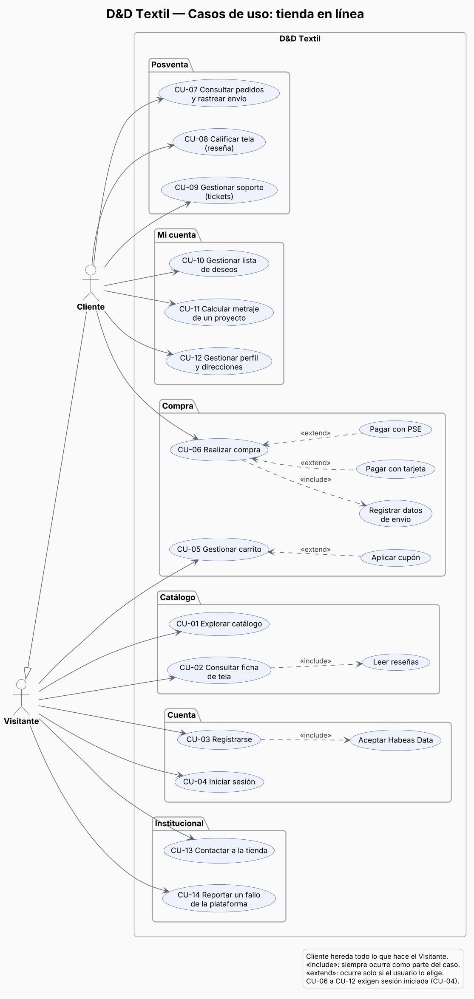
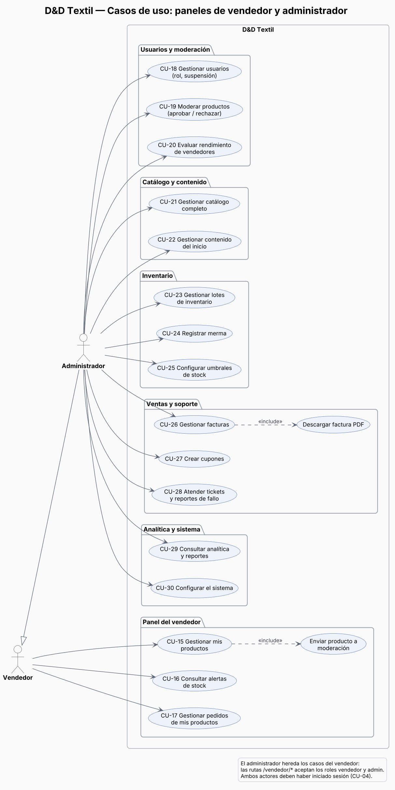

# Casos de uso — D&D Textil

> Construido a partir de las rutas de `src/App.jsx`, los menús de cada panel, las llamadas a la API del frontend (`src/contextos/ContextoMetricas.jsx`, `ContextoAutenticacion.jsx`, `ContextoProducto.jsx` y las páginas) y los manejadores del backend. La columna **Estado** indica qué tanto del caso funciona de verdad hoy, para que el documento describa el sistema real y sirva también como lista de pendientes.

## 1. Actores

| Actor | Descripción | Cómo entra |
| :--- | :--- | :--- |
| Visitante | Persona sin sesión que navega la tienda. | Sitio público (`/`, `/catalogo`, `/producto/:id`, `/carrito`…). |
| Cliente | Usuario registrado con rol `cliente`. Hereda todo lo del visitante. | Inicia sesión y llega a `/cliente`. |
| Vendedor | Usuario con rol `vendedor` que administra sus telas y pedidos. | Inicia sesión y llega a `/vendedor`. |
| Administrador | Usuario con rol `admin`. Hereda los casos del vendedor (las rutas `/vendedor/*` aceptan `vendedor` y `admin`). | Inicia sesión y llega a `/admin`. |

No hay actores externos: el pago con tarjeta y PSE no se conecta a ninguna pasarela (ver CU-06).

## 2. Diagramas

Fuentes editables en PlantUML: `diagramas/fuentes/cu_tienda.puml` y `diagramas/fuentes/cu_gestion.puml`.

## 3. Catálogo de casos de uso

Estado: **Completo** = la pantalla guarda y lee de la base de datos por la API · **Parcial** = funciona pero algo no se guarda o no se valida · **Solo navegador** = los datos viven en el navegador y se pierden al cambiar de equipo · **Incompleto** = falta una parte esencial.

| ID | Caso de uso | Actor | Pantallas | API | Estado |
| :-: | :--- | :--- | :--- | :--- | :--- |
| CU-01 | Explorar catálogo | Visitante | `/`, `/catalogo` | `GET /api/productos`, `/api/secciones-inicio` | Completo |
| CU-02 | Consultar ficha de tela | Visitante | `/producto/:id` | `GET /api/productos`, `GET /api/resenas` | Completo |
| CU-03 | Registrarse | Visitante | `/registro` | `POST /api/registro` | Parcial: no se pide la autorización de datos |
| CU-04 | Iniciar sesión | Visitante | `/login` | `POST /api/iniciar-sesion` | Parcial: sin token ni control de roles en la API |
| CU-05 | Gestionar carrito | Visitante | `/carrito` | ninguna (existe `/api/carrito`, pero no se usa) | Solo navegador |
| CU-06 | Realizar compra | Cliente | `/checkout`, `/pago`, `/confirmacion` | `POST /api/pedidos` | Parcial: sin pasarela y sin datos de envío |
| CU-07 | Consultar pedidos y rastrear envío | Cliente | `/cliente/pedidos`, `/cliente/pedidos/rastreo` | `GET /api/pedidos`, `GET /api/facturas/{id}` | Completo |
| CU-08 | Calificar tela (reseña) | Cliente | `/producto/:id` | `POST /api/resenas` | Completo |
| CU-09 | Gestionar soporte (tickets) | Cliente | `/cliente/soporte/nuevo`, `/cliente/soporte/tickets` | `POST /api/soporte/tickets` | Completo: solo admite pedidos entregados; sin tickets, «Mis tickets» muestra ejemplos |
| CU-10 | Gestionar lista de deseos | Cliente | `/cliente/coleccion` | ninguna | Solo navegador (se pierde al recargar) |
| CU-11 | Calcular metraje de un proyecto | Cliente | `/cliente/coleccion/calculadora` | ninguna (cálculo local) | Completo |
| CU-12 | Gestionar perfil y direcciones | Cliente | `/cliente/configuracion`, `/cliente/configuracion/direcciones` | ninguna | Incompleto: el guardado del perfil es simulado |
| CU-13 | Contactar a la tienda | Visitante | `/contacto` | ninguna | Incompleto: el mensaje no se envía |
| CU-14 | Reportar un fallo de la plataforma | Visitante | `/reportar-fallo` | `POST /api/soporte/errores` | Parcial: la pantalla no tiene enlace |
| CU-15 | Gestionar mis productos | Vendedor | `/vendedor`, `/vendedor/productos` | `GET/PUT/DELETE /api/productos` | Incompleto: el botón «Nuevo producto» no hace nada |
| CU-16 | Consultar alertas de stock | Vendedor | `/vendedor/stock` | `GET /api/inventario/umbrales` | Completo |
| CU-17 | Gestionar pedidos de mis productos | Vendedor | `/vendedor/pedidos` | `PUT /api/pedidos/{id}/estado` | Completo |
| CU-18 | Gestionar usuarios | Administrador | `/admin/usuarios`, `/admin/clientes` | `PUT /api/usuarios/{id}/rol` y estado | Completo |
| CU-19 | Moderar productos | Administrador | `/admin/moderacion/aprobacion` | `GET /api/productos/pendientes`, `PUT /api/productos/{id}/moderar` | Parcial: los pendientes ya se ven en el catálogo |
| CU-20 | Evaluar rendimiento de vendedores | Administrador | `/admin/vendedores`, `/admin/moderacion/vendedores` | lectura; comisión y suspensión sin API | Parcial: los cambios no se guardan |
| CU-21 | Gestionar catálogo completo | Administrador | `/admin/productos` | `PUT /api/productos/{id}` | Parcial: «Nuevo textil» muestra «Módulo de creación en desarrollo» |
| CU-22 | Gestionar contenido del inicio | Administrador | `/admin/carrusel`, `/admin/home` | `/api/carrusel`, `/api/secciones-inicio`, `/api/configuracion`, `/api/banner` | Completo |
| CU-23 | Gestionar lotes de inventario | Administrador | `/admin/inventario/lotes`, `/admin/inventario/historial` | `GET/PUT /api/inventario/lotes` | Parcial: «Ingresar lote» solo muestra un aviso; se pueden actualizar lotes existentes |
| CU-24 | Registrar merma | Administrador | `/admin/inventario/merma` | `POST /api/inventario/mermas` | Completo |
| CU-25 | Configurar umbrales de stock | Administrador | `/admin/inventario/alertas` | `PUT /api/inventario/umbrales` | Completo |
| CU-26 | Gestionar facturas | Administrador | `/admin/facturas` | `GET /api/facturas`, `GET /api/facturas/{id}` | Parcial: lee tablas en inglés |
| CU-27 | Crear cupones | Administrador | `/admin/soporte/cupones` | `POST /api/cupones`, `PUT /api/cupones/{id}` | Completo |
| CU-28 | Atender tickets y reportes de fallo | Administrador | `/admin/soporte/tickets` | `PUT /api/soporte/tickets/{id}`, `PUT /api/soporte/errores/{id}` | Parcial: la asignación no se guarda |
| CU-29 | Consultar analítica y reportes | Administrador | `/admin`, `/admin/analytics/*`, `/admin/reportes`, `/admin/actividad` | `GET /api/metricas/*`, `/api/actividad` | Completo |
| CU-30 | Configurar el sistema | Administrador | `/admin/configuracion` | `POST /api/configuracion` | Completo |

## 4. Especificación de los casos principales

### CU-03 Registrarse

| Campo | Detalle |
| :--- | :--- |
| Actor | Visitante |
| Objetivo | Crear una cuenta de cliente. |
| Precondición | El correo no está registrado. |
| Disparador | Clic en «Regístrate» desde Iniciar sesión. |

**Flujo principal**
1. El visitante escribe nombre, correo, contraseña y confirmación.
2. El formulario valida: nombre de 2 o más caracteres, correo con formato válido, contraseña de 6 o más caracteres y confirmación igual.
3. El sistema envía `POST /api/registro`.
4. El backend cifra la contraseña con SHA-256 y crea el usuario con rol `cliente`.
5. El sistema muestra «¡Cuenta creada!» y lleva al Inicio.

**Flujos alternos**
- 2a. Un campo no cumple la regla: el formulario muestra el mensaje junto al campo y no envía nada.
- 4a. El correo ya existe: el backend responde 400 y la pantalla muestra «Es posible que el correo ya exista».

**Postcondición:** existe un registro nuevo en `usuarios` con `rol = 'cliente'` y `activo = true`.

**Observación:** el backend exige aceptar la política de datos personales (Ley 1581 de 2012), pero la pantalla no muestra la casilla y el frontend no envía el campo; el backend lo da por aceptado.

### CU-04 Iniciar sesión

| Campo | Detalle |
| :--- | :--- |
| Actor | Visitante (cliente, vendedor o administrador) |
| Objetivo | Entrar al panel que corresponde a su rol. |
| Precondición | La cuenta existe, está activa y no está suspendida. |

**Flujo principal**
1. El usuario escribe correo y contraseña.
2. El sistema envía `POST /api/iniciar-sesion`.
3. El backend compara el hash SHA-256 con `usuarios.contrasena_hash` y actualiza `ultimo_acceso`.
4. El frontend guarda el usuario en el navegador y lo lleva a `/cliente`, `/vendedor` o `/admin` según su rol.

**Flujos alternos**
- 3a. Credenciales incorrectas o cuenta inactiva: respuesta 400 y mensaje «Credenciales incorrectas».
- 3b. Cuenta suspendida: respuesta 400 con el motivo de la suspensión.
- 2a. Más de 120 peticiones por minuto desde la misma IP: respuesta 429.

**Postcondición:** el usuario ve su panel; `ultimo_acceso` queda actualizado.

**Observaciones:** el backend no emite token; las demás rutas de la API no comprueban quién llama. Si el usuario llegó al login desde una ruta protegida (por ejemplo el checkout), no vuelve a ella: siempre va a su panel.

### CU-05 Gestionar carrito

| Campo | Detalle |
| :--- | :--- |
| Actor | Visitante |
| Objetivo | Reunir las telas y metros que se quieren comprar. |

**Flujo principal**
1. Desde la ficha de una tela el visitante elige los metros y pulsa «Agregar».
2. En `/carrito` puede cambiar la cantidad o quitar una tela.
3. El sistema recalcula el subtotal.

**Flujo alterno — Aplicar cupón (extend):** el visitante escribe un código; el sistema lo valida en el navegador contra los cupones cargados (activo, vigencia, compra mínima, solo primera compra, usos máximos) y muestra el descuento o el motivo del rechazo.

**Postcondición:** el carrito queda guardado en el navegador.

**Observación:** la tabla `items_carrito` y la ruta `/api/carrito` existen, pero el frontend no las usa; el carrito no se recupera desde otro equipo.

### CU-06 Realizar compra

| Campo | Detalle |
| :--- | :--- |
| Actor | Cliente |
| Objetivo | Convertir el carrito en un pedido. |
| Precondición | Sesión iniciada y carrito con al menos una tela. |
| Incluye | Registrar datos de envío. |
| Extensiones | Pagar con tarjeta · Pagar con PSE. |

**Flujo principal**
1. En el carrito el cliente pulsa «Proceder al pago» y llega a `/checkout`.
2. Escribe los datos de envío y confirma.
3. El sistema calcula: subtotal − descuento + envío ($15.000 si el subtotal es menor a $100.000) + IVA del 19 %.
4. En `/pago` elige tarjeta o PSE y llena el formulario.
5. El sistema envía `POST /api/pedidos` con el cliente, el total y los artículos.
6. El backend, en una transacción, crea el pedido, bloquea cada producto (`SELECT … FOR UPDATE`), descuenta el stock y registra los artículos.
7. El sistema vacía el carrito y muestra `/confirmacion` con el número de pedido.

**Flujos alternos**
- 1a. Sin sesión: el sistema lleva a `/login` (después del login el cliente no regresa al checkout).
- 6a. Un producto no existe o no tiene stock suficiente: el backend revierte toda la transacción y responde 500; la pantalla no muestra ningún mensaje.

**Postcondición:** hay un registro en `pedidos` con `estado = 'pending'`, sus `items_pedido` y el stock descontado.

**Observaciones:**
- No hay pasarela de pago: ni la tarjeta ni el banco se verifican.
- Los datos de envío no se guardan: el backend escribe `'Cliente'`, `'cliente@tienda.com'` y `'N/A'` en todos los pedidos.
- El total lo calcula el navegador y el backend lo acepta sin recalcularlo.
- El umbral de envío gratis es $100.000 en el checkout, pero el banner y la configuración dicen $200.000.

### CU-15 Gestionar mis productos

| Campo | Detalle |
| :--- | :--- |
| Actor | Vendedor (también administrador) |
| Objetivo | Mantener al día precio, stock e imagen de sus telas. |
| Precondición | Sesión con rol `vendedor` o `admin`. |
| Incluye | Enviar producto a moderación. |

**Flujo principal**
1. El vendedor abre `/vendedor/productos` y ve solo sus telas.
2. Pulsa editar en una tela, cambia precio, stock o imagen y guarda.
3. El sistema envía `PUT /api/productos/{id}` (y `POST /api/productos/{id}/imagen` si cambió la imagen).

**Flujos alternos**
- 2a. Eliminar: el sistema pide confirmación y envía `DELETE /api/productos/{id}`; el backend hace un borrado lógico (`activo = false`).

**Observación:** el botón «Nuevo producto» no tiene acción y ninguna pantalla llama a `POST /api/productos`, así que hoy no se pueden crear telas desde la aplicación. Si se creara una, el backend la guardaría con `estado_moderacion = 'pending'`.

### CU-19 Moderar productos

| Campo | Detalle |
| :--- | :--- |
| Actor | Administrador |
| Objetivo | Aprobar o rechazar las telas que publican los vendedores. |
| Precondición | Hay productos con `estado_moderacion = 'pending'`. |

**Flujo principal**
1. El administrador abre la cola de aprobación (`GET /api/productos/pendientes`).
2. Revisa la ficha y pulsa «Aprobar».
3. El sistema envía `PUT /api/productos/{id}/moderar` con `approved`.

**Flujo alterno — Rechazar:** el administrador escribe el motivo y el sistema guarda `rejected` y el `motivo_rechazo`; el producto queda inactivo.

**Observación:** el catálogo público filtra solo por `activo = true`, así que una tela pendiente ya aparece en la tienda antes de ser aprobada.

### CU-26 Gestionar facturas

| Campo | Detalle |
| :--- | :--- |
| Actor | Administrador (el cliente también descarga la suya desde su historial) |
| Objetivo | Consultar y descargar la factura PDF de un pedido. |

**Flujo principal**
1. El administrador abre `/admin/facturas` (`GET /api/facturas`).
2. Elige un pedido y pulsa descargar (`GET /api/facturas/{id}`).
3. El backend calcula subtotal e IVA del 19 % y genera el PDF con PDFBox (encabezado, cliente, artículos, totales y valor en letras).
4. El navegador descarga `FAC-00000N.pdf`.

**Flujo alterno:** 2a. El pedido no existe: respuesta 404.

**Observación:** el listado y los datos del cliente y los artículos salen de las tablas en inglés (`orders`, `users`, `order_items`, `products`), mientras que los pedidos se guardan en `pedidos`. Un pedido hecho desde la tienda no aparece en el listado y su PDF sale sin artículos.

## 5. Relación con los requisitos

La matriz de requisitos actual (`Matriz_de_requerimientos.xlsx`) usa otros identificadores de casos de uso (CU 1.1, CU 1.2…). Al corregir la matriz conviene adoptar los códigos CU-01 a CU-30 de este documento para que la hoja de trazabilidad coincida con los diagramas.
