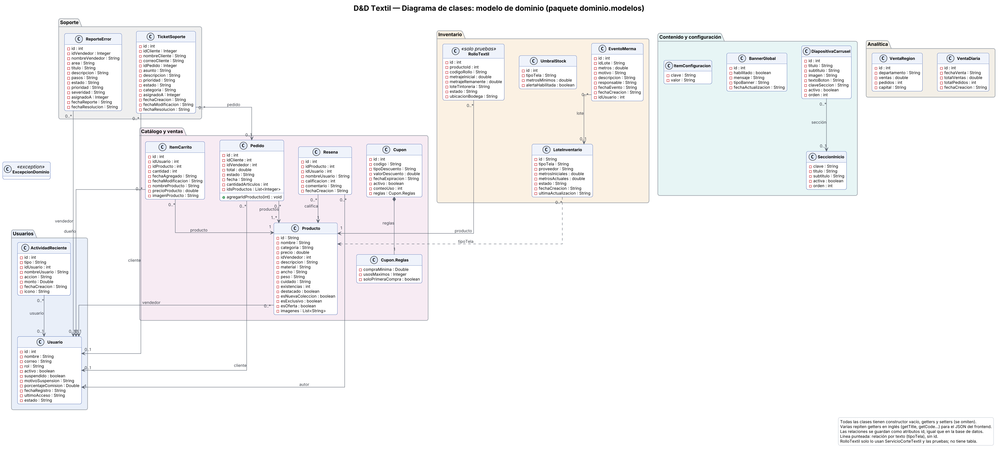
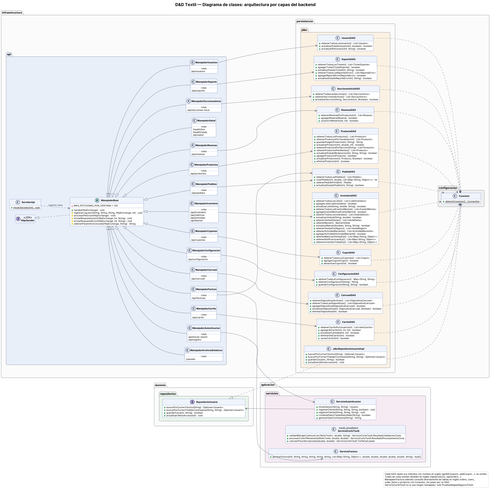
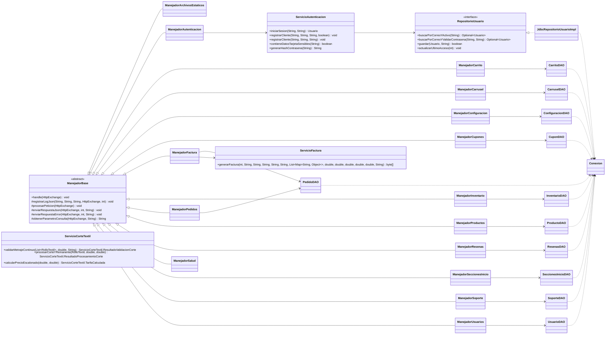

# Diagrama de clases — D&D Textil

> Generado desde el backend compilado (`javap` sobre `tienda digital de telas/backend-java/conexionPostgres/src`), así que los atributos y métodos son exactamente los del código. Se presentan dos vistas: el **modelo de dominio** (las clases de datos) y la **arquitectura por capas** (quién llama a quién).

## 1. Modelo de dominio

El paquete `dominio.modelos` tiene 19 clases. Son clases de datos: atributos privados, constructor vacío, getters y setters. La única con comportamiento propio es `Pedido.agregarIdProducto(int)`. Las relaciones no se modelan con referencias entre objetos sino con atributos `id`, igual que las llaves foráneas de la base de datos (ver `08-modelo-entidad-relacion.md`).

```mermaid
classDiagram
    direction LR
    class Usuario {
        -int id
        -String nombre
        -String correo
        -String rol
        -boolean activo
        -boolean suspendido
        -String motivoSuspension
        -Double porcentajeComision
        -String fechaRegistro
        -String ultimoAcceso
        -String estado
    }
    class Producto {
        -String id
        -String nombre
        -String categoria
        -double precio
        -int idVendedor
        -String descripcion
        -String material
        -String ancho
        -String peso
        -String cuidado
        -int existencias
        -boolean destacado
        -boolean esNuevaColeccion
        -boolean esExclusivo
        -boolean esOferta
        -List~String~ imagenes
    }
    class Resena {
        -int id
        -int idProducto
        -int idUsuario
        -String nombreUsuario
        -int calificacion
        -String comentario
        -String fechaCreacion
    }
    class ItemCarrito {
        -int id
        -int idUsuario
        -int idProducto
        -int cantidad
        -String fechaAgregado
        -String fechaModificacion
        -String nombreProducto
        -double precioProducto
        -String imagenProducto
    }
    class Pedido {
        -int id
        -int idCliente
        -int idVendedor
        -double total
        -String estado
        -String fecha
        -int cantidadArticulos
        -List~Integer~ idsProductos
        +agregarIdProducto(int) void
    }
    class Cupon {
        -int id
        -String codigo
        -String tipoDescuento
        -double valorDescuento
        -String fechaExpiracion
        -boolean activo
        -int conteoUso
        -Cupon.Reglas reglas
    }
    class LoteInventario {
        -String id
        -String tipoTela
        -String proveedor
        -double metrosIniciales
        -double metrosActuales
        -String estado
        -String fechaCreacion
        -String ultimaActualizacion
    }
    class EventoMerma {
        -int id
        -String idLote
        -double metros
        -String motivo
        -String descripcion
        -String responsable
        -String fechaEvento
        -String fechaCreacion
        -int idUsuario
    }
    class UmbralStock {
        -int id
        -String tipoTela
        -double metrosMinimos
        -boolean alertaHabilitada
    }
    class RolloTextil {
        -int id
        -int productoId
        -String codigoRollo
        -double metrajeInicial
        -double metrajeRemanente
        -String loteTintoreria
        -String estado
        -String ubicacionBodega
    }
    class TicketSoporte {
        -int id
        -Integer idCliente
        -String nombreCliente
        -String correoCliente
        -Integer idPedido
        -String asunto
        -String descripcion
        -String prioridad
        -String estado
        -String categoria
        -Integer asignadoA
        -String fechaCreacion
        -String fechaModificacion
        -String fechaResolucion
    }
    class ReporteError {
        -int id
        -Integer idVendedor
        -String nombreVendedor
        -String area
        -String titulo
        -String descripcion
        -String pasos
        -String estado
        -String prioridad
        -String severidad
        -Integer asignadoA
        -String fechaReporte
        -String fechaResolucion
    }
    class ActividadReciente {
        -int id
        -String tipo
        -int idUsuario
        -String nombreUsuario
        -String accion
        -Double monto
        -String fechaCreacion
        -String icono
    }
    class SeccionInicio {
        -String clave
        -String titulo
        -String subtitulo
        -boolean activa
        -int orden
    }
    class DiapositivaCarrusel {
        -int id
        -String titulo
        -String subtitulo
        -String imagen
        -String textoBoton
        -String claveSeccion
        -boolean activo
        -int orden
    }
    class BannerGlobal {
        -int id
        -boolean habilitado
        -String mensaje
        -String tipoBanner
        -String fechaActualizacion
    }
    class ItemConfiguracion {
        -String clave
        -String valor
    }
    class VentaDiaria {
        -int id
        -String fechaVenta
        -double totalVentas
        -int totalPedidos
        -String fechaCreacion
    }
    class VentaRegion {
        -int id
        -String departamento
        -double ventas
        -int pedidos
        -String capital
    }
    class CuponReglas {
        -Double compraMinima
        -Integer usosMaximos
        -boolean soloPrimeraCompra
    }
    Cupon *-- "1" CuponReglas : reglas
    Producto "0..*" --> "0..1" Usuario : vendedor
    Resena "0..*" --> "1" Producto : califica
    Resena "0..*" --> "1" Usuario : autor
    ItemCarrito "0..*" --> "1" Usuario : dueño
    ItemCarrito "0..*" --> "1" Producto : producto
    Pedido "0..*" --> "0..1" Usuario : cliente
    Pedido "0..*" --> "1..*" Producto : productos
    LoteInventario "0..*" ..> Producto : tipoTela
    EventoMerma "0..*" --> "0..1" LoteInventario : lote
    RolloTextil "0..*" --> "1" Producto : producto
    TicketSoporte "0..*" --> "0..1" Usuario : cliente
    TicketSoporte "0..*" --> "0..1" Pedido : pedido
    ReporteError "0..*" --> "0..1" Usuario : vendedor
    ActividadReciente "0..*" --> "0..1" Usuario : usuario
    DiapositivaCarrusel "0..*" --> "0..1" SeccionInicio : sección
    class RolloTextil
    <<soloPruebas>> RolloTextil
```

## 2. Arquitectura por capas

| Capa (paquete) | Responsabilidad | Clases |
| :--- | :--- | :--- |
| `infraestructura.api` | Recibe las peticiones HTTP, aplica CORS, límite de 120 peticiones/min por IP y registro en JSON (`ManejadorBase`), y delega en el manejador de cada ruta. | `ServidorApi`, `ManejadorBase` y 15 manejadores |
| `aplicacion.servicios` | Reglas de negocio que no son simple lectura/escritura. | `ServicioAutenticacion`, `ServicioFactura`, `ServicioCorteTextil` |
| `dominio` | Modelos, la interfaz `RepositorioUsuario` y `ExcepcionDominio`. | 19 modelos, 1 interfaz, 1 excepción |
| `infraestructura.persistencia.jdbc` | Acceso a PostgreSQL con JDBC y SQL escrito a mano. | 11 DAO y `JdbcRepositorioUsuarioImpl` |
| `infraestructura.configuracion` | Abre las conexiones con los datos de `DB_URL`, `DB_USER` y `DB_PASSWORD`. | `Conexion` |

### 2.1. Manejadores, rutas y tablas

| Manejador | Rutas (también existen en inglés) | Usa | Tablas que toca |
| :--- | :--- | :--- | :--- |
| `ManejadorArchivosEstaticos` | `/uploads` | — | — |
| `ManejadorAutenticacion` | `/api/iniciar-sesion`, `/api/registro` | `ServicioAutenticacion` | `usuarios` |
| `ManejadorCarrito` | `/api/carrito` | `CarritoDAO` | `imagenes_producto`, `items_carrito`, `productos` |
| `ManejadorCarrusel` | `/api/carrusel` | `CarruselDAO` | `diapositivas_carrusel` |
| `ManejadorConfiguracion` | `/api/configuracion` | `ConfiguracionDAO` | `configuracion_sistema` |
| `ManejadorCupones` | `/api/cupones` | `CuponDAO` | `cupones` |
| `ManejadorFactura` | `/api/facturas` | `PedidoDAO`, `ServicioFactura` | `items_pedido`, `order_items`, `orders`, `pedidos`, `productos`, `products`, `users` |
| `ManejadorInventario` | `/api/inventario`, `/api/metricas`, `/api/actividad`, `/api/banner` | `InventarioDAO` | `actividad_reciente`, `banner_global`, `eventos_merma`, `inventario_telas_erp`, `lotes_inventario`, `metricas_ventas_erp`, `notificaciones_sistema_erp`, `productos`, `umbrales_stock`, `ventas_diarias`, `ventas_region` |
| `ManejadorPedidos` | `/api/pedidos` | `PedidoDAO` | `items_pedido`, `pedidos`, `productos` |
| `ManejadorProductos` | `/api/productos` | `ProductoDAO` | `categorias`, `imagenes_producto`, `productos` |
| `ManejadorResenas` | `/api/resenas` | `ResenasDAO` | `resenas`, `usuarios` |
| `ManejadorSalud` | `/health/live`, `/health/ready`, `/api/salud` | — | — |
| `ManejadorSeccionesInicio` | `/api/secciones-inicio` | `SeccionesInicioDAO` | `secciones_inicio` |
| `ManejadorSoporte` | `/api/soporte` | `SoporteDAO` | `reportes_errores`, `tickets_soporte` |
| `ManejadorUsuarios` | `/api/usuarios` | `UsuarioDAO` | `usuarios` |

## 3. Observaciones de diseño

1. **Inversión de dependencias solo en autenticación.** `ServicioAutenticacion` depende de la interfaz `RepositorioUsuario` y recibe la implementación desde `ServidorApi`. El resto de manejadores crea sus DAO con `new` y no hay interfaces para ellos.
2. **Servicios casi vacíos.** La mayoría de manejadores habla directo con su DAO; la lógica de negocio (cupones, totales, IVA) vive en el frontend.
3. **`ManejadorFactura` salta la capa de persistencia.** Además de `PedidoDAO`, abre conexiones y consulta las tablas en inglés `orders`, `users`, `order_items` y `products` por su cuenta.
4. **`ServicioCorteTextil` y `RolloTextil` están desconectados.** Solo los usa `PruebasReglasNegocioTextil`; ningún manejador los llama y no existe tabla de rollos.
5. **Métodos y rutas duplicados en dos idiomas.** Cada DAO repite sus métodos en inglés (`getAllCoupons` junto a `obtenerTodosLosCupones`) y cada ruta existe en español e inglés. Si se elimina el frontend antiguo, basta con un solo idioma.
6. **`InventarioDAO` concentra seis temas** (lotes, merma, umbrales, banner, ventas y actividad). Separarlo haría más fácil probar cada parte.

Fuentes editables en PlantUML: `diagramas/fuentes/clases_dominio.puml` y `diagramas/fuentes/clases_capas.puml`.
