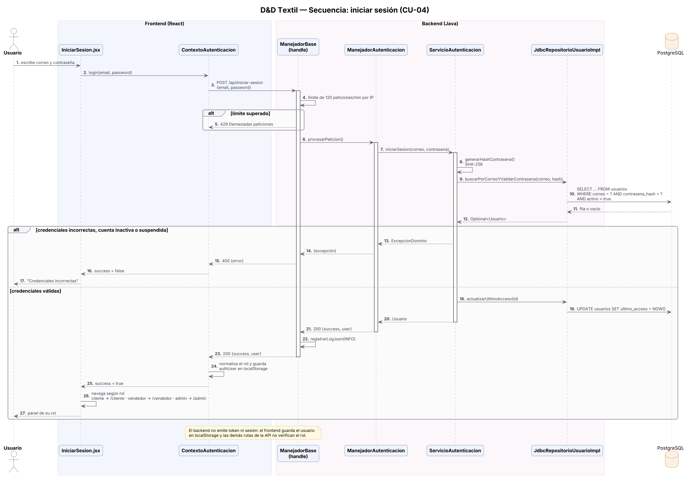
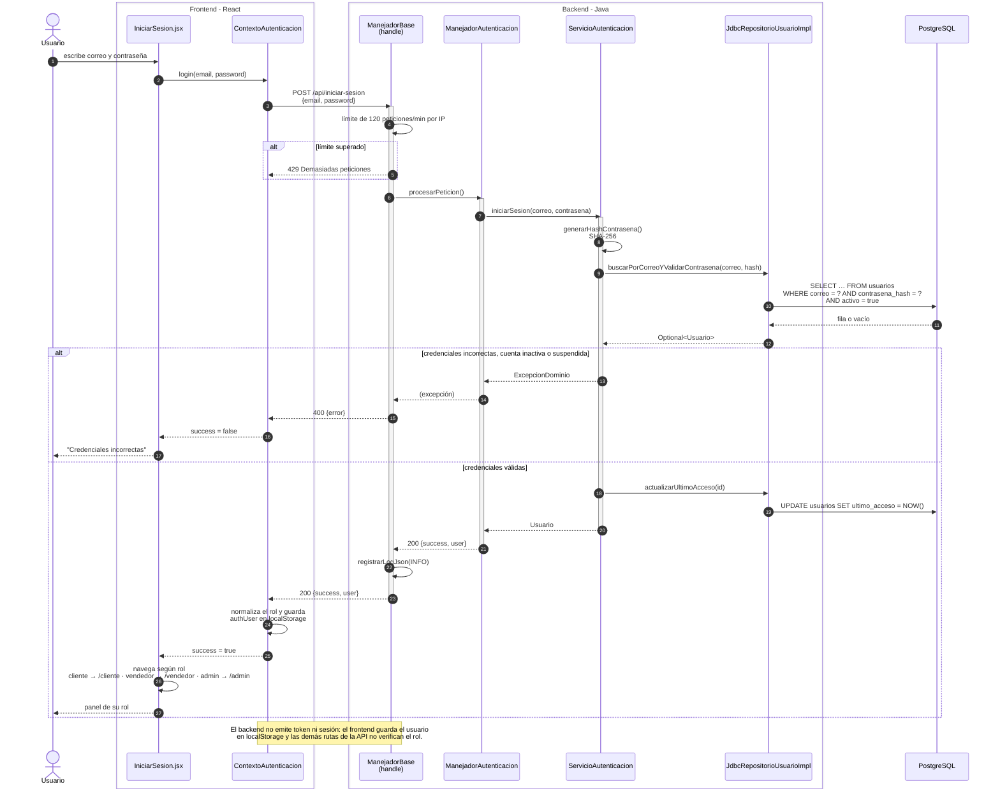
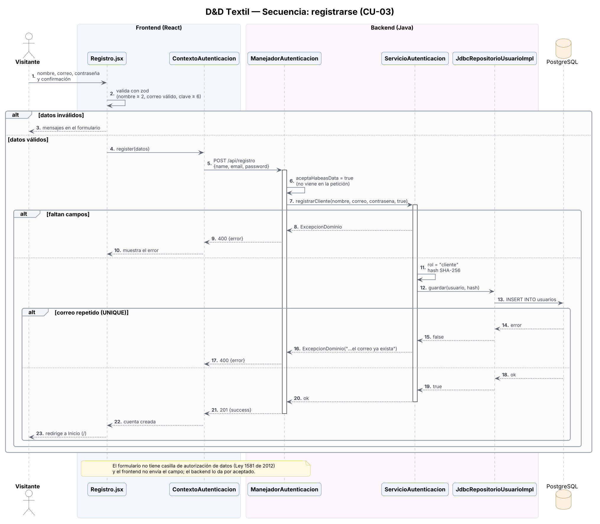
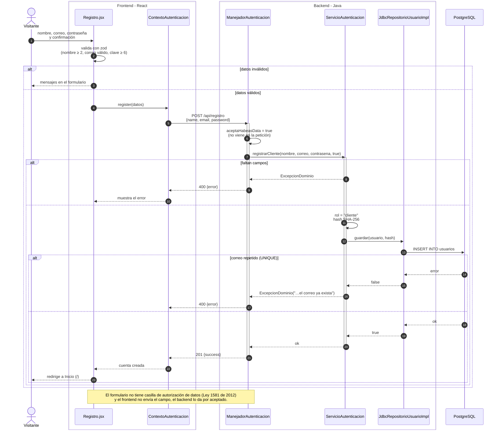
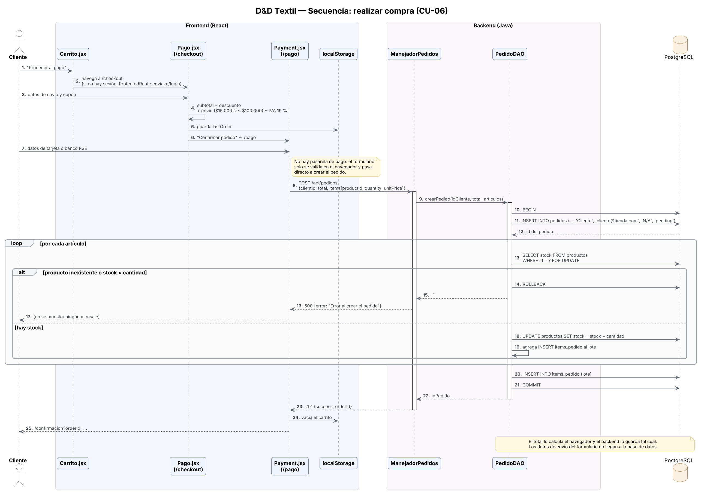
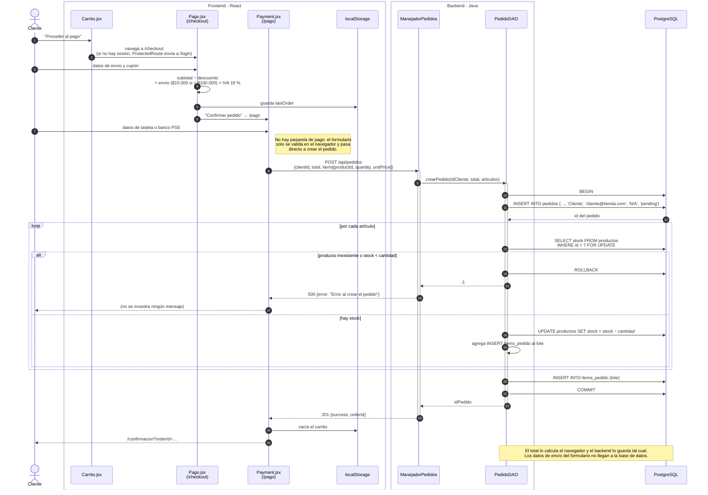
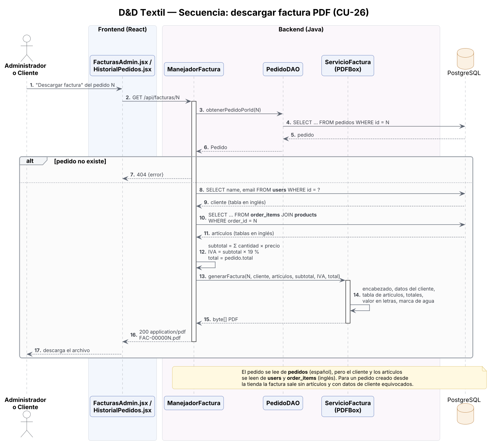
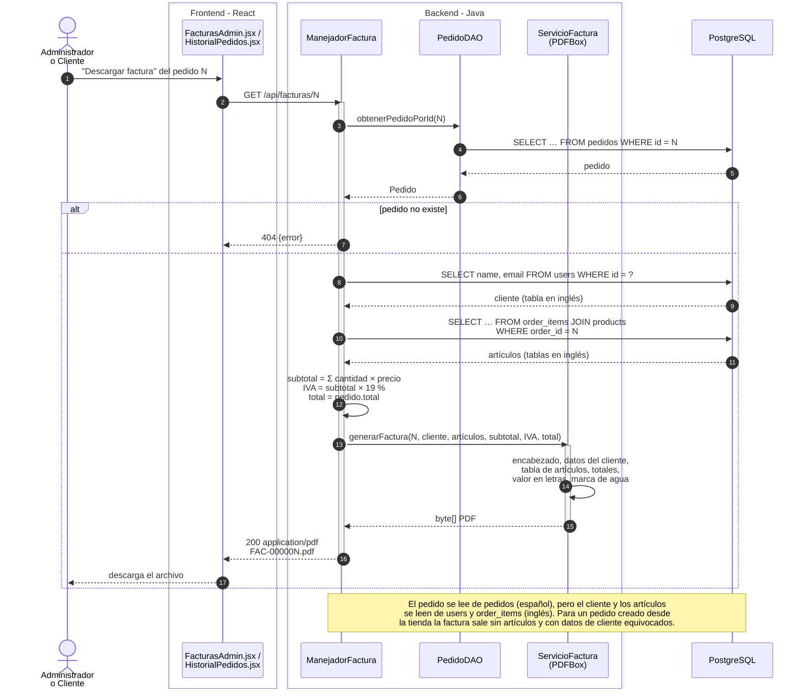
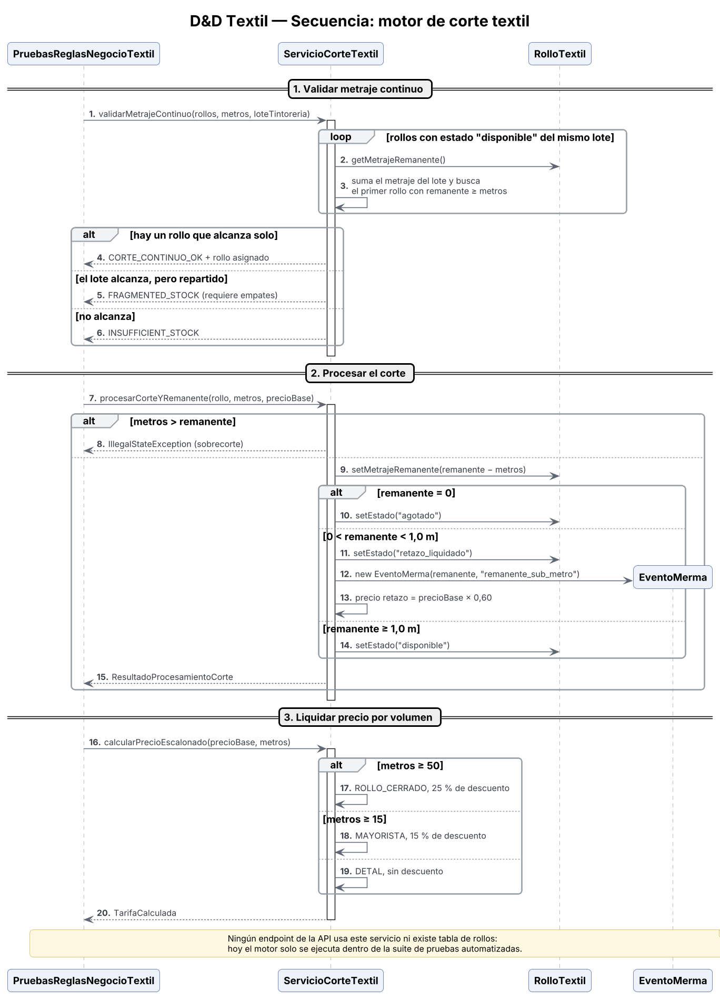
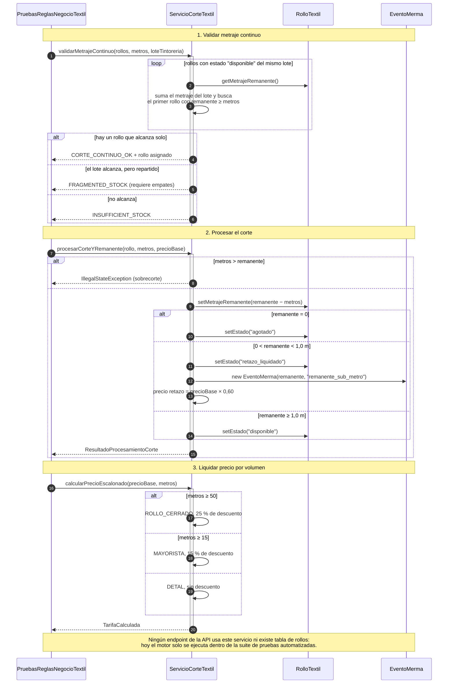

# Diagramas de secuencia — D&D Textil

> Cada diagrama sigue el código real, llamada por llamada: componentes de React, manejadores, servicios, DAO y las consultas SQL. Donde el comportamiento difiere de lo que dicen los requisitos, el diagrama lo marca con una nota.

| # | Flujo | Caso de uso | Archivos principales |
| :-: | :--- | :--- | :--- |
| 1 | Iniciar sesión | CU-04 | `IniciarSesion.jsx`, `ContextoAutenticacion.jsx`, `ManejadorAutenticacion`, `ServicioAutenticacion`, `JdbcRepositorioUsuarioImpl` |
| 2 | Registrarse | CU-03 | `Registro.jsx`, `ManejadorAutenticacion`, `ServicioAutenticacion` |
| 3 | Realizar compra | CU-06 | `Carrito.jsx`, `Pago.jsx`, `payment/Payment.jsx`, `ManejadorPedidos`, `PedidoDAO` |
| 4 | Descargar factura PDF | CU-26 | `FacturasAdmin.jsx`, `ManejadorFactura`, `PedidoDAO`, `ServicioFactura` |
| 5 | Motor de corte textil | — | `PruebasReglasNegocioTextil`, `ServicioCorteTextil`, `RolloTextil` |

## 1. Iniciar sesión

Todas las peticiones pasan primero por `ManejadorBase.handle()`, que agrega CORS, aplica el límite de 120 peticiones por minuto por IP, registra un log en JSON y convierte `ExcepcionDominio` en una respuesta 400.

Versión Mermaid (se dibuja en GitHub)

## 2. Registrarse

La validación ocurre dos veces: en el navegador con zod y en `ServicioAutenticacion`. El correo único lo garantiza la restricción `UNIQUE` de `usuarios.correo`.

Versión Mermaid (se dibuja en GitHub)

## 3. Realizar compra

Es el flujo más importante y el que más diferencias tiene con los requisitos: no hay pasarela de pago, los datos de envío no se guardan y si falla por stock la pantalla no avisa. Lo bueno: la creación del pedido es atómica y usa bloqueo pesimista (`SELECT … FOR UPDATE`) para evitar sobreventa.

Versión Mermaid (se dibuja en GitHub)

## 4. Descargar factura PDF

Muestra por qué la facturación falla con pedidos reales: el manejador mezcla la tabla `pedidos` (español) con `users`, `order_items` y `products` (inglés).

Versión Mermaid (se dibuja en GitHub)

## 5. Motor de corte textil

Documenta las reglas de negocio de corte (retazo por debajo de 1 m con 40 % de descuento; tarifa mayorista desde 15 m con 15 %; rollo cerrado desde 50 m con 25 %). Hoy este servicio solo se ejecuta en las pruebas automatizadas.

Versión Mermaid (se dibuja en GitHub)

Fuentes editables en PlantUML: `diagramas/fuentes/sec_*.puml`.
