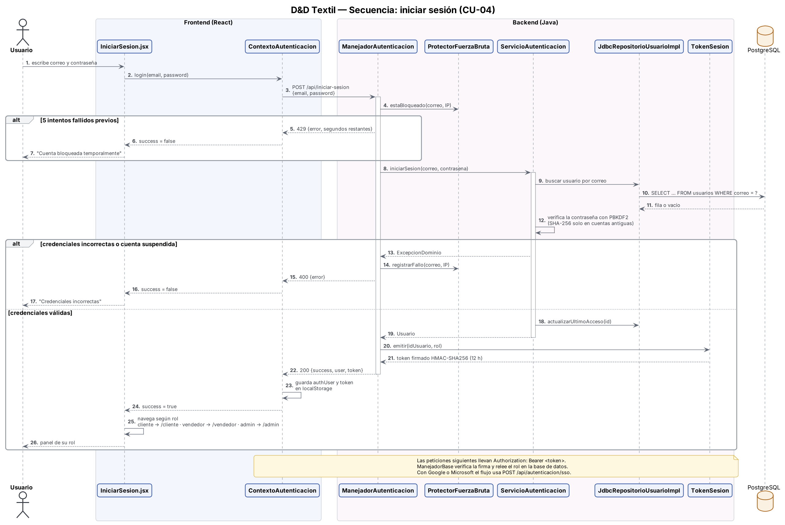
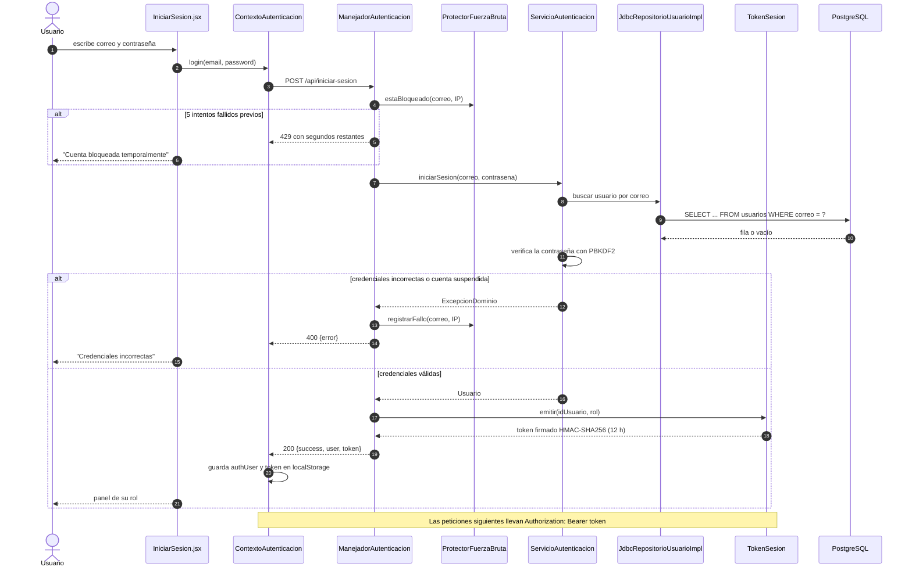
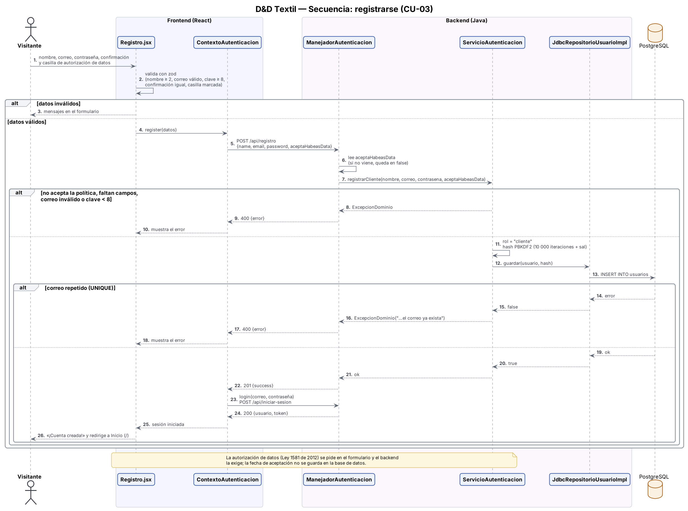
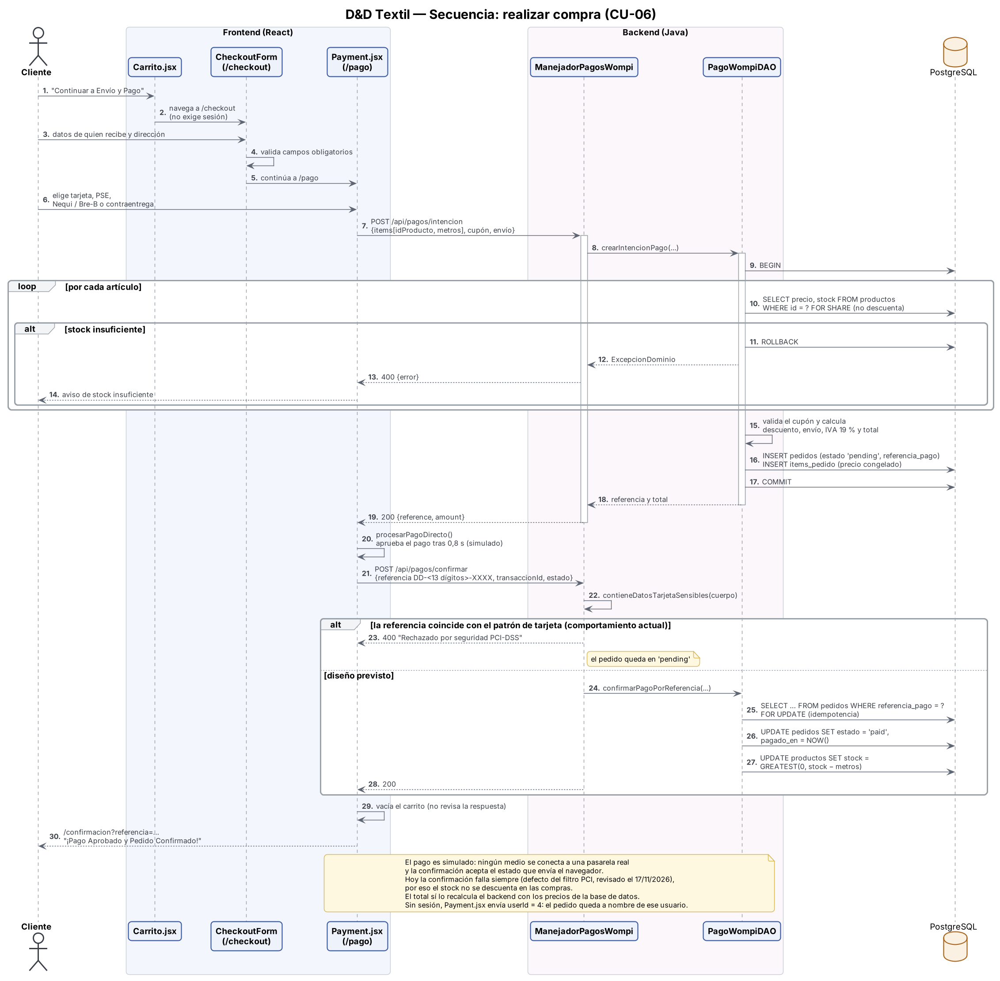
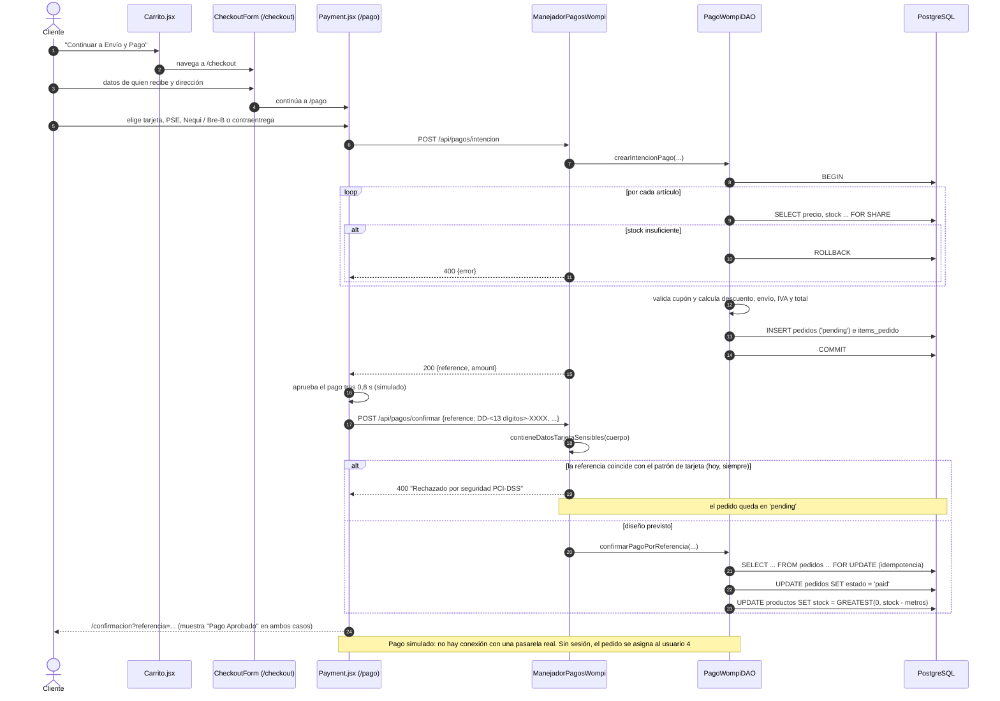
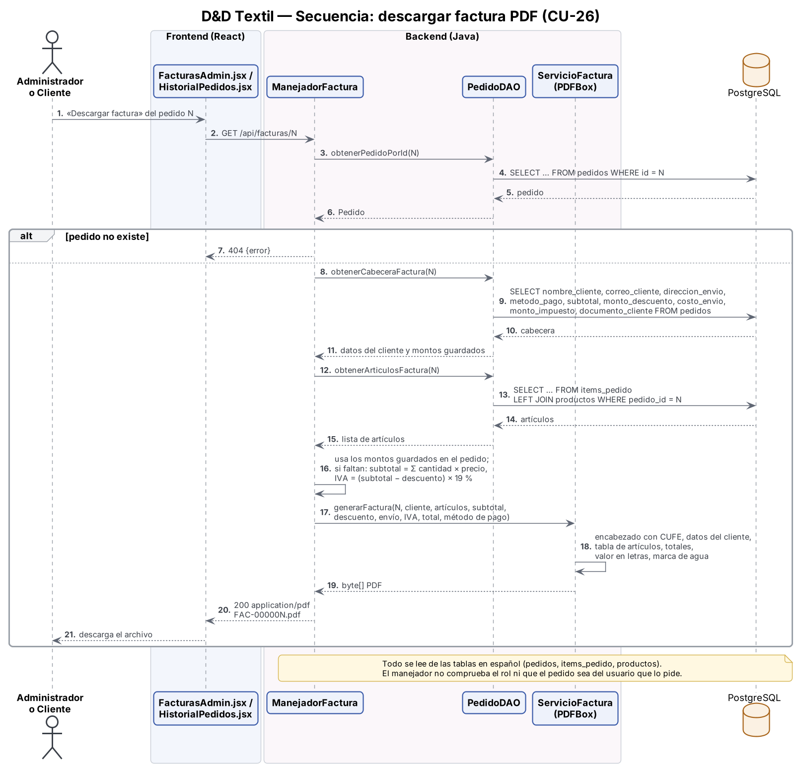
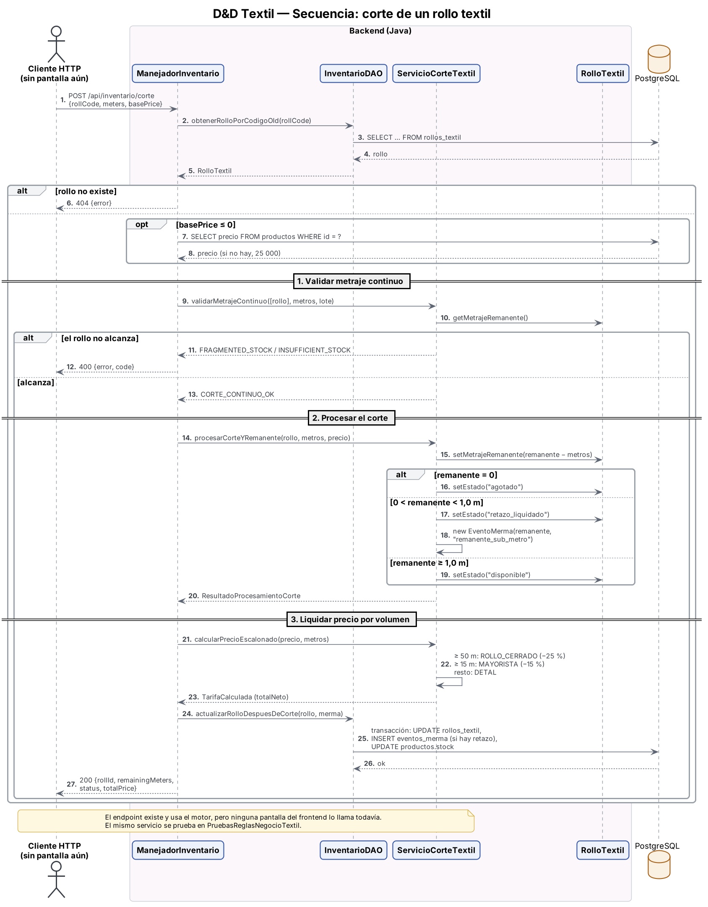
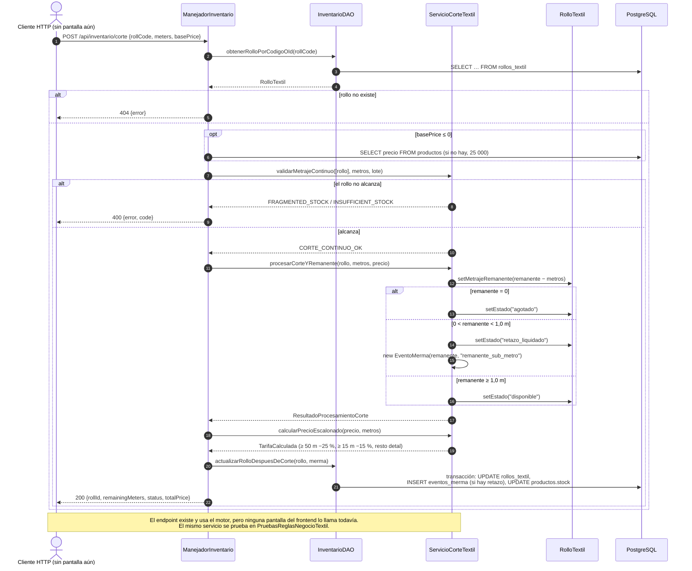
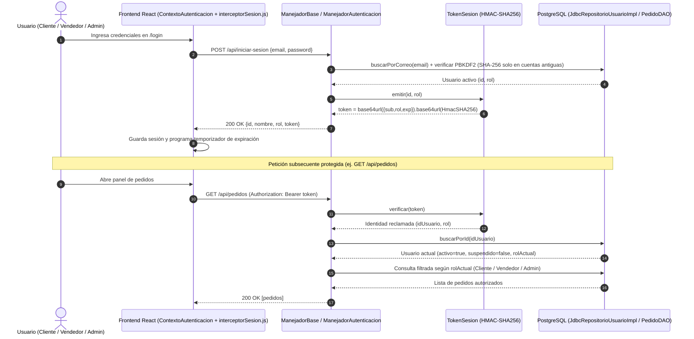

# Diagramas de secuencia — D&D Textil

> Cada diagrama sigue el código real, llamada por llamada: componentes de React, manejadores, servicios, DAO y las consultas SQL. Donde el comportamiento difiere de lo que dicen los requisitos, el diagrama lo marca con una nota.

| # | Flujo | Caso de uso | Archivos principales |
| :-: | :--- | :--- | :--- |
| 1 | Iniciar sesión | CU-04 | `IniciarSesion.jsx`, `ContextoAutenticacion.jsx`, `ManejadorAutenticacion`, `ServicioAutenticacion`, `JdbcRepositorioUsuarioImpl` |
| 2 | Registrarse | CU-03 | `Registro.jsx`, `ManejadorAutenticacion`, `ServicioAutenticacion` |
| 3 | Realizar compra | CU-06 | `Carrito.jsx`, `Pago.jsx`, `payment/Payment.jsx`, `ManejadorPedidos`, `PedidoDAO` |
| 4 | Descargar factura PDF | CU-26 | `FacturasAdmin.jsx`, `ManejadorFactura`, `PedidoDAO`, `ServicioFactura` |
| 5 | Motor de corte textil | — | `PruebasReglasNegocioTextil`, `ServicioCorteTextil`, `RolloTextil` |

## 1. Iniciar sesión

El inicio de sesión comprueba primero el bloqueo por intentos fallidos (`ProtectorFuerzaBruta`), verifica la contraseña con PBKDF2 y, si es correcta, emite un token firmado (`TokenSesion`, 12 horas) que el frontend envía en las peticiones siguientes.



<details><summary>Versión Mermaid (se dibuja en GitHub)</summary>



</details>

## 2. Registrarse

La validación ocurre dos veces: en el navegador con zod y en `ServicioAutenticacion`. El correo único lo garantiza la restricción `UNIQUE` de `usuarios.correo`.



<details><summary>Versión Mermaid (se dibuja en GitHub)</summary>

```mermaid
sequenceDiagram
    autonumber
    actor U as Visitante
    participant UI as Registro.jsx
    participant CTX as ContextoAutenticacion
    participant MA as ManejadorAutenticacion
    participant SA as ServicioAutenticacion
    participant REPO as JdbcRepositorioUsuarioImpl
    participant DB as PostgreSQL
    U->>UI: nombre, correo, contraseña, confirmación<br/>y casilla de autorización de datos
    UI->>UI: valida con zod (nombre ≥ 2, correo válido,<br/>clave ≥ 8, confirmación igual, casilla marcada)
    alt datos inválidos
        UI-->>U: mensajes en el formulario
    else datos válidos
        UI->>CTX: register(datos)
        CTX->>MA: POST /api/registro {name, email, password, aceptaHabeasData}
        MA->>SA: registrarCliente(nombre, correo, contrasena, aceptaHabeasData)
        alt no acepta la política, faltan campos, correo inválido o clave < 8
            SA-->>MA: ExcepcionDominio
            MA-->>CTX: 400 {error}
            CTX-->>UI: muestra el error
        else
            SA->>SA: rol = "cliente"<br/>hash PBKDF2 (10 000 iteraciones + sal)
            SA->>REPO: guardar(usuario, hash)
            REPO->>DB: INSERT INTO usuarios
            alt correo repetido (UNIQUE)
                DB-->>REPO: error
                REPO-->>SA: false
                SA-->>MA: ExcepcionDominio("…el correo ya exista")
                MA-->>CTX: 400 {error}
            else
                DB-->>REPO: ok
                REPO-->>SA: true
                MA-->>CTX: 201 {success}
                CTX->>MA: POST /api/iniciar-sesion (login automático)
                MA-->>CTX: 200 {usuario, token}
                UI-->>U: «¡Cuenta creada!» y redirige a Inicio (/)
            end
        end
    end
    Note over UI,SA: La autorización de datos (Ley 1581 de 2012) se pide en el formulario y el backend la exige;<br/>la fecha de aceptación no se guarda en la base de datos.
```

</details>

## 3. Realizar compra

La compra usa `ManejadorPagosWompi` y `PagoWompiDAO`: el backend recalcula el total, valida el stock con `SELECT … FOR SHARE` (sin descontarlo) y crea el pedido `pending` con los datos de envío. El stock solo se descuenta cuando el pago se aprueba (`procesarTransaccionWompi`), y como hoy la confirmación falla, las compras no bajan el stock. El pago es simulado: ningún medio se conecta a una pasarela real. El proceso no exige sesión, y si no la hay `Payment.jsx` asigna el pedido al usuario con id 4.



<details><summary>Versión Mermaid (se dibuja en GitHub)</summary>



</details>

## 4. Descargar factura PDF

El manejador lee el pedido, la cabecera de facturación y los artículos mediante `PedidoDAO`, todo desde las tablas en español (`pedidos`, `items_pedido`, `productos`), y arma el PDF con PDFBox.



<details><summary>Versión Mermaid (se dibuja en GitHub)</summary>

```mermaid
sequenceDiagram
    autonumber
    actor U as Administrador o Cliente
    participant UI as FacturasAdmin.jsx / HistorialPedidos.jsx
    participant MF as ManejadorFactura
    participant DAO as PedidoDAO
    participant SF as ServicioFactura (PDFBox)
    participant DB as PostgreSQL
    U->>UI: «Descargar factura» del pedido N
    UI->>MF: GET /api/facturas/N
    MF->>DAO: obtenerPedidoPorId(N)
    DAO->>DB: SELECT … FROM pedidos WHERE id = N
    DB-->>DAO: pedido
    DAO-->>MF: Pedido
    alt pedido no existe
        MF-->>UI: 404 {error}
    else
        MF->>DAO: obtenerCabeceraFactura(N)
        DAO->>DB: SELECT nombre_cliente, correo_cliente, direccion_envio, metodo_pago,<br/>subtotal, monto_descuento, costo_envio, monto_impuesto FROM pedidos
        DAO-->>MF: datos del cliente y montos guardados
        MF->>DAO: obtenerArticulosFactura(N)
        DAO->>DB: SELECT … FROM items_pedido LEFT JOIN productos
        DAO-->>MF: artículos
        MF->>MF: usa los montos guardados;<br/>si faltan: subtotal = Σ cantidad × precio,<br/>IVA = (subtotal − descuento) × 19 %
        MF->>SF: generarFactura(N, cliente, artículos, subtotal, descuento, envío, IVA, total, método)
        SF->>SF: encabezado con CUFE, cliente, artículos,<br/>totales, valor en letras, marca de agua
        SF-->>MF: byte[] PDF
        MF-->>UI: 200 application/pdf (FAC-00000N.pdf)
        UI-->>U: descarga el archivo
    end
    Note over MF,DB: Todo se lee de las tablas en español (pedidos, items_pedido, productos).<br/>El manejador no comprueba el rol ni que el pedido sea del usuario que lo pide.
```

</details>

## 5. Motor de corte textil

Documenta las reglas de negocio de corte (retazo por debajo de 1 m con 40 % de descuento; tarifa mayorista desde 15 m con 15 %; rollo cerrado desde 50 m con 25 %). El servicio se usa desde `POST /api/inventario/corte`, que actualiza el rollo, registra la merma y sincroniza el stock del producto; ninguna pantalla llama todavía a ese endpoint.



<details><summary>Versión Mermaid (se dibuja en GitHub)</summary>



</details>

Fuentes editables en PlantUML: `diagramas/fuentes/sec_*.puml`.


---

## 6. Diagrama de Secuencia: Emisión y Validación de Sesión Firmada (`TokenSesion`)


