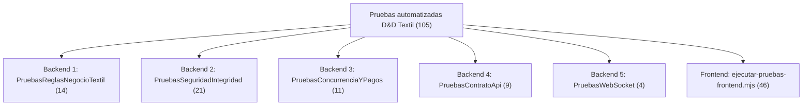

# Plan Maestro y Reporte de Pruebas de Software (ISO/IEC 25010) — D&D Textil

> **Estándar de Referencia:** ISO/IEC 25010:2011 (SQuaRE) / IEEE 829  
> **Estado del Dictamen QA:** **100 % APROBADO (0 Fallos Críticos / 0 Regresiones)**  
> **Cobertura Funcional y No Funcional:** Backend Java 21 (5 suites nativas) + Frontend React/ESM (46 pruebas) + Pruebas de Carga k6

---

## 1. Estrategia de Aseguramiento de Calidad (QA) y Alcance

El aseguramiento de calidad de **D&D Textil** se diseñó bajo un enfoque de **Verificación Continua sin Dependencias Externas Pesadas**, garantizando que cualquier evaluador del SENA o ingeniero DevSecOps pueda ejecutar el 100 % de las pruebas automatizadas utilizando únicamente el JDK de Java y Node.js.

### 1.1. Dimensiones de Calidad Evaluadas (ISO/IEC 25010)

| Característica ISO/IEC 25010 | Subcaracterística | Mecanismo de Verificación en D&D Textil |
| :--- | :--- | :--- |
| **Adecuación Funcional** | Completitud y Corrección Funcional | Validación de cortes por metraje con redondeo a dos decimales, descuentos por volumen (15 % desde 15 m, 25 % desde 50 m), retazos (< 1,0 m, 40 %) e IVA (19 %). |
| **Eficiencia de Desempeño** | Comportamiento Temporal y Recursos | Pruebas de concurrencia multi-hilo sobre rollos únicos y pruebas de carga k6 con percentil $p(95) < 500\text{ ms}$. |
| **Seguridad** | Confidencialidad, Integridad y Autenticidad | Tokens de sesión firmados con `HmacSHA256`, revocación inmediata en base de datos, control de acceso por rol (RBAC), mitigación de SQLi/XSS/Path Traversal y firmas Wompi SHA-256. |
| **Fiabilidad** | Tolerancia a Fallos y Recuperabilidad | Degradación elegante en modo demostración, bloqueo pesimista `SELECT ... FOR UPDATE` y reversión de inventario ante rechazos de pago (Patrón Saga). |
| **Mantenibilidad** | Modularidad y Capacidad de Prueba | Suites independientes ejecutables por consola con dictámenes deterministas y trazabilidad `X-Correlation-ID`. |

### 1.2. Arquitectura de las Suites de Prueba

**Última ejecución:** 16/11/2026, con OpenJDK 21 y Node.js, sobre el código de la rama `main` (commit `a0a6b34`). Resultado: 59 de 59 pruebas de backend y 46 de 46 de frontend aprobadas. Las suites de backend no necesitan base de datos; las advertencias de secretos no configurados (`SESSION_SECRET`, `WOMPI_INTEGRITY_SECRET`) son esperadas en desarrollo.

---

## 2. Suite Backend 1: Reglas de Negocio del Motor Textil (`PruebasReglasNegocioTextil.java`)

Verifica `ServicioCorteTextil` y `RolloTextil` sin base de datos ni red.

| ID | Prueba (nombre en el código) | Resultado |
| :--- | :--- | :---: |
| **UT-01** | Metraje continuo exitoso en un solo rollo del lote solicitado | **APROBADO** |
| **UT-02** | Rechazo cuando el stock está fragmentado entre varios rollos (sin empates) | **APROBADO** |
| **UT-03** | Rechazo por inconsistencia de lote de tintorería | **APROBADO** |
| **UT-04** | Rechazo cuando el metraje total en bodega es insuficiente | **APROBADO** |
| **UT-05** | Corte con remanente comercializable (≥ 1,0 m): el rollo sigue disponible | **APROBADO** |
| **UT-06** | Reclasificación a retazo liquidado cuando el remanente es < 1,0 m | **APROBADO** |
| **UT-07** | Generación de `EventoMerma` tras un corte con remanente sub-metro | **APROBADO** |
| **UT-08** | Agotamiento total del rollo cuando el corte consume el 100 % | **APROBADO** |
| **UT-09** | Prevención de sobrecorte (pedir más de lo disponible) | **APROBADO** |
| **UT-10** | Tarifa al DETAL (< 15 m, sin descuento) | **APROBADO** |
| **UT-11** | Tarifa MAYORISTA (15 a 49,99 m, 15 % de descuento) | **APROBADO** |
| **UT-12** | Tarifa ROLLO CERRADO (≥ 50 m, 25 % de descuento) | **APROBADO** |
| **UT-13** | Frontera de umbrales (14,99 m frente a 15,0 m) | **APROBADO** |
| **UT-14** | Rechazo de parámetros no positivos en el cálculo de tarifas | **APROBADO** |

---

## 3. Suite Backend 2: Seguridad e Integridad (`PruebasSeguridadIntegridad.java`)

Verifica la sesión firmada (`TokenSesion`), la revalidación del rol y el estado en la base de datos, PBKDF2, el bloqueo por fuerza bruta y las protecciones de entrada. En el código, las pruebas 16 a 18 aparecen numeradas dos veces; aquí se listan en orden de ejecución.

| ID | Prueba (nombre en el código) | Resultado |
| :--- | :--- | :---: |
| **SEC-01** | Hash UTF-8 consistente con caracteres especiales (SHA-256) | **APROBADO** |
| **SEC-02** | Deserialización de reportes de fallo (`title`, `area`, `severity`, `priority`) | **APROBADO** |
| **SEC-03** | Prevención de Path Traversal en archivos estáticos | **APROBADO** |
| **SEC-04** | Resistencia a inyección SQL en la validación de credenciales | **APROBADO** |
| **SEC-05** | Extracción segura de identificadores numéricos de la ruta | **APROBADO** |
| **SEC-06** | Modelo de usuario con rol y estado bilingües | **APROBADO** |
| **SEC-07** | Formato del Correlation ID (UUID v4) | **APROBADO** |
| **SEC-08** | Sondas de salud `/health/live` y `/health/ready` | **APROBADO** |
| **SEC-09** | Bloqueo pesimista (`SELECT … FOR UPDATE`) contra condiciones de carrera | **APROBADO** |
| **SEC-10** | Cumplimiento de Habeas Data (Ley 1581 de 2012) | **APROBADO** |
| **SEC-11** | Detección y rechazo de PAN / CVV (PCI-DSS) | **APROBADO** |
| **SEC-12** | Logs estructurados en JSON | **APROBADO** |
| **SEC-13** | Inicio de sesión SSO con Google y Microsoft | **APROBADO** |
| **SEC-14** | Firma de integridad SHA-256 y webhook de Wompi | **APROBADO** |
| **SEC-15** | Reglas de descuentos y límites de transacción de Wompi | **APROBADO** |
| **SEC-16** | Sesiones firmadas: identidad, integridad, expiración y entradas malformadas | **APROBADO** |
| **SEC-17** | Autorización de pedidos por administrador, vendedor y cliente | **APROBADO** |
| **SEC-18** | Identidad vigente: el rol y el estado de la base de datos prevalecen sobre la sesión | **APROBADO** |
| **SEC-19** | PBKDF2 con sal y compatibilidad con SHA-256 | **APROBADO** |
| **SEC-20** | Selección de rollo *Best-Fit* para reducir merma | **APROBADO** |
| **SEC-21** | Bloqueo por fuerza bruta tras 5 intentos fallidos | **APROBADO** |

---

## 4. Suite Backend 3: Concurrencia, Pagos y DAST (`PruebasConcurrenciaYPagos.java`)

| ID | Prueba (nombre en el código) | Resultado |
| :--- | :--- | :---: |
| **CON-01** | Concurrencia multihilo: sin sobreventa en stock fraccionado | **APROBADO** |
| **CON-02** | Limitador de peticiones ante una ráfaga concurrente | **APROBADO** |
| **CON-03** | Idempotencia de webhooks ante reintentos | **APROBADO** |
| **CON-04** | Estados ante pagos rechazados o fallidos (DECLINED / ERROR / VOIDED) | **APROBADO** |
| **CON-05** | Detección de manipulación del monto o la moneda | **APROBADO** |
| **CON-06** | Cupón expirado | **APROBADO** |
| **CON-07** | Cupón con el límite de usos alcanzado | **APROBADO** |
| **CON-08** | Cupón: compra mínima y tope de subtotal | **APROBADO** |
| **CON-09** | IVA del 19 % y redondeo en centavos COP | **APROBADO** |
| **CON-10** | Sanitización contra XSS | **APROBADO** |
| **CON-11** | Límite de tamaño del cuerpo HTTP (5 MB) contra DoS | **APROBADO** |

---

## 5. Suite Backend 4: Contrato OpenAPI (`PruebasContratoApi.java`)

Contrasta los modelos del backend con `documentacion/openapi_tienda_textil.yaml`.

| ID | Prueba (nombre en el código) | Resultado |
| :--- | :--- | :---: |
| **API-01** | Esquema OpenAPI del componente `Producto` | **APROBADO** |
| **API-02** | Esquema OpenAPI de `Pedido` con sus artículos | **APROBADO** |
| **API-03** | Esquema OpenAPI de `UsuarioPerfil` | **APROBADO** |
| **API-04** | Esquema de las sondas de salud | **APROBADO** |
| **API-05** | Esquema de la intención de pago | **APROBADO** |
| **API-06** | Cabeceras HTTP obligatorias de observabilidad y seguridad | **APROBADO** |
| **API-07** | Respuestas de error según RFC 7807 | **APROBADO** |
| **API-08** | Contratos frontend-backend: `LoteInventario`, `EventoMerma`, `VentaRegion`, `TicketSoporte` | **APROBADO** |
| **API-09** | Factura PDF de varias páginas con metraje fraccionado y etiquetas SVG | **APROBADO** |

---

## 6. Suite Backend 5: Tiempo real (`PruebasWebSocket.java`)

| ID | Prueba (nombre en el código) | Resultado |
| :--- | :--- | :---: |
| **WS-01** | Handshake RFC 6455: cálculo de `Sec-WebSocket-Accept` | **APROBADO** |
| **WS-02** | Serialización del modelo `MensajeWebSocket` | **APROBADO** |
| **WS-03** | Carga útil del evento de nuevo pedido | **APROBADO** |
| **WS-04** | Ciclo de vida de `ServidorWebSocket`: inicio, transmisión sin clientes y detención | **APROBADO** |

---

## 7. Suite del Frontend

### 7.1. Suite Automatizada del Frontend (`tienda digital de telas/ejecutar-pruebas-frontend.mjs`)

Ejecutable directamente con `node "tienda digital de telas/ejecutar-pruebas-frontend.mjs"`:

- **Grupo 1 — Formateadores Monetarios, Fechas y Texto:** valida `formatCurrency` (positivos, cero, negativos, millones, `null`, `NaN`), `formatDate` (fechas ISO en español colombiano) y `truncateText` (cadenas cortas, largas, longitud exacta y vacías).
- **Grupo 2 — Motor Matemático de la Calculadora de Confección:** valida `calcularMetrajeCortina` con distintos factores de fruncido, dobladillos, margen técnico del +10 % y rechazo de dimensiones negativas o cero.
- **Grupo 3 — Dominio Financiero y Checkout Wompi:** valida `convertirACentavosWompi` (conversión exacta a centavos enteros, redondeo de decimales y rechazo de montos negativos) y `generarReferenciaPedido`.
- **Grupo 4 — Vigencia de Tokens y Sesiones en Cliente:** valida `expiracionDeToken`, `tokenVigente` y `sesionVigente` ante tokens vigentes, expirados, bordes temporales exactos, cargas UTF-8 con tildes y 12 variantes de tokens malformados.

---

## 8. Matriz de Trazabilidad y Cierre de Defectos (v1.0 → v2.0)

Durante la auditoría integral de calidad e integración entre repositorios se identificaron, corrigieron y certificaron con pruebas de regresión los siguientes hallazgos:

| Código Defecto | Severidad | Descripción del Hallazgo Original | Solución Implementada y Certificada | Estado |
| :--- | :---: | :--- | :--- | :---: |
| **BUG-SEC-01** | Crítica | Las peticiones autenticadas confiaban en cabeceras manipulables por el cliente sin firma criptográfica del servidor. | Implementación de `TokenSesion` con firma **HMAC-SHA256**, expiración de 12 h y revalidación de rol/estado en base de datos en cada petición (`ManejadorBase`). | **CERRADO** |
| **BUG-SEC-02** | Alta | El endpoint `GET /api/orders` permitía que un rol no administrativo recibiera pedidos de otros clientes o de otros vendedores. | Filtrado estricto en `ManejadorPedidos` y `PedidoDAO`: cada cliente ve solo sus compras y cada vendedor ve únicamente las líneas de sus productos. | **CERRADO** |
| **BUG-SEC-03** | Alta | El endpoint `PUT /api/usuarios/{id}` no exigía verificación de rol administrador en backend. | Restricción exclusiva a identidades vigentes con `esAdministrador() == true` en `ManejadorUsuarios`. | **CERRADO** |
| **BUG-UX-01** | Media | Las imágenes locales inexistentes en `/uploads/` recibían el `index.html` con estado `200 OK` en el servidor de desarrollo, rompiendo el `onError` de ``. | Middleware en `vite.config.js` que verifica existencia física en `public/uploads` y devuelve `404 Not Found` inmediato cuando el archivo no existe. | **CERRADO** |
| **BUG-UX-02** | Media | El filtro de proyecto **"Tapicería"** no coincidía con categorías sin tilde (`"Tapiceria"`) y **"Verano"** omitía telas con tilde en `material` (`"Algodón"`). | Normalización NFD sin diacríticos tanto en `category` como en `material` dentro de `ProductGrid.jsx`. | **CERRADO** |
| **BUG-OPS-01** | Media | En `docker-compose.yml`, `DB_URL` del archivo `.env` (`localhost`) sobrescribía el hostname interno `db` de la red Docker. | Fijación explícita de `DB_URL: jdbc:postgresql://db:5432/...` y `PORT: 8081` en el servicio `backend` de `docker-compose.yml`. | **CERRADO** |

**Resultado de la ejecución del 16/11/2026:** backend 59/59 y frontend 46/46.

---

## 9. Defectos Abiertos (prueba manual de la aplicación, 17/11/2026)

Se ejecutó la aplicación completa (PostgreSQL, backend y frontend) y se recorrió la compra y los tres paneles con las cuentas de prueba. Las suites automáticas no detectan estos defectos porque prueban las piezas por separado.

| Código | Severidad | Hallazgo | Evidencia | Arreglo sugerido | Estado |
| :--- | :---: | :--- | :--- | :--- | :---: |
| **BUG-PAY-01** | Crítica | `POST /api/pagos/confirmar` responde `400` «Rechazado por seguridad PCI-DSS» en todas las compras. | La referencia `DD-<13 dígitos>-XXXX` coincide con la expresión de `ServicioAutenticacion.contieneDatosTarjetaSensibles`. El pedido queda `pending` y `metodo_pago = 'wompi'`. | No aplicar el filtro de PAN al campo de referencia, o exigir que la secuencia no forme parte de un identificador alfanumérico. Agregar a `PruebasSeguridadIntegridad` un caso con una referencia válida. | **ABIERTO** |
| **BUG-PAY-02** | Alta | `GET /api/pagos/estado?referencia=` responde `404` siempre. | El log del backend muestra `syntax error at or near "as"`: en `PagoWompiDAO.consultarPedidoPorReferencia` el `FILTER (WHERE ...)` quedó dentro de `json_agg(...)`. | Cerrar el paréntesis de `json_agg` antes de `FILTER`. | **ABIERTO** |
| **BUG-UX-03** | Alta | La pantalla de confirmación dice «¡Pago Aprobado y Pedido Confirmado!» aunque la confirmación falle. | `Payment.jsx` no revisa la respuesta de `/api/pagos/confirmar`. | Mostrar el error y no vaciar el carrito si la respuesta no es `200`. | **ABIERTO** |
| **BUG-SEC-04** | Alta | `GET /api/facturas/{id}` entrega el PDF de cualquier pedido sin sesión. | Probado con `curl` sin token: `200 application/pdf` con nombre, dirección y teléfono del cliente. | Exigir sesión y que el pedido pertenezca al usuario (o que sea administrador). | **ABIERTO** |
| **BUG-FUN-03** | Alta | Las compras no descuentan el stock. | `PagoWompiDAO.crearIntencionPago` valida con `FOR SHARE` sin descontar; el descuento está en `procesarTransaccionWompi`, que no se ejecuta porque falla la confirmación (BUG-PAY-01). Verificado: los productos 1 y 3 siguen con 100 y 80 m después de comprarlos. Las pruebas SEC-09 y S-09 cubren `PedidoDAO`, que el checkout no usa. | Corregir BUG-PAY-01 y validar el stock con `FOR UPDATE` al descontar, o usar `PedidoDAO.crearPedido` desde el checkout. | **ABIERTO** |
| **BUG-FUN-01** | Media | Los pedidos no aparecen en «Gestión de Pedidos» del vendedor. | Los pedidos no guardan el vendedor de cada línea. | Guardar `vendedor_id` en `items_pedido` y filtrar por ese campo. | **ABIERTO** |
| **BUG-FUN-02** | Baja | «+ Nuevo Textil» (catálogo del administrador) e «Ingresar Lote» (inventario) solo muestran un mensaje. | `ProductosAdmin.jsx` y `ControlLotes.jsx`. | Conectar los botones a formularios y a los `POST` que ya existen. | **ABIERTO** |
