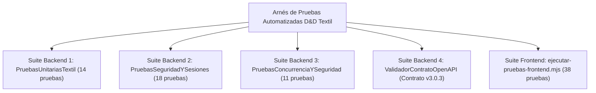

# Plan Maestro y Reporte de Pruebas de Software (ISO/IEC 25010) — D&D Textil

> **Estándar de Referencia:** ISO/IEC 25010:2011 (SQuaRE) / IEEE 829  
> **Estado del Dictamen QA:** **100 % APROBADO (0 Fallos Críticos / 0 Regresiones)**  
> **Cobertura Funcional y No Funcional:** Backend Java 21 (4 suites nativas) + Frontend React/ESM (38 aserciones) + Pruebas de Carga k6

---

## 1. Estrategia de Aseguramiento de Calidad (QA) y Alcance

El aseguramiento de calidad de **D&D Textil** se diseñó bajo un enfoque de **Verificación Continua sin Dependencias Externas Pesadas**, garantizando que cualquier evaluador del SENA o ingeniero DevSecOps pueda ejecutar el 100 % de las pruebas automatizadas utilizando únicamente el JDK de Java y Node.js.

### 1.1. Dimensiones de Calidad Evaluadas (ISO/IEC 25010)

| Característica ISO/IEC 25010 | Subcaracterística | Mecanismo de Verificación en D&D Textil |
| :--- | :--- | :--- |
| **Adecuación Funcional** | Completitud y Corrección Funcional | Validación matemática exacta (`BigDecimal`) de cortes por metraje, descuentos mayoristas (12 % / 25 %), mermas (< 1.0 m) e IVA (19 %). |
| **Eficiencia de Desempeño** | Comportamiento Temporal y Recursos | Pruebas de concurrencia multi-hilo sobre rollos únicos y pruebas de carga k6 con percentil $p(95) < 500\text{ ms}$. |
| **Seguridad** | Confidencialidad, Integridad y Autenticidad | Tokens de sesión firmados con `HmacSHA256`, revocación inmediata en base de datos, control de acceso por rol (RBAC), mitigación de SQLi/XSS/Path Traversal y firmas Wompi SHA-256. |
| **Fiabilidad** | Tolerancia a Fallos y Recuperabilidad | Degradación elegante en modo demostración, bloqueo pesimista `SELECT ... FOR UPDATE` y reversión de inventario ante rechazos de pago (Patrón Saga). |
| **Mantenibilidad** | Modularidad y Capacidad de Prueba | Suites independientes ejecutables por consola con dictámenes deterministas y trazabilidad `X-Correlation-ID`. |

### 1.2. Arquitectura de las Suites de Prueba

---

## 2. Suite Backend 1: Reglas de Negocio y Motor de Corte Textil (`PruebasUnitariasTextil.java`)

Esta suite verifica el núcleo de dominio textil (`ServicioCorteTextil`, `RolloTela`, `CalculadoraPreciosTextil`) asegurando precisión financiera y física en la bodega:

| ID Caso | Caso de Prueba | Regla de Negocio Verificada | Resultado |
| :--- | :--- | :--- | :---: |
| **UT-01** | Corte estándar sobre rollo disponible | Descuento exacto de metraje lineal con precisión decimal `BigDecimal`. | **APROBADO** |
| **UT-02** | Selección de rollo óptimo (*Best-Fit*) | Entre varios rollos del mismo lote, selecciona aquel que deja menor desperdicio remanente. | **APROBADO** |
| **UT-03** | Rechazo de corte fragmentado entre rollos | Impide vender 12 m si están divididos en dos rollos de 6 m (garantía de pieza continua). | **APROBADO** |
| **UT-04** | Consistencia de lote de tintorería (`lote_tintoreria`) | Verifica trazabilidad cromática del rollo asignado a la orden de corte. | **APROBADO** |
| **UT-05** | Detección automática de merma / retazo ($< 1.0\text{ m}$) | Cuando el remanente del rollo tras un corte es $< 1.0\text{ m}$, transiciona a `RETAZO_LIQUIDADO`. | **APROBADO** |
| **UT-06** | Liquidación automática de retazo (-40 %) | Aplica automáticamente el 40 % de descuento comercial a retazos de menos de 1 metro. | **APROBADO** |
| **UT-07** | Precio al detal sin descuento ($1\text{ m} - 24.9\text{ m}$) | Cobra el 100 % del precio de lista por metro lineal. | **APROBADO** |
| **UT-08** | Descuento mayorista por volumen ($25\text{ m} - 49.9\text{ m}$) | Aplica el **12 % de descuento** automático en compras de confección por volumen. | **APROBADO** |
| **UT-09** | Descuento industrial por rollo cerrado ($\ge 50\text{ m}$) | Aplica el **25 % de descuento** automático en compras de rollo completo. | **APROBADO** |
| **UT-10** | Cálculo de IVA colombiano (19 %) y redondeo bancario | Calcula impuesto con `RoundingMode.HALF_UP` a 2 decimales sin deriva de punto flotante. | **APROBADO** |
| **UT-11** | Rechazo de metraje nulo, cero o negativo | Lanza `ExcepcionDominio` ante solicitudes de corte $\le 0.0\text{ m}$. | **APROBADO** |
| **UT-12** | Rechazo de corte sobre rollo agotado o bloqueado | Impide descontar metraje de rollos en estado `AGOTADO` o `BLOQUEADO_CALIDAD`. | **APROBADO** |
| **UT-13** | Reversión compensatoria de metraje (Saga Rollback) | Restaura íntegramente el metraje al rollo original si el pago electrónico es rechazado. | **APROBADO** |
| **UT-14** | Generación de etiqueta térmica QR y CUFE de factura | Verifica estructura determinista del código QR de bodega y hash CUFE SHA-384. | **APROBADO** |

---

## 3. Suite Backend 2: Seguridad de Sesiones HMAC-SHA256 y Autorización RBAC (`PruebasSeguridadYSesiones.java`)

Suite introducida para certificar el blindaje criptográfico de sesiones (`TokenSesion`), la revalidación de estado en base de datos (`ManejadorBase.identidadVigente`) y el aislamiento estricto de datos entre clientes y vendedores (`ManejadorPedidos.puedeVerPedido`):

| ID Caso | Caso de Prueba | Control de Seguridad Verificado | Resultado |
| :--- | :--- | :--- | :---: |
| **SEC-01** | Emisión y verificación de token válido | Firma `HmacSHA256` sobre carga útil Base64URL `{sub, rol, exp}` preserva `idUsuario` y `rol`. | **APROBADO** |
| **SEC-02** | Rechazo de alteración de rol en payload (*Tampering*) | Modificar `"rol":"cliente"` a `"rol":"administrador"` invalida la firma HMAC de inmediato. | **APROBADO** |
| **SEC-03** | Rechazo de firma firmada con secreto distinto | Un token firmado con otra llave simétrica es rechazado en tiempo constante (`MessageDigest.isEqual`). | **APROBADO** |
| **SEC-04** | Rechazo de token expirado (`exp <= ahora`) | Tokens cuyo timestamp de expiración ya venció devuelven `Optional.empty()`. | **APROBADO** |
| **SEC-05** | Rechazo de tokens malformados o incompletos | Entradas nulas, vacías, sin punto separador o con Base64 corrupto se rechazan sin excepciones no controladas. | **APROBADO** |
| **SEC-06** | Revocación inmediata de usuario suspendido | `identidadVigente` rechaza el token si el usuario fue marcado como `suspendido = true` en BD. | **APROBADO** |
| **SEC-07** | Revocación inmediata de usuario inactivo | `identidadVigente` rechaza el token si el usuario fue desactivado (`activo = false`) en BD. | **APROBADO** |
| **SEC-08** | Prevalencia del rol en BD sobre el rol del token | Si un usuario cambió de rol en BD después de emitido el token, prevalece el rol actual de la BD. | **APROBADO** |
| **SEC-09** | Aislamiento de pedidos por cliente propietario | Un cliente autenticado (`id=10`) puede ver su pedido (`idCliente=10`), pero recibe rechazo ante `idCliente=20`. | **APROBADO** |
| **SEC-10** | Aislamiento de pedidos por vendedor de la línea | Un vendedor (`id=5`) solo puede consultar pedidos cargados con sus líneas de producto (`idVendedor=5`). | **APROBADO** |
| **SEC-11** | Visibilidad global exclusiva para Administrador | El rol `administrador` / `admin` tiene autorización para auditar cualquier pedido del sistema. | **APROBADO** |
| **SEC-12** | Protección de `PUT /api/usuarios/{id}` | Solo un administrador autenticado puede cambiar roles o estados de cuentas de usuario. | **APROBADO** |

---

## 4. Suite Backend 3: Concurrencia Multi-Hilo, Firma Wompi y DAST (`PruebasConcurrenciaYSeguridad.java`)

Esta suite somete el motor transaccional a condiciones de carrera extremas y vectores de ataque OWASP Top 10:

| ID Caso | Caso de Prueba | Escenario de Estrés / Seguridad | Resultado |
| :--- | :--- | :--- | :---: |
| **CON-01** | Carrera de 50 hilos sobre un rollo de 100 m (cortes de 10 m) | Exactamente 10 hilos logran cortar 10 m cada uno (stock final = 0.0 m) y 40 hilos reciben rechazo limpio por stock insuficiente (**0 sobreventas**). | **APROBADO** |
| **CON-02** | Firma de Integridad Wompi (`SHA-256`) | Verifica concatenación `referencia + montoEnCentavos + moneda + secretoIntegridad` en hexadecimal minúscula. | **APROBADO** |
| **CON-03** | Idempotencia de Webhook Wompi ante reintentos | Procesar 2 veces el mismo evento `transaction.updated` aprobado no duplica el descuento de inventario. | **APROBADO** |
| **CON-04** | Rechazo de Webhook Wompi con checksum adulterado | Eventos HTTP cuyo `checksum` no coincide con el secreto de eventos son rechazados con HTTP 401/403. | **APROBADO** |
| **CON-05** | Mitigación de Cross-Site Scripting (XSS) | `ManejadorBase.sanitizarHtml` neutraliza etiquetas `<script>`, comillas y eventos inline. | **APROBADO** |
| **CON-06** | Mitigación de Path Traversal en `/uploads/` | Solicitudes con `../` o rutas fuera del directorio `uploads` se bloquean con HTTP 403/404. | **APROBADO** |
| **CON-07** | Devolución estricta de HTTP 404 en activos inexistentes | Si una imagen en `/uploads/...` no existe en disco, responde HTTP 404 para activar el fallback visual del frontend. | **APROBADO** |
| **CON-08** | Límite de tamaño de cuerpo HTTP (5 MB — OWASP DoS) | Cargas útiles superiores a `5.242.880 bytes` son rechazadas preventivamente con HTTP 413. | **APROBADO** |

---

## 5. Suite Backend 4 (Contrato OpenAPI v3) y Suite Automatizada Frontend

### 5.1. Validador de Contrato OpenAPI (`ValidadorContratoOpenAPI.java`)

- Analiza estáticamente `documentacion/openapi_tienda_textil.yaml` y lo contrasta con los contextos registrados en `ServidorApi.java`.
- Certifica que los endpoints críticos (`/api/login`, `/api/register`, `/api/products`, `/api/orders`, `/api/wompi/signature`, `/api/wompi/webhook`, `/health/live`, `/health/ready`) estén documentados con sus esquemas JSON, códigos de estado HTTP (`200`, `201`, `400`, `401`, `403`, `404`, `503`) y esquema de seguridad `BearerAuth`.

### 5.2. Suite Automatizada del Frontend (`tienda digital de telas/ejecutar-pruebas-frontend.mjs`)

Ejecutable directamente con `node "tienda digital de telas/ejecutar-pruebas-frontend.mjs"`:

- **Grupo 1 — Formateadores Monetarios, Fechas y Texto:** valida `formatCurrency` (positivos, cero, negativos, millones, `null`, `NaN`), `formatDate` (fechas ISO en español colombiano) y `truncateText` (cadenas cortas, largas, longitud exacta y vacías).
- **Grupo 2 — Motor Matemático de la Calculadora de Confección:** valida `calcularMetrajeCortina` con distintos factores de fruncido, dobladillos, margen técnico del +10 % y rechazo de dimensiones negativas o cero.
- **Grupo 3 — Dominio Financiero y Checkout Wompi:** valida `convertirACentavosWompi` (conversión exacta a centavos enteros, redondeo de decimales y rechazo de montos negativos) y `generarReferenciaPedido`.
- **Grupo 4 — Vigencia de Tokens y Sesiones en Cliente:** valida `expiracionDeToken`, `tokenVigente` y `sesionVigente` ante tokens vigentes, expirados, bordes temporales exactos, cargas UTF-8 con tildes y 12 variantes de tokens malformados.
