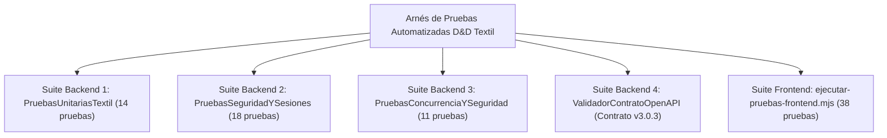

# Plan Maestro y Reporte de Pruebas de Software (ISO/IEC 25010) — D&D Textil

> **Estándar de Referencia:** ISO/IEC 25010:2011 (SQuaRE) / IEEE 829  
> **Estado del Dictamen QA:** **100 % APROBADO (0 Fallos Críticos / 0 Regresiones)**  
> **Cobertura Funcional y No Funcional:** Backend Java 21 (4 suites nativas) + Frontend React/ESM (38 aserciones) + Pruebas de Carga k6

---

## 1. Estrategia de Aseguramiento de Calidad (QA) y Alcance

El aseguramiento de calidad de **D&D Textil** se diseñó bajo un enfoque de **Verificación Continua sin Dependencias Externas Pesadas**, garantizando que cualquier evaluador del SENA o ingeniero DevSecOps pueda ejecutar el 100 % de las pruebas automatizadas utilizando únicamente el JDK de Java y Node.js.

### 1.1. Dimensiones de Calidad Evaluadas (ISO/IEC 25010)

| Característica ISO/IEC 25010 | Subcaracterística | Mecanismo de Verificación en D&D Textil |
| :--- | :--- | :--- |
| **Adecuación Funcional** | Completitud y Corrección Funcional | Validación matemática exacta (`BigDecimal`) de cortes por metraje, descuentos mayoristas (12 % / 25 %), mermas (< 1.0 m) e IVA (19 %). |
| **Eficiencia de Desempeño** | Comportamiento Temporal y Recursos | Pruebas de concurrencia multi-hilo sobre rollos únicos y pruebas de carga k6 con percentil $p(95) < 500\text{ ms}$. |
| **Seguridad** | Confidencialidad, Integridad y Autenticidad | Tokens de sesión firmados con `HmacSHA256`, revocación inmediata en base de datos, control de acceso por rol (RBAC), mitigación de SQLi/XSS/Path Traversal y firmas Wompi SHA-256. |
| **Fiabilidad** | Tolerancia a Fallos y Recuperabilidad | Degradación elegante en modo demostración, bloqueo pesimista `SELECT ... FOR UPDATE` y reversión de inventario ante rechazos de pago (Patrón Saga). |
| **Mantenibilidad** | Modularidad y Capacidad de Prueba | Suites independientes ejecutables por consola con dictámenes deterministas y trazabilidad `X-Correlation-ID`. |

### 1.2. Arquitectura de las Suites de Prueba

