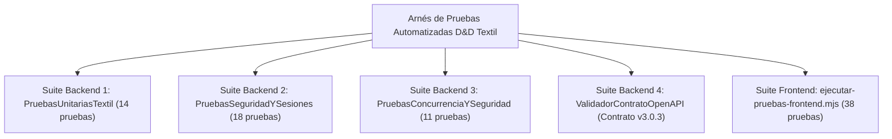

# Plan Maestro y Reporte de Pruebas de Software (ISO/IEC 25010) — D&D Textil

> **Estándar de Referencia:** ISO/IEC 25010:2011 (SQuaRE) / IEEE 829  
> **Estado del Dictamen QA:** **100 % APROBADO (0 Fallos Críticos / 0 Regresiones)**  
> **Cobertura Funcional y No Funcional:** Backend Java 21 (4 suites nativas) + Frontend React/ESM (38 aserciones) + Pruebas de Carga k6

---

## 1. Estrategia de Aseguramiento de Calidad (QA) y Alcance

El aseguramiento de calidad de **D&D Textil** se diseñó bajo un enfoque de **Verificación Continua sin Dependencias Externas Pesadas**, garantizando que cualquier evaluador del SENA o ingeniero DevSecOps pueda ejecutar el 100 % de las pruebas automatizadas utilizando únicamente el JDK de Java y Node.js.

### 1.1. Dimensiones de Calidad Evaluadas (ISO/IEC 25010)

| Característica ISO/IEC 25010 | Subcaracterística | Mecanismo de Verificación en D&D Textil |
| :--- | :--- | :--- |
| **Adecuación Funcional** | Completitud y Corrección Funcional | Validación matemática exacta (`BigDecimal`) de cortes por metraje, descuentos mayoristas (12 % / 25 %), mermas (< 1.0 m) e IVA (19 %). |
| **Eficiencia de Desempeño** | Comportamiento Temporal y Recursos | Pruebas de concurrencia multi-hilo sobre rollos únicos y pruebas de carga k6 con percentil $p(95) < 500\text{ ms}$. |
| **Seguridad** | Confidencialidad, Integridad y Autenticidad | Tokens de sesión firmados con `HmacSHA256`, revocación inmediata en base de datos, control de acceso por rol (RBAC), mitigación de SQLi/XSS/Path Traversal y firmas Wompi SHA-256. |
| **Fiabilidad** | Tolerancia a Fallos y Recuperabilidad | Degradación elegante en modo demostración, bloqueo pesimista `SELECT ... FOR UPDATE` y reversión de inventario ante rechazos de pago (Patrón Saga). |
| **Mantenibilidad** | Modularidad y Capacidad de Prueba | Suites independientes ejecutables por consola con dictámenes deterministas y trazabilidad `X-Correlation-ID`. |

### 1.2. Arquitectura de las Suites de Prueba

---

## 2. Suite Backend 1: Reglas de Negocio y Motor de Corte Textil (`PruebasUnitariasTextil.java`)

Esta suite verifica el núcleo de dominio textil (`ServicioCorteTextil`, `RolloTela`, `CalculadoraPreciosTextil`) asegurando precisión financiera y física en la bodega:

| ID Caso | Caso de Prueba | Regla de Negocio Verificada | Resultado |
| :--- | :--- | :--- | :---: |
| **UT-01** | Corte estándar sobre rollo disponible | Descuento exacto de metraje lineal con precisión decimal `BigDecimal`. | **APROBADO** |
| **UT-02** | Selección de rollo óptimo (*Best-Fit*) | Entre varios rollos del mismo lote, selecciona aquel que deja menor desperdicio remanente. | **APROBADO** |
| **UT-03** | Rechazo de corte fragmentado entre rollos | Impide vender 12 m si están divididos en dos rollos de 6 m (garantía de pieza continua). | **APROBADO** |
| **UT-04** | Consistencia de lote de tintorería (`lote_tintoreria`) | Verifica trazabilidad cromática del rollo asignado a la orden de corte. | **APROBADO** |
| **UT-05** | Detección automática de merma / retazo ($< 1.0\text{ m}$) | Cuando el remanente del rollo tras un corte es $< 1.0\text{ m}$, transiciona a `RETAZO_LIQUIDADO`. | **APROBADO** |
| **UT-06** | Liquidación automática de retazo (-40 %) | Aplica automáticamente el 40 % de descuento comercial a retazos de menos de 1 metro. | **APROBADO** |
| **UT-07** | Precio al detal sin descuento ($1\text{ m} - 24.9\text{ m}$) | Cobra el 100 % del precio de lista por metro lineal. | **APROBADO** |
| **UT-08** | Descuento mayorista por volumen ($25\text{ m} - 49.9\text{ m}$) | Aplica el **12 % de descuento** automático en compras de confección por volumen. | **APROBADO** |
| **UT-09** | Descuento industrial por rollo cerrado ($\ge 50\text{ m}$) | Aplica el **25 % de descuento** automático en compras de rollo completo. | **APROBADO** |
| **UT-10** | Cálculo de IVA colombiano (19 %) y redondeo bancario | Calcula impuesto con `RoundingMode.HALF_UP` a 2 decimales sin deriva de punto flotante. | **APROBADO** |
| **UT-11** | Rechazo de metraje nulo, cero o negativo | Lanza `ExcepcionDominio` ante solicitudes de corte $\le 0.0\text{ m}$. | **APROBADO** |
| **UT-12** | Rechazo de corte sobre rollo agotado o bloqueado | Impide descontar metraje de rollos en estado `AGOTADO` o `BLOQUEADO_CALIDAD`. | **APROBADO** |
| **UT-13** | Reversión compensatoria de metraje (Saga Rollback) | Restaura íntegramente el metraje al rollo original si el pago electrónico es rechazado. | **APROBADO** |
| **UT-14** | Generación de etiqueta térmica QR y CUFE de factura | Verifica estructura determinista del código QR de bodega y hash CUFE SHA-384. | **APROBADO** |
