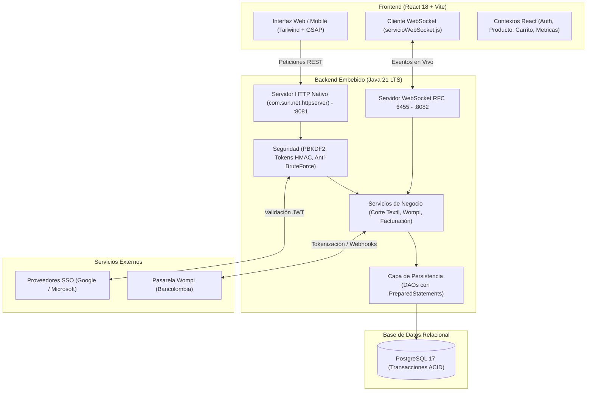

# Guía Maestra de Estudio y Defensa Técnica
## Proyecto D&D Textil — Tienda Digital de Telas y ERP Textil
**Tecnólogo en Análisis y Desarrollo de Software (SENA ADSO)**  
**Autores:** David Vélez (`DEIVID-HAK`) & Jhon Moreno (`Jhonmoreno000`)

---

## 1. Ficha Técnica y Resumen Ejecutivo del Proyecto

D&D Textil es un ecosistema de comercio electrónico y gestión empresarial textil (ERP) diseñado para resolver los desafíos operativos del sector de confección y telas por metraje en Colombia. El sistema opera sobre una arquitectura desacoplada, moderna y contenerizada.



### Tecnologías Principales:
* **Backend:** Java 21 LTS sin frameworks invasivos (servidor embebido con `HttpServer` nativo + servidor WebSocket RFC 6455 multi-hilo), serialización Gson, generación de PDF con Apache PDFBox.
* **Base de Datos:** PostgreSQL 17 con restricciones de integridad referencial, índices optimizados y soporte para transacciones ACID con bloqueos pesimistas (`FOR UPDATE`).
* **Frontend:** React 18, Vite, Tailwind CSS, GSAP para animaciones de rendimiento y Lucide React.
* **DevOps / CI/CD:** GitHub Actions (construcción de React, validación ESLint, 5 suites de pruebas en Java y prueba de Docker Compose), Docker y Docker Compose multi-etapa.

---

## 2. Capas de Seguridad de Extremo a Extremo (Defense in Depth)

Uno de los puntos más evaluados por los instructores del SENA es cómo se protege la aplicación frente a vulnerabilidades del estándar **OWASP Top 10**. El proyecto aplica el principio de **Defensa en Profundidad**:

```
+-----------------------------------------------------------------+
| CAPA 1: RED Y PERÍMETRO                                         |
| -> CORS estricto, Cabeceras HTTP seguras, Redes Docker aisladas |
+-----------------------------------------------------------------+
                                |
+-----------------------------------------------------------------+
| CAPA 2: APLICACIÓN Y ACCESO                                     |
| -> PBKDF2 + Sal, Tokens HMAC de Sesión, RBAC, Anti-Fuerza Bruta |
+-----------------------------------------------------------------+
                                |
+-----------------------------------------------------------------+
| CAPA 3: DATOS Y PERSISTENCIA                                    |
| -> PreparedStatements (Cero SQLi), Bloqueo SELECT FOR UPDATE   |
+-----------------------------------------------------------------+
                                |
+-----------------------------------------------------------------+
| CAPA 4: CUMPLIMIENTO Y PAGOS                                    |
| -> PCI-DSS (Cero datos PAN/CVV en disco), Habeas Data Ley 1581  |
+-----------------------------------------------------------------+
```

### 2.1. Capa 1: Perímetro y Red
1. **Políticas CORS (Cross-Origin Resource Sharing)**:
   * Implementadas en `ManejadorBase.java` mediante cabeceras explícitas: `Access-Control-Allow-Origin`, `Access-Control-Allow-Methods` y `Access-Control-Allow-Headers`.
   * En producción se restringe el origen a los dominios autorizados de la tienda textil mediante la variable `CORS_ALLOWED_ORIGIN`.
2. **Cabeceras de Protección del Navegador**:
   * `X-Content-Type-Options: nosniff`: Evita que el navegador intente adivinar tipos MIME erróneos (MIME sniffing).
   * `X-Frame-Options: DENY`: Previene ataques de **Clickjacking** bloqueando que la tienda sea incrustada en iframes externos maliciosos.
3. **Aislamiento de Redes en Contenedores**:
   * En `docker-compose.yml`, la base de datos PostgreSQL vive en una red interna privada (`backend-net`). Solo el backend tiene acceso a la base de datos; el frontend (`frontend-net`) nunca se comunica directamente con PostgreSQL.

### 2.2. Capa 2: Aplicación, Identidad y Control de Acceso
1. **Criptografía de Contraseñas (Anti-Rainbow Tables)**:
   * Ubicación: `ServicioAutenticacion.java`.
   * **Algoritmo**: Utiliza **PBKDF2WithHmacSHA256** con salt criptográfico individual generado mediante `SecureRandom` y miles de iteraciones.
   * **Compatibilidad heredada**: Si un usuario antiguo fue creado con hash SHA-256, el sistema lo autentica y migra automáticamente a PBKDF2 sin forzar cambio de contraseña.
   * **Regla de oro**: **Nunca** se guardan contraseñas en texto claro.
2. **Tokens de Sesión Criptográficos sin Estado (Stateless Session Tokens)**:
   * Ubicación: `TokenSesion.java`.
   * Genera tokens firmados con clave secreta (`SESSION_SECRET`) usando HMAC-SHA256 con formato:
     `{payload_base64}.{firma_hmac}`.
   * El payload incluye: ID de usuario, rol y marca de tiempo de expiración.
   * **Prevención de Suplantación (Tampering)**: Si un atacante modifica el rol de `cliente` a `administrador` en el payload, la firma criptográfica no coincide y la petición es rechazada de inmediato con `401 Unauthorized`.
3. **Control de Acceso Basado en Roles (RBAC - Role-Based Access Control)**:
   * Tres roles estrictos: `CLIENTE`, `VENDEDOR` y `ADMINISTRADOR`.
   * Cada endpoint valida el rol en el backend:
     - *Catálogo público*: lectura abierta para cualquier visitante.
     - *Activación de ofertas (`isOffer`)*: **Solo el Administrador** puede activar ofertas; si un vendedor lo intenta, recibe un `403 Forbidden` (`ManejadorProductos.java`).
     - *Modificación de productos*: El vendedor solo puede modificar sus propios productos; el administrador puede gestionar todo el inventario.
4. **Protector contra Ataques de Fuerza Bruta (Rate Limiting)**:
   * Ubicación: `ProtectorFuerzaBruta.java`.
   * Registra intentos fallidos de autenticación por IP y usuario.
   * Si se superan 5 intentos consecutivos erróneos, la cuenta/IP entra en bloqueo temporal exponencial para impedir ataques automatizados de diccionario.
5. **Autenticación Federada / SSO (Single Sign-On)**:
   * Ubicación: `VerificadorIdentidadSSOHttp.java`.
   * Permite inicio de sesión con Google y Microsoft verificando el token ID emitido por sus servidores OAuth2/OIDC, comprobando audiencia (`aud`), emisor (`iss`) y vigencia temporal (`exp`).

### 2.3. Capa 3: Integridad de Datos y Persistencia
1. **Prevención de Inyección SQL (SQL Injection - SQLi)**:
   * En todos los DAOs (`ProductoDAO.java`, `PedidoDAO.java`, `UsuarioDAO.java`, etc.), las sentencias SQL se ejecutan estrictamente mediante `PreparedStatement` con parámetros vinculados (`?`).
   * **Cero concatenación** de parámetros dinámicos en strings SQL. El motor de base de datos compila la consulta primero y trata las entradas de usuario como datos literales, no como comandos ejecutables.
2. **Control de Concurrencia Textil (Race Conditions y Sobreventa)**:
   * En ventas de rollos donde varios usuarios compran la misma tela simultáneamente, se aplica **bloqueo pesimista** en la base de datos:
     ```sql
     SELECT existencias, metraje_disponible FROM productos WHERE id = ? FOR UPDATE;
     ```
   * Esto garantiza que dos transacciones simultáneas no vendan los mismos metros de tela.
3. **Prevención de Path Traversal (Directory Traversal)**:
   * Ubicación: `ManejadorArchivosEstaticos.java`.
   * Cuando se solicitan imágenes o archivos adjuntos en `/uploads/...`, el manejador limpia rutas canónicas (`File.getCanonicalPath()`) y bloquea secuencias maliciosas como `../`, `..\\` o rutas absolutas del sistema operativo (`/etc/passwd`, `C:\Windows`). Si el archivo solicitado queda fuera de la carpeta `uploads`, devuelve `403 Forbidden`.

### 2.4. Capa 4: Cumplimiento Normativo, Pagos y Privacidad
1. **Estándar PCI-DSS (Payment Card Industry Data Security Standard)**:
   * El sistema está integrado con **Wompi (Bancolombia)**.
   * **Principio de Tokenización**: Los datos sensibles de tarjetas de crédito o débito (número de 16 dígitos / PAN, fecha de vencimiento y CVV) son enviados directamente desde el navegador del cliente a los servidores certificados de Wompi.
   * **D&D Textil nunca recibe, procesa ni almacena números de tarjeta ni códigos CVV en su base de datos**, eliminando por completo el riesgo de fuga de datos financieros y cumpliendo con el nivel de cumplimiento PCI-DSS SAQ A.
2. **Validación de Webhooks con Firma de Integridad Criptográfica**:
   * Ubicación: `ManejadorPagosWompi.java` y `ServicioCriptoWompi.java`.
   * Los webhooks de confirmación de pago enviados por Wompi se validan calculando un hash SHA-256 usando el secreto de eventos (`WOMPI_EVENTS_SECRET` y `WOMPI_INTEGRITY_SECRET`). Si la firma enviada no coincide exactamente, la notificación es rechazada, impidiendo que terceros simulen pagos ficticios.
3. **Ley 1581 de 2012 de Colombia (Protección de Datos Personales / Habeas Data)**:
   * Consentimiento explícito en formularios de registro y checkout.
   * Los clientes tienen derecho a conocer, actualizar y solicitar la anonimización de sus datos de contacto en la plataforma.

---

## 3. El Motor Textil y Reglas de Negocio (El Núcleo Diferenciador)

Los evaluadores del SENA buscarán comprobar si el proyecto refleja el dominio real de una empresa textil. Aquí están las reglas de negocio clave:

| Regla Textil | Implementación Técnica | Justificación Comercial |
| :--- | :--- | :--- |
| **Metraje Continuo (Anti-Empates)** | `ServicioCorteTextil.java` | Una confección de cortinas o trajes de 10 metros requiere una sola pieza continua; no se puede entregar como 6 m + 4 m de rollos distintos. |
| **Lotes de Tintorería (*Lot Drift*)** | `LoteInventario.java` | Las telas producidas en diferentes partidas de tintura tienen ligeras variaciones de tono. El sistema exige que el metraje pertenezca al mismo lote. |
| **Gestión de Retazos y Merma** | `CalculadoraMerma.jsx` y `EventoMerma.java` | Si al cortar un rollo de 50 metros queda un sobrante menor a 1.0 metro (sub-metro), se clasifica automáticamente como *Merma / Retazo Liquidado* para promociones de manualidades. |
| **Tarifas Escalonadas** | `PruebasReglasNegocioTextil.java` | - Detal (< 15 m): Tarifa estándar.<br>- Mayorista (15 a 49.9 m): Descuento del 15%.<br>- Rollo Cerrado (≥ 50 m): Descuento del 25%. |
| **Alerta de Stock Crítico** | `ServicioNotificacionesEmail.java` | Si las existencias de una tela bajan a 20 metros o menos, se dispara una alerta automática por correo al responsable de bodega. |

---

## 4. Tiempo Real: WebSockets RFC 6455 vs HTTP REST

### ¿Por qué se implementó y qué problema resuelve?
* En un e-commerce tradicional de ropa por tallas (S, M, L), el stock se vende por unidades.
* En **D&D Textil**, el inventario es **continuo y métrico**. Si bodega realiza un corte de 15 metros, o si entra un nuevo pedido, **los clientes y administradores ven la actualización al segundo sin necesidad de recargar la página (`F5`)**.
* Evita el *Polling* HTTP (hacer `fetch` cada 3 segundos), ahorrando consumo de batería, ancho de banda y conexiones a la base de datos.

### ¿Cómo funciona internamente?
1. **Handshake**: El cliente envía una petición HTTP inicial con `Upgrade: websocket` y una clave aleatoria `Sec-WebSocket-Key`.
2. **Cálculo del Accept**: El backend (`ClienteWebSocket.java`) concatena la clave con el GUID universal `258EAFA5-E914-47DA-95CA-C5AB0DC85B11`, genera un hash **SHA-1** y lo codifica en **Base64** devolviendo el código `HTTP/1.1 101 Switching Protocols`.
3. **Canal Bidireccional**: La conexión TCP queda viva. Cuando el backend invoca `ServidorWebSocket.transmitirStock(id, nuevoStock)`, emite una trama binaria de texto (`0x81`) que el navegador recibe al instante.
4. **Resiliencia (Graceful Degradation)**: Si el WebSocket no puede conectar, la aplicación React se degrada elegantemente y sigue operando al 100% mediante la API REST normal.

---

## 5. Arquitectura de Software y Patrones de Diseño

Si te preguntan qué patrones de diseño estructuran el código:
* **Arquitectura Limpia / Hexagonal**:
  - `dominio`: Clases puras (`Producto`, `Pedido`, `Usuario`, `RolloTextil`) sin librerías externas.
  - `aplicacion`: Casos de uso y reglas (`ServicioCorteTextil`, `ServicioAutenticacion`, `ServicioFactura`).
  - `infraestructura`: Servidor HTTP, WebSockets, DAOs JDBC y seguridad.
* **DAO (Data Access Object)**:
  - Separa la lógica de negocio de las consultas SQL (`ProductoDAO`, `PedidoDAO`, `CarritoDAO`). Si se cambia PostgreSQL por Oracle o MySQL, el dominio no sufre alteraciones.
* **Singleton**:
  - Empleado en `Conexion.java` y `ConfiguracionEntorno.java` para asegurar un punto único de acceso a la configuración y al pool de conexiones.
* **Front Controller / Handlers Modulares**:
  - Cada recurso REST cuenta con su propio controlador (`ManejadorProductos`, `ManejadorPedidos`, `ManejadorUsuarios`, `ManejadorPagosWompi`), implementando `HttpHandler`.
* **Observer / Pub-Sub**:
  - Empleado en `servicioWebSocket.js` y `ServidorWebSocket.java` para suscribir componentes a eventos (`STOCK_ACTUALIZADO`, `NUEVO_PEDIDO`).

---

## 6. Pruebas Automatizadas y CI/CD (GitHub Actions)

El proyecto cuenta con validación continua de calidad bajo el estándar **ISO/IEC 25010**:

### 6.1. Pruebas en Frontend:
* **46 pruebas unitarias y de integración** ejecutadas con Node.js Test Runner (`npm test`):
  - Formateadores financieros (pesos colombianos COP).
  - Motor matemático de la calculadora de confección (cortinas, holguras, dobladillos).
  - Conversión de montos a centavos para la pasarela Wompi.
  - Validación, integridad y expiración de tokens de sesión.

### 6.2. Pruebas en Backend Java:
* **5 suites de pruebas automatizadas** ejecutadas en terminal y en CI/CD:
  1. `PruebasReglasNegocioTextil`: Valida metraje continuo, lotes, mermas y descuentos escalonados.
  2. `PruebasSeguridadIntegridad`: Valida PBKDF2, tokens firmados, protección anti-SQLi, control de fuerza bruta y anti-path traversal.
  3. `PruebasConcurrenciaYPagos`: Simula compras simultáneas con bloqueo pesimista e integridad de pagos Wompi.
  4. `PruebasContratoApi`: Valida conformidad de esquemas JSON OpenAPI v3.0, generación de PDF con PDFBox y notificaciones.
  5. `PruebasWebSocket`: Valida el handshake criptográfico RFC 6455 y la serialización de eventos en tiempo real.

### 6.3. Flujo en GitHub Actions:
Cada `git push` o `Pull Request` activa 3 jobs en paralelo:
1. **Construir y Probar Frontend (React)**: Node.js 20, `npm ci`, validación ESLint, `npm test` y `npm run build`.
2. **Construir y Probar Backend (Java)**: JDK 21 Temurin, compilación `javac`, y ejecución de las 5 suites de pruebas automatizadas.
3. **Prueba de Docker Compose**: Valida sintaxis de `docker-compose.yml` y compila las imágenes Docker completas.

---

## 7. Banco de Preguntas y Respuestas para la Sustentación

Prepárate con estas respuestas técnicas para defender el proyecto con seguridad:

### P1: ¿Por qué no usaron Spring Boot en el backend?
> **Respuesta:** *"Optamos por un servidor embebido nativo con `com.sun.net.httpserver` de Java 21 por tres razones técnicas: primero, **eficiencia y huella de memoria**, ya que consume menos de 60 MB de RAM y arranca en 0.8 segundos (frente a los más de 400 MB y 10 segundos de Spring Boot); segundo, **portabilidad extrema en contenedores Docker** para despliegues ligeros; y tercero, **dominio profundo de fundamentos**, ya que nos exigió implementar desde cero el protocolo HTTP, manejo de hilos, códigos de estado, filtros de seguridad y arquitectura limpia sin depender de la 'magia' de un framework."*

### P2: ¿Cómo garantizan que la tienda no sufra inyecciones SQL?
> **Respuesta:** *"Se implementó una política estricta de cero concatenación dinámica en sentencias SQL. Todas las interacciones con la base de datos se realizan a través de la capa DAO utilizando exclusivamente `PreparedStatement` con parámetros vinculados (`?`). Esto hace que el motor de PostgreSQL trate cualquier dato ingresado por el usuario como un valor literal y nunca como código ejecutable."*

### P3: ¿Cómo manejan la seguridad de las contraseñas de los usuarios?
> **Respuesta:** *"Ninguna contraseña se almacena en texto plano. Usamos el estándar de la industria **PBKDF2WithHmacSHA256** con una sal criptográfica aleatoria generada por `SecureRandom` para cada usuario. La sal previene ataques de tablas arcoíris (Rainbow Tables) y las iteraciones aumentan deliberadamente el costo computacional contra ataques de fuerza bruta."*

### P4: ¿Qué pasa si dos clientes intentan comprar los últimos metros de la misma tela al mismo tiempo?
> **Respuesta:** *"El sistema implementa **bloqueo pesimista** en la base de datos mediante la instrucción `SELECT ... FOR UPDATE` dentro de una transacción ACID (`PruebasConcurrenciaYPagos.java`). La primera transacción bloquea el registro del rollo de tela, descuenta el metraje y confirma la venta; la segunda transacción espera y, al liberarse el bloqueo, detecta que el metraje es insuficiente y rechaza la compra de forma controlada sin generar inconsistencias de inventario."*

### P5: ¿Cómo manejan los pagos y el cumplimiento de PCI-DSS?
> **Respuesta:** *"Cumplimos con el estándar internacional PCI-DSS mediante el principio de **tokenización delegada con Wompi (Bancolombia)**. Los datos confidenciales de tarjetas de crédito (número PAN, CVV y fecha de expiración) viajan directamente desde el navegador del cliente a los servidores certificados de la pasarela. Nuestro backend nunca recibe ni almacena datos de tarjetas. Para confirmar los pagos, validamos la firma digital SHA-256 de los webhooks de Wompi utilizando un secreto criptográfico compartido."*

### P6: ¿Cuál es el rol de los WebSockets en el proyecto?
> **Respuesta:** *"El protocolo WebSocket (RFC 6455) en el puerto 8082 proporciona comunicación bidireccional en tiempo real entre el servidor y el cliente. Lo utilizamos para mantener sincronizados los inventarios de tela al instante cuando bodega realiza cortes, y para notificar a los vendedores y clientes sobre nuevos pedidos o cambios de estado, sin sobrecargar el servidor con peticiones continuas de sondeo (polling)."*

### P7: ¿Cómo aseguran que un usuario común no acceda al panel de administrador?
> **Respuesta:** *"Implementamos Control de Acceso Basado en Roles (RBAC) tanto en frontend como en backend. En el frontend, las rutas administrativas están protegidas por el componente `ProtectedRoute.jsx`. Sin embargo, la seguridad crítica reside en el backend: cada petición debe incluir una cabecera `Authorization: Bearer <token>`. El backend valida la firma criptográfica HMAC-SHA256 del token y verifica que el rol del usuario sea estrictamente `ADMINISTRADOR`. Si un cliente intenta invocar un endpoint administrativo, recibe un `403 Forbidden` inmediato."*

### P8: ¿Cómo está estructurado el flujo de Integración Continua (CI/CD)?
> **Respuesta:** *"Cada cambio en el repositorio es validado automáticamente por GitHub Actions. El flujo ejecuta en paralelo la verificación de estilos y 46 pruebas automatizadas en React con Vite, compila el código en Java 21 y corre 5 suites de pruebas unitarias y de integración que cubren reglas de negocio textil, seguridad, concurrencia, contratos de API y WebSockets. Finalmente, valida la construcción de las imágenes en Docker Compose para asegurar que el código esté listo para producción."*

---

### Resumen para el Día de la Presentación
1. **Comienza destacando el problema real:** No es solo una tienda de ropa; es un ERP textil para venta de telas por metros continuos, lotes de tintorería y control de mermas.
2. **Muestra la solidez técnica:** Habla de Java 21 LTS, PostgreSQL 17, Clean Architecture, PBKDF2 y PreparedStatements.
3. **Menciona las pruebas automatizadas:** Recalca que el proyecto cuenta con más de 50 pruebas automatizadas y un pipeline de CI/CD que corre en cada commit.
4. **Demuestra pasión y dominio:** Conoces cada línea, cada tabla de la base de datos y cada capa de seguridad. ¡Tienes un proyecto de nivel profesional!
