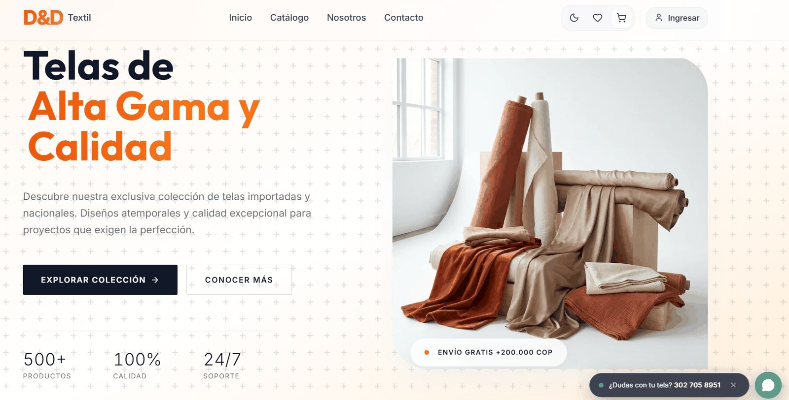

<p align="center">
  
</p>

<p align="center">
  
  
  
  
  
</p>

<p align="center">
  
</p>

---

# D&D Textil: aplicación web y API

Esta carpeta contiene el código de la tienda: el frontend en React (`src/`), el backend en Java (`backend-java/servidor-api/`) y la app Android generada con Capacitor (`android/`). La documentación detallada está en [`../documentacion/`](../documentacion/); este archivo resume lo necesario para entender y ejecutar el proyecto.

## Contenido

1. [Qué hace la plataforma](#1-qué-hace-la-plataforma)
2. [Frontend](#2-frontend)
3. [Backend](#3-backend)
4. [Base de datos](#4-base-de-datos)
5. [Ejecución local sin Docker](#5-ejecución-local-sin-docker)
6. [Pruebas automatizadas](#6-pruebas-automatizadas)
7. [Cuentas de prueba](#7-cuentas-de-prueba)
8. [Limitaciones conocidas](#8-limitaciones-conocidas)
9. [Más documentación](#9-más-documentación)

## 1. Qué hace la plataforma

Tienda en línea de telas por metro con tres roles:

| Rol | Qué puede hacer |
| :--- | :--- |
| Cliente | Comprar, ver y rastrear sus pedidos, descargar la factura PDF, abrir tickets de soporte, guardar favoritos y usar la calculadora de metraje |
| Vendedor | Publicar y editar sus telas (precio, stock, imagen), gestionar sus pedidos y ver alertas de stock bajo |
| Administrador | Usuarios y roles, moderación de productos, inventario (lotes, mermas, umbrales), contenido del inicio, cupones, tickets, facturas y analítica |

La aplicación tiene **54 rutas** definidas en `src/App.jsx`. El mapa completo está en [09-mapa-de-navegacion.md](../documentacion/09-mapa-de-navegacion.md).

## 2. Frontend

| Pieza | Versión o detalle |
| :--- | :--- |
| React | 18.3 |
| Vite | 5.4 (servidor de desarrollo en el puerto **3001**; reenvía `/api` y `/uploads` al backend en el 8081) |
| Tailwind CSS | 3.4 |
| React Router DOM | 6.22 |
| Formularios | react-hook-form + zod |
| Gráficas y animación | Recharts y GSAP |
| App móvil | Capacitor 8 (`android/`) |

Estado global con Context API en `src/contextos/`: `ContextoAutenticacion` (login, registro, SSO y token), `ContextoCarrito`, `ContextoProducto` (catálogo y eventos de stock en tiempo real), `ContextoMetricas` (datos de los paneles), `ContextoNotificacion` y `ContextoWebSocket`. `utilidades/interceptorSesion.js` agrega `Authorization: Bearer <token>` a cada petición. La estructura de carpetas completa está en [03-arquitectura-frontend-y-roles.md](../documentacion/03-arquitectura-frontend-y-roles.md).

## 3. Backend

Java 21 sin frameworks, sobre `com.sun.net.httpserver.HttpServer` (pool de mínimo 32 hilos), con Gson, PDFBox y el driver JDBC de PostgreSQL (carpeta `lib/`). El código se organiza en tres capas:

```text
backend-java/servidor-api/src/
 +-- dominio/          # 19 clases de datos (Producto, Pedido, Usuario, RolloTextil...) y repositorios
 +-- aplicacion/       # Servicios: autenticación, corte textil, facturas PDF, notificaciones
 +-- infraestructura/
 |    +-- api/          # ServidorApi, ManejadorBase y 16 manejadores HTTP; websocket/ (puerto 8082)
 |    +-- persistencia/ # 11 DAO, JdbcRepositorioUsuarioImpl y MigradorEsquemaPagos
 |    +-- seguridad/    # TokenSesion, ProtectorFuerzaBruta, verificación SSO
 |    +-- configuracion/# Conexion (pool JDBC propio) y variables de entorno
 +-- App.java          # Punto de entrada
 +-- Pruebas*.java     # 5 suites de pruebas
```

Seguridad implementada:

- Contraseñas con **PBKDF2WithHmacSHA256** (10.000 iteraciones, sal de 16 bytes). Las cuentas antiguas con SHA-256 se siguen aceptando.
- **Token de sesión** firmado con HMAC-SHA256, válido 12 horas. En cada petición protegida el backend vuelve a leer el rol y el estado del usuario en la base de datos.
- **Bloqueo** del correo o la IP durante 15 minutos tras 5 intentos fallidos (HTTP 429).
- Límite de **1200 peticiones por minuto** por IP y de 5 MB por cuerpo de petición.
- Inicio de sesión con **Google y Microsoft**, validando el token con el proveedor.

La API expone las rutas en español con alias en inglés (`/api/productos` y `/api/products`). El catálogo completo, con el control de acceso de cada ruta, está en [02-arquitectura-software-c4-y-backend.md](../documentacion/02-arquitectura-software-c4-y-backend.md), sección 6. El servidor WebSocket (puerto 8082) emite `NUEVO_PEDIDO`, `PEDIDO_ACTUALIZADO`, `STOCK_ACTUALIZADO`, `NUEVO_PRODUCTO`, `OFERTA_ACTUALIZADA` y `NOTIFICACION`.

## 4. Base de datos

PostgreSQL 17 con **29 tablas** y **25 llaves foráneas**, definidas en [`../BASE DE DATOS/01_esquema_espanol.sql`](../BASE%20DE%20DATOS/01_esquema_espanol.sql). Los datos de prueba están en `02_datos_iniciales.sql`. Al iniciar, el backend comprueba que existan las tablas de pagos, direcciones y auditoría (`MigradorEsquemaPagos`). El diccionario de datos está en [04-base-de-datos-diseno-y-esquema.md](../documentacion/04-base-de-datos-diseno-y-esquema.md) y el diagrama entidad-relación en [08-modelo-entidad-relacion.md](../documentacion/08-modelo-entidad-relacion.md).

## 5. Ejecución local sin Docker

Con Docker basta `docker compose up -d` desde la raíz (ver el README principal). Sin Docker:

**Requisitos:** Node.js 20, Java 21 (JDK) y PostgreSQL 17.

```bash
# 1. Base de datos
psql -U postgres -c "CREATE DATABASE tienda_digital_textiles_db;"
psql -U postgres -d tienda_digital_textiles_db -f "BASE DE DATOS/01_esquema_espanol.sql"
psql -U postgres -d tienda_digital_textiles_db -f "BASE DE DATOS/02_datos_iniciales.sql"

# 2. Backend (desde "tienda digital de telas/backend-java/servidor-api")
mkdir -p bin
javac -encoding UTF-8 -cp "lib/*" -d bin $(find src -name "*.java")
java -cp "bin:lib/*" App          # en Windows: java -cp "bin;lib/*" App

# 3. Frontend (desde "tienda digital de telas")
npm install
npm run dev                       # http://localhost:3001
```

El backend lee la conexión de las variables `DB_URL`, `DB_USER` y `DB_PASSWORD` (o del archivo `.env` de la raíz). La plantilla completa de variables está en `../.env.example` y se explica en [06-manual-tecnico-instalacion-y-despliegue.md](../documentacion/06-manual-tecnico-instalacion-y-despliegue.md).

## 6. Pruebas automatizadas

| Suite | Pruebas |
| :--- | :---: |
| `PruebasReglasNegocioTextil` | 14 |
| `PruebasSeguridadIntegridad` | 21 |
| `PruebasConcurrenciaYPagos` | 11 |
| `PruebasContratoApi` | 9 |
| `PruebasWebSocket` | 4 |
| **Backend** | **59** |
| `ejecutar-pruebas-frontend.mjs` (`npm test`) | 46 |

Las 105 pruebas pasaron en la ejecución del 16/11/2026 (OpenJDK 21). Para el backend, después de compilar: `java -cp "bin:lib/*" PruebasReglasNegocioTextil` y así con cada suite. El detalle de cada prueba está en [14-plan-y-reporte-de-pruebas-iso25010.md](../documentacion/14-plan-y-reporte-de-pruebas-iso25010.md).

## 7. Cuentas de prueba

Las crea `01_esquema_espanol.sql`:

| Rol | Correo | Contraseña |
| :--- | :--- | :--- |
| Administrador | `admin@ddtextil.com` | `admin123` |
| Vendedor | `vendedor@ddtextil.com` | `vendedor123` |
| Vendedor | `maria.gonzalez@ddtextil.com` | `vendedor123` |
| Cliente | `cliente@ddtextil.com` | `cliente123` |
| Cliente | `cliente@gmail.com` | `cliente123` |

Estas cuentas se siembran con hash SHA-256, que el backend acepta por compatibilidad. Las cuentas nuevas se guardan con PBKDF2. La pantalla de inicio de sesión tiene botones de acceso rápido para `admin@ddtextil.com`, `vendedor@ddtextil.com` y `cliente@ddtextil.com`.

## 8. Limitaciones conocidas

- **Pago simulado:** ningún medio de pago se conecta a una pasarela real; `/api/pagos/confirmar` acepta el estado que envía el navegador.
- **Confirmación de pago rechazada:** `/api/pagos/confirmar` responde `400` «Rechazado por seguridad PCI-DSS» porque la referencia `DD-<13 dígitos>-XXXX` coincide con el patrón de tarjeta de `contieneDatosTarjetaSensibles`. La pantalla muestra «Pago Aprobado», pero el pedido queda `pending`. `GET /api/pagos/estado` responde `404` por un error de sintaxis SQL (`FILTER` dentro de `json_agg`) en `PagoWompiDAO.consultarPedidoPorReferencia`.
- **Stock sin descontar en las compras:** la intención de pago valida el stock con `FOR SHARE` y lo descuenta solo al aprobar el pago; como la confirmación falla, el stock no baja. `POST /api/pedidos` (`PedidoDAO`) sí descuenta con `FOR UPDATE`, pero el checkout no lo usa.
- **Facturas sin sesión:** `GET /api/facturas/{id}` entrega el PDF de cualquier pedido sin token.
- **Compra sin sesión:** las rutas de compra no exigen iniciar sesión; sin sesión el pedido queda a nombre del usuario 4 (`cliente@gmail.com`).
- **Control por rol parcial:** solo los manejadores de usuarios, productos, pedidos y cupones validan el token. Facturas, inventario, soporte, carrusel, configuración y reseñas no.
- **Stock sin liberar:** si un pedido se queda en `pending`, nadie devuelve su stock.
- **Falta de stock:** el backend responde 500 en lugar de un error que explique el motivo.
- **Lista de deseos y carrito:** se guardan en el navegador de cada usuario, no en el servidor.

## 9. Más documentación

El índice completo está en [`../DOCUMENTACION.md`](../DOCUMENTACION.md). Los requisitos y su estado están en [`../documentacion/Matriz_de_requerimientos_v3.xlsx`](../documentacion/Matriz_de_requerimientos_v3.xlsx).
